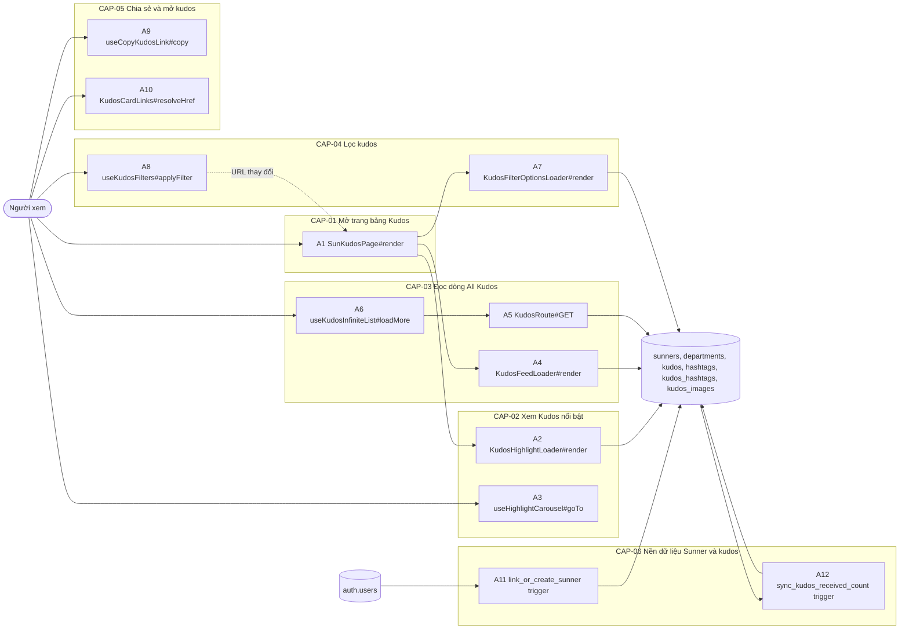
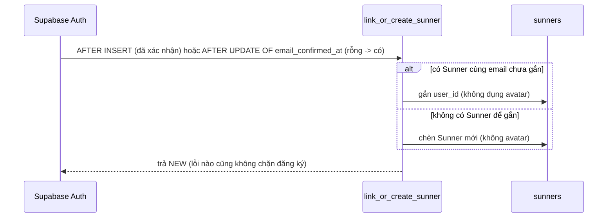
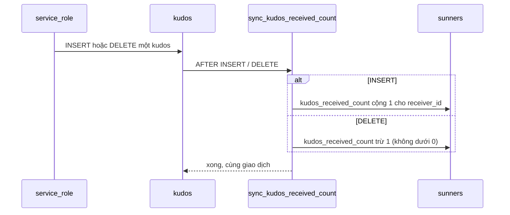
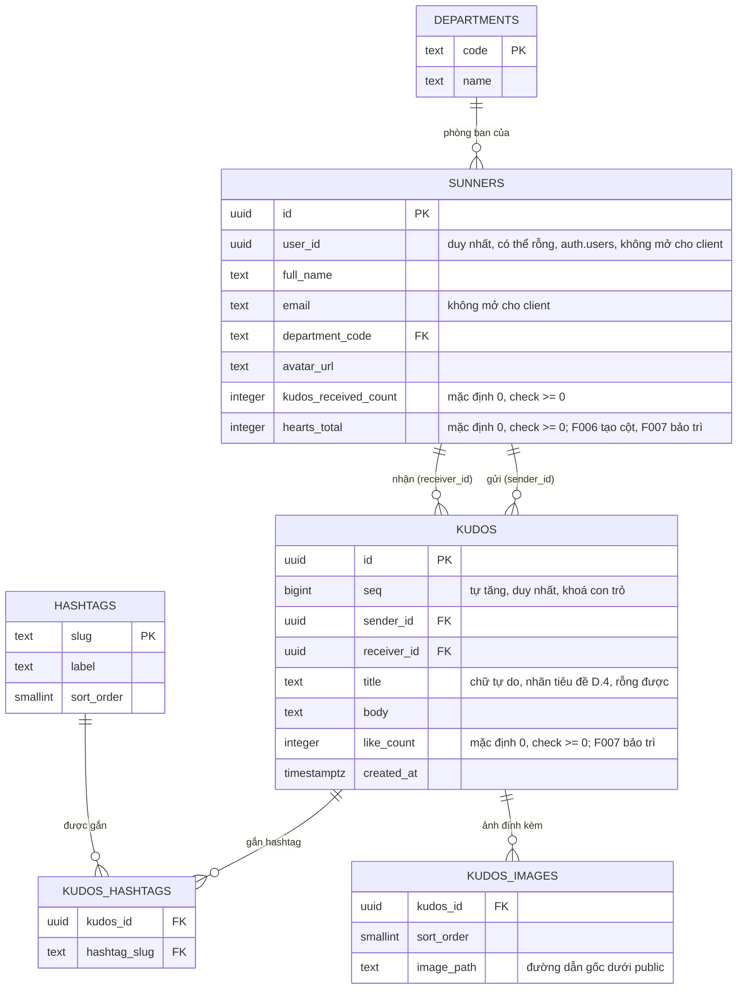

# F006_KudosBoardBrowse — Technical Spec

**Priority**: P0
**Type**: ui
**Generated**: 2026-10-12

**See also:** [`functional-spec.md`](./functional-spec.md) — plain-language overview, open
decisions, requirements/business rules stated in one-liners, screens, user stories, scenarios,
edge cases, and configuration for a BA/QA audience.

**How to read this file:** § 2 is the index — pick the action you care about and read its block
in § 3 straight through; each block is one complete thread, top to bottom. § 4 is the shared
appendix — jump in only when a § 3 block points you there. Bản này soạn trước khi có mã: dòng **Source** còn `TBD (draft)` và tên đánh dấu *(planned)* chưa được đối chiếu lại với mã đã giao (Stage 6 chỉ đối chiếu A1, A2, A4, A7, A11, A12 và § 4.2, § 4.5; muốn có `path:line` cho phần còn lại chạy `/tkm:rebuild-spec --features F006`).

## 1. Technical Overview

Người xem (khách hoặc Sunner đã đăng nhập) mở `/sun-kudos`; trang theo đúng khuôn của `/awards-information`: vỏ tĩnh `SaaPageShell` bọc `<Suspense>`, bên trong đọc cookie ngôn ngữ, `searchParams` (`hashtag`, `department`) và phiên rồi ghép header (liên kết "Sun* Kudos" đang chọn), banner, thanh gửi kudos, khối Highlight, vùng giữ chỗ Spotlight, khối All Kudos, vùng giữ chỗ sidebar và footer. Hai khối dữ liệu là hai Server Component riêng trong hai ranh giới `<Suspense>`: Highlight (5 kudos nhiều tim nhất) và trang đầu của All Kudos; cả hai gọi cùng một hàm áp bộ lọc rồi cùng một hàm ánh xạ hàng thành thẻ. Trang kế của All Kudos lấy qua Route Handler `GET /api/kudos` (con trỏ `seq` + bộ lọc), vì Server Action xếp hàng tuần tự và không huỷ được. Bộ lọc nằm trên URL; đổi bộ lọc bằng `router.replace` rồi `key` làm carousel và danh sách mount lại. Nền dữ liệu (Sunner liên kết với `auth.users`, phòng ban, kudos, hashtag, ảnh) nằm trong một migration cộng thêm kèm hai trigger: một trên `auth.users` gắn hoặc tạo Sunner, một trên `kudos` giữ số kudos nhận.



## 2. Action Index

| # | Action (handler) | Method · Path | Codes | Writes | Detail |
|---|---|---|---|---|---|
| **A0** | *cross-cutting — belongs to no single action* | — | FR-001, FR-601, BR-001 | — | § 4.4 |
| **A1** | `SunKudosPage#render` *(planned)* | `GET` `/sun-kudos` | FR-101, FR-102, FR-201, FR-202, FR-203, FR-404, BR-002, BR-009, US034 | — *(read-only)* | § 3.1 |
| **A2** | `KudosHighlightLoader#render` *(planned)* | `GET` `/sun-kudos` *(đoạn sau `<Suspense>` của Highlight)* | FR-204, FR-205, FR-207, FR-208, FR-211, FR-212, FR-213, BR-003, BR-004, BR-006, BR-007, BR-008, BR-009, DEC-001, ALG-001, ALG-002, INT-001, US035, US040 | — *(read-only: `kudos`, `sunners`, `kudos_hashtags`, `hashtags`, `kudos_images`)* | § 3.2 |
| **A3** | `useHighlightCarousel#goTo` *(planned; client behaviour, no HTTP)* | — | FR-206, DEC-002, US035 | — *(read-only, chỉ đổi thẻ đang xem)* | § 3.2 |
| **A4** | `KudosFeedLoader#render` *(planned)* | `GET` `/sun-kudos` *(đoạn sau `<Suspense>` của All Kudos)* | FR-209, FR-211, FR-212, FR-213, FR-214, FR-215, BR-003, BR-005, BR-006, BR-007, BR-008, BR-009, DEC-003, ALG-001, ALG-002, INT-001, US036, US040 | — *(read-only: như A2)* | § 3.3 |
| **A5** | `KudosRoute#GET` *(planned)* | `GET` `/api/kudos` | FR-209, FR-210, BR-003, BR-005, BR-006, BR-008, ALG-001, ALG-002, INT-001, US036 | — *(read-only: như A2)* | § 3.3 |
| **A6** | `useKudosInfiniteList#loadMore` *(planned; client behaviour)* | `GET` `/api/kudos` *(gọi A5)* | FR-210, FR-215, BR-005, DEC-004, US036 | — *(read-only)* | § 3.3 |
| **A7** | `KudosFilterOptionsLoader#render` *(planned)* | `GET` `/sun-kudos` *(đoạn sau `<Suspense>` của nút lọc)* | FR-301, INT-001, US037 | — *(read-only: `hashtags`, `departments`)* | § 3.4 |
| **A8** | `useKudosFilters#applyFilter` *(planned; client behaviour, no HTTP riêng)* | — | FR-302, FR-303, FR-304, FR-305, BR-006, DEC-005, US037 | — *(read-only, chỉ đổi URL)* | § 3.4 |
| **A9** | `useCopyKudosLink#copy` *(planned; client behaviour, no HTTP)* | — | FR-401, BR-009, BR-013, DEC-006, INT-002, US038 | — *(chỉ ghi clipboard)* | § 3.5 |
| **A10** | `KudosCardLinks#resolveHref` *(planned; client behaviour)* | — | FR-402, FR-403, BR-010, DEC-007, US039 | — *(read-only, chỉ điều hướng)* | § 3.5 |
| **A11** | `public.link_or_create_sunner()#trigger` *(background, no FE)* | trigger · `auth.users` AFTER INSERT (đã xác nhận) · AFTER UPDATE OF `email_confirmed_at` | FR-002, BR-011, US041 | `sunners` | § 3.6 ▸ **diagram** |
| **A12** | `public.sync_kudos_received_count#trigger` *(planned; background, no FE)* | trigger · `public.kudos` AFTER INSERT/DELETE | FR-003, BR-012, US040 | `sunners` | § 3.6 ▸ **diagram** |

**Rung set** — mỗi khối trong § 3 theo thứ tự **Who** → **FE** → **Request** → **BE** → **Rule** → **Result** → **State** → **Source**; rung vắng thì bỏ hẳn. Feature này không có máy trạng thái bền vững (§ 4.3) và bản nháp chưa có mã nguồn để xác nhận chuyển trạng thái, nên không khối nào có rung **State**; rung **Source** là `TBD (draft)` ở mọi khối. Chỉ A11 và A12 là hành động nền (ghi bảng bằng trigger) nên mang `sequenceDiagram`; các khối còn lại chỉ đọc, đồng bộ, dưới ngưỡng.

## 3. Actions

### 3.1 CAP-01 — Mở trang bảng Kudos

#### A1 · Hiển thị trang Sun* Kudos
`GET /sun-kudos` → `` `SunKudosPage#render` *(planned)* ``
`FR-101` `FR-102` `FR-201` `FR-202` `FR-203` `FR-404` `BR-002` `BR-009` `US034` · `SCR006_SunKudosLiveBoard`

**Who** · Người xem, khách hoặc đã đăng nhập *(gate A0 — § 4.4)*
**FE** · Vỏ tĩnh `SaaPageShell` bọc `<Suspense>` có khung chờ nền tối cao bằng màn hình, đúng khuôn trang chủ và Awards Information. Nội dung ghép `SiteHeader` (`currentPage="kudos"`, vùng tài khoản, chuông, bộ chọn ngôn ngữ cắm vào slot sẵn có); banner (ảnh nền, tiêu đề "Hệ thống ghi nhận và cảm ơn", logo "SAA 2025 KUDOS", chỉ để xem); thanh gửi kudos A.1 (biểu tượng bút + chữ gợi ý; từ F010 là `KudosSendButton` nhận `onClick` qua `sendButton` của `KudosSendBar`: người đã đăng nhập mở hộp thoại Viết Kudo, khách tới `/login`) và thanh "Tìm kiếm profile Sunner" cạnh nó, vẫn vẽ đúng Figma nhưng chưa làm gì (D013, đã chốt: `<button>` không handler, không `href`); khối Highlight (tiêu đề + hai nút lọc từ A7 + carousel từ A2); vùng giữ chỗ Spotlight (một `<section>` có chiều cao cố định, F008 cắm vào); khối All Kudos (tiêu đề + danh sách từ A4) cùng cột phải giữ chỗ sidebar (F009 cắm vào, cuộn độc lập); `SiteFooter` (`currentPage="kudos"`). Mỗi thẻ kudos có một vùng giữ chỗ nút tim nhận `{kudosId, likeCount, likedByMe, isSender}` (xem D015: hiện tim xám chỉ để xem cho tới khi F007 thay bằng nút thật). F006 gắn một kho trạng thái tim dùng chung theo mã kudos (provider client; F007 cấp logic, tên `TBD (draft)`) bao quanh cả Highlight lẫn All Kudos để hai nút của cùng một kudos luôn cùng trạng thái; mỗi thẻ đăng ký giá trị khởi tạo của mình vào kho. Tất cả vùng giữ chỗ có kích thước cố định để bố cục không nhảy. Dưới khổ máy tính (D022, đã chốt) trang xếp một cột: sidebar nằm dưới All Kudos, carousel chỉ hiện một thẻ, không phần nào bị ẩn.
**Request** · cookie `NEXT_LOCALE`; `searchParams` `hashtag`, `department` (mỗi khoá lấy giá trị chuỗi đầu tiên nếu lặp)
**BE** · `getLocale()`, `getDictionary(locale)` có sẵn; từ điển thêm nhánh chữ riêng của trang (file chữ mới `lib/i18n/sun-kudos-copy.ts` *(planned)*, dạng `{vi, en}`). `getCurrentUser()` có sẵn (đã `cache()`, đọc lúc request, trong `<Suspense>`, lỗi thì coi như khách) cho cờ `signedIn` truyền xuống thẻ. Khi `signedIn`, `getViewerSunnerId()` (`lib/kudos/get-viewer-sunner-id.ts`) lấy `id` Sunner của người xem từ hàm `public.get_my_sunner()` (§ 4.2, § 4.4) qua `getMySunnerPerRequest()`, chỉ một lần RPC mỗi lần render trang và dùng chung với thống kê cá nhân của F009 (xem § 4.5 INT-001); không đọc được thì coi `viewerSunnerId = null` (fail closed: không thẻ nào là `isSender`, và DB vẫn chặn tự thích ở F007). Hàm thuần `withViewerFlags(card, viewerSunnerId)` *(planned)* gắn cho mỗi thẻ `isSender = (sender.id === viewerSunnerId)` và `likedByMe` (mặc định `false` ở F006; F007 bổ sung nguồn thật là embed lượt thích của chính người xem); A2 và A4 dùng nó ở máy chủ, A6 dùng cho thẻ nạp thêm ở trình duyệt. `parseKudosFilters(searchParams)` (nửa đầu của ALG-001) kiểm định dạng giá trị lọc rồi truyền `filters` và `filterKey` cho A2, A4, A7. `SitePage` ở `site-types.ts` mở rộng thêm `"kudos"`; header và footer chọn kiểu đang chọn như đã làm cho `"awards"`.
**Rule**
- **BR-002 — Mỗi trang đánh dấu đang chọn đúng một liên kết điều hướng, là liên kết trỏ về chính trang đó.** Ở trang này là "Sun* Kudos" (header chữ vàng, gạch chân, `aria-current="page"`; footer kiểu chọn riêng); "About SAA 2025" và "Awards Information" về kiểu thường; trang chủ và Awards Information không truyền `"kudos"` nên giữ nguyên hành vi. **Design basis:** F004 đã thiết lập mẫu `currentPage`; feature này chỉ thêm giá trị `"kudos"`.
- **BR-009 — Ngôn ngữ chỉ là `vi` hoặc `en` (mặc định `vi`); EN chỉ dịch chữ giao diện.** Nhãn trang, nút lọc, tooltip sao, thông báo đều tra từ từ điển; nội dung kudos, tên, hashtag, phòng ban lấy nguyên từ dữ liệu. *(§ 4.4)*

**Result** · Chỉ đọc, không ghi DB. Người xem thấy đủ khung của trang: header, banner, thanh gửi kudos, Highlight, vùng giữ chỗ Spotlight, All Kudos, vùng giữ chỗ sidebar, footer.
**Source:** TBD (draft)
**Design basis:** Study report (scout § 1, § 6) + clarifications.md; khuôn trang là `app/awards-information/page.tsx` và `awards-information-content.tsx` hiện có.

<!-- Không vẽ sequenceDiagram: dưới ngưỡng (chỉ đọc, không ghi bảng, đồng bộ trong request). -->

---

### 3.2 CAP-02 — Xem Kudos nổi bật

#### A2 · Nạp Highlight (top 5 theo tim) và vẽ carousel
`GET /sun-kudos` *(đoạn sau `<Suspense>` của Highlight)* → `` `KudosHighlightLoader#render` *(planned)* ``
`FR-204` `FR-205` `FR-207` `FR-208` `FR-211` `FR-212` `FR-213` `BR-003` `BR-004` `BR-006` `BR-007` `BR-008` `BR-009` `DEC-001` `ALG-001` `ALG-002` `INT-001` `US035` `US040` · `SCR006_SunKudosLiveBoard`

**Who** · Người xem *(vai trò DB `anon` hoặc `authenticated`; gate A0 — § 4.4)*
**FE** · Tiêu đề khối ("Sun* Annual Awards 2025" nhỏ + "HIGHLIGHT KUDOS" lớn) và carousel; mỗi thẻ gồm khối người gửi, mũi tên gửi→nhận (không bấm), khối người nhận (ảnh đại diện, tên, phòng ban, sao, nhãn Hero), giờ, nhãn tiêu đề (cột `kudos.title`, chữ tự do; là chip bấm được chỉ khi `titleTagSlug` khác rỗng, ngược lại chữ thường — D014), nội dung cắt 3 dòng, hashtag một dòng tối đa 5, vùng nút tim (nhận `likedByMe`, `isSender` từ A1), "Copy Link" (A9) và "Xem chi tiết" (A10); không có ảnh đính kèm. Dưới khổ máy tính chỉ hiện thẻ đang xem (D022). Carousel là client component (A3) nhận mảng thẻ đã ánh xạ. Khung chờ: một khung cùng kích thước carousel, không chữ. Rỗng hoặc lỗi: một dòng "Hiện tại chưa có Kudos nào." thay cho carousel.
**Request** · `filters` = `{hashtag?, department?}`, `locale`, `signedIn`, `viewerSunnerId` từ A1
**BE** · `getKudosHighlight(filters, locale)` *(planned, `lib/kudos/get-kudos-highlight.ts`)*: `await connection()` ngoài `try`, `createClient()` có sẵn, một truy vấn chọn cột tường minh với embed người gửi, người nhận, hashtag, ảnh, rồi `applyKudosFilters` (ALG-001) và `order like_count desc, seq desc limit 5`; lọc hàng hỏng và ánh xạ thành thẻ (ALG-002); `INT-001`: đọc qua Supabase Data API *(§ 4.5)*. Trả `{status: "ok", cards}` hoặc `{status: "error"}` (không ném; log `[kudos]`).
**Rule**
- **BR-004 — Highlight lấy tối đa 5 kudos nhiều tim nhất trong phạm vi bộ lọc; cùng số tim thì mới hơn trước.** Số tim là cột `kudos.like_count` do F007 bảo trì, F006 chỉ tạo cột (mặc định 0, `check >= 0`) và seed giá trị; kudos 0 tim vẫn được lấy để đủ 5 thẻ khi có đủ kudos (D019, đã chốt). Thứ tự chỉ tính lúc tải: sau khi thả hoặc rút tim số tim trên thẻ đổi qua kho trạng thái tim nhưng carousel không xếp lại; chỉ tải lại hoặc đổi bộ lọc mới xếp lại. **Design basis:** clarifications.md + researcher-01 § 1–2.
- **BR-003 — Hạng Hero theo số kudos nhận.** Thẻ hiện sao và nhãn của cả người gửi lẫn người nhận; 0–9 New (0 sao), 10–19 Rising (1), 20–49 Super (2), 50+ Legend (3). *(§ 4.4)*
- **BR-006 — Bộ lọc dùng chung cho Highlight và All Kudos.** Phòng ban khớp người nhận, hashtag là danh sách cố định, hai bộ lọc kết hợp bằng "và"; áp bằng cùng một hàm với A4 và A5. *(§ 4.4)*
- **BR-007 — Giới hạn hiển thị của thẻ.** Nội dung 3 dòng ở Highlight (`line-clamp`), hashtag tối đa 5 và một dòng rồi "...", không ảnh ở Highlight. *(§ 4.4)*
- **BR-008 — Giờ hiển thị `HH:mm - MM/DD/YYYY` theo Asia/Ho_Chi_Minh.** *(§ 4.4)*
- **BR-009 — Ngôn ngữ chỉ là `vi` hoặc `en`; EN chỉ dịch chữ giao diện.** Nhãn Hero và tooltip sao theo từ điển; nội dung kudos giữ nguyên. *(§ 4.4)*

| DEC | subtype | Condition | What the user sees | Source |
|---|---|---|---|---|
| **DEC-001** | render | đọc thành công VÀ ≥ 1 kudos | carousel với 1 đến 5 thẻ, thẻ 1 ở giữa; bộ đếm `1/n` | TBD (draft) |
| **DEC-001** | render | đọc thành công VÀ 0 kudos (kể cả bộ lọc không khớp) | "Hiện tại chưa có Kudos nào." thay cho carousel | TBD (draft) |
| **DEC-001** | render | truy vấn lỗi hoặc ném ngoại lệ (kể cả thiếu biến môi trường Supabase) | cùng thông báo như khi rỗng; log `[kudos]` ở máy chủ; All Kudos và phần còn lại vẫn hiện | TBD (draft) |
| **DEC-001** | render | một số hàng thiếu cột hoặc sai kiểu | hàng hỏng bị bỏ, log số hàng bị bỏ; hàng hợp lệ còn lại vẫn hiện | TBD (draft) |

**Result** · Chỉ đọc, không ghi DB. Người xem thấy carousel Highlight theo bộ lọc hiện tại hoặc thông báo rỗng.
**Source:** TBD (draft)
**Design basis:** researcher-01 § 2 (một truy vấn dùng chung `applyKudosFilters`), § 4 (carousel) + scout § 2 (khuôn getter); mẫu getter là `lib/awards/get-award-details.ts` hiện có.

<!-- Không vẽ sequenceDiagram: dưới ngưỡng (một truy vấn đọc, không ghi bảng, không bất đồng bộ nền). Phần phân nhánh là bảng DEC-001. -->

---

#### A3 · Chuyển thẻ trong carousel
`—` → `` `useHighlightCarousel#goTo` *(planned)* `` *(client; hook của `HighlightCarousel`, trong khối của A2)*
`FR-206` `DEC-002` `US035` · `SCR006_SunKudosLiveBoard`

**Who** · Người xem *(gate A0 — § 4.4)*
**FE** · Hai nút mũi tên và bộ đếm `n/tổng`; thẻ đang xem ở giữa (to, rõ), các thẻ liền kề mờ (nhỏ, `opacity` thấp) và `inert`, các thẻ xa hơn ẩn; chuyển thẻ bằng CSS transform, không chạy chuyển động khi `prefers-reduced-motion: reduce`. Dưới khổ máy tính (D022) chỉ thẻ đang xem hiện, thẻ liền kề ẩn; mũi tên và bộ đếm giữ nguyên. Bao ngoài `role="region" aria-roledescription="carousel"`, mỗi thẻ `role="group" aria-roledescription="slide"` và nhãn "n trên tổng".
**Request** · sự kiện `click` trên mũi tên trước hoặc sau
**BE** · không gọi máy chủ; giữ `index` (0 đến n−1) trong `useState`, thẻ nào nằm ở vị trí `i − index` quyết định kiểu hiển thị (0: giữa; ±1: mờ; còn lại: ẩn). `HighlightCarousel` nhận `key={filterKey}` từ A1 nên đổi bộ lọc thì mount lại và `index` về 0 (FR-302).
**Rule** · Quyết định nút mũi tên nào tắt theo vị trí thẻ đang xem; không có luật nghiệp vụ `BR` riêng ngoài bảng dưới:

| DEC | subtype | Condition | What the user sees | Source |
|---|---|---|---|---|
| **DEC-002** | interaction | `index = 0` | mũi tên trước `disabled`, bộ đếm `1/n` | TBD (draft) |
| **DEC-002** | interaction | `index = n − 1` | mũi tên sau `disabled`, bộ đếm `n/n` | TBD (draft) |
| **DEC-002** | interaction | `n = 1` | cả hai mũi tên `disabled`, bộ đếm `1/1` | TBD (draft) |
| **DEC-002** | interaction | `0 < index < n − 1` | cả hai mũi tên bật; bấm một mũi tên đổi thẻ giữa và bộ đếm | TBD (draft) |

**Result** · Chỉ đọc, không ghi DB; chỉ đổi thẻ đang xem. Thẻ hai bên không bấm được nên người xem chỉ chuyển bằng mũi tên.
**Source:** TBD (draft)
**Design basis:** researcher-01 § 4 (trạng thái React + transform; cuộn `scroll-snap` bị loại vì "thẻ giữa nổi bật, mũi tên tắt, bộ đếm" là trạng thái, không phải vị trí cuộn) + clarifications.md (thẻ bên không tương tác, không vuốt).

<!-- Không vẽ sequenceDiagram: dưới ngưỡng (một sự kiện client, không ghi bảng). Phần phân nhánh là bảng DEC-002. -->

---

### 3.3 CAP-03 — Đọc dòng All Kudos

#### A4 · Nạp trang đầu của All Kudos và vẽ danh sách
`GET /sun-kudos` *(đoạn sau `<Suspense>` của All Kudos)* → `` `KudosFeedLoader#render` *(planned)* ``
`FR-209` `FR-211` `FR-212` `FR-213` `FR-214` `FR-215` `BR-003` `BR-005` `BR-006` `BR-007` `BR-008` `BR-009` `DEC-003` `ALG-001` `ALG-002` `INT-001` `US036` `US040` · `SCR006_SunKudosLiveBoard`

**Who** · Người xem *(vai trò DB `anon` hoặc `authenticated`; gate A0 — § 4.4)*
**FE** · Tiêu đề khối ("Sun* Annual Awards 2025" nhỏ + "ALL KUDOS") và danh sách thẻ: khối người gửi/người nhận, giờ, nhãn tiêu đề (cột `kudos.title`, biểu tượng bút; bấm được chỉ khi có hashtag trùng chữ, D014), nội dung cắt 5 dòng (bấm → chi tiết, A10), thư viện ảnh vuông tối đa 5 căn trái (mỗi ảnh là `<a target="_blank" rel="noopener">` tới ảnh gốc, mở tab mới, D017), hashtag, vùng nút tim (nhận `likedByMe`, `isSender` từ A1), "Copy Link" (không có "Xem chi tiết" ở All Kudos). Danh sách là client component `KudosFeedList` (A6) nhận `initialItems`, `nextCursor`, `filters`, `viewerSunnerId` và `key={filterKey}`. Khung chờ: vài thẻ khung không chữ. Rỗng hoặc lỗi: "Hiện tại chưa có Kudos nào.".
**Request** · `filters`, `locale`, `signedIn`, `viewerSunnerId` từ A1; không có con trỏ ở lần tải đầu
**BE** · `getKudosPage({cursor: null, filters}, locale)` *(planned, `lib/kudos/get-kudos-page.ts`, dùng chung với A5)*: `await connection()` ngoài `try`, `createClient()`, cùng truy vấn và `applyKudosFilters` như A2 (ALG-001), `order seq desc limit PAGE_SIZE + 1`; hàng thừa (`PAGE_SIZE + 1`) chỉ để biết còn trang kế, không trả về; ánh xạ ALG-002; `INT-001` *(§ 4.5)*. Trả `{status: "ok", items, nextCursor}` hoặc `{status: "error"}`.
**Rule**
- **BR-005 — All Kudos xếp mới nhất trước; mỗi kudos xuất hiện đúng một lần; trang kế nối đúng sau thẻ cuối đã thấy.** Thứ tự và con trỏ dùng `kudos.seq` (bigint tự tăng), không dùng `created_at`. *(§ 4.4)*
- **BR-003 — Hạng Hero theo số kudos nhận** (cùng quy tắc như A2): sao và nhãn của người gửi và người nhận trên từng thẻ. *(§ 4.4)*
- **BR-006 — Bộ lọc dùng chung** với Highlight: lần tải đầu dùng đúng `filters` của trang. *(§ 4.4)*
- **BR-007 — Giới hạn hiển thị của thẻ.** Nội dung 5 dòng, hashtag tối đa 5 một dòng, ảnh tối đa 5; chỉ hiện ảnh khi có. *(§ 4.4)*
- **BR-008 — Giờ hiển thị `HH:mm - MM/DD/YYYY` theo Asia/Ho_Chi_Minh.** *(§ 4.4)*
- **BR-009 — Ngôn ngữ chỉ là `vi` hoặc `en`.** *(§ 4.4)*

| DEC | subtype | Condition | What the user sees | Source |
|---|---|---|---|---|
| **DEC-003** | render | đọc thành công VÀ ≥ 1 kudos | danh sách thẻ; có sentinel nạp thêm nếu `nextCursor` khác rỗng | TBD (draft) |
| **DEC-003** | render | đọc thành công VÀ 0 kudos (kể cả bộ lọc không khớp) | "Hiện tại chưa có Kudos nào." thay cho danh sách | TBD (draft) |
| **DEC-003** | render | truy vấn lỗi hoặc ném ngoại lệ | cùng thông báo như khi rỗng; log `[kudos]`; Highlight và phần còn lại vẫn hiện | TBD (draft) |
| **DEC-003** | render | một số hàng hỏng | hàng hỏng bị bỏ, log số hàng bị bỏ | TBD (draft) |

**Result** · Chỉ đọc, không ghi DB. Người xem thấy trang đầu All Kudos theo bộ lọc hoặc thông báo rỗng.
**Source:** TBD (draft)
**Design basis:** researcher-01 § 2 (keyset trên `seq`, `PAGE_SIZE + 1` thay cho truy vấn đếm) + clarifications.md + functional-spec § 3 (D009, D010).

<!-- Không vẽ sequenceDiagram: dưới ngưỡng (một truy vấn đọc, không ghi bảng). Phần phân nhánh là bảng DEC-003. -->

---

#### A5 · Trả trang kế của All Kudos
`GET /api/kudos` → `` `KudosRoute#GET` *(planned, `app/api/kudos/route.ts`)* ``
`FR-209` `FR-210` `BR-003` `BR-005` `BR-006` `BR-008` `ALG-001` `ALG-002` `INT-001` `US036` · `SCR006_SunKudosLiveBoard`

**Who** · Người xem, khách hoặc đã đăng nhập *(vai trò DB `anon` hoặc `authenticated`; gate A0 — § 4.4)*
**FE** · không có giao diện riêng; kết quả do `useKudosInfiniteList` (A6) dựng thành thẻ.
**Request** · query `cursor` (chuỗi số nguyên dương, bắt buộc; thiếu thì 400), `hashtag`, `department` (tuỳ chọn, cùng quy tắc định dạng như A1); `locale` đọc từ cookie của request
**BE** · Route Handler `GET` đọc cookie của request nên chạy lúc request (xem § 5.3 về `connection()`); `parseKudosFilters` (ALG-001) rồi `getKudosPage({cursor, filters}, locale)` giống A4; trả JSON `{items, nextCursor}` (`nextCursor` là chuỗi `seq` của thẻ cuối hoặc `null`) với `Cache-Control: no-store`; mỗi thẻ mang `sender.id` để A6 gắn `isSender` bằng `withViewerFlags` với `viewerSunnerId` đã có trên client, nên A5 không gọi `get_my_sunner()`. Cursor sai định dạng hoặc quá dài: 400. Truy vấn lỗi: 500 kèm `{error}`, không rò chi tiết. Proxy áp dụng bình thường vì matcher phủ cả `/api/*`: cổng prelaunch F005 chuyển hướng người không phải admin khi site còn khoá (không ảnh hưởng khi site đã mở).
**Rule**
- **BR-005 — Con trỏ là `seq`.** Chỉ lấy kudos có `seq` nhỏ hơn `cursor` theo thứ tự `seq` giảm dần, nên trang kế nối đúng sau thẻ cuối và kudos thêm vào giữa chừng không làm lặp. *(§ 4.4)*
- **BR-003, BR-006, BR-008** — như A4: cùng bộ lọc, cùng hạng Hero và cùng giờ hiển thị vì dùng chung ALG-001 và ALG-002. *(§ 4.4)*

**Result** · Chỉ đọc, không ghi DB. Người gọi nhận tối đa `PAGE_SIZE` thẻ cùng con trỏ kế tiếp.
**Source:** TBD (draft)
**Design basis:** researcher-01 § 2 (Route Handler thay Server Action vì Server Action xếp hàng tuần tự và không huỷ được) + scout § 3 (proxy matcher phủ `/api`).

<!-- Không vẽ sequenceDiagram: dưới ngưỡng (một truy vấn đọc, không ghi bảng). -->

---

#### A6 · Tự nạp thêm khi cuộn gần cuối
`GET /api/kudos` *(gọi A5)* → `` `useKudosInfiniteList#loadMore` *(planned)* `` *(client; hook của `KudosFeedList`)*
`FR-210` `FR-215` `BR-005` `DEC-004` `US036` · `SCR006_SunKudosLiveBoard`

**Who** · Người xem *(gate A0 — § 4.4)*
**FE** · Một phần tử sentinel ở cuối danh sách; vùng trạng thái dưới danh sách hiện khung chờ khi đang nạp, hoặc thông báo lỗi kèm nút "Thử lại" (D020); `aria-live="polite"` báo lỗi.
**Request** · `IntersectionObserver` (`rootMargin` khoảng 400px) báo sentinel vào tầm nhìn; yêu cầu gọi A5 với `cursor = nextCursor` và bộ lọc hiện tại
**BE** · giữ `{items, nextCursor, status}`; chỉ nạp khi `status = idle` và `nextCursor` khác rỗng; gửi bằng `fetch` kèm `AbortController` (huỷ khi component bị unmount do đổi bộ lọc); nối kết quả vào `items`, loại trùng theo `id`.
**Rule**
- **BR-005 — Mỗi kudos xuất hiện đúng một lần.** Khi nối trang kế, bỏ thẻ có `id` đã có; con trỏ chỉ tiến, không lùi. Ở đây quy tắc được thực thi phía trình duyệt (loại trùng) ngoài phần thứ tự do A5 bảo đảm. *(§ 4.4)*

| DEC | subtype | Condition | What the user sees | Source |
|---|---|---|---|---|
| **DEC-004** | interaction | sentinel vào tầm nhìn VÀ còn `nextCursor` VÀ không đang nạp | nạp trang kế; khung chờ dưới danh sách; thành công thì thẻ mới nối xuống dưới | TBD (draft) |
| **DEC-004** | interaction | nạp thành công VÀ `nextCursor` rỗng | danh sách dừng ở đây, bỏ sentinel; không báo gì | TBD (draft) |
| **DEC-004** | interaction | nạp lỗi (mạng, 4xx, 5xx, hoặc phản hồi không phải JSON hợp lệ, ví dụ trang đếm ngược khi site vừa bị khoá) | giữ nguyên thẻ đã có; "Không tải thêm được Kudos." kèm nút "Thử lại"; bấm nút thì nạp lại | TBD (draft) |
| **DEC-004** | interaction | bộ lọc đổi trong lúc đang nạp | yêu cầu cũ bị huỷ, danh sách mount lại từ đầu theo `key`; không lẫn thẻ cũ | TBD (draft) |

**Result** · Chỉ đọc, không ghi DB. Danh sách dài dần khi người xem cuộn, không lặp thẻ, dừng khi hết kudos.
**Source:** TBD (draft)
**Design basis:** researcher-01 § 2 (IntersectionObserver, bảo vệ `loading`/`hasMore`, loại trùng theo `id`, huỷ bằng `AbortController`).

<!-- Không vẽ sequenceDiagram: dưới ngưỡng (không ghi bảng). Phần phân nhánh là bảng DEC-004. -->

---

### 3.4 CAP-04 — Lọc kudos theo Hashtag và Phòng ban

#### A7 · Nạp danh sách giá trị cho hai nút lọc
`GET /sun-kudos` *(đoạn sau `<Suspense>` của nút lọc)* → `` `KudosFilterOptionsLoader#render` *(planned)* ``
`FR-301` `INT-001` `US037` · `SCR006_SunKudosLiveBoard`

**Who** · Người xem *(vai trò DB `anon` hoặc `authenticated`; gate A0 — § 4.4)*
**FE** · Hai nút "Hashtag" và "Phòng ban" ở đầu khối Highlight; bấm mở danh sách `role="listbox"` (một danh sách mở mỗi lần, Esc hoặc bấm ra ngoài thì đóng) có mục "Tất cả" (D020) và các giá trị; nút hiện giá trị đang chọn. Khung chờ: hai nút cùng kích thước, không chữ.
**Request** · `filters` hiện tại từ A1 (để đánh dấu giá trị đang chọn)
**BE** · `getKudosFilterOptions()` (`lib/kudos/get-kudos-filter-options.ts`): `await connection()` ngoài `try`, đọc `hashtags` (theo `sort_order`, rồi `slug`) qua `getHashtagRowsPerRequest()` dùng chung với A2 và A4 (xem § 4.5 INT-001) và `departments` (theo `code`), mỗi truy vấn chọn cột tường minh; lỗi hoặc rỗng thì danh sách trống (nút vẫn hiện, danh sách chỉ có "Tất cả"); `INT-001` *(§ 4.5)*. Chưa dùng `use cache` (KISS; có thể thêm sau nếu số liệu tăng).
**Rule** · Không có luật nghiệp vụ riêng ngoài nguồn giá trị: danh sách lấy đúng từ hai bảng (FR-301), hashtag là danh sách cố định theo D006 và phòng ban theo D018.
**Result** · Chỉ đọc, không ghi DB. Hai danh sách lọc có đúng các giá trị trong hệ thống.
**Source:** TBD (draft)
**Design basis:** clarifications.md + functional-spec § 3 (D005, D006) + researcher-01 § 2 (bộ lọc trên URL, nút lọc là client island nhận props).

<!-- Không vẽ sequenceDiagram: dưới ngưỡng (hai truy vấn đọc, không ghi bảng). -->

---

#### A8 · Áp bộ lọc lên Highlight và All Kudos
`—` → `` `useKudosFilters#applyFilter` *(planned)* `` *(client; hook dùng chung cho nút lọc và chip hashtag trên thẻ)*
`FR-302` `FR-303` `FR-304` `FR-305` `BR-006` `DEC-005` `US037` · `SCR006_SunKudosLiveBoard`

**Who** · Người xem *(gate A0 — § 4.4)*
**FE** · Mục của hai danh sách lọc (A7), chip hashtag và nhãn tiêu đề khi `titleTagSlug` khác rỗng (cùng là `<Link replace scroll={false}>`) trên mọi thẻ. Trong lúc chuyển, nội dung cũ vẫn hiện và mờ nhẹ (`isPending` của `useTransition`).
**Request** · sự kiện chọn một mục (`hashtag` | `department`, giá trị hoặc rỗng = bỏ lọc) hoặc bấm chip hashtag
**BE** · `buildFilterHref(current, patch)` dựng URL mới từ các tham số hiện có, đặt hoặc xoá một khoá, giữ khoá còn lại; mục thì gọi `router.replace(href, {scroll: false})` trong `startTransition`. URL đổi nên A1 render lại với `filters` mới và `filterKey` mới; carousel (A3) và danh sách (A6) mount lại theo `key`: carousel về thẻ 1, danh sách bỏ các trang đã gom và huỷ yêu cầu đang bay. Không có Server Action.
**Rule**
- **BR-006 — Bộ lọc dùng chung cho Highlight và All Kudos, kết hợp bằng "và".** Một thao tác lọc đổi URL một lần, nên cả hai khối đọc cùng một bộ lọc; giá trị sai định dạng bị `parseKudosFilters` bỏ qua, giá trị đúng định dạng nhưng không có trong danh sách cho kết quả rỗng. *(§ 4.4)*

| DEC | subtype | Condition | What the user sees | Source |
|---|---|---|---|---|
| **DEC-005** | interaction | chọn một giá trị khác giá trị đang lọc của cùng nút | khoá đó trong URL được đặt; cả Highlight (về thẻ 1) và All Kudos (nạp lại) theo bộ lọc mới | TBD (draft) |
| **DEC-005** | interaction | chọn "Tất cả" | khoá đó bị xoá khỏi URL; bỏ lọc phần đó; bộ lọc còn lại giữ nguyên | TBD (draft) |
| **DEC-005** | interaction | bấm chip hashtag khác giá trị hashtag đang lọc | `hashtag` được đặt, `department` giữ nguyên | TBD (draft) |
| **DEC-005** | interaction | bấm chip hashtag trùng giá trị đang lọc | không đổi URL, không nạp lại | TBD (draft) |
| **DEC-005** | interaction | bấm nhãn tiêu đề mà có hashtag trùng chữ (`titleTagSlug` khác rỗng) | như bấm chip hashtag đó: `hashtag` được đặt, `department` giữ nguyên | TBD (draft) |
| **DEC-005** | render | nhãn tiêu đề không trùng chữ với hashtag nào (`titleTagSlug` rỗng) | nhãn chỉ là chữ thường, không bấm được, không nhận tiêu điểm | TBD (draft) |
| **DEC-005** | flow | mở trang với `hashtag`/`department` hợp lệ trên URL | trang đã lọc ngay từ lần tải đầu; nút lọc hiện giá trị đang chọn | TBD (draft) |

**Result** · Chỉ đọc, không ghi DB; chỉ đổi URL. Người xem thấy Highlight và All Kudos cùng thu hẹp; địa chỉ chia sẻ được và Back khôi phục bộ lọc trước.
**Source:** TBD (draft)
**Design basis:** researcher-01 § 2 (filter trên URL, `router.replace` trong `startTransition`, `key` để reset) + clarifications.md (bộ lọc áp cho cả hai, đặt lại carousel về 1).

<!-- Không vẽ sequenceDiagram: dưới ngưỡng (chỉ đổi URL, không ghi bảng). Phần phân nhánh là bảng DEC-005. -->

---

### 3.5 CAP-05 — Chia sẻ và mở kudos

#### A9 · Chép liên kết một kudos
`—` → `` `useCopyKudosLink#copy` *(planned)* `` *(client; nút "Copy Link" trên mọi thẻ)*
`FR-401` `BR-009` `BR-013` `DEC-006` `INT-002` `US038` · `SCR006_SunKudosLiveBoard`

**Who** · Người xem *(gate A0 — § 4.4)*
**FE** · Nút "Copy Link" trên mỗi thẻ; thông báo nhỏ `role="status"` ở cuối màn hình, tự tắt sau 3 giây, dùng lại một phần tử cho mọi lần bấm; chữ thông báo thành công "Link copied — ready to share!" (nguyên văn Figma, giữ nguyên ở cả VN lẫn EN), thông báo lỗi theo D020.
**Request** · sự kiện `click` trên nút; tham số là `id` của kudos
**BE** · không gọi máy chủ; dựng `url = window.location.origin + "/sun-kudos/" + id` lúc bấm (đúng với mọi host Docker, không cần biến môi trường), gọi `copyText(url)` (INT-002) trong chính trình xử lý `click` (cần cử chỉ người dùng) rồi hiện thông báo theo kết quả.
**Rule**
- **BR-013 — Địa chỉ Copy Link là địa chỉ tuyệt đối của chi tiết kudos, dựng lúc bấm từ địa chỉ trang đang mở.** Không đọc biến môi trường nên đúng cả ở máy cục bộ lẫn Docker. **Design basis:** researcher-01 § 5.
- **BR-009 — Ngôn ngữ chỉ là `vi` hoặc `en`.** Thông báo lỗi và nhãn nút tra từ từ điển; chữ "Link copied — ready to share!" là nguyên văn Figma. *(§ 4.4)*

| DEC | subtype | Condition | What the user sees | Source |
|---|---|---|---|---|
| **DEC-006** | interaction | trang ở secure context VÀ `navigator.clipboard.writeText` thành công | thông báo "Link copied — ready to share!" | TBD (draft) |
| **DEC-006** | interaction | không có `navigator.clipboard` (ví dụ `http` không phải localhost) hoặc `writeText` bị từ chối VÀ cách dự phòng `textarea` + `execCommand("copy")` thành công | cùng thông báo thành công | TBD (draft) |
| **DEC-006** | interaction | cả hai cách đều thất bại | thông báo lỗi "Không sao chép được liên kết" | TBD (draft) |

**Result** · Chỉ ghi clipboard của người xem, không ghi DB. Người xem có địa chỉ chi tiết trong clipboard và thấy thông báo; `INT-002` chép bằng Clipboard API và có cách dự phòng *(§ 4.5)*.
**Source:** TBD (draft)
**Design basis:** researcher-01 § 5 (Clipboard API rồi `textarea` + `execCommand`; Docker `http` không có `navigator.clipboard`; e2e phải xoá `navigator.clipboard` để phủ nhánh dự phòng).

<!-- Không vẽ sequenceDiagram: dưới ngưỡng (một sự kiện client, không ghi bảng). Phần phân nhánh là bảng DEC-006. -->

---

#### A10 · Mở chi tiết kudos hoặc hồ sơ từ thẻ
`—` → `` `KudosCardLinks#resolveHref` *(planned)* `` *(client; dựng `href` cho ảnh đại diện, tên, "Xem chi tiết", nội dung thẻ)*
`FR-402` `FR-403` `BR-010` `DEC-007` `US039` · `SCR006_SunKudosLiveBoard`

**Who** · Người xem, khách hoặc Sunner đã đăng nhập *(gate A0 — § 4.4; liên kết chỉ là tiện lợi UX, trang đích tương lai phải tự kiểm lại phiên)*
**FE** · Ảnh đại diện và tên người gửi, người nhận là liên kết; "Xem chi tiết" (Highlight) và nội dung thẻ (cả hai khối) là liên kết tới chi tiết kudos, dùng mẫu liên kết kéo giãn (stretched link) để phủ cả thẻ mà không lồng `<a>` trong `<a>`. Liên kết tới trang chưa xây đặt `prefetch={false}` để không bắn yêu cầu nạp trước lỗi.
**Request** · sự kiện `click`; tham số `kind` (`detail` | `profile`), `id` (kudos hoặc Sunner), `signedIn` từ A1
**BE** · không gọi máy chủ; `kudosLinkHref(kind, id, signedIn)` chọn `href` lúc render: `signedIn` thì `/sun-kudos/{id}` hoặc `/profiles/{id}`, ngược lại `/login`; điều hướng do `next/link` làm.
**Rule**
- **BR-010 — Liên kết tới trang chưa xây dùng địa chỉ dự kiến; khách bấm thì tới đăng nhập.** Trang đích chưa có thì Next trả 404 mặc định, không làm trang lỗi riêng (cùng cách xử lý như trang Awards Information). Đăng nhập xong về trang chủ theo luồng hiện có, không quay lại trang vừa bấm (D016, đã chốt; F001 không đổi). **Design basis:** clarifications.md + functional-spec § 3 (D002, D003) + scout § 3 (callback đăng nhập của F001 bỏ qua `next`).

| DEC | subtype | Condition | What the user sees | Source |
|---|---|---|---|---|
| **DEC-007** | flow | `signedIn` VÀ bấm "Xem chi tiết" hoặc nội dung thẻ | chuyển tới `/sun-kudos/{id}` (hiện là 404 mặc định) | TBD (draft) |
| **DEC-007** | flow | `signedIn` VÀ bấm ảnh đại diện hoặc tên | chuyển tới `/profiles/{id}` (hiện là 404 mặc định) | TBD (draft) |
| **DEC-007** | flow | không `signedIn` (khách, hoặc `getCurrentUser()` trả `null` do lỗi — fail closed) VÀ bấm một trong các liên kết trên | chuyển tới `/login` | TBD (draft) |
| **DEC-007** | interaction | bấm kèm phím bổ trợ hoặc không phải nút trái | không chặn; trình duyệt xử lý liên kết mặc định (mở tab mới) | TBD (draft) |

**Result** · Chỉ đọc, không ghi DB; chỉ điều hướng. Sunner thấy trang dự kiến, khách thấy màn hình đăng nhập.
**Source:** TBD (draft)
**Design basis:** clarifications.md + functional-spec § 3 (D002, D003) + scout § 3 (`getCurrentUser()` fail closed).

<!-- Không vẽ sequenceDiagram: dưới ngưỡng (một sự kiện điều hướng client, không ghi bảng). Phần phân nhánh là bảng DEC-007. -->

---

### 3.6 CAP-06 — Nền dữ liệu Sunner và kudos

#### A11 · Gắn hoặc tạo Sunner khi có tài khoản mới *(background, no FE)*
`trigger · auth.users AFTER INSERT / AFTER UPDATE OF email_confirmed_at` → `` `public.link_or_create_sunner()#trigger` ``
`FR-002` `BR-011` `US041` · BL### TBD (draft)

**Who** · *no human actor — trigger kích hoạt khi Supabase Auth tạo hàng `auth.users` đã xác nhận email (đăng nhập Google lần đầu, A0 của F001) hoặc khi `email_confirmed_at` đổi từ rỗng sang có giá trị*
**FE** · *none*
**Request** · *no HTTP request* — hàng `auth.users` mới: `id`, `email`, `email_confirmed_at`, `raw_user_meta_data`
**BE** · hai trigger trên `auth.users` cùng gọi hàm bao `public.link_or_create_sunner()`: `on_auth_user_created_link_sunner` (`AFTER INSERT`, `when (new.email_confirmed_at is not null)`) và `on_auth_user_confirmed_link_sunner` (`AFTER UPDATE OF email_confirmed_at`, `when (old.email_confirmed_at is null and new.email_confirmed_at is not null)`), vì GoTrue thường chèn user trước rồi mới đặt `email_confirmed_at` ở lần UPDATE sau (tạo bằng admin, tự xác nhận, OAuth). Hàm bao chỉ làm việc khi `new.email_confirmed_at` khác `null`, gọi hàm lõi `public.link_or_create_sunner_for_user(uuid, text, jsonb)`; cả hai `security definer`, `set search_path = ''`, thu quyền `execute` của `public`, `anon`, `authenticated`. Hàm lõi: không làm gì nếu tài khoản đã có Sunner; gắn `user_id` vào Sunner chưa gắn có `lower(email)` trùng; không thì chèn Sunner mới với tên lấy từ `raw_user_meta_data` (`full_name`, rồi `name`, rồi phần trước `@`, rồi `Sunner`; tối đa 200 ký tự) và `email` chỉ khi chưa Sunner nào giữ; **không bao giờ sao chép avatar** (metadata do người dùng ghi được; `avatar_url` chỉ nhận đường dẫn cục bộ từ seed, § 4.2). Thân hàm bao có `exception when others then raise warning ... return new` (lỗi hạ xuống WARNING, đăng ký không bao giờ bị chặn). Migration chạy hàm lõi một lần cho mọi `auth.users` đã xác nhận có từ trước (backfill).
**Rule** · **BR-011 — Một tài khoản chỉ ứng với tối đa một Sunner, và chỉ tài khoản đã xác nhận email mới có.** Khi `email_confirmed_at` khác `null`: có Sunner `user_id` rỗng có `lower(email)` trùng thì gắn `user_id`, không thì tạo Sunner mới. Chưa xác nhận thì không gắn, không tạo cho tới khi xác nhận (trigger UPDATE chạy lại). Không bao giờ ghi đè Sunner đã có `user_id`; `sunners.user_id` duy nhất nên mỗi tài khoản không quá một Sunner. **Design basis:** researcher-01 § 6.
**Result**
- Writes `sunners.user_id` ← `new.id`, hoặc chèn hàng `sunners` mới (`full_name`, `email`, `user_id`; không có `avatar_url`) khi không có Sunner để gắn.
- Không có hiệu ứng nào khác; từ đó trang này, F007 và F009 tìm Sunner của người đang đăng nhập qua hàm `public.get_my_sunner()` (§ 4.2, § 4.4), không đọc `user_id` trực tiếp từ trình duyệt.
**Source:** `supabase/migrations/20261012072146_create_kudos_board.sql` (hàm bao, hai trigger, backfill); `supabase/migrations/20261013060400_restrict_sunner_avatars_and_index_department.sql` (hàm lõi bản hiện hành, không sao chép avatar)
**Design basis:** researcher-01 § 6 + scout § 4 (khuôn migration `create_profiles`, trigger `on_auth_user_created`).



---

#### A12 · Giữ số kudos nhận khi kudos được thêm hoặc xoá *(background, no FE)*
`trigger · public.kudos AFTER INSERT/DELETE` → `` `public.sync_kudos_received_count()#trigger` ``
`FR-003` `BR-012` `US040` · BL### TBD (draft)

**Who** · *no human actor — trigger kích hoạt khi một hàng `kudos` được chèn hoặc xoá bằng `service_role` (seed hoặc quản trị sau này)*
**FE** · *none*
**Request** · *no HTTP request* — hàng `kudos` vừa chèn hoặc vừa xoá (`receiver_id`)
**BE** · hàm `public.sync_kudos_received_count()` `security definer`, `set search_path = ''`, thu quyền `execute` như A11; một hàm cho hai sự kiện: chèn thì cộng, xoá thì trừ.
**Rule** · **BR-012 — Số kudos nhận của người nhận do hệ thống tự cộng, trừ theo kudos được thêm, xoá; không ai sửa trực tiếp.** `sunners.kudos_received_count` luôn bằng số hàng `kudos` có `receiver_id` là Sunner đó; cột có `check (>= 0)`, khi trừ dùng `greatest(count - 1, 0)`; client không có quyền ghi cột này. **Design basis:** researcher-01 § 6 + clarifications.md (hạng Hero tính từ số kudos nhận, không lưu).
**Result**
- Writes `sunners.kudos_received_count` ← `+ 1` (chèn) hoặc `- 1` (xoá) cho đúng `receiver_id`, trong cùng giao dịch với hàng `kudos`.
**Source:** `supabase/migrations/20261012072146_create_kudos_board.sql` (`sync_kudos_received_count`, trigger `kudos_sync_received_count`)
**Design basis:** researcher-01 § 6 (trigger đếm trên `kudos`, hạng Hero tính ở TypeScript).



---

### 3.7 Edge cases

| Action | Scenario | Behavior |
|---|---|---|
| A1 · A2 · A4 | Khách chưa đăng nhập mở trang | Khi site đã mở: thấy đủ nội dung, proxy không chuyển hướng; khi site còn khoá, cổng prelaunch F005 chuyển về `/countdown` *(A0, BR-001)* |
| A2 · A4 | Bảng `kudos` rỗng, truy vấn lỗi hoặc thiếu `SUPABASE_URL`/`SUPABASE_PUBLISHABLE_KEY` | log `[kudos]`; mỗi khối tự hiện "Hiện tại chưa có Kudos nào."; phần còn lại của trang không ảnh hưởng *(DEC-001, DEC-003)* |
| A2 · A4 · A5 | Hàng thiếu cột hoặc sai kiểu | hàng bị bỏ, log số hàng bị bỏ *(ALG-002)* |
| A2 · A4 | Sunner chưa có phòng ban hoặc ảnh đại diện, hoặc `avatar_url` không phải đường dẫn cục bộ | không hiện dòng phòng ban; ảnh thay bằng chữ cái đầu của tên (avatar chỉ nhận đường dẫn dưới `/public`, không URL ngoài); `image_path` rỗng, tương đối hoặc bắt đầu `//` hoặc có `\` thì coi như không có ảnh *(ALG-002)* |
| A2 · A4 | Kudos có hơn 5 hashtag hoặc hơn 5 ảnh | chỉ hiện 5 hashtag đầu (theo `sort_order` của hashtag) và 5 ảnh đầu (theo `sort_order` của ảnh) *(BR-007)* |
| A2 · A4 | Một Sunner vừa là người gửi vừa là người nhận trong dữ liệu seed | hiển thị bình thường; không có ràng buộc `sender_id <> receiver_id` ở F006 (F010: `create_kudos` chặn gửi cho chính mình) *(§ 5.2)* |
| A3 | Có ít hơn 5 kudos nổi bật | bộ đếm theo số thẻ thực; một thẻ thì cả hai mũi tên tắt *(DEC-002)* |
| A3 · A8 | Đổi bộ lọc khi đang ở thẻ 4 | carousel mount lại ở thẻ 1 *(DEC-005)* |
| A5 | `cursor` thiếu, không phải số nguyên dương, hoặc dài quá 19 chữ số | 400, không chạm DB *(ALG-001)* |
| A5 · A6 | Site vừa bị khoá giữa lúc cuộn (người không phải admin) | proxy trả chuyển hướng tới `/countdown`; phản hồi không phải JSON nên A6 coi là lỗi, hiện "Thử lại" *(DEC-004)* |
| A6 | Cuộn nhanh làm sentinel vào tầm nhìn hai lần liên tiếp | chỉ một yêu cầu bay; yêu cầu thứ hai bị chặn bởi cờ `loading` *(DEC-004)* |
| A6 · A8 | Đổi bộ lọc khi đang nạp trang kế | yêu cầu cũ bị `AbortController` huỷ khi component unmount, danh sách mới không nhận thẻ cũ *(DEC-004, DEC-005)* |
| A7 | `hashtags` hoặc `departments` rỗng hoặc lỗi | nút vẫn hiện, danh sách chỉ có "Tất cả" *(FR-301)* |
| A8 | URL mang `hashtag` sai định dạng | `parseKudosFilters` bỏ khoá đó, trang như chưa lọc; giá trị đúng định dạng nhưng lạ cho kết quả rỗng *(BR-006)* |
| A9 | Địa chỉ trang là `http` không phải localhost | `navigator.clipboard` không có; dùng `textarea` + `execCommand` *(DEC-006)* |
| A9 | Bấm "Copy Link" liên tiếp nhiều lần | thông báo nhỏ được dùng lại một phần tử, bộ đếm giờ tắt đặt lại *(DEC-006)* |
| A10 | Phiên không xác định được (lỗi đọc phiên) | coi như khách, mọi liên kết thẻ trỏ `/login` *(DEC-007)* |
| A10 | Trang đích `/sun-kudos/[id]` hoặc `/profiles/[id]` chưa xây | 404 mặc định của Next, trang bảng không ảnh hưởng *(BR-010)* |
| A11 | Tài khoản có email trùng một Sunner nhưng `email_confirmed_at` rỗng | không gắn, không tạo Sunner nào; khi email được xác nhận, trigger UPDATE gắn hoặc tạo *(BR-011)* |
| A11 | Hai tài khoản cùng email | GoTrue từ chối email trùng nên không xảy ra (ghi chú thủ công, không tự động hoá); nếu vẫn có, tài khoản sau nhận Sunner mới không có `email` (email vẫn duy nhất) *(BR-011)* |
| A11 | Lỗi bất kỳ trong thân trigger | `raise warning` (hạ xuống WARNING), trả `NEW`; đăng ký vẫn thành công, tài khoản chưa có Sunner cho tới backfill kế *(BR-011)* |
| A12 | Xoá một kudos làm số nhận về dưới 0 (dữ liệu bất nhất) | `greatest(count - 1, 0)` giữ không âm *(BR-012)* |
| A12 | `service_role` sửa `receiver_id` của kudos đã có | không được hỗ trợ: trigger chỉ xử lý INSERT và DELETE *(§ 5.2)* |
| A1-A12 | Người đã đăng nhập mở trang | cùng nội dung như khách; chỉ vùng tài khoản khác (F003) và liên kết thẻ dẫn tới đích thay vì `/login` *(A0, BR-001)* |

## 4. Shared Foundation

### 4.1 Components

| Component | Responsibility | Used in | File |
|---|---|---|---|
| `SunKudosPage` | vỏ tĩnh: `SaaPageShell` + `<Suspense>` quanh nội dung | A1 | `app/sun-kudos/page.tsx` *(planned)* |
| `SunKudosContent` | đọc locale, phiên, `searchParams`; ghép header, banner, thanh gửi kudos, các khối, footer | A1 | `app/sun-kudos/_components/sun-kudos-content.tsx` *(planned)* |
| `KudosHighlightLoader`, `KudosFeedLoader`, `KudosFilterOptionsLoader` | bộ nạp dữ liệu (async Server Component) của Highlight, trang đầu All Kudos, hai danh sách lọc | A2, A4, A7 | `app/sun-kudos/_components/*-loader.tsx` *(planned)* |
| `KudosBanner`, `KudosSendBar`, `KudosCard`, `KudosPersonBlock`, `KudosStars`, `KudosHeartSlot`, `KudosEmpty`, `KudosSkeleton` | bản trình bày thuần: banner, thanh gửi kudos (từ F010 nhận `onClick`) và thanh tìm hồ sơ (inert), thẻ, khối người, sao và nhãn Hero, chỗ nút tim (F007) nhận `likedByMe` và `isSender`, thông báo rỗng, khung chờ | A1, A2, A4 | `app/_components/sun-kudos/*` *(planned)* |
| kho trạng thái tim dùng chung theo mã kudos *(provider client; tên `TBD (draft)`)* | F006 gắn vào `SunKudosContent` bao quanh Highlight và All Kudos; F007 cấp logic thả/rút lạc quan; mỗi thẻ đăng ký `{likeCount, likedByMe}` ban đầu | A1, A2, A4 | `app/_components/sun-kudos-behaviour/` *(planned; F007 sở hữu logic)* |
| `getViewerSunnerId`, `withViewerFlags` | gọi `get_my_sunner()` khi `signedIn`, trả `id` Sunner của người xem hoặc `null`; hàm thuần gắn `isSender` và `likedByMe` vào thẻ | A1, A2, A4, A6 | `lib/kudos/get-viewer-sunner-id.ts`, `lib/kudos/with-viewer-flags.ts` *(planned)* |
| `HighlightCarousel`, `useHighlightCarousel` | carousel client: giữ `index`, tắt mũi tên ở hai đầu, bộ đếm | A3 | `app/_components/sun-kudos-behaviour/highlight-carousel.tsx` *(planned)* |
| `KudosFeedList`, `useKudosInfiniteList` | danh sách client: sentinel, nối trang, loại trùng, huỷ yêu cầu | A6 | `app/_components/sun-kudos-behaviour/kudos-feed-list.tsx` *(planned)* |
| `KudosFilterBar`, `useKudosFilters` | nút lọc, danh sách `listbox`, chip hashtag, dựng URL mới | A7, A8 | `app/_components/sun-kudos-behaviour/kudos-filter-bar.tsx` *(planned)* |
| `CopyLinkButton`, `useCopyKudosLink`, `CopyToast` | nút chép liên kết, thông báo nhỏ dùng lại một phần tử | A9 | `app/_components/sun-kudos-behaviour/copy-link-button.tsx` *(planned)* |
| `KudosCardLinks` | dựng `href` theo `signedIn`, liên kết kéo giãn | A10 | `app/_components/sun-kudos-behaviour/kudos-card-links.tsx` *(planned)* |
| `KudosRoute` | Route Handler `GET /api/kudos` | A5 | `app/api/kudos/route.ts` *(planned)* |
| `getKudosHighlight`, `getKudosPage`, `getKudosFilterOptions` | hàm đọc dữ liệu (Supabase), trả `{status, ...}` không ném | A2, A4, A5, A7 | `lib/kudos/get-kudos-highlight.ts`, `get-kudos-page.ts`, `get-kudos-filter-options.ts` *(planned)* |
| `parseKudosFilters`, `applyKudosFilters`, `buildFilterHref` | định dạng và áp bộ lọc; dựng URL bộ lọc mới | A1, A2, A4, A5, A8 | `lib/kudos/kudos-filters.ts` *(planned)* |
| `toKudosCard`, `isKudosRow`, `heroTierOf`, `formatKudosTime` | ánh xạ hàng DB thành thẻ, kiểu bảo vệ, hạng Hero, giờ Việt Nam | A2, A4, A5 | `lib/kudos/kudos-mapping.ts`, `hero-tier.ts`, `kudos-time.ts` *(planned)* |
| `copyText` | Clipboard API + cách dự phòng | A9 | `lib/ui/copy-text.ts` *(planned)* |
| `kudosLinkHref` | chọn `href` theo loại liên kết và `signedIn` | A10 | `lib/kudos/kudos-links.ts` *(planned)* |
| `SiteHeader`, `SiteFooter`, `SitePage` | `currentPage` thêm giá trị `"kudos"`, footer có kiểu chọn riêng | A1 | `app/_components/site/site-header.tsx`, `site-footer.tsx`, `site-types.ts` *(có sẵn, sửa)* |
| `SaaPageShell`, `LanguageSelector`, `AccountRegion`, `AccountBellRegion` | vỏ trang, bộ chọn ngôn ngữ, hai vùng tài khoản (F003) | A1 | `app/_components/site/saa-page-shell.tsx`, `app/_components/site/language-selector.tsx`, `app/_components/header-behaviour/account-region.tsx` *(có sẵn)* |
| `getLocale`, `getDictionary`, bản chữ của trang | cookie ngôn ngữ, từ điển, chữ riêng của trang Sun* Kudos | A1, A2, A4, A9 | `lib/i18n/dictionary.ts` *(có sẵn, sửa)*, `lib/i18n/sun-kudos-copy.ts` *(planned)* |
| `createClient`, `getCurrentUser` | Supabase server client gắn cookie request; người dùng hiện tại (fail closed) | A1, A2, A4, A5, A7 | `lib/supabase/server.ts`, `lib/supabase/current-user.ts` *(có sẵn, không đổi)* |
| `link_or_create_sunner`, `link_or_create_sunner_for_user`, `sync_kudos_received_count`, `get_my_sunner` | hàm bao trigger `auth.users`, hàm lõi gắn/tạo Sunner, hàm trigger đếm kudos nhận và một hàm RPC `security definer` chỉ trả hàng Sunner của người gọi | A0, A11, A12 | `supabase/migrations/20261012072146_create_kudos_board.sql`, `20261013060400_restrict_sunner_avatars_and_index_department.sql` (hàm lõi bản hiện hành) |

### 4.2 Data Model



<!-- erDiagram chỉ giữ quan hệ và cột chính; bảng dưới nêu mục đích và action, không lặp danh sách cột. -->

#### Key Entities

| Entity | Table | Key Columns | Purpose |
|--------|-------|-------------|---------|
| `Sunner` *(mới; MODEL### TBD (draft))* | `sunners` | `id` (PK), `user_id` (duy nhất, rỗng được, không mở cho client), `email` (duy nhất theo `lower(email)`, không mở cho client), `department_code`, `kudos_received_count`, `hearts_total` (mặc định 0; từ F010 review C2 không mở `select` cho client, chủ đọc qua `get_my_sunner()`) | hồ sơ người dùng bảng Kudos: người gửi, người nhận, người đang đăng nhập; có thể có sẵn trước khi có tài khoản *(A2, A4, A5, A11, A12)* |
| `Department` *(mới; MODEL### TBD (draft))* | `departments` | `code` (PK), `name` | phòng ban để hiện và lọc *(A2, A4, A7)* |
| `Kudos` *(mới; MODEL### TBD (draft))* | `kudos` | `id` (PK), `seq` (duy nhất, tự tăng), `sender_id`, `receiver_id`, `title` (chữ tự do, rỗng được), `body`, `like_count` (mặc định 0), `created_at`, `is_anonymous`, `anonymous_name`, `public_sender_id` (F010: cột sinh; `sender_id` không còn đọc được từ client) | một lời ghi nhận; `seq` là khoá thứ tự và con trỏ, `like_count` là khoá xếp Highlight *(A2, A4, A5, A12)* |
| `Hashtag` *(mới; MODEL### TBD (draft))* | `hashtags` | `slug` (PK), `label`, `sort_order` | danh sách cố định của bộ lọc Hashtag *(A2, A4, A7)* |
| `KudosHashtag` *(mới; MODEL### TBD (draft))* | `kudos_hashtags` | khoá (`kudos_id`, `hashtag_slug`) | nhiều-nhiều giữa kudos và hashtag *(A2, A4, A5)* |
| `KudosImage` *(mới; MODEL### TBD (draft))* | `kudos_images` | khoá (`kudos_id`, `sort_order`), `image_path` | ảnh đính kèm, thứ tự hiển thị *(A4, A5)* |

**Design basis** (migration `supabase/migrations/<timestamp>_create_kudos_board.sql` *(planned)*, cộng thêm hoàn toàn, theo khuôn `create_awards` và `create_site_settings`: đầu tệp có `-- ROLLBACK STRATEGY` + `-- Down SQL` + ghi chú F006; chưa có bảng cũ nào bị đổi):
- Tên bảng và cột là tạm; mã `MODEL###` do bước promote cấp. F006 tạo cả hai bộ đếm tim: `kudos.like_count` và `sunners.hearts_total` (mặc định 0, `check >= 0`) để Highlight có khoá sắp xếp ngay và F009 có chỗ đọc tổng tim; F007 chỉ thêm `kudos_likes`, `special_days` và các trigger bảo trì hai cột đó; F009 thêm `secret_boxes`. `kudos.title` là cột chữ tự do (D014, đã chốt), không khoá ngoại tới `hashtags`; `titleTagSlug` của thẻ do ALG-002 suy ra khi ánh xạ. `sunners.avatar_url` chỉ là đường dẫn cục bộ dưới `/public` (CHECK `^/[^/\\[:space:]][^\\[:space:]]*$`, tối đa 2048 ký tự: một `/` đầu, không `//`, không `\`, không khoảng trắng; clarifications 2026-10-13, M1); NULL thì hiện chữ cái đầu; migration `20261013060400_restrict_sunner_avatars_and_index_department.sql` xoá giá trị cũ không cục bộ. Chỉ mục: `sunners_user_id_key` (duy nhất, phục vụ `get_my_sunner`), `sunners_email_lower_key`, `sunners_department_code_idx` (bộ lọc Department của All Kudos), `kudos_highlight_idx (like_count desc, seq desc)`, `kudos_receiver_seq_idx`, `kudos_sender_id_idx`, `kudos_hashtags_slug_kudos_idx`; `kudos.seq` có chỉ mục duy nhất của ràng buộc `unique`, đủ cho `ORDER BY seq DESC`. F010 (2026-10-14) thêm `is_anonymous`, `anonymous_name`, cột sinh `public_sender_id` và thu hồi `select` của `sender_id` (xem `F010_KudosWrite`). F010 review C2 (migration `20261014004700_hide_sunner_hearts_total.sql`) còn thu `select` của `sunners.hearts_total`: quyền cột của `sunners` chỉ còn `id, full_name, department_code, avatar_url, kudos_received_count, created_at`, vì tổng tim đọc được thì so sánh quanh một lượt thích lộ người gửi kudos ẩn danh.
- `public.get_my_sunner()` *(provisional name)*: `security definer`, `set search_path = ''`, trả tối đa một hàng `sunners` có `user_id = (select auth.uid())` với cột `id, full_name, avatar_url, department_code, kudos_received_count, hearts_total` (không `email`, không `user_id`; đây là đường duy nhất đọc `hearts_total`, xem F010 review C2); thu `execute` của `public`, `anon`, rồi cấp `execute` cho `authenticated`. Đây là đường duy nhất để trình duyệt/server client biết Sunner của người xem, nên `user_id` và `email` không phải cấp quyền cột cho client (F007 trigger và policy `secret_boxes` của F009 cũng dùng nó hoặc chạy `security definer`).
- `sunners.user_id` tham chiếu `auth.users(id)` với `on delete set null`; chỉ mục duy nhất trên `user_id` (khi khác rỗng) và trên `lower(email)` (khi khác rỗng); `department_code` tham chiếu `departments(code)`.
- Chỉ mục: `kudos (like_count desc, seq desc)` cho Highlight, `kudos (seq desc)` cho All Kudos, `kudos (receiver_id, seq desc)` cho lọc phòng ban, `kudos_hashtags (hashtag_slug, kudos_id)` cho lọc hashtag, `sunners (user_id)`.
- Khoá con tham chiếu cha dùng `on delete cascade on update cascade`; `kudos_hashtags` và `kudos_images` có khoá chính lồng với khoá ngoại dẫn đầu nên không cần chỉ mục riêng.
- Seed `supabase/seeds/common/04-kudos-board.sql` *(planned)*, chạy sau `03-site-settings.sql` (thứ tự tên tệp), idempotent (`on conflict ... do update`), ghi chú Figma frame `MaZUn5xHXZ`; nạp phòng ban, hashtag, Sunner, khoảng 60 kudos chèn theo thứ tự thời gian (để `seq` khớp giờ), một người nhận có đủ 50 kudos (Legend), giá trị `like_count` đặt trực tiếp để Highlight có thứ tự xác định, hashtag và ảnh gắn kèm; email Sunner trong seed là địa chỉ giả. Hằng số dùng chung với kiểm thử phản chiếu vào `e2e/support/kudos-board-seed.ts` *(planned)*.

#### Polymorphic Behavior

N/A — no discriminator fields in Key Entities.

### 4.3 State Management

None.

<!-- Chỉ số thẻ của carousel (`index`) và trạng thái nạp của danh sách là trạng thái giao diện cục bộ, mỗi cái ít hơn 3 trạng thái có ý nghĩa nghiệp vụ hoặc được diễn đạt trọn trong DEC-002 và DEC-004; không phải vòng đời bền vững nên không lập SM. -->

### 4.4 Shared Rules

#### Bin 3 — cross-cutting, belongs to no single action

**A0 · FR-001 / FR-601 / BR-001 — Dữ liệu bảng Kudos công khai chỉ đọc cho mọi người xem; không ai ghi được từ trình duyệt.**
Cross-cutting: áp dụng cho toàn trang và cả `/api/kudos`, không thuộc riêng action nào. Trang không kiểm tra phiên để quyết định nội dung (chỉ để chọn đích liên kết ở A10); matcher của `proxy.ts` (literal tĩnh phủ mọi page route và `/api`) làm mới token phiên và áp cổng prelaunch F005 như mọi trang, `loginRedirectTarget` vẫn chỉ chuyển hướng người đã đăng nhập khỏi `/login`. Ở tầng dữ liệu, cả sáu bảng bật RLS với chính sách `<table>_select_public` (`select` cho `anon, authenticated`), thu hết quyền (`revoke all ... from public, anon, authenticated`) rồi chỉ cấp `select` cho `anon, authenticated` và đủ quyền ghi cho `service_role`. Riêng `sunners`: quyền `select` theo cột, **không** gồm `email` và `user_id` (nên mọi truy vấn phải liệt kê cột tường minh; `select=*` sẽ bị từ chối); hàng Sunner của chính người xem chỉ lấy được qua `get_my_sunner()` (§ 4.2), hàm này không trả `email` và `user_id`. Hai hàm trigger là `security definer`, `set search_path = ''`, đã thu `execute` nên không gọi được qua API; riêng `get_my_sunner()` cố ý chỉ cấp `execute` cho `authenticated` và chỉ trả hàng của `auth.uid()`. Không có `insert`/`update`/`delete` cho client trên bảng nào, kể cả `kudos.like_count` và `sunners.kudos_received_count`. Không dùng `service_role` trong mã ứng dụng.
**Design basis:** Study report (scout § 4, researcher-01 § 6) + clarifications.md ("New tables have RLS: public read for board data, no client writes to counters").

#### Bin 2 — used by ≥2 named actions

**BR-003 — Hạng Hero theo số kudos nhận.**
Used in: **A2** · **A4** · **A5**. Số kudos nhận của một Sunner (`sunners.kudos_received_count`) quyết định số sao và nhãn: 0–9 New Hero (0 sao), 10–19 Rising Hero (1), 20–49 Super Hero (2), từ 50 Legend Hero (3). Hạng tính ở TypeScript lúc ánh xạ thẻ (ALG-002), không lưu; thẻ hiện hạng của cả người gửi lẫn người nhận; 0 sao không có tooltip, 1–3 sao có tooltip nguyên văn Figma (B.3.2).
**Design basis:** clarifications.md + functional-spec § 3 (D004) + MoMorph digest B.3.2.
```text
heroTierOf(n): n >= 50 -> {legend, 3}
               n >= 20 -> {super, 2}
               n >= 10 -> {rising, 1}
               else    -> {new, 0}
```

**BR-005 — All Kudos xếp mới nhất trước; mỗi kudos xuất hiện đúng một lần; trang kế nối đúng sau thẻ cuối đã thấy.**
Used in: **A4** · **A5** · **A6**. Thứ tự là `seq` giảm dần; con trỏ là `seq` của thẻ cuối trang trước; trang kế lấy `seq < cursor`; lấy thêm một hàng để biết còn trang sau chứ không đếm tổng; phía trình duyệt loại trùng theo `id`.
**Design basis:** researcher-01 § 2 (`seq` thay cho `(created_at, id)` vì PostgREST không có so sánh hàng và `created_at` bị cắt vi giây khi qua JS).
```text
page(cursor?): rows = select ... where (cursor is null or seq < cursor) order by seq desc limit PAGE_SIZE + 1
               hasMore = len(rows) > PAGE_SIZE
               items = rows[:PAGE_SIZE]
               nextCursor = hasMore ? str(items.last.seq) : null
client merge:  items = items + (page.items where id not in items.ids)
```

**BR-006 — Bộ lọc dùng chung cho Highlight và All Kudos, kết hợp bằng "và".**
Used in: **A2** · **A4** · **A5** · **A8**. Một hashtag (`hashtags.slug`, danh sách cố định) và một phòng ban (`departments.code` của người NHẬN); giá trị sai định dạng bị bỏ ở `parseKudosFilters`, giá trị đúng định dạng nhưng không có trong danh sách cho kết quả rỗng; cả ba nơi đọc dữ liệu gọi cùng `applyKudosFilters`.
**Design basis:** clarifications.md + functional-spec § 3 (D005, D006) + researcher-01 § 2.
```text
parse(sp): hashtag    = sp.hashtag    matches ^[a-z0-9][a-z0-9-]{0,63}$ ? value : none
           department = sp.department matches ^[A-Za-z0-9][A-Za-z0-9_-]{0,31}$ ? value : none
apply(q, f): if f.department: q = q.eq(receiver.department_code, f.department)   # receiver embed is !inner
             if f.hashtag:    q = q.eq(filter_tag.hashtag_slug, f.hashtag)          # filter_tag embed is !inner
```

**BR-007 — Giới hạn hiển thị của thẻ.**
Used in: **A2** · **A4**. Nội dung cắt bằng `line-clamp` 3 dòng ở Highlight và 5 dòng ở All Kudos (rồi "..."); hashtag tối đa 5, trên một dòng (tràn thì "..."); ảnh đính kèm tối đa 5 (chỉ All Kudos), hình vuông căn trái; không dữ liệu nào bị cắt ở DB, chỉ cắt khi vẽ.
**Design basis:** MoMorph digest B.3, B.4.2, C.3.5–C.3.7.
```text
content: clamp(lines = isHighlight ? 3 : 5)
hashtags: take(5), single line, overflow -> "..."
images:  isHighlight ? none : take(5) by sort_order
```

**BR-008 — Giờ hiển thị `HH:mm - MM/DD/YYYY` theo Asia/Ho_Chi_Minh.**
Used in: **A2** · **A4** · **A5**. Giờ lấy từ `kudos.created_at` (UTC) cộng 7 giờ cố định (Việt Nam không có giờ mùa hè) rồi định dạng bằng các hàm `getUTC*`, không phụ thuộc múi giờ của máy chủ hay trình duyệt và không dùng ICU, nên không lệch giữa máy chủ và trình duyệt.
**Design basis:** clarifications.md + functional-spec § 3 (D009) + scout § 2 (số liệu định dạng bằng regex, không ICU).
```text
t = created_at_ms + 7 * 3600 * 1000
label = pad2(UTC hours(t)) ":" pad2(UTC minutes(t)) " - " pad2(UTC month(t)+1) "/" pad2(UTC date(t)) "/" UTC fullYear(t)
```

**BR-009 — Ngôn ngữ chỉ là `vi` hoặc `en` (mặc định `vi`); EN chỉ dịch chữ giao diện.**
Used in: **A1** · **A2** · **A4** · **A9**. Nhãn trang, nút lọc, tooltip sao, mục "Tất cả", thông báo trạng thái và lỗi tra từ từ điển theo locale (`{vi, en}`, EN rơi về VN khi trống); nội dung kudos, tên, hashtag, phòng ban lấy nguyên văn từ dữ liệu và dùng chung hai ngôn ngữ; "Link copied — ready to share!" là nguyên văn Figma ở cả hai ngôn ngữ.
**Design basis:** clarifications.md + functional-spec § 3 (D009) + quy tắc "EN chỉ dịch nhãn" đã dùng ở trang chủ và Awards Information (nay là BR của riêng spec này).
```text
locale = cookie NEXT_LOCALE in {vi, en} ? cookie : vi
chrome text   -> dictionary.sunKudos[locale]
kudos content -> as stored (title, body, hashtag.label, department.name, sunner.full_name)
```

### 4.5 Algorithms & Integrations

### Áp bộ lọc dùng chung và dựng truy vấn Highlight, trang đầu và trang kế (ALG-001)
**Linked FR:** FR-205, FR-209, FR-210, FR-303, FR-305
**Used in:** A2, A4, A5
**Source:** TBD (draft)
**Design basis:** researcher-01 § 2 + clarifications.md + functional-spec § 3 (D005, D006)
**Input:** `{hashtag?, department?}` đã qua `parseKudosFilters`, `mode` (`highlight` | `feed`), `cursor?` · **Output:** truy vấn PostgREST đã áp bộ lọc, thứ tự và giới hạn · **Complexity:** N/A (một truy vấn; chi phí do chỉ mục)
**Description:** Một chuỗi cột `KUDOS_CARD_COLUMNS` duy nhất cho cả ba nơi đọc (cột tường minh vì `sunners` và `kudos` (từ F010, không có `sender_id`) chỉ cấp quyền theo cột). Highlight sắp `like_count` giảm dần rồi `seq` giảm dần, giới hạn 5. Feed sắp `seq` giảm dần, nếu có `cursor` thì chỉ lấy `seq` nhỏ hơn, giới hạn `PAGE_SIZE + 1`. Phòng ban lọc trên embed người nhận kiểu `!inner`; hashtag lọc trên một embed `kudos_hashtags!inner` đặt bí danh riêng (`filter_tag`) tách khỏi embed hiển thị hashtag để thẻ vẫn trả đủ hashtag, không chỉ hashtag đang lọc (xem § 5.3).

**Pseudocode:**
```text
base = from("kudos").select(KUDOS_CARD_COLUMNS)      # sender (qua public_sender_id, F010), receiver!inner, hashtags, images embeds
if f.department: base = base.eq("receiver.department_code", f.department)
if f.hashtag:    base = base.eq("filter_tag.hashtag_slug", f.hashtag)   # filter_tag:kudos_hashtags!inner(...)
highlight: base.order("like_count", desc).order("seq", desc).limit(5)
feed:      (cursor ? base.lt("seq", cursor) : base).order("seq", desc).limit(PAGE_SIZE + 1)
```

### Chuyển hàng DB thành thẻ hiển thị, bỏ hàng hỏng (ALG-002)
**Linked FR:** FR-211, FR-212, FR-213, FR-214
**Used in:** A2, A4, A5
**Source:** TBD (draft)
**Design basis:** scout § 2 (khuôn `award-detail-mapping`: kiểu bảo vệ, bộ ánh xạ thuần, `pick(locale, vi, en)`) + BR-003, BR-007, BR-008
**Input:** các hàng kudos kèm embed, danh sách `hashtags` (`slug`, `label`; đọc một lần mỗi lần render trang qua `getHashtagRowsPerRequest()`), `locale` · **Output:** danh sách `KudosCard` giữ nguyên thứ tự · **Complexity:** O(n)
**Description:** Hàng thiếu cột bắt buộc hoặc sai kiểu bị bỏ và đếm vào log. Mỗi hàng hợp lệ thành một thẻ: giờ (BR-008), hạng Hero và số sao của người gửi, người nhận (BR-003), hashtag sắp theo `sort_order` của hashtag, ảnh sắp theo `sort_order` của ảnh, `likeCount` từ `like_count`; `titleTagSlug` là `slug` của hashtag có `label` trùng chữ với `title` (so khớp nguyên văn sau khi cắt khoảng trắng hai đầu; `title` rỗng hoặc không trùng thì `null`, D014); ảnh đại diện chỉ nhận đường dẫn gốc dưới `/public` (bắt đầu `/`, không `//`, không `\`) hoặc `https://`, ngoài ra coi như không có (chữ cái đầu thay thế). F010: hàng ẩn danh (`is_anonymous`, `sender` rỗng) thành thẻ có `sender: null` và `senderAlias`; `body` được phân tích thành `bodyBlocks` ngay ở đây.

**Pseudocode:**
```text
rows  = rows.filter(isKudosRow)                      # log "skipped N malformed row(s)"
cards = rows.map(r => ({
  id: r.id, seq: String(r.seq), title: r.title, titleTagSlug: slugByLabel[trim(r.title)] ?? null,
  body: r.body, bodyBlocks: parseKudosMarkdown(r.body), likeCount: r.like_count,
  timeLabel: formatKudosTime(r.created_at),
  sender: r.sender && person(r.sender), senderAlias: r.is_anonymous ? (trim(r.anonymous_name) || null) : null, receiver: person(r.receiver),
  hashtags: r.hashtags.sortBy(h => h.sort_order).map(h => ({slug: h.slug, label: h.label})),
  images: r.images.sortBy(i => i.sort_order).map(i => i.image_path).filter(isAllowedImagePath) }))
person(s) = { id: s.id, name: s.full_name, department: s.department_code, avatarUrl: safeAvatarUrl(s.avatar_url),   # chỉ đường dẫn cục bộ dưới /public, không thì null
              ...heroTierOf(s.kudos_received_count) }
```

### Đọc dữ liệu bảng Kudos qua Supabase Data API (INT-001)
**Linked FR:** FR-001, FR-205, FR-209, FR-215, FR-301, FR-601
**Used in:** A2, A4, A5, A7
**Source:** TBD (draft)
**Design basis:** scout § 2 (khuôn `lib/awards/get-award-details.ts`: `connection()` ngoài `try`, `createClient()`, log `[tag] query failed`, `unstable_rethrow` trong `catch`) + researcher-01 § 2
**Type:** api-call
**Target:** Supabase Data API (PostgREST) trên `public.kudos`, `public.sunners`, `public.departments`, `public.hashtags`, `public.kudos_hashtags`, `public.kudos_images`, qua server client dùng khóa publishable (vai trò `anon` khi không có phiên, `authenticated` khi có)
**Payload:** truy vấn lồng với cột tường minh (`KUDOS_CARD_COLUMNS`), bộ lọc `eq`/`lt`, `order`, `limit`; không có secret nào đi qua trình duyệt, không có `service_role`.
**Failure handling:** lỗi truy vấn hoặc ngoại lệ được log một dòng `[kudos]` và trả `{status: "error"}` (A2, A4: hiện thông báo rỗng, DEC-001/DEC-003; A5: 500 để A6 hiện "Thử lại", DEC-004); không retry; không dùng `use cache`, đọc theo từng request vì thẻ có dữ liệu theo người dùng (`my_like` của F007). Hai đọc dùng chung trong một lần render trang, bọc bằng `cache()` của React (chỉ nhớ trong một lượt render, không chia sẻ giữa các request): `getHashtagRowsPerRequest()` (`lib/kudos/get-hashtag-rows-per-request.ts`; danh sách `hashtags` cho Highlight, trang đầu All Kudos và nút lọc: 1 truy vấn thay vì 3) và `getMySunnerPerRequest()` (`lib/kudos/get-my-sunner-per-request.ts`; một RPC `get_my_sunner()` cho `getViewerSunnerId` và thống kê F009; khách không gọi). Server Action và Route Handler không phải lượt render nên `GET /api/kudos` vẫn tự đọc `hashtags` mỗi lần.

### Chép văn bản vào clipboard của người xem (INT-002)
**Linked FR:** FR-401
**Used in:** A9
**Source:** TBD (draft)
**Design basis:** researcher-01 § 5 (Clipboard API rồi `textarea` + `execCommand`; `navigator.clipboard` không có trên `http` không phải localhost)
**Type:** api-call
**Target:** Clipboard API của trình duyệt (`navigator.clipboard.writeText`), dự phòng `document.execCommand("copy")` trên một `textarea` ẩn
**Payload:** một chuỗi URL tuyệt đối `origin + "/sun-kudos/" + id`; không có secret.
**Failure handling:** `writeText` bị từ chối hoặc không có thì thử cách dự phòng; cả hai thất bại thì trả `false` để A9 hiện thông báo lỗi; không retry; `textarea` luôn bị gỡ khỏi DOM trong `finally`.

### 4.6 Configuration

```text
NEXT_LOCALE (cookie)                                    # vi | en, path=/, 1 năm, sameSite=lax (A1, dùng lại)
SUPABASE_URL, SUPABASE_PUBLISHABLE_KEY                  # server-only, đọc bởi createClient cho A2, A4, A5, A7 (tên biến, không có giá trị ở đây)
KUDOS_PAGE_SIZE = 10                                    # lib/kudos (planned); A4, A5 lấy PAGE_SIZE + 1 hàng
HIGHLIGHT_MAX_CARDS = 5                                 # A2; carousel hiện 1 đến 5 thẻ
CARD_LINE_CLAMP = highlight 3 / feed 5                  # BR-007
CARD_HASHTAGS_MAX = 5, CARD_IMAGES_MAX = 5              # BR-007
HERO_TIERS = 10 / 20 / 50                               # BR-003
VN_UTC_OFFSET_HOURS = 7                                 # BR-008
COPY_TOAST_MS = 3000                                    # A9
SENTINEL_ROOT_MARGIN_PX = 400                           # A6, researcher-01 § 2
proxy.ts matcher ["/((?!_next/|__nextjs|.*\\..*).*)"]   # có sẵn; phủ /sun-kudos và /api/kudos, làm mới phiên và áp cổng prelaunch (A0)
supabase/migrations/20261012072146_create_kudos_board.sql  # 6 bảng + RLS + GRANT + trigger/hàm Sunner + backfill
supabase/migrations/20261013060400_restrict_sunner_avatars_and_index_department.sql  # avatar chỉ cục bộ, chỉ mục department_code, hàm lõi không sao chép avatar
supabase/seeds/common/04-kudos-board.sql                # seed phòng ban, hashtag, Sunner, ~60 kudos (chỉ khi db reset local) (planned)
public/sun-kudos/**                                     # ảnh banner, avatar seed, ảnh kudos xuất từ Figma
e2e/sun-kudos-*.spec.ts, e2e/support/kudos-board-seed.ts  # kiểm thử e2e-red-first và hằng số seed dùng chung
```

**Client behavior:** see
[`behavior-logic.md`](../../generated/behavior-logic.md) (client-side patterns — debounce, optimistic UI, polling, upload, realtime),
[`permissions.md`](../../system/permissions.md) (feature flags / experiments / env / locale gates),
[`architecture.md`](../../system/architecture.md) (guards / deep-link state restoration / unsaved-changes protection).

## 5. Verification & Technical Notes

### 5.1 Technical Verification

Chính sách kiểm thử: `e2e-red-first` (lọc, carousel, cuộn vô hạn, Copy Link, chuyển tới đăng nhập là hành vi) — viết ca Playwright cho màn hình này và chạy ĐỎ trước khi viết mã; runner `@playwright/test` đã có (`e2e/`), ca cần dữ liệu cần Supabase local đã `db reset`. Tệp dự kiến: `e2e/sun-kudos-page-shell.spec.ts` (A1: khách và Sunner, header/footer, banner, A.1, vùng giữ chỗ, EN), `-highlight-carousel.spec.ts` (A2, A3), `-all-kudos-feed.spec.ts` (A4 đến A6), `-filters.spec.ts` (A7, A8), `-copy-link-and-links.spec.ts` (A9, A10; có ca xoá `navigator.clipboard` bằng `addInitScript`), `-hero-tiers.spec.ts` (BR-003 qua chỉnh `kudos_received_count` bằng `service_role` rồi khôi phục), `supabase-schema-rls-kudos-board-read.spec.ts` và `-write-denied.spec.ts` (A0, A11, A12); sửa `e2e/awards-information-page.spec.ts` (hiện mong `/sun-kudos` là 404). Hằng số seed dùng chung ở `e2e/support/kudos-board-seed.ts`. Ca có thay đổi dữ liệu chạy song song (`fullyParallel: true`) phải dùng dữ liệu riêng (email người dùng riêng, kudos riêng) và khôi phục trong `afterEach`, không dùng chung hàng với các tệp khác.

- **SC-001** *(A0, A1)* `/sun-kudos` không chuyển hướng với khách; thấy header, banner, thanh gửi kudos, Highlight, All Kudos, footer; "Sun* Kudos" ở header và footer có `aria-current="page"`, "About SAA 2025" và "Awards Information" thì không (covers FR-101, FR-102, BR-001, BR-002)
- **SC-002** *(A1)* Banner có tiêu đề "Hệ thống ghi nhận và cảm ơn"; thanh gửi kudos có đúng chữ gợi ý của Figma, bấm vào thì người đã đăng nhập mở hộp thoại Viết Kudo (F010, trước đó "không mở gì"), khách tới `/login`; có đủ vùng giữ chỗ Spotlight và sidebar; thanh "Tìm kiếm profile Sunner" hiện và bấm không mở gì; ở viewport hẹp trang là một cột, sidebar dưới All Kudos, carousel một thẻ (covers FR-201, FR-202, FR-203, D013, D022)
- **SC-003** *(A2)* Với seed, Highlight có đúng 5 thẻ theo thứ tự `like_count` giảm dần rồi `seq` giảm dần, kể cả kudos 0 tim khi lọc ra ít hơn 5 kudos có tim (covers FR-205, BR-004, D019)
- **SC-004** *(A3)* Bộ đếm `1/5` ban đầu, mũi tên trước `disabled`; bấm mũi tên sau bốn lần ra `5/5` và mũi tên sau `disabled`; thẻ bên có `inert`; một thẻ thì cả hai `disabled` (covers FR-206, DEC-002)
- **SC-005** *(A4, A5, A6)* All Kudos bắt đầu bằng kudos có `seq` lớn nhất; cuộn tới sentinel nạp thêm đúng `PAGE_SIZE` thẻ, không lặp `id`, dừng ở trang cuối không báo gì; nạp lỗi (chặn `/api/kudos` bằng `page.route`) giữ thẻ cũ và hiện "Thử lại" (covers FR-209, FR-210, FR-215, BR-005, DEC-003, DEC-004)
- **SC-006** *(A2, A4)* Bộ lọc không khớp cho "Hiện tại chưa có Kudos nào." ở cả Highlight và All Kudos; lọc có kết quả thu hẹp cả hai (covers FR-208, FR-215, DEC-001, DEC-003)
- **SC-007** *(A7, A8)* Hai danh sách lọc có đúng giá trị của `hashtags` và `departments`; chọn giá trị đặt khoá trên URL, carousel về `1/n`, All Kudos nạp lại; "Tất cả" bỏ khoá; bấm chip hashtag đặt `hashtag` và giữ `department`; `?hashtag=<sai định dạng>` được bỏ qua, `?hashtag=<đúng định dạng, không có trong danh sách>` cho rỗng; bấm nhãn tiêu đề đặt `hashtag` khi có hashtag trùng chữ, còn không thì nhãn không bấm được (covers FR-301, FR-302, FR-303, FR-304, FR-305, BR-006, DEC-005)
- **SC-008** *(A2, A4)* Thẻ có khối người gửi và người nhận (tên, phòng ban, sao, nhãn Hero), giờ `HH:mm - MM/DD/YYYY` đúng theo giờ Việt Nam, nhãn tiêu đề, nội dung cắt 3 hoặc 5 dòng, tối đa 5 hashtag một dòng, tối đa 5 ảnh vuông ở All Kudos và không ảnh ở Highlight, bấm ảnh mở tab mới tới ảnh gốc; tooltip sao đúng mức (covers FR-207, FR-211, FR-212, FR-213, FR-214, BR-003, BR-007, BR-008)
- **SC-009** *(A9)* Bấm "Copy Link" đặt đúng `origin + /sun-kudos/<id>` vào clipboard và hiện "Link copied — ready to share!"; khi `navigator.clipboard` bị xoá vẫn chép được; khi cả hai cách thất bại hiện thông báo lỗi (covers FR-401, BR-013, DEC-006)
- **SC-010** *(A10)* Sunner đã đăng nhập: `href` của "Xem chi tiết" và nội dung là `/sun-kudos/<id>`, của ảnh đại diện và tên là `/profiles/<id>`; khách: mọi `href` đó là `/login` và bấm tới màn hình đăng nhập, đăng nhập xong về `/` (covers FR-402, FR-403, BR-010, DEC-007, D016)
- **SC-011** *(A0)* Với vai trò `anon`, `select` có cột tường minh trên sáu bảng thành công, `select email`, `select user_id` hoặc `select hearts_total` (từ F010, review C2) trên `sunners` bị từ chối, và `insert`/`update`/`delete` trên mọi bảng (kể cả `like_count`, `hearts_total`, `kudos_received_count`) bị từ chối; `rpc('get_my_sunner')` với `anon` bị từ chối, với `authenticated` trả đúng một hàng của chính họ và không có `email`, `user_id` (covers FR-001, FR-002, FR-601, BR-001)
- **SC-012** *(A11)* Tạo `auth.users` với email xác nhận trùng một Sunner chưa gắn thì `sunners.user_id` được đặt; email đã xác nhận nhưng không trùng thì có Sunner mới; email chưa xác nhận thì không gắn và không tạo Sunner nào cho tới khi xác nhận; tài khoản thứ hai cùng email bị GoTrue từ chối (ghi chú thủ công, không tự động hoá); đăng ký không bao giờ thất bại vì trigger (covers FR-002, BR-011)
- **SC-013** *(A12)* Chèn một kudos tăng `kudos_received_count` của người nhận đúng 1, xoá giảm đúng 1 và không xuống dưới 0 (covers FR-003, BR-012)
- **SC-014** *(A1, A2, A4)* Chọn EN đổi nhãn trang, nút lọc, nhãn Hero, thông báo; nội dung kudos, tên, hashtag, phòng ban không đổi (covers FR-404, BR-009)

#### US034 *(A1)*

**Independent Test:** Mở `/sun-kudos` khi chưa đăng nhập, rồi khi đã đăng nhập; mở từ liên kết "Sun* Kudos" ở header trang chủ.

**Acceptance Scenarios:**

1. **Given** khách chưa đăng nhập, **When** mở `/sun-kudos`, **Then** trả 200 với đủ khối của trang, URL không đổi, không có màn hình đăng nhập.
2. **Given** khách ở `/`, **When** bấm "Sun* Kudos" ở header, **Then** tới `/sun-kudos` và liên kết đó có `aria-current="page"`.

#### US035 *(A2, A3)*

**Independent Test:** Đọc thứ tự thẻ Highlight theo seed, bấm mũi tên, thử bộ lọc không khớp.

**Acceptance Scenarios:**

1. **Given** seed có hơn 5 kudos, **When** mở trang, **Then** Highlight có 5 thẻ theo `like_count` giảm dần, bộ đếm `1/5`, mũi tên trước `disabled`.
2. **Given** bộ lọc không khớp kudos nào, **When** trang tải, **Then** Highlight hiện "Hiện tại chưa có Kudos nào." thay cho carousel.

#### US036 *(A4, A5, A6)*

**Independent Test:** Cuộn tới cuối danh sách đã nạp và đếm thẻ; chặn `/api/kudos` rồi cuộn.

**Acceptance Scenarios:**

1. **Given** seed có nhiều hơn một trang, **When** cuộn tới sentinel, **Then** `PAGE_SIZE` thẻ cũ hơn nối xuống dưới, không lặp `id`.
2. **Given** `/api/kudos` trả lỗi, **When** cuộn tới sentinel, **Then** các thẻ cũ còn nguyên và nút "Thử lại" hiện.

#### US037 *(A7, A8)*

**Independent Test:** Chọn phòng ban rồi bấm chip hashtag; mở URL có sẵn bộ lọc; thử giá trị sai định dạng.

**Acceptance Scenarios:**

1. **Given** không có bộ lọc, **When** chọn một phòng ban rồi bấm chip hashtag, **Then** URL mang cả hai khoá, carousel `1/n`, All Kudos nạp lại và chỉ còn kudos thoả cả hai.
2. **Given** URL mang `hashtag` sai định dạng, **When** trang tải, **Then** trang hiện như chưa lọc, không lỗi.

#### US038 *(A9)*

**Independent Test:** Bấm "Copy Link", đọc clipboard; lặp lại khi đã xoá `navigator.clipboard`.

**Acceptance Scenarios:**

1. **Given** người xem ở `/sun-kudos`, **When** bấm "Copy Link" ở một thẻ, **Then** clipboard có `origin/sun-kudos/<id>` và thông báo "Link copied — ready to share!" hiện.
2. **Given** `navigator.clipboard` không có, **When** bấm "Copy Link", **Then** cách dự phòng vẫn chép được và thông báo thành công hiện.

#### US039 *(A10)*

**Independent Test:** Kiểm `href` và hành vi bấm của từng liên kết với phiên Sunner rồi với khách.

**Acceptance Scenarios:**

1. **Given** Sunner đã đăng nhập, **When** bấm "Xem chi tiết", **Then** tới `/sun-kudos/<id>` (404 mặc định cho tới khi xây).
2. **Given** khách, **When** bấm ảnh đại diện người nhận, **Then** tới `/login`.

#### US040 *(A2, A4, A5, A12)*

**Independent Test:** Đặt `kudos_received_count` của một Sunner bằng `service_role` tại các biên 9, 10, 19, 20, 49, 50 rồi đọc nhãn trên thẻ; chèn và xoá một kudos.

**Acceptance Scenarios:**

1. **Given** người nhận có 20 kudos nhận, **When** thẻ hiện, **Then** khối người nhận có 2 sao và "Super Hero", tooltip đúng mức 2 sao.
2. **Given** người nhận có 9 kudos nhận, **When** chèn thêm một kudos tới họ, **Then** số nhận là 10 và thẻ hiện 1 sao "Rising Hero".

#### US041 *(A11)*

**Independent Test:** Tạo người dùng qua Admin API với email trùng và không trùng Sunner seed, có và không xác nhận email; đọc `sunners.user_id`.

**Acceptance Scenarios:**

1. **Given** Sunner seed `a@x` chưa gắn, **When** tạo tài khoản `a@x` đã xác nhận, **Then** `sunners.user_id` bằng id tài khoản và không có Sunner thứ hai.
2. **Given** Sunner seed `a@x`, **When** tạo tài khoản `a@x` chưa xác nhận, **Then** Sunner seed vẫn `user_id` rỗng, tài khoản chưa có Sunner nào (cho tới khi email được xác nhận) và việc tạo thành công.

### 5.2 Assumptions

- *(A1)* Header và footer là mã của F002, được sửa ở mức mở rộng `SitePage` thêm `"kudos"` với mặc định giữ nguyên hành vi trang chủ và Awards Information (cùng mô thức F004 đã dùng cho `"awards"`).
- *(A2, A4)* Ảnh banner, avatar seed và ảnh đính kèm kudos được xuất từ Figma vào `public/sun-kudos/**` và seed lưu đường dẫn gốc `/sun-kudos/...`; chưa có tệp xuất nên bản triển khai cần lấy qua MoMorph khi làm. Avatar chỉ là đường dẫn cục bộ dưới `/public` (clarifications 2026-10-13, M1): không cấu hình `images.remotePatterns`, không nhúng URL ngoài (kể cả avatar Google, không sao chép từ `user_metadata`); giá trị không hợp lệ thì hiện chữ cái đầu (`safeAvatarUrl`, `lib/kudos/safe-media-path.ts`).
- *(A2, A4, A5)* Highlight và All Kudos đọc theo từng request, không dùng `use cache`: thẻ sẽ có dữ liệu theo người dùng khi F007 thêm `my_like`, và `use cache` cấm `cookies()` trong ngăn xếp gọi (researcher-01 § 2).
- *(A0, A11)* `sunners.user_id` và `sunners.email` không mở cho client (đã chốt). F007 xác định người thích bằng `auth.uid()` ở tầng RLS/trigger (hàm `security definer` đọc được `user_id`); trang F006 và F009 lấy hàng Sunner của người xem bằng `get_my_sunner()` do F006 tạo (§ 4.2).
- *(A2, A4)* "Hashtag trùng chữ với tiêu đề" (D014) được hiểu là `hashtags.label` bằng `kudos.title` nguyên văn sau khi cắt khoảng trắng hai đầu; nếu Figma ghi hashtag kèm `#` hoặc khác hoa thường thì chỉnh quy tắc so khớp lúc seed, không đổi bảng.
- *(A11)* Với đăng nhập Google, `email_confirmed_at` có ngay lúc chèn hoặc ở UPDATE ngay sau; hai trigger (INSERT đã xác nhận, UPDATE OF `email_confirmed_at`) phủ cả hai. Tên nằm ở `raw_user_meta_data` dưới `full_name`/`name` (suy luận từ tài liệu OIDC); ảnh không được dùng.
- *(A12)* Kudos chỉ được chèn hoặc xoá bằng `service_role` (seed hoặc quản trị sau này) hoặc, từ F010, chèn qua hàm `create_kudos`; không có đường sửa `receiver_id`, nên trigger không xử lý UPDATE. Không có ràng buộc `sender_id <> receiver_id` vì đầu vào không nêu.
- *(A2, A4)* Bộ lọc hashtag chỉ nhận một hashtag mỗi lần (một khoá `hashtag` trên URL); chọn nhiều hashtag cùng lúc không có trong Figma nên không làm.
- *(A0)* Dữ liệu seed chỉ có ở môi trường local; môi trường thật nằm ngoài phạm vi (như trang chủ).

### 5.3 Unresolved Questions

1. **PostgREST có lọc được theo bí danh embed không** *(A2, A4, A5)*: ALG-001 giả định có thể viết `filter_tag:kudos_hashtags!inner(hashtag_slug)` song song với embed hiển thị `hashtags:kudos_hashtags(...)` rồi `.eq("filter_tag.hashtag_slug", …)` mà không làm embed hiển thị chỉ còn hashtag đang lọc. Chưa chạy thử trên supabase-js 2.117; nếu không được thì dùng một RPC `security invoker` hoặc truy vấn hai bước (lấy `kudos_id` theo hashtag rồi `in(...)`).
2. **`connection()` trong Route Handler dưới `cacheComponents`** *(A5)* — **đã chốt** (chú thích đầu `app/api/kudos/route.ts`): đọc `request.nextUrl` đã khiến handler `GET` chạy lúc request nên route không gọi `connection()`; `getKudosPage` vẫn `await connection()` theo khuôn getter, không có tác dụng ở đây.
3. **Đăng nhập Google có `email_confirmed_at` ngay lúc chèn không** *(A11)* — **đã phủ bằng thiết kế**: trigger thứ hai chạy khi `email_confirmed_at` đổi từ rỗng sang có giá trị. Chưa kiểm bằng một lần đăng nhập Google thật; e2e (`e2e/sun-kudos-serial-sunner-link-and-count-triggers.spec.ts`) phủ tài khoản đã xác nhận (gắn Sunner có sẵn, hoặc tạo mới) và chưa xác nhận (không gắn), chưa có ca xác nhận sau qua trigger UPDATE.
4. **Cách e2e ép trạng thái lỗi của loader** *(A2, A4)*: truy vấn chạy ở máy chủ nên `page.route` không chặn được; trạng thái rỗng kiểm được bằng bộ lọc không khớp, trạng thái lỗi của lần tải đầu chưa có đường kiểm tự động (như F004); lỗi của A5/A6 thì chặn được bằng `page.route` vì gọi từ trình duyệt.
5. **`page.clock` không đổi giờ máy chủ** *(A2, A4)*: giờ hiển thị tính từ `created_at` trong seed nên ca kiểm giờ so với hằng số seed chứ không so với giờ hiện tại.

### 5.4 Source References

Mã đã giao: `app/sun-kudos/`, `app/api/kudos/route.ts`, `app/_components/sun-kudos/`, `app/_components/sun-kudos-behaviour/`, `lib/kudos/`, `lib/i18n/sun-kudos-copy*.ts`, `supabase/migrations/20261012072146_create_kudos_board.sql`, `20261012072217_create_kudos_likes.sql`, `20261012072258_create_secret_boxes.sql`, `20261013060400_restrict_sunner_avatars_and_index_department.sql`. Mã có sẵn dùng làm khuôn hoặc sửa nhẹ: `app/awards-information/page.tsx` và `app/awards-information/_components/awards-information-content.tsx` (khuôn trang), `app/awards-information/_components/award-details-loader.tsx` và `lib/awards/get-award-details.ts` (khuôn bộ nạp và getter), `lib/awards/award-detail-mapping.ts` (khuôn ánh xạ), `app/_components/site/site-header.tsx`, `site-footer.tsx`, `site-types.ts` (thêm `"kudos"`), `lib/supabase/server.ts`, `lib/supabase/current-user.ts`, `lib/i18n/dictionary.ts`, `proxy.ts` và `lib/supabase/proxy-session.ts` (matcher và cổng prelaunch, không sửa), `supabase/migrations/20261008045415_create_profiles.sql` (khuôn trigger `handle_new_user`), `supabase/migrations/20261009083754_create_site_settings.sql` và `supabase/seeds/common/03-site-settings.sql` (khuôn RLS và seed), `e2e/awards-information-page.spec.ts` (cần sửa ca "/sun-kudos là 404").

#### Data Flow

```text
A1: cookie NEXT_LOCALE + searchParams -> locale, parseKudosFilters (BR-006) -> filters, filterKey, signedIn, get_my_sunner() -> viewerSunnerId -> vỏ tĩnh + kho trạng thái tim + Suspense x3 (A2, A4, A7)
A2: filters -> applyKudosFilters (ALG-001) order like_count desc, seq desc limit 5 (INT-001) -> hàng -> lọc + ánh xạ (ALG-002) -> HighlightCarousel | thông báo rỗng
A3: click mũi tên -> index (0..n-1) -> kiểu thẻ theo vị trí, mũi tên disabled ở hai đầu (DEC-002)
A4: filters -> applyKudosFilters order seq desc limit PAGE_SIZE+1 (INT-001) -> hàng -> ALG-002 -> {items, nextCursor} -> KudosFeedList | thông báo rỗng
A5: ?cursor&hashtag&department -> kiểm định dạng -> getKudosPage -> JSON {items, nextCursor}
A6: IntersectionObserver(sentinel) -> fetch /api/kudos?cursor=nextCursor&... (A5) -> loại trùng theo id -> nối vào items | lỗi -> "Thử lại"
A7: filters -> hashtags + departments (INT-001) -> danh sách listbox (+ "Tất cả")
A8: chọn mục | chip -> buildFilterHref -> router.replace (startTransition) -> URL mới -> A1 render lại -> key mới -> A3 và A6 mount lại
A9: click -> url = origin + /sun-kudos/<id> -> copyText (INT-002) -> toast thành công | lỗi
A10: kind + id + signedIn -> kudosLinkHref -> /sun-kudos/<id> | /profiles/<id> | /login
A11: auth.users INSERT -> link_or_create_sunner -> sunners (gắn user_id hoặc tạo mới)
A12: kudos INSERT/DELETE -> sync_kudos_received_count -> sunners.kudos_received_count +/- 1
```

### 5.5 Artifact References

| Artifact | File | Codes Used | Reviewed |
|----------|------|------------|----------|
| System Overview | [overview.md](../../system/overview.md) | — | [ ] |
| Architecture | [architecture.md](../../system/architecture.md) | — | [ ] |
| Feature List | [feature-list.md](../../generated/feature-list.md) | F006 | [ ] |
| API Map | [api-map.md](../../generated/api-map.md) | ROUTE011, ROUTE014, ROUTE015 | [ ] |
| Entities | [entities.md](../../generated/entities.md) | MODEL005, MODEL006, MODEL007, MODEL008, MODEL009, MODEL010 | [ ] |
| Screens | [functional-spec.md § 6](./functional-spec.md#6-screens) | SCR006_SunKudosLiveBoard | [ ] |
| Behavior Logic | [behavior-logic.md](../../generated/behavior-logic.md) | — (trigger DB không thuộc kho BL; BL001, BL003 dùng chung) | [ ] |
| Permissions Matrix | [permissions-matrix.md](../../generated/permissions-matrix.md) | PERM014, PERM015, PERM016 | [ ] |
| User Stories | [functional-spec.md § 7](./functional-spec.md#7-user-stories) | US034..US041 (chưa có trong user-stories.md) | [ ] |
