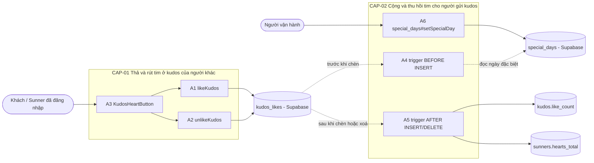
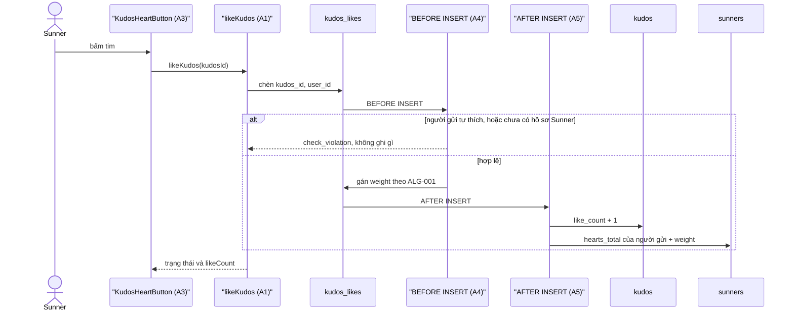
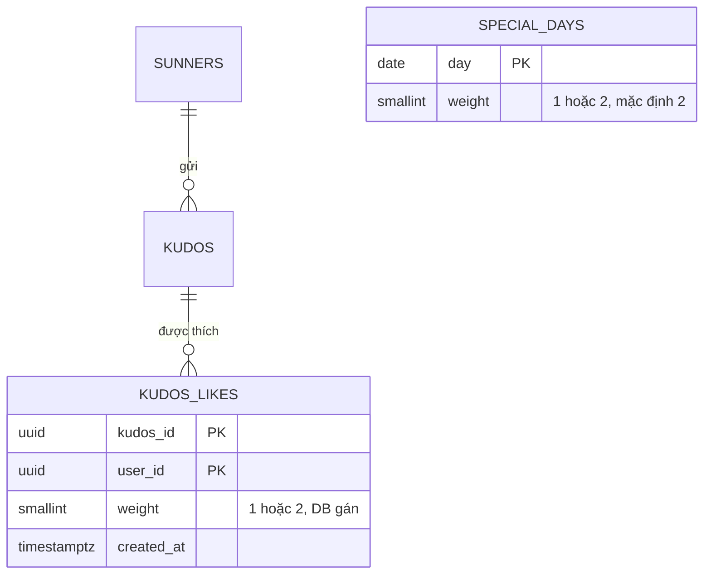
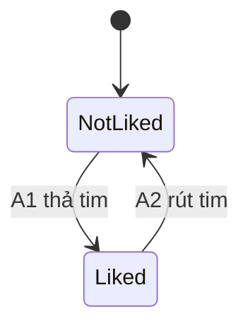

# F007_KudosHearts — Technical Spec

**Priority**: P1
**Type**: mixed
**Generated**: 2026-10-12

**See also:** [`functional-spec.md`](./functional-spec.md) — plain-language overview, open
decisions, requirements/business rules stated in one-liners, screens, user stories, scenarios,
edge cases, and configuration for a BA/QA audience.

**How to read this file:** § 2 is the index — pick the action you care about and read its block
in § 3 straight through; each block is one complete thread, top to bottom. § 4 is the shared
appendix — jump in only when a § 3 block points you there. Bản soạn trước khi có mã (2026-10-12); Stage 6 (2026-10-13) đã đối chiếu `Source` của A1 đến A5 với mã đã giao, các `TBD (draft)` còn lại và tên *(planned)* chưa đối chiếu (muốn có `path:line` chạy `/tkm:rebuild-spec --features F007`).

## 1. Technical Overview

Feature thêm hai bảng (`kudos_likes`, `special_days`), hai trigger trên `kudos_likes` và hai Server Action (`likeKudos`, `unlikeKudos`) để Sunner đã đăng nhập thả hoặc rút tim ở kudos của người khác; vùng nút tim trên thẻ kudos của `/sun-kudos` là một Client Component thả tim lạc quan (optimistic), do F007 sở hữu, còn thẻ, danh sách và vỏ trang thuộc F006. Mọi bất biến nằm ở DB, không ở giao diện: khoá chính `(kudos_id, user_id)` giữ "một lượt thích mỗi người mỗi kudos"; trigger trước khi chèn chặn người gửi tự thích và tự gán trọng số (+1, hoặc +2 vào ngày đặc biệt theo giờ Asia/Ho_Chi_Minh); trigger sau khi chèn hoặc xoá cập nhật `kudos.like_count` và tổng tim của NGƯỜI GỬI cùng giao dịch, bỏ thích thì trừ đúng trọng số đã lưu. Khách bấm tim được đưa tới `/login`; Server Action kiểm lại phiên ở máy chủ rồi ghi bằng client gắn cookie của chính người dùng để RLS có hiệu lực. *Design basis: clarifications.md + Study report (researcher-01 § 1).*



## 2. Action Index

| # | Action (handler) | Method · Path | Codes | Writes | Detail |
|---|---|---|---|---|---|
| **A0** | *cross-cutting — belongs to no single action* | — | FR-603, FR-604 | — | § 4.4 |
| **A1** | `likeKudos` | `POST` `/sun-kudos` *(Next-Action: `likeKudos`)* | FR-001, FR-401, FR-601, FR-602, BR-001, BR-006, DEC-001, SM-001, INT-001, US042, US044 | `kudos_likes` | § 3.1 |
| **A2** | `unlikeKudos` | `POST` `/sun-kudos` *(Next-Action: `unlikeKudos`)* | FR-402, FR-601, FR-602, BR-004, BR-006, SM-001, INT-001, US043 | `kudos_likes` | § 3.1 |
| **A3** | `KudosHeartButton` *(client behaviour, no HTTP)* | — | FR-201, FR-202, FR-203, FR-403, FR-404, FR-601, DEC-002, SM-001, US042, US043, US044, US045 | — *(chỉ trạng thái client)* | § 3.1 |
| **A4** | `kudos_likes_before_insert` *(background, no FE)* | trigger · `BEFORE INSERT` `kudos_likes` | FR-203, FR-405, BR-002, BR-003, ALG-001, US045, US046 | `kudos_likes` | § 3.2 ▸ **diagram** |
| **A5** | `kudos_likes_after_change` + `release_kudos_like_hearts` *(background, no FE)* | trigger · `AFTER INSERT` `AFTER DELETE` `kudos_likes`; trigger · `BEFORE DELETE` `kudos` | FR-003, FR-405, BR-003, BR-004, BR-005, US046 | `kudos`, `sunners` | § 3.2 ▸ **diagram** |
| **A6** | `special_days#setSpecialDay` (planned) *(operator, no FE; thao tác SQL, không có hàm trong mã)* | operator · `service_role` | FR-002, US047 | `special_days` | § 3.2 |

**Rung set** — mỗi khối trong § 3 theo thứ tự **Who** → **FE** → **Request** → **BE** → **Rule** → **Result** → **State** → **Source**; rung vắng thì bỏ hẳn. Bản nháp không có rung **State** (chưa có mã để đối chiếu); vòng đời một lượt thích nằm ở SM-001 (§ 4.3) và các cạnh của nó thuộc A1, A2. A4 và A5 là action nền (trigger DB, không có HTTP); chuỗi A1/A2 → A4 → A5 ghi nhiều bảng nên có một `sequenceDiagram` đặt ở cấp CAP-02 (§ 3.2).

## 3. Actions

### 3.1 CAP-01 — Thả và rút tim ở kudos của người khác

#### A1 · Thả tim cho kudos của người khác
`POST /sun-kudos` *(Next-Action: `likeKudos`)* → `` `likeKudos` ``
`FR-001` `FR-401` `FR-601` `FR-602` `BR-001` `BR-006` `DEC-001` `SM-001` `INT-001` `US042` `US044` · `TBD (draft)` *(vùng nút tim của màn hình `/sun-kudos`; vỏ màn hình do kudos-board-browse sở hữu)*

**Who** · Sunner đã đăng nhập, không phải người gửi kudos (US042: thả tim cho kudos của người khác). Khách cũng thấy nút nhưng A3 đưa họ tới `/login` trước khi gọi action (US044); action vẫn kiểm lại phiên nên người gọi thẳng cũng không ghi được *(gate A0 — § 4.4)*
**FE** · không có giao diện riêng — A3 gọi action trong một transition và dựng lại nút từ giá trị trả về (FR-401: thả tim thấy ngay, số tim +1).
**Request** · tham số `kudosId` *(mã kudos, `uuid` theo `kudos.id` của F006)*; cookie phiên Supabase đi kèm. Không có trường `weight` hay `userId` trong yêu cầu: người thích lấy từ phiên, trọng số do DB quyết (A4).
**BE** · `` `likeKudos` `` — (1) kiểm `kudosId` có đúng hình dạng; (2) `getCurrentUser()` (`lib/supabase/current-user.ts:33-59`, có sẵn, fail closed): `null` thì trả `{ status: "unauthenticated" }` *(FR-602: máy chủ kiểm lại phiên, giao diện chỉ là tiện ích)*; (3) `createClient()` gắn cookie (`lib/supabase/server.ts:19-50`, có sẵn) rồi chèn `{ kudos_id, user_id }` vào `kudos_likes` với `on conflict do nothing` *(INT-001 — ghi lượt thích bằng phiên của chính người dùng để RLS áp dụng, § 4.5)*; (4) đọc lại `kudos.like_count` để trả số chuẩn; (5) lỗi `check_violation` từ A4 → `{ status: "forbidden" }`, lỗi khoá ngoại → `{ status: "not_found" }`, lỗi khác → `{ status: "error" }` và log `[kudos-likes]`. Server Action là mutation (client gửi tuần tự, không dùng cho đọc). *Design basis: Study report (researcher-01 § 1–2).*
**Rule** · quyết định ghi hay không ghi:
- **BR-001 — Mỗi người thả tối đa một lượt tim cho một kudos.** Khoá chính `(kudos_id, user_id)` giữ bất biến ở DB; lần chèn thứ hai bị bỏ qua nhờ `on conflict do nothing`, không lỗi và bộ đếm không đổi.
- **BR-006 — Thao tác lặp lại là vô hại.** Thả khi đã thả sẵn, hay rút khi chưa thả, đều không đổi gì và không báo lỗi; action trả trạng thái hiện hành để client khớp lại *(§ 4.4)*.

| DEC | subtype | Condition | What the user sees | Source |
|---|---|---|---|---|
| **DEC-001** | flow | không có phiên hợp lệ | action trả `unauthenticated`, giao diện chuyển tới `/login`; không ghi gì | `TBD (draft)` |
| **DEC-001** | flow | người đang đăng nhập là người gửi kudos | DB từ chối (A4), action trả `forbidden`, nút hoàn về trạng thái cũ | `TBD (draft)` |
| **DEC-001** | flow | đã thích sẵn | không đổi gì, trả trạng thái hiện hành (BR-006) | `TBD (draft)` |
| **DEC-001** | flow | kudos không còn tồn tại | khoá ngoại lỗi, action trả `not_found`, nút hoàn về trạng thái cũ | `TBD (draft)` |
| **DEC-001** | flow | hợp lệ, chưa thích | ghi một dòng `kudos_likes`; A4 và A5 chạy trong cùng giao dịch; số tim +1 | `TBD (draft)` |

**Result** · Ghi `kudos_likes` ← một dòng `(kudos_id, user_id, weight, created_at)`; `weight` do A4 gán (ALG-001), không do action. Số tim của kudos và tổng tim của người gửi đổi ở A5, không do action ghi trực tiếp (FR-001: mỗi lượt thích lưu thành một dòng riêng). SM-001 (vòng đời một lượt thích) đi cạnh "chưa thích → đã thích". User sees: nút chuyển xám → đỏ và số tim +1, rồi được khớp với `likeCount` trả về (FR-401).
**Source:** `lib/kudos/kudos-heart-actions.ts` (`likeKudos`, `writeHeart`)

<!-- Không vẽ sequenceDiagram riêng: action chỉ ghi một bảng; phần nối A1 → A4 → A5 nằm ở diagram cấp CAP-02 (§ 3.2). -->

---

#### A2 · Rút tim đã thả
`POST /sun-kudos` *(Next-Action: `unlikeKudos`)* → `` `unlikeKudos` ``
`FR-402` `FR-601` `FR-602` `BR-004` `BR-006` `SM-001` `INT-001` `US043` · `TBD (draft)` *(vùng nút tim của màn hình `/sun-kudos`)*

**Who** · Sunner đã đăng nhập đã thả tim trước đó (US043: rút tim đã thả); khách bị A3 đưa tới `/login`, nhưng action vẫn tự kiểm lại phiên *(gate A0 — § 4.4)*
**FE** · không có giao diện riêng — A3 gọi action khi nút đang đỏ và dựng lại từ giá trị trả về (FR-402: rút tim thấy ngay, số tim −1).
**Request** · tham số `kudosId`; cookie phiên. Action biểu thị ý định "rút", không phải nút bật/tắt: hai lần bấm nhanh không thể đảo nhau ngoài ý muốn.
**BE** · `` `unlikeKudos` `` — (1) kiểm `kudosId`; (2) `getCurrentUser()` như A1, `null` thì `{ status: "unauthenticated" }` (FR-602); (3) `createClient()` rồi xoá dòng `kudos_likes` có `kudos_id` này và `user_id` là chính người dùng (RLS chỉ cho xoá dòng của mình; INT-001, § 4.5); (4) đọc lại `kudos.like_count`; (5) lỗi → `{ status: "error" }` và log `[kudos-likes]`. Không tìm thấy dòng nào để xoá không phải lỗi.
**Rule**
- **BR-004 — Bỏ thích thu hồi đúng số tim lượt thích đó đã cộng cho người gửi.** Trọng số là giá trị đã lưu cùng lượt thích lúc thả, không tra lại ngày đặc biệt hôm nay; thả vào ngày đặc biệt (+2) rồi rút sau ngày đó vẫn trừ 2 *(§ 4.4)*.
- **BR-006 — Thao tác lặp lại là vô hại.** Rút khi chưa thả không xoá gì, không báo lỗi, bộ đếm không đổi *(§ 4.4)*.

**Result** · Xoá `kudos_likes` ← dòng của người dùng cho kudos này (nếu có); A5 trừ `kudos.like_count` và tổng tim người gửi trong cùng giao dịch. SM-001 đi cạnh "đã thích → chưa thích". User sees: nút chuyển đỏ → xám và số tim −1 rồi khớp với `likeCount` trả về (FR-402).
**Source:** `lib/kudos/kudos-heart-actions.ts` (`unlikeKudos`, `writeHeart`)

<!-- Không vẽ sequenceDiagram riêng: một bảng ghi trực tiếp; chuỗi trigger ở diagram cấp CAP-02 (§ 3.2). -->

---

#### A3 · Nút tim trên thẻ kudos: thả/rút lạc quan, vô hiệu cho người gửi, khách tới đăng nhập
`—` *(client behaviour, no HTTP)* → `` `KudosHeartButton` ``
`FR-201` `FR-202` `FR-203` `FR-403` `FR-404` `FR-601` `DEC-002` `SM-001` `US042` `US043` `US044` `US045` · `TBD (draft)` *(vùng nút tim của màn hình `/sun-kudos`)*

**Who** · Mọi người xem: khách, Sunner đã đăng nhập, người gửi kudos (US042: thả tim; US043: rút tim; US044: khách bấm thì tới đăng nhập; US045: người gửi thấy nút vô hiệu) *(gate A0 — § 4.4)*
**FE** · Client Component trong vùng nút tim của thẻ, dùng ở cả carousel Highlight và All Kudos: biểu tượng tim + số tim (FR-201: số tim hiện cho mọi người kể cả khách; FR-202: xám khi người xem chưa thích, đỏ khi đã thích). Nhận từ thẻ (F006) mã kudos, `likeCount`, `likedByMe`, loại người xem (`guest` hoặc `member`) và `isSender` (hợp đồng prop đã chốt: trang F006 truyền hai giá trị `likedByMe`, `isSender` cho từng thẻ, § 5.2). Lỗi thả/rút hiện một thông báo nhỏ `role="status"` (cùng cơ chế thông báo nhỏ của trang, tự tắt sau vài giây); chữ tạm, chờ người sở hữu nội dung, thêm vào `lib/i18n/sun-kudos-copy.ts` của F006: VN "Không cập nhật được tim. Vui lòng thử lại." / EN "Could not update the heart. Please try again." (D003). Nút của người gửi dùng `disabled` thật và không bao giờ đỏ (FR-203). Bấm tạo một transition gọi A1 (đang xám) hoặc A2 (đang đỏ); trong lúc chờ nút giữ trạng thái lạc quan và bỏ qua bấm tiếp (`aria-busy`), nên hai lần bấm nhanh chỉ tạo một yêu cầu tại một thời điểm.
**Request** · gọi A1 hoặc A2 với `kudosId`; không gửi giá trị `liked` hay `weight`. Khách không gọi action mà điều hướng thẳng tới `/login` (FR-601).
**Rule** · quyết định hiển thị và hành vi của nút (DEC-002), cùng hai cách xử lý lỗi và đồng bộ:

| DEC | subtype | Condition | What the user sees | Source |
|---|---|---|---|---|
| **DEC-002** | render, interaction | người xem là khách | tim xám, số tim hiện; bấm chuyển tới `/login`, không gọi action | `TBD (draft)` |
| **DEC-002** | render, interaction | đã đăng nhập, không phải người gửi, `likedByMe` sai | tim xám; bấm gọi A1, tim đỏ và số +1 ngay | `TBD (draft)` |
| **DEC-002** | render, interaction | đã đăng nhập, không phải người gửi, `likedByMe` đúng | tim đỏ; bấm gọi A2, tim xám và số −1 ngay | `TBD (draft)` |
| **DEC-002** | render | đã đăng nhập, là người gửi (`isSender`) | tim xám, nút vô hiệu, số tim vẫn hiện; không bấm được | `TBD (draft)` |
| **DEC-002** | interaction | action đang chạy (`pending`) | giữ trạng thái lạc quan, bấm tiếp bị bỏ qua | `TBD (draft)` |
| **DEC-002** | interaction | action trả `forbidden`, `not_found`, `error` hoặc ném lỗi | nút và số hoàn về giá trị trước khi bấm (hoặc về giá trị máy chủ mới hơn mà đợt đồng bộ bộ lọc nhận trong lúc chờ; chỉ hoàn giá trị lạc quan do chính lần bấm này ghi) và hiện thông báo lỗi ngắn (FR-403, D003) | `TBD (draft)` |
| **DEC-002** | interaction | action trả `unauthenticated` (phiên hết hạn giữa chừng) | chuyển tới `/login`; nút hoàn về giá trị trước khi bấm (không có thông báo lỗi vì đã chuyển trang) | `TBD (draft)` |

- FR-404 (cùng một kudos hiện ở Highlight và All Kudos thì hai nút luôn cùng trạng thái): trạng thái lạc quan giữ trong một kho client chung theo mã kudos thay vì mỗi nút tự giữ; F007 cấp kho (provider + hook), F006 gắn provider vào vỏ trang bao quanh cả Highlight lẫn All Kudos (đã chốt, clarifications.md) và mỗi thẻ đăng ký `{likeCount, likedByMe}` ban đầu vào kho. *Design basis: clarifications.md ("one like per user per kudos") + Study report.*
**Result** · Không ghi DB (chỉ A1, A2 ghi). Số tim đổi tại chỗ nhưng thứ tự carousel Highlight không xếp lại (D002, đã chốt: chỉ đổi khi tải lại hoặc đổi bộ lọc). Số tim và màu nút luôn khớp với giá trị máy chủ trả về gần nhất; SM-001 (vòng đời lượt thích) quyết định nút đang ở "chưa thích" hay "đã thích" (FR-202).
**Source:** `TBD (draft)`

<!-- Không vẽ sequenceDiagram: hành vi client, không ghi bảng; phần phân nhánh là bảng DEC-002. -->

---

### 3.2 CAP-02 — Cộng và thu hồi tim cho người gửi kudos

Một lượt thích đi qua ba action trong cùng một giao dịch DB: A1 (hoặc A2) chèn hoặc xoá dòng `kudos_likes`, A4 chặn và gán trọng số trước khi chèn, A5 cập nhật bộ đếm sau khi chèn hoặc xoá. Không action nào có toàn bộ chuỗi nên sơ đồ đặt ở cấp CAP; luồng rút tim giống luồng thả nhưng bỏ A4 và A5 trừ `OLD.weight`.



#### A4 · Chặn người gửi tự thích và gán trọng số cho lượt thích *(background, no FE)*
`trigger · BEFORE INSERT kudos_likes` → `` `kudos_likes_before_insert` ``
`FR-203` `FR-405` `BR-002` `BR-003` `ALG-001` `US045` `US046` · `TBD (draft)` *(không có màn hình; chạy trong DB)*

**Who** · *không có người dùng — trigger DB chạy khi A1 chèn một dòng* (US045: người gửi không thích được kudos của chính mình; US046: người gửi được cộng đúng tim). Hàm `security definer` với `set search_path = ''`, thu quyền `execute` của `public`, `anon`, `authenticated` để không gọi được qua API — cùng công thức với `handle_new_user` của F001 *(gate A0 — § 4.4)*.
**Request** · *không có yêu cầu HTTP* — dòng mới `NEW` gồm `kudos_id`, `user_id` (từ phiên của người gọi qua policy RLS); mọi giá trị `weight` client gửi, nếu có, bị ghi đè.
**BE** · `` `kudos_likes_before_insert` `` — (1) tìm Sunner của người thích: `sunners.user_id = NEW.user_id`; không có thì từ chối; (2) đọc `kudos.sender_id` của `NEW.kudos_id`; trùng thì từ chối bằng `check_violation`; (3) gán `NEW.weight` bằng ALG-001 (§ 4.5). Cột `weight` còn bị ràng buộc `check (weight in (1,2))`.
**Rule**
- **BR-002 — Người gửi không thích được kudos của chính mình.** Bất biến ở DB, không chỉ ở nút bị vô hiệu: dù gọi thẳng qua API, lượt chèn bị từ chối và không đổi bộ đếm nào. Nút bị vô hiệu ở giao diện là FR-203.
- **BR-003 — Người gửi nhận +1 tim cho mỗi lượt thích, +2 nếu lượt thích xảy ra vào ngày đặc biệt.** Ngày tính theo giờ Asia/Ho_Chi_Minh lúc chèn; trọng số lưu cùng lượt thích (A5 cộng, § 4.4). Ở A4 đây là bước gán `weight` (ALG-001: tra `special_days` theo ngày hôm nay, không có thì 1).

**Result** · Ghi `kudos_likes.weight` ← ALG-001 (ghi đè mọi giá trị client); hoặc từ chối cả lượt chèn bằng `check_violation` (người gửi tự thích, hoặc người thích chưa có Sunner). Trọng số quyết ở DB nên client không giả mạo được (FR-405: tim người gửi đổi đúng trọng số).
**Source:** `supabase/migrations/20261012072217_create_kudos_likes.sql` (`kudos_likes_before_insert`, trigger `kudos_likes_before_insert`)

<!-- sequenceDiagram: ở đầu § 3.2, vì A4 và A5 là hai bước của cùng một chuỗi bắt đầu từ A1. -->

---

#### A5 · Cập nhật số tim của kudos và tổng tim của người gửi *(background, no FE)*
`trigger · AFTER INSERT, AFTER DELETE kudos_likes` + `trigger · BEFORE DELETE kudos` → `` `kudos_likes_after_change` ``, `` `release_kudos_like_hearts` ``
`FR-003` `FR-405` `BR-003` `BR-004` `BR-005` `US046` · `TBD (draft)` *(không có màn hình; chạy trong DB)*

**Who** · *không có người dùng — trigger DB chạy sau khi A1 chèn hoặc A2 xoá* (US046: người gửi kudos được cộng tim khi kudos được thích và bị thu hồi khi bỏ thích). Cùng cấu hình `security definer`, `search_path = ''`, thu `execute` như A4 *(gate A0 — § 4.4)*.
**Request** · *không có yêu cầu HTTP* — dòng `NEW` (chèn) hoặc `OLD` (xoá) của `kudos_likes`, gồm `kudos_id` và `weight`.
**BE** · `` `kudos_likes_after_change` `` — khi chèn: `kudos.like_count += 1` và `sunners.hearts_total += NEW.weight` cho Sunner là `kudos.sender_id`; khi xoá: `-= 1` và `-= OLD.weight`. Cùng giao dịch với dòng thích nên hoặc cả ba thay đổi cùng có hiệu lực, hoặc không cái nào. Hàng `kudos` bị khoá cho tới hết giao dịch nên các lượt thích đồng thời trên cùng một kudos xếp hàng (đủ cho quy mô hiện tại, không cần sharded counter). *Design basis: Study report (researcher-01 § 1).*
**Rule**
- **BR-005 — Số tim hiện trên thẻ là số lượt thích hiện có, mỗi lượt tính 1, kể cả vào ngày đặc biệt.** Chỉ tim của người gửi mới có trọng số; hai con số khác nhau (xem RISK-02 trong functional-spec.md).
- **BR-003 — Người gửi nhận +1 tim mỗi lượt thích, +2 vào ngày đặc biệt.** Ở A5 đây là bước cộng đúng `NEW.weight` vào tổng tim của người gửi *(§ 4.4)*.
- **BR-004 — Bỏ thích thu hồi đúng số tim lượt thích đó đã cộng.** Ở A5 đây là bước trừ `OLD.weight` đã lưu, không tra lại `special_days` *(§ 4.4)*.

**Result**
- Ghi `kudos.like_count` ← `+1` khi chèn, `−1` khi xoá (FR-003: bộ đếm do DB tự cập nhật, client không ghi được)
- Ghi `sunners.hearts_total` ← `+weight` khi chèn, `−weight` khi xoá, cho Sunner là người gửi (FR-405)
- Xoá kudos (trực tiếp bằng SQL `service_role`, ngoài giao diện): không dựa vào `kudos_likes_after_change`, vì cascade chỉ xoá các lượt thích sau khi hàng `kudos` đã mất nên trigger đó không còn tìm được người gửi. Thay vào đó trigger `kudos_before_delete_release_like_hearts` (`BEFORE DELETE` trên `kudos`, hàm `release_kudos_like_hearts`, `security definer`, thu `execute` như A4) cộng `weight` đã lưu của mọi lượt thích của kudos đó rồi trừ tổng khỏi `sunners.hearts_total` của người gửi (`greatest(.., 0)`); hành vi đã chốt là đúng ý (functional-spec.md D001).
**Source:** `supabase/migrations/20261012072217_create_kudos_likes.sql` (`kudos_likes_after_change`, trigger `kudos_likes_after_change`; `release_kudos_like_hearts`, trigger `kudos_before_delete_release_like_hearts`)

<!-- sequenceDiagram: ở đầu § 3.2. -->

---

#### A6 · Vận hành khai báo ngày đặc biệt
`—` → `` `special_days#setSpecialDay` (planned) *(operator, no FE; migration + seed + cập nhật bằng service_role)* ``
`FR-002` `US047` · `TBD (draft)` *(không có màn hình; không có trang quản trị)*

**Who** · Người vận hành, bằng khoá `service_role` (Supabase Studio, SQL hoặc helper E2E); không phải người dùng cuối (US047: khai báo ngày đặc biệt để lượt thích vào ngày đó tính gấp đôi) *(gate A0 — § 4.4)*
**FE** · *no entry point found* — chưa có giao diện quản trị ngày đặc biệt trong phạm vi vòng này (clarifications.md: "special days are a seeded table with no admin UI this round"); chỉ thao tác trực tiếp trên DB.
**Request** · `insert into public.special_days (day, weight) values ('<YYYY-MM-DD>', 2)` hoặc `delete` dòng của ngày đó; `day` kiểu `date` là khoá chính nên mỗi ngày có tối đa một trọng số.
**BE** · migration tạo `special_days(day date primary key, weight smallint not null default 2 check (weight in (1, 2)))`, bật RLS, policy chọn công khai cho `anon`, `authenticated`; thu hết quyền rồi cấp `select` cho hai vai trò đó và đủ ghi cho `service_role` — cùng mẫu `site_settings` của F005; seed local đặt một vài ngày đặc biệt để E2E dùng *(§ 4.2)*. *Design basis: Study report (researcher-01 § 1), mẫu migration có sẵn.*
**Rule** · Không có BR riêng. Đổi hoặc xoá một ngày đặc biệt chỉ ảnh hưởng các lượt thích tạo SAU đó: trọng số đã lưu cùng lượt thích cũ không đổi (BR-004, § 4.4). Test đặt ngày đặc biệt là hôm nay rồi phải khôi phục khi xong.
**Result** · Ghi `special_days` ← một dòng `(day, weight)`; ALG-001 ở A4 đọc nó ở lượt thích kế tiếp (FR-002: ngày đặc biệt do vận hành khai báo).
**Source:** `TBD (draft)`

<!-- Không vẽ sequenceDiagram: dưới ngưỡng (ghi một bảng, đồng bộ, không có bước nền). -->

---

### 3.3 Edge cases

| Action | Scenario | Behavior |
|---|---|---|
| A1 · A3 | Hai lần bấm nhanh liên tiếp | nút bỏ qua lần bấm khi đang chờ; action là "ý định" nên dù có hai yêu cầu cũng không đảo nhau *(BR-006, DEC-002)* |
| A1 | Thả khi đã thích sẵn (hai tab, tab cũ chưa biết) | `on conflict do nothing`; trả `likeCount` hiện hành, tab cũ khớp lại; không cộng tim lần hai *(BR-001, BR-006)* |
| A2 | Rút khi chưa thích | không xoá dòng nào, không lỗi, bộ đếm không đổi *(BR-006)* |
| A1 · A4 | Người gửi gọi thẳng action (bỏ qua nút vô hiệu) | A4 từ chối bằng `check_violation`; action trả `forbidden`; không đổi bộ đếm nào *(BR-002)* |
| A1 · A4 | Tài khoản đăng nhập chưa có hồ sơ Sunner | A4 không tìm thấy Sunner của người thích, từ chối; action trả `forbidden`, nút hoàn về trạng thái cũ và hiện thông báo lỗi ngắn (D003; giả định, § 5.2) |
| A1 | Kudos bị xoá giữa lúc thả | khoá ngoại lỗi, action trả `not_found`, nút hoàn về trạng thái cũ và hiện thông báo lỗi ngắn *(DEC-001, D003)* |
| A1 · A3 | Phiên hết hạn giữa lúc giao diện vẫn hiện "đã đăng nhập" | action trả `unauthenticated`, giao diện chuyển tới `/login`, nút hoàn về giá trị cũ *(FR-602, DEC-002)* |
| A1 · A4 · A5 | Thả đúng lúc nửa đêm Asia/Ho_Chi_Minh | ngày tính theo `now()` của DB lúc chèn; lượt thích thuộc ngày đó, không theo đồng hồ trình duyệt *(ALG-001, BR-003)* |
| A2 · A5 | Rút tim sau khi ngày đặc biệt đã qua | trừ đúng trọng số đã lưu (2), không phải 1 *(BR-004)* |
| A3 | Cùng một kudos có mặt ở Highlight và All Kudos | hai nút cùng trạng thái nhờ kho client chung theo mã kudos (F007 cấp, F006 gắn vào trang) *(FR-404)* |
| A3 | Máy chủ hoặc mạng lỗi | nút và số hoàn về giá trị trước khi bấm và hiện thông báo lỗi ngắn (chữ tạm, functional-spec.md D003) *(FR-403)* |
| A1-A6 | Gọi trực tiếp API ghi `weight` hoặc ghi `kudos.like_count`, `sunners.hearts_total` | bị từ chối bởi RLS và thu quyền; `weight` còn bị A4 ghi đè *(FR-604, A0)* |

## 4. Shared Foundation

### 4.1 Components

| Component | Responsibility | Used in | File |
|---|---|---|---|
| `KudosHeartButton` | Client Component: nút tim + số tim, thả/rút lạc quan, vô hiệu cho người gửi, khách tới `/login` | A3 | `TBD (draft)` *(mới)* |
| kho trạng thái tim theo mã kudos | giữ `liked` và `likeCount` dùng chung cho hai nút của cùng một kudos (FR-404); F007 cấp logic, F006 gắn provider vào vỏ trang | A3 | `TBD (draft)` *(mới; provider do F006 mount)* |
| `likeKudos` / `unlikeKudos` | Server Action: kiểm phiên, ghi/xoá `kudos_likes`, trả `{ status, likeCount }` | A1, A2 | `TBD (draft)` *(mới)* |
| `kudos_likes_before_insert` | hàm trigger `security definer`: chặn tự thích, gán `weight` (ALG-001) | A4 | `TBD (draft)` *(mới, trong migration)* |
| `kudos_likes_after_change` | hàm trigger `security definer`: cập nhật `kudos.like_count` và `sunners.hearts_total` | A5 | `TBD (draft)` *(mới, trong migration)* |
| `getCurrentUser` | người đã đăng nhập hay khách, chỉ từ claims đã xác minh | A1, A2 | `lib/supabase/current-user.ts:33-59` *(có sẵn, không đổi)* |
| `createClient` (server) | client Supabase gắn cookie phiên, để RLS thấy `auth.uid()` của người dùng | A1, A2 | `lib/supabase/server.ts:19-50` *(có sẵn, không đổi)* |

### 4.2 Data Model



<!-- erDiagram chỉ giữ cột chính và quan hệ; KUDOS và SUNNERS thuộc F006 (`kudos.id` là `uuid` theo F006, nên `kudos_likes.kudos_id` cũng `uuid`); SPECIAL_DAYS không có quan hệ khoá ngoại, A4 chỉ tra theo ngày. -->

#### Key Entities

| Entity | Table | Key Columns | Purpose |
|--------|-------|-------------|---------|
| `KudosLike` *(mới)* | `kudos_likes` | `kudos_id` (FK `kudos`, `on delete cascade`), `user_id` (FK `auth.users`, `on delete cascade`), PK `(kudos_id, user_id)`, `weight smallint not null check (weight in (1,2))`, `created_at` | một lượt thích của một người trên một kudos, kèm trọng số đã chốt lúc thích; A1 chèn, A2 xoá, A4 gán `weight`, A5 đọc |
| `SpecialDay` *(mới)* | `special_days` | `day date` (PK), `weight smallint not null default 2 check (weight in (1,2))` | ngày đặc biệt cấu hình bởi vận hành; A6 ghi, A4 đọc |
| `Kudos` *(của F006)* | `kudos` | `id`, `sender_id` (FK `sunners.id`), `like_count int not null default 0` | thẻ kudos; F006 sở hữu bảng và cột `like_count`, F007 chỉ cập nhật cột đó qua A5 (A1, A2 gián tiếp, Highlight sắp theo cột này) |
| `Sunner` *(của F006)* | `sunners` | `id`, `user_id` (liên kết tới `auth.users`, có thể null, không mở cho client), `hearts_total int not null default 0` | người gửi/nhận; `hearts_total` là tổng tim người gửi kiếm được; F006 tạo cột (mặc định 0, `check >= 0`), A5 chỉ cập nhật; từ F010 (review C2) cột này không mở `select` cho `anon`/`authenticated`, chủ đọc qua `get_my_sunner()` |

Ghi chú migration và quyền *(dự kiến — design basis: Study report + mẫu `site_settings`, `profiles` có sẵn)*:
- Migration chỉ thêm, có chú thích ROLLBACK STRATEGY; không tạo `kudos.like_count` hay `sunners.hearts_total` (F006 đã tạo, mặc định 0), chỉ thêm `kudos_likes`, `special_days` và hai trigger bảo trì hai cột đó; `kudos_likes` và `special_days` bật RLS rồi `revoke all ... from public, anon, authenticated` trước khi cấp quyền cụ thể.
- `kudos_likes`: policy `insert ... to authenticated with check (user_id = (select auth.uid()))`, `delete ... using (user_id = (select auth.uid()))`, `select` CHỈ dòng của mình (`user_id = (select auth.uid())`) nên không ai biết ai đã thích kudos nào; không cấp `update`; chỉ cấp `insert (kudos_id, user_id)` theo cột để `weight` không do client chọn; chỉ mục theo cột của policy (`user_id`) cho đúng hướng dẫn hiệu năng RLS.
- `special_days`: đọc công khai, chỉ `service_role` ghi. Không có quyền ghi nào của client lên `kudos.like_count` hay `sunners.hearts_total`; hai cột chỉ đổi qua trigger A5. Từ F010 (review C2) `sunners.hearts_total` còn bị thu `select` của client: A5 vẫn cộng tim cho người gửi kể cả kudos ẩn danh, nhưng không ai đọc được tổng của người khác nên so sánh trước và sau một lượt thích không lộ người gửi; `kudos.like_count` vẫn công khai.
- Chỉ mục: F007 thêm `kudos_likes_user_id_idx (user_id)` (cột của policy RLS); `(like_count desc, seq desc)` cho Highlight và `kudos(sender_id)` thuộc F006 (cột `seq` có chỉ mục duy nhất, đủ cho `ORDER BY seq DESC`); F007 chỉ phụ thuộc vào chúng.

#### Polymorphic Behavior

N/A — no discriminator fields in Key Entities.

<!-- `kudos_likes.weight` (1 hoặc 2) rẽ nhánh số tim cộng cho người gửi nên đủ điều kiện làm discriminator khi bước thu thập data-model chạy; mã DISC-### do bước đó cấp, bản nháp không bịa. -->

### 4.3 State Management

### Một lượt thích của một người trên một kudos: chưa thích hoặc đã thích (SM-001)
**kind:** entity
**Linked FR:** FR-401, FR-402
**Source:** `TBD (draft)`



**Action transitions:** guard và tác dụng phụ của từng cạnh nằm ở rung **Result** của action trên cạnh đó (§ 3.1) — không nhắc lại ở đây (DRY). "Chưa thích" là KHÔNG có dòng trong `kudos_likes`; trạng thái chờ phản hồi của nút (`pending`) là trạng thái trình bày của A3, không phải trạng thái của lượt thích.

### 4.4 Shared Rules

#### Bin 3 — cross-cutting, belongs to no single action

**A0 · FR-603 — Không ai xem được ai đã thích kudos nào.**
Cross-cutting: policy `select` của `kudos_likes` chỉ trả dòng của chính người dùng, nên mỗi người chỉ biết mình đã thích gì; số tim của kudos là cột tổng hợp công khai trên `kudos`. Người xem lấy trạng thái "đã thích bởi tôi" từ một quan hệ nhúng của chính dòng mình (0 hoặc 1 dòng), khách luôn nhận mảng rỗng. Không có chức năng "danh sách người đã thích" trong phạm vi.
**Design basis:** Study report (researcher-01 § 1, "Liked by me") + `Related Permissions` của feature-list.

**A0 · FR-604 — Client không ghi trực tiếp lên bộ đếm hay trọng số.**
Cross-cutting: `kudos.like_count`, `sunners.hearts_total` và `kudos_likes.weight` chỉ đổi qua trigger A4, A5 trong cùng giao dịch với lượt thích; không vai trò client nào có quyền ghi các cột đó, hàm trigger không gọi được qua API. Nhờ vậy gọi thẳng API cũng không tự cộng tim hay chọn trọng số. `sunners.hearts_total` cũng không đọc được từ client (F010 review C2).
**Design basis:** Study report (researcher-01 § 1) + acceptance criteria "no client writes to counters".

#### Bin 2 — used by ≥2 named actions

**BR-003 — Người gửi nhận +1 tim mỗi lượt thích, +2 nếu lượt thích xảy ra vào ngày đặc biệt.**
Used in: **A4** · **A5**. A4 gán `weight` theo ngày (ALG-001) và A5 cộng đúng `weight` đó vào `sunners.hearts_total` của `kudos.sender_id`. Ngày là ngày theo giờ Asia/Ho_Chi_Minh tại thời điểm chèn. Người nhận kudos không được cộng gì.
**Design basis:** clarifications.md (spec C.4.1 ghi "receiver" khi bỏ thích; quyết định chốt là NGƯỜI GỬI).
```text
on insert into kudos_likes:
  today  = (now() at time zone 'Asia/Ho_Chi_Minh')::date
  weight = special_days.weight where day = today, else 1     # A4, ALG-001
  sender = kudos.sender_id of NEW.kudos_id
  kudos.like_count             += 1                          # A5, BR-005
  sunners[sender].hearts_total += weight                     # A5
```

**BR-004 — Bỏ thích thu hồi đúng số tim lượt thích đó đã cộng cho người gửi.**
Used in: **A2** · **A5**. A2 xoá dòng; A5 trừ `OLD.weight` (giá trị đã lưu cùng lượt thích) khỏi `sunners.hearts_total` của người gửi và trừ 1 khỏi `kudos.like_count`. Không tra lại `special_days`, nên đổi hay xoá ngày đặc biệt về sau không làm lệch tổng.
**Design basis:** clarifications.md ("Unlike takes back exactly what that like gave (store the weight per like)").
```text
on delete from kudos_likes:
  sender = kudos.sender_id of OLD.kudos_id
  kudos.like_count             -= 1
  sunners[sender].hearts_total -= OLD.weight                 # trọng số đã lưu, không tra special_days
```

**BR-006 — Thao tác lặp lại là vô hại (idempotent).**
Used in: **A1** · **A2**. Thả khi đã thả sẵn: bị bỏ qua bởi `on conflict do nothing`, trigger sau không chạy cho dòng bị bỏ nên bộ đếm không đổi. Rút khi chưa thả: không có dòng để xoá nên trigger không chạy. Cả hai trả trạng thái hiện hành, không báo lỗi. Action biểu thị ý định (thả/rút), không phải nút bật/tắt, để hai yêu cầu chạy chồng nhau không đảo trạng thái.
**Design basis:** Study report (researcher-01 § 1, phương án A). *Cần kiểm bằng ca DB: trigger trước chạy cả với dòng sau đó bị `on conflict` bỏ qua (§ 5.2).*
```text
like(kudosId):   insert ... on conflict (kudos_id, user_id) do nothing
unlike(kudosId): delete ... where kudos_id = kudosId and user_id = auth.uid()   # 0 dòng: bình thường
return { liked, likeCount }
```

### 4.5 Algorithms & Integrations

### Chọn trọng số của lượt thích theo ngày đặc biệt (ALG-001)
**Linked FR:** FR-405
**Used in:** A4
**Source:** `TBD (draft)`
**Input:** thời điểm chèn (`now()` của DB) và bảng `special_days` · **Output:** `weight` là 1 hoặc giá trị `special_days.weight` (1 hoặc 2) · **Complexity:** O(1) (tra khoá chính)
**Description:** đổi thời điểm chèn sang ngày theo múi giờ Asia/Ho_Chi_Minh rồi tra `special_days`; có dòng thì lấy trọng số của dòng, không có thì 1. Chạy trong trigger nên là một phần của giao dịch chèn và client không can thiệp được.

**Pseudocode:**
```text
today  = (now() at time zone 'Asia/Ho_Chi_Minh')::date
row    = select weight from special_days where day = today
NEW.weight = row.weight if row exists else 1
```

### Ghi và xoá lượt thích qua dịch vụ dữ liệu Supabase bằng phiên của người dùng (INT-001)
**Linked FR:** FR-001, FR-402, FR-602
**Used in:** A1, A2
**Source:** `TBD (draft)`
**Type:** api-call
**Target:** Supabase Data API (PostgREST), bảng `public.kudos_likes` (và đọc `public.kudos.like_count`); client gắn cookie phiên (`createClient` của `lib/supabase/server.ts`), khoá publishable, vai trò `authenticated`, nên policy RLS thấy `auth.uid()` của chính người dùng
**Payload:** chèn `{ kudos_id, user_id }` với bỏ qua trùng, hoặc xoá theo `kudos_id` và `user_id`; không có `weight` và không có secret đi qua trình duyệt.
**Failure handling:** mọi lỗi (mạng, hạn chờ, RLS từ chối, `check_violation` của A4, khoá ngoại) → action trả `{ status: "forbidden" | "not_found" | "error" }` kèm log một dòng `[kudos-likes]`, không ném lỗi ra client; không retry tự động (người dùng bấm lại được). Lỗi quá thời gian chờ vẫn có thể đã ghi: client khớp lại với `likeCount` ở lần tải hoặc lần thao tác kế tiếp. *Design basis: mẫu getter/Server Action có sẵn (scout § 2–3).*

### 4.6 Configuration

```text
LIKE_WEIGHT_DEFAULT = 1                  # trọng số lượt thích ngày thường (A4, ALG-001)
special_days.weight in {1, 2}            # trọng số theo ngày đặc biệt, mặc định 2 (A4, A6)
SPECIAL_DAY_TIMEZONE = Asia/Ho_Chi_Minh  # múi giờ quyết định "hôm nay" (ALG-001)
SUPABASE_URL, SUPABASE_PUBLISHABLE_KEY   # server-only, đã có; A1, A2 đọc qua createClient (tên biến, không có giá trị)
supabase/migrations/*_kudos_likes.sql    # mới (TBD (draft)): bảng, RLS, GRANT, trigger A4, A5
supabase/seeds/common/*special-days.sql  # mới (TBD (draft)): vài ngày đặc biệt cho local/E2E, idempotent
```

**Client behavior:** see behavior-logic.md, permissions.md, architecture.md

## 5. Verification & Technical Notes

### 5.1 Technical Verification

Chính sách kiểm thử: `e2e-red-first` (thả/rút tim, chuyển hướng khách, nút vô hiệu là hành vi; runner `@playwright/test` có sẵn trong `e2e/`) — viết ca trước và chạy ĐỎ trước khi viết mã. Bất biến DB kiểm ở tầng thấp nhất làm được (ca schema/RLS cùng loại `supabase-schema-rls-*` có sẵn, dùng client `anon`/`authenticated`/`service_role`), phần còn lại ở tầng giao diện. Hai điểm cần lưu ý khi viết ca: (1) ca ngày đặc biệt ghi `special_days` dùng chung nên phải khôi phục khi xong, và `playwright.config.ts` đang `fullyParallel: true`, nên ca đổi dữ liệu dùng chung cần tệp riêng hoặc dòng dữ liệu riêng để không đụng ca song song (Gap/Risk); (2) `page.clock` chỉ di chuyển đồng hồ trình duyệt, còn ngày đặc biệt do giờ DB quyết nên ca "ngày đặc biệt" dùng dòng `special_days` của đúng hôm nay thay vì tua giờ. Ánh xạ SC → tệp E2E thuộc bước viết ca đỏ (chưa có).

- **SC-001** *(A4)* Dùng client `authenticated` của chính người gửi để chèn lượt thích vào kudos của mình: bị từ chối (`check_violation`), `kudos.like_count` và `sunners.hearts_total` không đổi (covers BR-002, FR-203)
- **SC-002** *(A1)* Cùng một người thích hai lần một kudos: lần hai không thêm dòng; ở tầng DB trực tiếp lần hai báo vi phạm duy nhất; qua action thì là no-op, `like_count` chỉ +1 (covers BR-001, BR-006, FR-001)
- **SC-003** *(A4, A5)* Có dòng `special_days` cho hôm nay: lượt thích của người khác lên kudos của A làm `sunners.hearts_total` của A +2 và `like_count` +1; rút tim trả đúng +2 về giá trị trước (covers BR-003, BR-004, BR-005, ALG-001, FR-405)
- **SC-004** *(A5)* Không có ngày đặc biệt: +1 rồi −1; đổi hoặc xoá `special_days` sau khi thích rồi rút vẫn trừ đúng trọng số đã lưu (covers BR-004, FR-003)
- **SC-005** *(A0, A4)* Vai trò `anon` không chèn được `kudos_likes`; `authenticated` chỉ thấy dòng của mình, chỉ chèn/xoá với `user_id` của mình, không `update`, không ghi `weight`, không ghi `kudos.like_count` hay `sunners.hearts_total` (covers FR-603, FR-604)
- **SC-006** *(A3, A1)* Khách bấm tim trên thẻ: URL chuyển tới `/login`, không có dòng `kudos_likes` mới (covers FR-601, DEC-002)
- **SC-007** *(A3)* Người gửi mở bảng: nút tim trên kudos của mình `disabled`, số tim vẫn hiện, bấm không đổi gì (covers FR-203, DEC-002)
- **SC-008** *(A3, A1, A2)* Sunner khác bấm tim: xám → đỏ, số +1; bấm lại: đỏ → xám, số −1; tải lại trang vẫn giữ trạng thái và số (covers FR-201, FR-202, FR-401, FR-402, SM-001)
- **SC-009** *(A3)* Khi action lỗi (chặn mạng hoặc kudos đã bị xoá): nút và số hoàn về giá trị trước khi bấm và thông báo lỗi ngắn hiện ra (covers FR-403, D003)
- **SC-010** *(A3)* Cùng một kudos có mặt ở Highlight và All Kudos: bấm ở một nơi thì nơi kia đổi theo (covers FR-404)

#### US042 *(A1, A3)*

**Independent Test:** Đăng nhập một Sunner không phải người gửi, thả tim một kudos của người khác trên `/sun-kudos`.

**Acceptance Scenarios:**

1. **Given** Sunner đã đăng nhập chưa thích kudos X của người khác, **When** bấm nút tim, **Then** tim chuyển đỏ, số tim +1, và tải lại trang vẫn đỏ với số mới.
2. **Given** Sunner đã thích kudos X, **When** gọi action thả tim lần nữa, **Then** không có lượt thích thứ hai và số tim không đổi.

#### US043 *(A2, A3)*

**Independent Test:** Từ trạng thái đã thả tim, bấm lại nút.

**Acceptance Scenarios:**

1. **Given** tim đang đỏ, **When** bấm nút, **Then** tim chuyển xám, số tim −1.
2. **Given** chưa thả tim, **When** gọi action rút tim, **Then** không lỗi và số tim không đổi.

#### US044 *(A1, A3)*

**Independent Test:** Mở `/sun-kudos` như khách rồi bấm nút tim.

**Acceptance Scenarios:**

1. **Given** khách chưa đăng nhập, **When** bấm nút tim, **Then** được chuyển tới `/login` và không có lượt thích nào được ghi.
2. **Given** phiên hết hạn trong lúc trang vẫn hiện như đã đăng nhập, **When** bấm tim, **Then** action trả `unauthenticated` và giao diện chuyển tới `/login`.

#### US045 *(A3, A4)*

**Independent Test:** Đăng nhập bằng tài khoản là người gửi của một kudos và nhìn nút tim trên kudos đó.

**Acceptance Scenarios:**

1. **Given** người gửi xem kudos của chính mình, **When** nhìn nút tim, **Then** nút bị vô hiệu và số tim vẫn hiện.
2. **Given** người gửi gọi thẳng action thả tim kudos của mình, **When** DB xử lý, **Then** lượt chèn bị từ chối và không bộ đếm nào đổi.

#### US046 *(A4, A5)*

**Independent Test:** Cho Sunner B thích kudos do Sunner A gửi và đọc `sunners.hearts_total` của A trước/sau bằng `service_role` (client không đọc được cột này từ F010 review C2), ngày thường rồi ngày đặc biệt.

**Acceptance Scenarios:**

1. **Given** hôm nay không phải ngày đặc biệt, **When** B thích kudos của A, **Then** tổng tim của A tăng 1; **And** khi B bỏ thích thì giảm lại 1.
2. **Given** hôm nay là ngày đặc biệt, **When** B thích kudos của A, **Then** tổng tim của A tăng 2; **And** bỏ thích (kể cả sau ngày đó) giảm đúng 2.

#### US047 *(A6)*

**Independent Test:** Dùng `service_role` thêm một dòng `special_days` cho hôm nay rồi cho một Sunner thích một kudos.

**Acceptance Scenarios:**

1. **Given** vận hành đã thêm ngày đặc biệt cho hôm nay, **When** có lượt thích mới, **Then** lượt thích đó có `weight` 2.
2. **Given** vai trò `anon` hoặc `authenticated`, **When** ghi vào `special_days`, **Then** bị từ chối.

### 5.2 Assumptions

- *(A1, A3)* Thẻ của F006 cung cấp cho vùng nút tim mã kudos, `likeCount`, `likedByMe`, loại người xem và `isSender` (người xem là người gửi); F006 tự tính `isSender` bằng cách so `viewerSunnerId` (lấy từ `get_my_sunner()`) với `sender.id`. Hợp đồng prop này đã chốt: trang F006 truyền `likedByMe` và `isSender` cho từng thẻ. Từ F010 thẻ ẩn danh có `sender: null` nên `withViewerFlags` cho `isSender = false` (trình duyệt không biết người gửi); nút tim của người gửi thật bật, và trigger `kudos_likes_before_insert` vẫn từ chối tự thích.
- *(A3)* Thông báo lỗi dùng cùng cơ chế thông báo nhỏ `role="status"` của trang (F006 dựng cho Copy Link) thay vì dựng cơ chế thứ hai; nếu F006 không xuất cơ chế đó dùng chung thì F007 thêm một thông báo nhỏ tối thiểu.
- *(A4)* Mỗi tài khoản đăng nhập đều có một hàng `sunners` liên kết qua `user_id` (trigger trên `auth.users` của F006 tạo hoặc liên kết lúc đăng ký); người chưa có hàng đó không thích được và bị A4 từ chối. Cần ca kiểm trường hợp này.
- *(A1, A4, A5)* `insert ... on conflict do nothing` chạy trigger trước cho dòng sau đó bị bỏ qua nhưng KHÔNG chạy trigger sau, nên bộ đếm không cộng lần hai (BR-006). Đây là hành vi Postgres theo hiểu biết chung, bản nháp không chạy thử; ca SC-002 là chỗ kiểm.
- *(A5)* Lượt thích đồng thời trên cùng một kudos xếp hàng ở khoá hàng `kudos`; quy mô vài trăm tên, dưới 10 nghìn kudos (từ clarifications/Figma, chưa đo) nên không cần bộ đếm chia nhỏ (YAGNI).
- *(A1, A2)* Server Action do client gửi tuần tự (Next 16, tài liệu `server-actions` mục "Sequential dispatch"), nên thả/rút của cùng một người không chạy song song với nhau từ cùng một tab; hai tab khác nhau thì BR-006 lo.
- *(Data model)* `kudos_likes.weight` sẽ đủ điều kiện làm DISC-### (giá trị cố định rẽ nhánh hành vi) khi `data-model.md` được dựng; mã do bước đó cấp.

### 5.3 Unresolved Questions

1. **Ai mount kho trạng thái tim dùng chung** *(A3)* — **đã chốt**: F007 cấp provider client theo mã kudos, F006 mount ở vỏ trang. Không còn câu hỏi mở.
2. **Cascade khi xoá kudos** *(A5)* — **đã chốt** (functional-spec.md D001): xoá kudos trực tiếp bằng SQL trừ đúng trọng số đã lưu của các lượt thích khỏi người gửi. Không còn câu hỏi mở.
3. **Cột `sunners.hearts_total` do feature nào tạo** *(A5)* — **đã chốt**: F006 tạo cả `kudos.like_count` và `sunners.hearts_total` (mặc định 0); F007 chỉ thêm `kudos_likes`, `special_days` và các trigger. Không còn câu hỏi mở.
4. **Hợp đồng prop giữa thẻ F006 và vùng nút tim F007** *(A3)* — **đã chốt**: F006 truyền `likedByMe` và `isSender` cho từng thẻ, F007 không tự đọc. Không còn câu hỏi mở.
5. **Kiểu khoá chính của `kudos`** *(A1)* — **đã khớp với F006**: `kudos.id` là `uuid`, nên `kudos_likes.kudos_id` và `kudosId` của action là `uuid`.
6. **Ca E2E đổi `special_days` dùng chung với `fullyParallel: true`** *(A6)*: cần quy ước cô lập (tệp riêng, hay dòng ngày riêng) khi viết ca đỏ.

### 5.4 Source References

Mã đã giao: `lib/kudos/kudos-heart-actions.ts` (Server Action `likeKudos`, `unlikeKudos`), `lib/kudos/kudos-heart-store.tsx` (kho tim dùng chung, hoàn tác khi lỗi), `app/_components/sun-kudos-behaviour/kudos-heart-button.tsx`, `supabase/migrations/20261012072217_create_kudos_likes.sql`, `supabase/seeds/common/05-special-days.sql`. Mã có sẵn được dùng lại không đổi: `lib/supabase/current-user.ts` (hàm `getCurrentUser`, dòng 33-59) và `lib/supabase/server.ts` (hàm `createClient`, dòng 19-50); mẫu migration/RLS/GRANT lấy từ `supabase/migrations/20261009083754_create_site_settings.sql` và `supabase/migrations/20261008045415_create_profiles.sql`.

#### Data Flow

```text
Browser (member) -> A3 bấm tim -> Server Action likeKudos / unlikeKudos (A1/A2): getCurrentUser() == null -> { unauthenticated } -> /login
   -> createClient() (cookie, role authenticated) -> insert/delete kudos_likes (RLS: user_id = auth.uid())
   -> A4 BEFORE INSERT: sunner(user) == kudos.sender ? reject : NEW.weight = special_days[today ICT] ?? 1
   -> A5 AFTER INSERT/DELETE: kudos.like_count +-1 ; sunners[sender].hearts_total +-weight   (cùng giao dịch)
   -> action đọc kudos.like_count -> { status, likeCount } -> A3 khớp nút và số (lỗi: hoàn nút và số, hiện thông báo lỗi ngắn)
Guest -> A3 -> /login (không gọi action)
Operator (service_role) -> A6 insert/delete special_days -> chỉ ảnh hưởng lượt thích tạo sau đó
```

### 5.5 Artifact References

| Artifact | File | Codes Used | Reviewed |
|----------|------|------------|----------|
| System Overview | [overview.md](../../system/overview.md) | — | [ ] |
| Architecture | [architecture.md](../../system/architecture.md) | — | [ ] |
| Feature List | [feature-list.md](../../generated/feature-list.md) | F007 | [ ] |
| API Map | [api-map.md](../../generated/api-map.md) | ROUTE012, ROUTE013 | [ ] |
| Entities | [entities.md](../../generated/entities.md) | MODEL011, MODEL012 | [ ] |
| Screens | [functional-spec.md § 6](./functional-spec.md#6-screens) | SCR006_SunKudosLiveBoard (vùng nút tim) | [ ] |
| Permissions Matrix | [permissions-matrix.md](../../generated/permissions-matrix.md) | PERM015, PERM017, PERM019 | [ ] |
| User Stories | [functional-spec.md § 7](./functional-spec.md#7-user-stories) | US042..US047 (chưa có trong user-stories.md) | [ ] |
