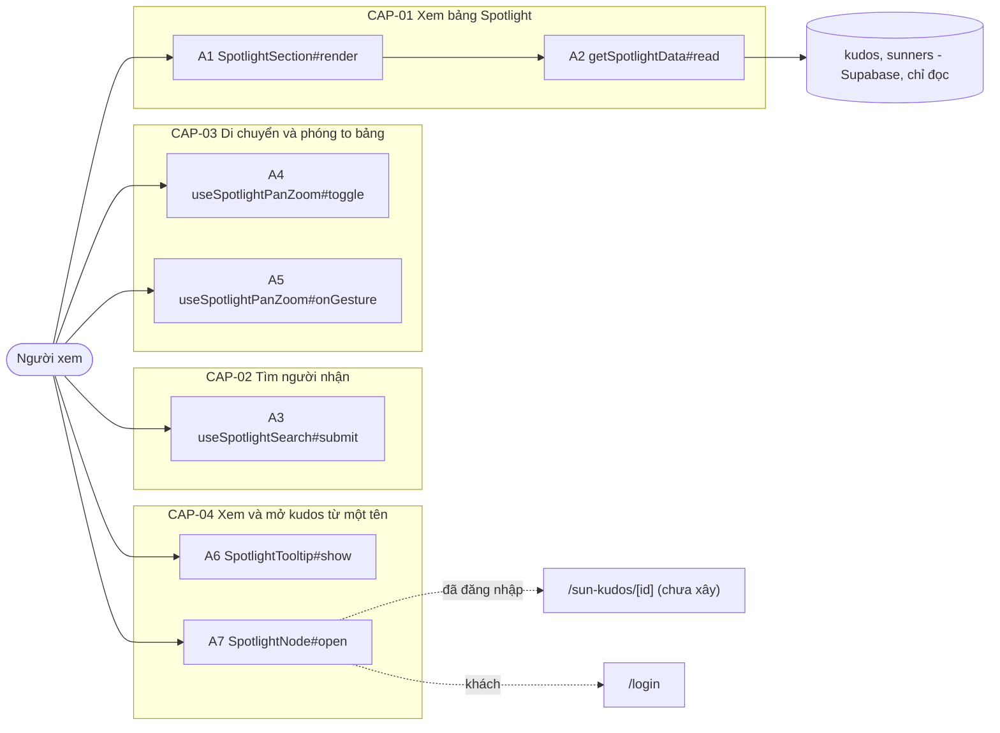
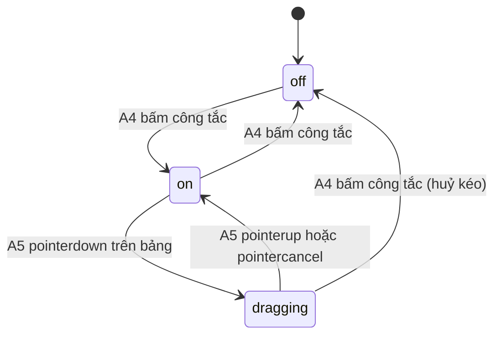

# F008_KudosSpotlight — Technical Spec

**Priority**: P2
**Type**: ui
**Generated**: 2026-10-12

**See also:** [`functional-spec.md`](./functional-spec.md) — plain-language overview, open
decisions, requirements/business rules stated in one-liners, screens, user stories, scenarios,
edge cases, and configuration for a BA/QA audience.

**How to read this file:** § 2 is the index — pick the action you care about and read its block
in § 3 straight through; each block is one complete thread, top to bottom. § 4 is the shared
appendix — jump in only when a § 3 block points you there. Bản soạn trước khi có mã: tên handler là tên dự kiến và `**Source:**` còn `TBD (draft)`, Stage 6 (2026-10-13) chỉ đối chiếu ALG-002 và INT-001 với mã đã giao (muốn có `path:line` cho phần còn lại chạy `/tkm:rebuild-spec --features F008`); căn cứ thiết kế là báo cáo nghiên cứu (Design basis: Study report, topic 3) và `clarifications.md`.

## 1. Technical Overview

Người xem (khách hoặc Sunner đã đăng nhập) mở `/sun-kudos`; vùng Spotlight là một đoạn của trang do F006 sở hữu vỏ, nằm sau ranh giới `<Suspense>` riêng. Một Server Component đọc dữ liệu công khai của F006 (kudos kèm người nhận, tổng số kudos) qua Supabase server client, tính bố cục tất định bằng hàm thuần chạy ở máy chủ rồi chuyển danh sách nút đã có toạ độ cho một client component. Client component giữ trạng thái dịch chuyển/thu phóng, công tắc Pan/Zoom, chuỗi tìm kiếm và tooltip; feature không ghi bảng nào, không thêm bảng, không thêm route.



## 2. Action Index

| # | Action (handler) | Method · Path | Codes | Writes | Detail |
|---|---|---|---|---|---|
| **A0** | *cross-cutting — belongs to no single action* | — | FR-601, BR-001 | — | § 4.4 |
| **A1** | `SpotlightSection#render` (planned) | `GET` `/sun-kudos` *(đoạn Spotlight sau `<Suspense>` riêng)* | FR-101, FR-201, FR-202, FR-203, FR-206, FR-207, FR-208, FR-209, FR-409, BR-002, BR-003, BR-004, DEC-001, ALG-001, US048, US053 | — *(read-only)* | § 3.1 |
| **A2** | `getSpotlightData#read` (planned) | `GET` `/sun-kudos` *(đọc dữ liệu trong cùng request)* | FR-001, FR-002, FR-209, BR-002, BR-004, BR-005, INT-001, US048 | — *(read-only: `kudos`, `sunners`)* | § 3.1 |
| **A3** | `useSpotlightSearch#submit` (planned) *(client behaviour, no HTTP)* | — | FR-205, FR-404, FR-405, FR-406, BR-006, DEC-002, ALG-002, US051 | — *(read-only, chỉ đổi kiểu hiển thị nút)* | § 3.2 |
| **A4** | `useSpotlightPanZoom#toggle` (planned) *(client behaviour, no HTTP)* | — | FR-204, FR-403, BR-007, SM-001, US052 | — *(read-only, chỉ đổi chế độ)* | § 3.3 |
| **A5** | `useSpotlightPanZoom#onGesture` (planned) *(client behaviour, no HTTP)* | — | FR-403, FR-407, FR-408, BR-007, SM-001, ALG-003, US052 | — *(read-only, chỉ đổi dịch chuyển/thu phóng)* | § 3.3 |
| **A6** | `SpotlightTooltip#show` (planned) *(client behaviour, no HTTP)* | — | FR-401, BR-005, US049 | — *(read-only)* | § 3.4 |
| **A7** | `SpotlightNode#open` (planned) | `GET` `/sun-kudos/[id]` *(đã đăng nhập)* · `/login` *(khách)* | FR-402, BR-008, US050 | — *(read-only)* | § 3.4 |

**Rung set** — mỗi khối trong § 3 theo thứ tự **Who** → **FE** → **Request** → **BE** → **Rule** → **Result** → **State** → **Source**; rung vắng thì bỏ hẳn. Feature không ghi bảng nào và không chạy nền nên không khối nào vượt ngưỡng `sequenceDiagram`. Rung **State** bỏ hẳn trong bản nháp (chưa có mã để xác nhận chuyển trạng thái); máy trạng thái giao diện SM-001 nằm ở § 4.3.

## 3. Actions

### 3.1 CAP-01 — Xem bảng Spotlight

#### A1 · Hiển thị vùng Spotlight (tiêu đề, tổng số, bảng tên, dải kudos mới nhất, trạng thái chờ/rỗng)
`GET /sun-kudos` → `` `SpotlightSection#render` (planned) ``
`FR-101` `FR-201` `FR-202` `FR-203` `FR-206` `FR-207` `FR-208` `FR-209` `FR-409` `BR-002` `BR-003` `BR-004` `DEC-001` `ALG-001` `US048` `US053` · TBD (draft)

**Who** · Người xem, khách hoặc đã đăng nhập *(gate A0 — § 4.4)*
**FE** · Vùng nằm giữa Highlight và All Kudos trên `/sun-kudos`; vỏ trang và khe (slot) do F006 cấp, F008 chỉ lấp nội dung vùng B.6–B.7. Server Component bọc trong `<Suspense>` riêng, khung chờ không chữ cùng kích thước vùng thật (FR-207). Khi đã đọc xong: tiêu đề (chữ nhỏ "Sun* Annual Awards 2025" + chữ lớn "SPOTLIGHT BOARD"), nhãn tổng `{n} KUDOS`, nút Pan/Zoom (A4), ô tìm kiếm (A3), khung bảng (`role="group"` có nhãn) chứa các nút tên (A6, A7), dải kudos mới nhất ở góc dưới trái (5 dòng xếp chồng, tĩnh). Rỗng thì thay khung bảng bằng thông báo. Nhãn, placeholder, thông báo lấy từ từ điển theo ngôn ngữ; tên người nhận giữ nguyên (FR-409).
**Request** · cookie `NEXT_LOCALE`; không có tham số truy vấn riêng: vùng không đọc bộ lọc Hashtag/Department của trang (D001 đã chốt: luôn là toàn bộ kudos của sự kiện, tổng thật)
**BE** · `getSpotlightData(locale)` (A2) trả `{ total, nodes, latest }` (`latest` là mảng tối đa 5 dòng); `layoutSpotlightNodes(nodes)` (ALG-001) gán toạ độ và cỡ chữ ở máy chủ nên không lệch hydrate. Cờ đã đăng nhập (để chọn đích liên kết của A7) lấy từ `getCurrentUser()` mà vỏ trang F006 đã đọc; cách truyền xuống vùng xem § 5.3.
**Rule**
- **BR-002 — Mỗi kudos là đúng một nút và nút hiện tên người nhận của kudos đó.** Người nhận có nhiều kudos thì có nhiều nút cùng tên; không gộp theo người. *(§ 4.4)*
- **BR-003 — Bố cục tất định.** Vị trí chỉ phụ thuộc vào dữ liệu và một thứ tự cố định (số kudos người nhận giảm dần, hoà thì kudos mới hơn trước), không dùng số ngẫu nhiên, nên cùng dữ liệu luôn cho cùng vị trí. Mô tả thuật toán ở ALG-001 *(§ 4.5)*.
- **BR-004 — Bảng chỉ vẽ tối đa `SPOTLIGHT_MAX_NODES` nút nhưng nhãn tổng luôn là tổng thật.** Tổng 388 mà chỉ vẽ 300 nút là đúng thiết kế; 300 nút là 300 kudos mới nhất (D002 đã chốt). *(§ 4.4)*

| DEC | subtype | Condition | What the user sees | Source |
|---|---|---|---|---|
| **DEC-001** | render | dữ liệu chưa về (đang chờ trong `<Suspense>`) | khung chờ không chữ cùng kích thước vùng | TBD (draft) |
| **DEC-001** | render | đọc xong VÀ `total` > 0 VÀ có ≥ 1 nút | tiêu đề, nhãn `{total} KUDOS`, bảng tương tác, dải kudos mới nhất | TBD (draft) |
| **DEC-001** | render | đọc xong VÀ không có nút nào (rỗng) | tiêu đề và nhãn `0 KUDOS` giữ nguyên; thông báo "Hiện tại chưa có Kudos nào." thay bảng; nút Pan/Zoom và ô tìm kiếm bị vô hiệu; không có dải kudos mới nhất | TBD (draft) |
| **DEC-001** | render | truy vấn lỗi hoặc ném ngoại lệ | hiện như rỗng; lỗi ghi log `[sun-kudos]` ở máy chủ; các vùng khác của trang vẫn hiện | TBD (draft) |

**Result** · Chỉ đọc, không ghi DB. Người xem thấy vùng Spotlight theo trạng thái ở DEC-001. Dải kudos mới nhất (FR-206, US053) là 5 nút đầu của danh sách thô (đã `seq desc` nên là 5 kudos mới nhất) nên không tốn truy vấn thêm; mỗi dòng xếp chồng (mới nhất ở trên cùng) hiện giờ dạng 12 giờ `hh:mmAM/PM` theo Asia/Ho_Chi_Minh, tên người nhận và câu "đã nhận được một Kudos mới" (D005 đã chốt); dữ liệu đọc một lần lúc tải trang, không có cập nhật trực tiếp. Dải dùng `aria-live="off"` (không tự đọc), dưới giảm chuyển động thì đứng yên (FR-408).
**Source:** TBD (draft)

<!-- Không vẽ sequenceDiagram: dưới ngưỡng (chỉ đọc, không ghi bảng nào, đồng bộ trong request). Phần phân nhánh là bảng DEC-001. -->

---

#### A2 · Đọc dữ liệu Spotlight (tên người nhận, thời điểm, tổng kudos)
`GET /sun-kudos` *(đọc dữ liệu trong cùng request)* → `` `getSpotlightData#read` (planned) ``
`FR-001` `FR-002` `FR-209` `BR-002` `BR-004` `BR-005` `INT-001` `US048` · TBD (draft)

**Who** · Người xem *(vai trò DB `anon` hoặc `authenticated`; gate A0 — § 4.4)*
**Request** · locale (chỉ để chọn chữ); không có tham số
**BE** · `getSpotlightData(locale)` theo khuôn getter có sẵn của repo: `await connection()` ngoài `try`; `createClient()` server có sẵn; hai truy vấn song song qua `INT-001` (Supabase Data API, *§ 4.5*): (1) tối đa `SPOTLIGHT_MAX_NODES` kudos, mới nhất trước, kèm tên và số kudos đã nhận của người nhận; (2) đếm chính xác tổng số hàng `kudos`. Lọc hàng hỏng (thiếu tên hoặc kiểu sai) bằng type-guard và log số hàng bị bỏ; ánh xạ sang `{ id, name, receivedCount, createdAtLabel }`; `latest` là 5 nút đầu kèm nhãn giờ 12 giờ `hh:mmAM/PM` (BR-005). Lỗi: `unstable_rethrow(cause)` trước, rồi log `[sun-kudos] spotlight query failed` và trả `{ total: 0, nodes: [], latest: [] }`; hàm không bao giờ ném.
**Rule**
- **BR-002 — Mỗi kudos một nút, tên là tên người nhận.** Hàm không `group by` người nhận. *(§ 4.4)*
- **BR-004 — Chỉ lấy tối đa `SPOTLIGHT_MAX_NODES` hàng nhưng tổng luôn đếm trên toàn bảng.** Hai truy vấn độc lập nên nhãn tổng không bị cắt theo số nút. *(§ 4.4)*
- **BR-005 — Thời điểm nhận hiển thị `HH:mm - MM/DD/YYYY` theo Asia/Ho_Chi_Minh; riêng dải kudos mới nhất dùng dạng 12 giờ `hh:mmAM/PM`.** Nhãn thời gian được dựng ở máy chủ rồi gửi sang client dạng chuỗi (client không tự đổi múi giờ). *(§ 4.4)*
**Result** · Chỉ đọc, **không ghi DB**. Trả dữ liệu cho A1; lỗi thì A1 hiện như rỗng (DEC-001). Không dùng `use cache` ở bản nháp này (đếm tổng luôn mới, e2e dễ kiểm); có thể thêm sau (§ 5.3).
**Source:** TBD (draft)

<!-- Không vẽ sequenceDiagram: dưới ngưỡng (hai truy vấn đọc song song, không ghi bảng nào, không nền). -->

---

### 3.2 CAP-02 — Tìm người nhận

#### A3 · Tìm một tên và tô sáng các nút khớp
`(client) submit tìm kiếm` → `` `useSpotlightSearch#submit` (planned) ``
`FR-205` `FR-404` `FR-405` `FR-406` `BR-006` `DEC-002` `ALG-002` `US051` · TBD (draft)

**Who** · Người xem *(không cần đăng nhập)*
**FE** · Ô nhập có biểu tượng kính lúp và placeholder "Tìm kiếm" (B.7.3); Enter hoặc bấm kính lúp thì tìm. Nút khớp có lớp tô sáng, nút không khớp bị làm mờ (`opacity`); không tính lại bố cục. Số nút khớp thông báo qua vùng `aria-live="polite"`. Lỗi (quá 100 ký tự hoặc để trống) hiện dưới ô, gắn `aria-describedby`/`role="alert"`.
**Request** · giá trị ô nhập `query` *(chuỗi, 0–100 ký tự sau khi cắt khoảng trắng hai đầu)*
**BE** · không có máy chủ; `matchSpotlightNodes(nodes, query)` chạy ở client trên danh sách đã có (ALG-002 *— chuẩn hoá bỏ dấu và hoa thường rồi so khớp chuỗi con, § 4.5*).
**Rule**
- **BR-006 — Chuỗi tìm tối đa 100 ký tự và không được để trống.** 100 ký tự được chấp nhận; 101 bị từ chối kèm thông báo lỗi; để trống mà tìm thì bị chặn kèm thông báo bắt buộc nhập; khớp không phân biệt hoa thường và dấu tiếng Việt (đã chốt, functional-spec.md § 3 D003, D004); chuỗi chỉ có dấu kết hợp (chuẩn hoá xong rỗng) bị coi như để trống (`evaluateSpotlightSearch`, `lib/kudos/spotlight-search-match.ts`). Ô nhập không đặt `maxLength`: gõ quá 100 ký tự vẫn được, lỗi chỉ hiện khi bấm tìm; kiểm tra làm trong hàm submit nên cũng chặn được chuỗi dán hoặc điền sẵn vượt giới hạn.

| DEC | subtype | Condition | What the user sees | Source |
|---|---|---|---|---|
| **DEC-002** | render | chưa tìm lần nào (hoặc ô đã xoá, FR-406) | mọi nút ở kiểu thường | TBD (draft) |
| **DEC-002** | render | đã tìm VÀ ≥ 1 nút khớp | nút khớp tô sáng, nút còn lại mờ; thông báo "{n} kết quả" cho trình đọc màn hình | TBD (draft) |
| **DEC-002** | render | đã tìm VÀ 0 nút khớp | mọi nút giữ kiểu thường (không làm mờ hết); thông báo "Không tìm thấy" dưới ô (chữ đang chờ xác nhận) | TBD (draft) |
| **DEC-002** | interaction | `query` rỗng khi bấm tìm | lỗi bắt buộc nhập, không đổi tô sáng hiện có | TBD (draft) |
| **DEC-002** | interaction | `length(query)` > 100 | lỗi quá dài, không tìm, không đổi tô sáng hiện có | TBD (draft) |

**Result** · Chỉ đọc, **không ghi DB**, không gọi máy chủ; chỉ đổi lớp hiển thị của nút. Xoá hết chữ trong ô thì bỏ tô sáng ngay (FR-406, D004 đã chốt).
**Source:** TBD (draft)

<!-- Không vẽ sequenceDiagram: dưới ngưỡng (client thuần, không bảng). Phần phân nhánh là bảng DEC-002. -->

---

### 3.3 CAP-03 — Di chuyển và phóng to bảng

#### A4 · Bật hoặc tắt chế độ Pan/Zoom
`(client) click nút Pan/Zoom` → `` `useSpotlightPanZoom#toggle` (planned) ``
`FR-204` `FR-403` `BR-007` `SM-001` `US052` · TBD (draft)

**Who** · Người xem *(không cần đăng nhập)*
**FE** · Nút `<button aria-pressed>` có tooltip "Pan/Zoom" (B.7.2), tiếp cận bằng Tab. Bật: khung bảng `touch-action: none`, con trỏ `grab`; tắt: khung bảng trả `touch-action` mặc định, trang cuộn bình thường.
**Request** · không có
**BE** · không có máy chủ; hook giữ `panZoomOn` (mặc định `false`).
**Rule** · **BR-007 — Kéo và lăn chuột chỉ tác động lên bảng khi Pan/Zoom đang bật.** Tắt thì không bắt sự kiện wheel/kéo của bảng và trang cuộn bình thường; tắt rồi bật lại giữ nguyên dịch chuyển/thu phóng hiện có. *(§ 4.4)*
**Result** · Chỉ đổi chế độ; **không ghi DB**. Trạng thái chuyển theo SM-001 (`off` ↔ `on`) *(§ 4.3)*.
**Source:** TBD (draft)

<!-- Không vẽ sequenceDiagram: dưới ngưỡng (client thuần, không bảng). -->

---

#### A5 · Kéo, lăn chuột hoặc dùng bàn phím để dịch chuyển và thu phóng bảng
`(client) pointerdown/pointermove/wheel/keydown` → `` `useSpotlightPanZoom#onGesture` (planned) ``
`FR-403` `FR-407` `FR-408` `BR-007` `SM-001` `ALG-003` `US052` · TBD (draft)

**Who** · Người xem *(không cần đăng nhập)*
**FE** · Một khung chứa duy nhất có `transform: translate(x,y) scale(k)`, `transform-origin: 0 0`; trạng thái `{x, y, k}` trong hook. Kéo: `setPointerCapture` trên khung. Lăn chuột: gắn bằng `addEventListener("wheel", …, { passive: false })` trong `useEffect` (React `onWheel` là passive nên không gọi được `preventDefault`). Bàn phím khi khung có tiêu điểm và Pan/Zoom bật: phím mũi tên dịch, `+`/`-` thu phóng. Không dùng `will-change` lúc nghỉ (chữ nhoè). Giảm chuyển động bật thì bỏ `transition` của transform (FR-408).
**Request** · sự kiện con trỏ/chuột/bàn phím; tham số wheel `deltaY`
**BE** · không có máy chủ; `zoomAt(state, cx, cy, delta)` (ALG-003 — thu phóng quanh con trỏ, kẹp `k` trong `[SPOTLIGHT_ZOOM_MIN, SPOTLIGHT_ZOOM_MAX]`, *§ 4.5*). Khi một nút nhận tiêu điểm bàn phím thì `onFocus` dịch khung để nút nằm trong tầm nhìn (trình duyệt có thể tự cuộn tổ tiên `overflow: hidden` rồi cãi nhau với transform, nên khung đặt `overflow: clip`).
**Rule** · **BR-007 — Kéo và lăn chuột chỉ tác động lên bảng khi Pan/Zoom đang bật.** Khi tắt, mọi sự kiện kéo/wheel bị bỏ qua, riêng phím Tab và tiêu điểm vẫn hoạt động. Mức thu phóng không vượt `[0.5, 4]`. *(§ 4.4)*
**Result** · Chỉ đổi `{x, y, k}`; **không ghi DB**. Trạng thái `on` ↔ `dragging` theo SM-001 *(§ 4.3)*. Không hỗ trợ pinch hai ngón theo quyết định đã chốt; trên thiết bị cảm ứng chỉ kéo một ngón và nút/phím.
**Source:** TBD (draft)

<!-- Không vẽ sequenceDiagram: dưới ngưỡng (client thuần, không bảng). Phần ngữ nghĩa trạng thái ở SM-001. -->

---

### 3.4 CAP-04 — Xem và mở kudos từ một tên

#### A6 · Hiện tooltip tên và thời gian khi rê chuột hoặc lấy tiêu điểm vào một nút
`(client) pointerenter/focus` → `` `SpotlightTooltip#show` (planned) ``
`FR-401` `BR-005` `US049` · TBD (draft)

**Who** · Người xem *(không cần đăng nhập)*
**FE** · MỘT phần tử tooltip dùng chung, `position: fixed` đặt ngoài khung có `transform` (để không bị phóng to theo bảng), `role="tooltip"`, nút liên kết gắn `aria-describedby` khi đang hiện; hiện khi `pointerenter` hoặc `focus` vào một nút, ẩn khi `pointerleave` hoặc `blur`. Nội dung: tên người nhận và nhãn thời gian.
**Request** · không có (dữ liệu đã nằm trong props của nút)
**BE** · không có máy chủ.
**Rule** · **BR-005 — Thời điểm nhận hiển thị `HH:mm - MM/DD/YYYY` theo Asia/Ho_Chi_Minh,** lấy chuỗi đã dựng ở A2, không tính lại ở client. *(§ 4.4)*
**Result** · Chỉ đọc; **không ghi DB**. Rời nút hoặc nhấn Esc thì tooltip ẩn.
**Source:** TBD (draft)

<!-- Không vẽ sequenceDiagram: dưới ngưỡng (client thuần, không bảng). -->

---

#### A7 · Bấm một nút để mở kudos tương ứng (khách thì đến đăng nhập)
`GET /sun-kudos/[id]` *(đã đăng nhập)* · `GET /login` *(khách)* → `` `SpotlightNode#open` (planned) ``
`FR-402` `BR-008` `US050` · TBD (draft)

**Who** · Sunner đã đăng nhập hoặc khách *(gate A0 — § 4.4)*
**FE** · Mỗi nút là một thẻ `<a>` thật (Tab, Enter, trình đọc màn hình, `getByRole("link")` trong e2e) có `href` do máy chủ chọn sẵn; không dùng `onClick` điều hướng. Kéo bảng (A5) không được kích hoạt nhấp: nếu con trỏ dịch quá ngưỡng nhỏ giữa `pointerdown` và `pointerup` thì huỷ nhấp.
**Request** · điều hướng `GET` tới `/sun-kudos/[id]` (id của kudos) hoặc `/login`
**BE** · trang đích `/sun-kudos/[id]` do feature khác sở hữu và chưa xây (404 mặc định của Next); `/login` thuộc F001. F008 chỉ sinh `href`.
**Rule** · **BR-008 — Đã đăng nhập thì nút dẫn tới kudos của nó; khách thì dẫn tới `/login`.** Máy chủ quyết định `href` theo phiên (ẩn/hiện liên kết chỉ là UX; việc chặn thật ở trang đích khi nó được xây). Quy ước khách → `/login` cùng loại với avatar/tên/chi tiết ở vùng F006 nhưng mỗi feature tự nêu quy tắc của mình.
**Result** · Điều hướng; **không ghi DB**. Chưa có trang chi tiết thì người đã đăng nhập thấy 404 mặc định (chấp nhận được giai đoạn này).
**Source:** TBD (draft)

<!-- Không vẽ sequenceDiagram: dưới ngưỡng (điều hướng thuần, không bảng). -->

### 3.5 Edge cases

| Action | Scenario | Behavior |
|---|---|---|
| A1 | Tổng kudos lớn hơn `SPOTLIGHT_MAX_NODES` (vd 388 > 300) | Nhãn ghi 388; chỉ vẽ 300 nút (BR-004) |
| A1 · A2 | Truy vấn lỗi hoặc thiếu biến môi trường Supabase | Hiện như rỗng, log lỗi, vùng khác vẫn hiện (DEC-001) |
| A1 | Không có kudos nào | "0 KUDOS", thông báo rỗng, điều khiển vô hiệu (DEC-001) |
| A1 | Hai tên dài ở vị trí gần nhau chồng chữ | Chấp nhận chồng lấn còn lại của bố cục tất định; tooltip và thu phóng bù (ALG-001) |
| A3 | Chuỗi đúng 100 ký tự | Chấp nhận (BR-006) |
| A3 | Chuỗi 101 ký tự (dán hoặc điền sẵn) | Từ chối, hiện lỗi (BR-006) |
| A3 | Ô trống rồi bấm tìm | Chặn, hiện lỗi bắt buộc nhập |
| A3 | Tìm chuỗi không khớp tên nào | Thông báo "Không tìm thấy", nút giữ kiểu thường (DEC-002) |
| A4 · A5 | Pan/Zoom tắt rồi lăn chuột trên bảng | Trang cuộn bình thường, bảng không đổi (BR-007) |
| A5 | Lăn chuột liên tục quá mức | Mức thu phóng kẹp ở 0.5 và 4 |
| A5 · A7 | Kéo bảng rồi nhả chuột trên một nút | Không kích hoạt điều hướng |
| A6 | Nút nằm sát mép khung | Tooltip lật vào trong khung nhìn |
| A7 | Khách bấm một nút | Đến `/login` |
| A7 | Người đã đăng nhập bấm khi trang chi tiết chưa xây | 404 mặc định, vùng Spotlight không lỗi |
| A1-A7 | Site còn khoá trước giờ mở (F005), người xem không phải admin | Proxy chuyển tới trang đếm ngược trước khi tới vùng này (A0) |

## 4. Shared Foundation

### 4.1 Components

| Component | Responsibility | Used in | File |
|---|---|---|---|
| `SpotlightSection` (Server Component) | Gọi `getSpotlightData`, chạy `layoutSpotlightNodes`, chọn `href` theo phiên, ghép tiêu đề/đếm/bảng/dải mới nhất hoặc trạng thái | A1 | `app/_components/sun-kudos/spotlight-section.tsx` (planned) |
| `SpotlightView` (stateless) | Tiêu đề B.6, nhãn tổng B.7.1, khung vùng; chuỗi nhận qua props | A1 | `app/_components/sun-kudos/spotlight-view.tsx` (planned) |
| `SpotlightStates` | Khung chờ không chữ và thông báo rỗng | A1 | `app/_components/sun-kudos/spotlight-states.tsx` (planned) |
| `SpotlightBoard` (`"use client"`) | Giữ `{x,y,k}`, `panZoomOn`, `query`, nút đang hiện tooltip; ghép nút, tooltip, ô tìm, công tắc | A3-A7 | `app/_components/sun-kudos-behaviour/spotlight-board.tsx` (planned) |
| `SpotlightNodeLink` | Một nút = `<a>` có toạ độ, cỡ chữ, trạng thái khớp/mờ | A3, A6, A7 | `app/_components/sun-kudos/spotlight-node-link.tsx` (planned) |
| `SpotlightTooltip` | Phần tử tooltip dùng chung | A6 | `app/_components/sun-kudos/spotlight-tooltip.tsx` (planned) |
| `SpotlightSearchBox` | Ô nhập, nút kính lúp, thông báo lỗi và số kết quả | A3 | `app/_components/sun-kudos/spotlight-search-box.tsx` (planned) |
| `SpotlightTicker` | Dải 5 kudos mới nhất, xếp chồng, tĩnh | A1 | `app/_components/sun-kudos/spotlight-ticker.tsx` (planned) |
| `getSpotlightData` / ánh xạ | Getter + `SPOTLIGHT_COLUMNS`, type-guard, mapper, nhãn giờ 12 giờ của dải (`formatTickerTime`) | A2 | `lib/kudos/get-spotlight-data.ts`, `lib/kudos/spotlight-mapping.ts` (planned) |
| `layoutSpotlightNodes` | Hàm thuần bố cục phyllotaxis | A1 | `lib/kudos/spotlight-layout.ts` (planned) |
| `useSpotlightPanZoom` | Hook trạng thái `{x,y,k}`, công tắc, sự kiện | A4, A5 | `lib/kudos/use-spotlight-pan-zoom.ts` (planned) |
| `useSpotlightSearch` / `matchSpotlightNodes` | Hook + hàm thuần so khớp tên | A3 | `lib/kudos/use-spotlight-search.ts`, `lib/kudos/spotlight-search-match.ts` (planned) |

Mỗi tệp dưới 200 dòng theo quy ước repo; tên và thư mục là dự kiến, theo khuôn có sẵn (`app/_components/<feature>/` cho view không trạng thái, `app/_components/<feature>-behaviour/` cho client component, `lib/<feature>/` cho hook và hàm thuần).

### 4.2 Data Model

#### Key Entities

| Entity | Table | Key Columns | Purpose |
|--------|-------|-------------|---------|
| Kudos *(F006 sở hữu, chỉ đọc)* | `kudos` *(tên tạm theo F006)* | mã kudos, `seq` (khoá phân trang tăng dần), thời điểm tạo, mã người nhận | Mỗi hàng là một nút của bảng; thời điểm tạo là "thời gian nhận" ở tooltip |
| Sunner *(F006 sở hữu, chỉ đọc)* | `sunners` *(tên tạm theo F006)* | mã, tên đầy đủ, số kudos đã nhận | Tên hiện trên nút; số kudos đã nhận quyết cỡ chữ và thứ tự bố cục |

F008 **không thêm bảng, cột, migration hay chính sách RLS**; chỉ dùng quyền đọc công khai F006 đã cấp cho `kudos` và cột `sunners` được cấp (không cần `email`). Tên cột chính xác do F006 quyết (TBD (draft)).

#### Polymorphic Behavior

N/A — no discriminator fields in Key Entities.

### 4.3 State Management

### Chế độ Pan/Zoom của bảng Spotlight (SM-001)
**kind:** ui
**Linked FR:** FR-403
**Source:** TBD (draft)



**Action transitions:** guard và hệ quả của từng cạnh nằm ở rung **Result** của action ghi trên cạnh (§ 3.3) — không lặp ở đây. Trạng thái `off` là mặc định mỗi lần mở trang; không lưu giữa các lần mở.

### 4.4 Shared Rules

#### Bin 3 — cross-cutting, belongs to no single action

**A0 · FR-601 / BR-001 — Vùng Spotlight mở công khai và chỉ đọc: khách và Sunner thấy cùng dữ liệu, không action nào của F008 ghi dữ liệu.**
Dữ liệu đọc qua vai trò DB `anon` hoặc `authenticated` với quyền đọc công khai F006 đã cấp; không có quyền ghi, không có Server Action. Việc `/sun-kudos` bị khoá trước giờ mở và việc làm mới phiên là của proxy hiện có (F005, F001), **không phải quy tắc của feature này**; matcher đã phủ mọi trang.
**Source:** TBD (draft)

#### Bin 2 — used by ≥2 named actions

**BR-002 — Mỗi kudos là đúng một nút, nút hiện tên người nhận của kudos đó.**
Used in: **A1** · **A2**. A2 không gộp theo người nhận; A1 vẽ mỗi phần tử danh sách thành một nút. Người nhận có nhiều kudos thì có nhiều nút cùng tên, cùng cỡ chữ (theo người nhận), khác `id` và thời gian.
**Source:** TBD (draft)
```text
nodes = kudos.map(k => { id: k.id, name: k.receiver.fullName, time: k.createdAt })   # không group by receiver
```

**BR-004 — Bảng chỉ vẽ tối đa `SPOTLIGHT_MAX_NODES` nút, nhãn tổng luôn là tổng thật.**
Used in: **A1** · **A2**. A2 chạy hai truy vấn độc lập (danh sách bị cắt và đếm tổng); A1 hiển thị tổng từ truy vấn đếm, không từ độ dài danh sách.
**Source:** TBD (draft)
```text
nodes = select kudos order by seq desc limit SPOTLIGHT_MAX_NODES
total = count(kudos)          # độc lập với nodes
label = `${total} KUDOS`
```

**BR-005 — Thời điểm nhận hiển thị `HH:mm - MM/DD/YYYY` theo Asia/Ho_Chi_Minh.**
Used in: **A2** · **A6**. A2 dựng chuỗi ở máy chủ (cùng cách định dạng với thẻ kudos của F006, nên dùng chung một hàm định dạng nếu F006 đã xuất); A6 chỉ hiện chuỗi đó. Quy tắc này của F008 nêu lại bằng lời của mình, không dẫn mã của feature khác.
**Source:** TBD (draft)
```text
label       = formatInTimeZone(createdAt, "Asia/Ho_Chi_Minh", "HH:mm - MM/DD/YYYY")
tickerLabel = formatInTimeZone(createdAt, "Asia/Ho_Chi_Minh", "hh:mma")   # 12 giờ + AM/PM, dải kudos mới nhất (D005)
```

**BR-007 — Kéo và lăn chuột chỉ tác động lên bảng khi Pan/Zoom đang bật.**
Used in: **A4** · **A5**. A4 giữ cờ `panZoomOn`; A5 bỏ qua kéo và wheel khi cờ tắt nên trang cuộn bình thường; thu phóng kẹp trong `[0.5, 4]`.
**Source:** TBD (draft)
```text
onWheel(e):  if !panZoomOn: return              # không preventDefault -> trang cuộn
             e.preventDefault(); state = zoomAt(state, e.x, e.y, e.deltaY)
onPointerDown(e): if !panZoomOn: return; capture; dragging = true
```

### 4.5 Algorithms & Integrations

### Bố cục tên theo phyllotaxis góc vàng, tất định, tính ở máy chủ (ALG-001)
**Linked FR:** FR-203
**Used in:** A1
**Source:** TBD (draft)
**Input:** danh sách nút `{ id, name, receivedCount, seq }` (≤ `SPOTLIGHT_MAX_NODES`) · **Output:** cùng danh sách kèm `{ x, y, fontSize }` · **Complexity:** O(n log n) do sắp xếp, phần xếp vị trí O(n)
**Description:** Sắp xếp nút theo `receivedCount` giảm dần, hoà thì `seq` giảm dần (kudos mới trước) để thứ tự ổn định tuyệt đối; nút thứ `i` đặt tại bán kính `c·√i` và góc `i·137.508°` (góc vàng), kéo giãn trục x khoảng 1.6 lần cho chữ ngang; cỡ chữ theo mốc `receivedCount`. Không số ngẫu nhiên, không bộ giải va chạm; chồng lấn còn lại của tên dài được chấp nhận (tooltip và thu phóng bù). Chạy ở máy chủ nên HTML trả về và hydrate khớp nhau (Design basis: Study report, topic 3).

**Pseudocode:**
```text
sorted = sortBy(nodes, [receivedCount desc, seq desc])
for i, n in sorted:
    r = C * sqrt(i)
    theta = i * 137.508 * PI / 180
    n.x = r * cos(theta) * X_STRETCH     # X_STRETCH ~ 1.6
    n.y = r * sin(theta)
    n.fontSize = tierFont(n.receivedCount)
return sorted
```

### So khớp tên không phân biệt hoa thường và dấu (ALG-002)
**Linked FR:** FR-404
**Used in:** A3
**Source:** TBD (draft)
**Input:** `query` (≤ 100 ký tự) và danh sách tên · **Output:** tập mã nút khớp · **Complexity:** O(n · L)
**Description:** Chuẩn hoá cả `query` lẫn tên bằng chuẩn hoá Unicode NFD, bỏ dấu kết hợp, đổi `đ`/`Đ` thành `d`, đưa về chữ thường, rồi khớp chuỗi con. Query chuẩn hoá xong rỗng thì không khớp nút nào (`matchSpotlightNodes` trả tập rỗng). Quyết định D003 (functional-spec.md § 3) đã chốt.

**Pseudocode:**
```text
fold(s) = lower(replaceDd(stripCombining(NFD(s))))
matches = ids of nodes where fold(node.name).includes(fold(query.trim()))
```

### Thu phóng quanh con trỏ, kẹp mức thu phóng (ALG-003)
**Linked FR:** FR-403
**Used in:** A5
**Source:** TBD (draft)
**Input:** `{x, y, k}`, vị trí con trỏ `(cx, cy)` trong khung, `deltaY` · **Output:** `{x, y, k}` mới · **Complexity:** O(1)
**Description:** Tính `k'` = kẹp(`k·factor(deltaY)`, `[0.5, 4]`) rồi giữ nguyên điểm dưới con trỏ bằng cách dịch lại `x`, `y` theo tỉ lệ `k'/k`.

**Pseudocode:**
```text
k2 = clamp(k * exp(-deltaY * ZOOM_SPEED), ZOOM_MIN, ZOOM_MAX)
x2 = cx - (cx - x) * (k2 / k)
y2 = cy - (cy - y) * (k2 / k)
return { x: x2, y: y2, k: k2 }
```

### Đọc dữ liệu Spotlight qua Supabase Data API (INT-001)
**Linked FR:** FR-001
**Used in:** A2
**Source:** TBD (draft)
**Type:** api-call
**Target:** Supabase Data API (PostgREST) qua `createClient()` server có sẵn; vai trò `anon` hoặc `authenticated`
**Payload:** truy vấn chỉ đọc: danh sách kudos (cột tường minh `SPOTLIGHT_COLUMNS` trong `lib/kudos/spotlight-mapping.ts`, kèm tên và số kudos đã nhận của người nhận; `seq` ép sang `text` (`seq::text`) vì bigint dạng số JSON mất chính xác quá 2^53, và `isSpotlightRow` chỉ nhận chuỗi số nguyên dương; `order seq desc limit SPOTLIGHT_MAX_NODES`) và đếm chính xác tổng số hàng `kudos`; không gửi dữ liệu người dùng
**Failure handling:** lỗi truy vấn hoặc ngoại lệ → log `[sun-kudos]` một dòng có mã lỗi, trả `{ total: 0, nodes: [], latest: [] }` (không retry); `unstable_rethrow` chạy trước để không nuốt tín hiệu của Next.

### 4.6 Configuration

```text
SPOTLIGHT_MAX_NODES = 300          # số nút tối đa trên bảng (A1, A2)
SPOTLIGHT_SEARCH_MAX_LENGTH = 100  # độ dài tối đa chuỗi tìm (A3); kiểm khi bấm tìm, không `maxLength`
SPOTLIGHT_TICKER_LINES = 5         # số dòng của dải kudos mới nhất (A1, A2)
SPOTLIGHT_ZOOM_MIN = 0.5           # mức thu phóng nhỏ nhất (A5)
SPOTLIGHT_ZOOM_MAX = 4             # mức thu phóng lớn nhất (A5)
```

Hằng số mã nguồn, không biến môi trường, không cờ tính năng. Chữ giao diện của vùng (tiêu đề, nhãn, placeholder, thông báo) thêm một nhánh vào từ điển `lib/i18n/dictionary.ts` hiện có.

**Client behavior:** see behavior-logic.md, permissions.md, architecture.md

## 5. Verification & Technical Notes

### 5.1 Technical Verification

Chính sách kiểm thử `e2e-red-first` (hành vi: tìm kiếm, bật/tắt Pan/Zoom, tooltip, chuyển hướng khách): viết e2e RED trước bằng `@playwright/test` hiện có, ví dụ `e2e/sun-kudos-spotlight-*.spec.ts` (tên dự kiến, theo `e2e/<khu-vực>-<chủ-đề>.spec.ts`), dùng dữ liệu seed của F006. Bố cục (ALG-001) và so khớp (ALG-002) là hàm thuần nhưng repo chưa có test runner đơn vị, nên được kiểm qua e2e (cùng vị trí nút giữa hai lần tải).

- **SC-001** *(A1, A2)* Mở `/sun-kudos` không chuyển hướng với khách; vùng Spotlight có tiêu đề "SPOTLIGHT BOARD", nhãn `{n} KUDOS` với n bằng đúng tổng hàng `kudos` đếm bằng service_role, và bảng có số nút bằng `min(n, 300)` (covers FR-101, FR-201, FR-202, FR-203, BR-002, BR-004)
- **SC-002** *(A1)* Tải trang hai lần với cùng dữ liệu thì mỗi nút nằm đúng cùng toạ độ (so `boundingBox()` có dung sai) (covers FR-203, BR-003, ALG-001)
- **SC-003** *(A1, A2)* Khi chặn truy vấn trả lỗi hoặc không có kudos, vùng hiện "Hiện tại chưa có Kudos nào." với tiêu đề giữ nguyên, nút Pan/Zoom và ô tìm bị vô hiệu; khung chờ xuất hiện không chữ khi dữ liệu chậm; các vùng khác của trang vẫn hiện (covers FR-207, FR-208, FR-209, DEC-001)
- **SC-004** *(A1)* Dải kudos mới nhất hiện 5 dòng (ít hơn nếu có dưới 5 kudos) của 5 kudos có `seq` lớn nhất, mỗi dòng có giờ `hh:mmAM/PM`, tên người nhận và "đã nhận được một Kudos mới"; thêm kudos sau khi tải trang thì dải không đổi; với giảm chuyển động bật thì đứng yên (covers FR-206, FR-408, D005)
- **SC-005** *(A3)* Gõ đúng 100 ký tự rồi Enter được chấp nhận (không lỗi); gõ tiếp vượt 100 ký tự vẫn nhập được nhưng 101 ký tự điền bằng `fill` rồi Enter bị từ chối kèm thông báo lỗi; để trống rồi bấm kính lúp hiện thông báo bắt buộc; chuỗi khớp thì nút khớp có lớp tô sáng và nút khác mờ; xoá ô thì bỏ tô sáng (covers FR-205, FR-404, FR-405, FR-406, BR-006, DEC-002)
- **SC-006** *(A3)* Gõ "nguyen" khớp tên "Nguyễn …" (covers ALG-002, D003)
- **SC-007** *(A4, A5)* Mặc định `aria-pressed="false"` và lăn chuột trên bảng cuộn trang; bật thì kéo đổi `transform` và lăn chuột đổi `k` trong `[0.5, 4]`; tắt thì bảng không đổi khi lăn (covers FR-204, FR-403, BR-007, SM-001, ALG-003)
- **SC-008** *(A5)* Nút `Tab` tới được; nút nhận tiêu điểm nằm trong tầm nhìn sau khi dịch; mũi tên và `+`/`-` hoạt động khi Pan/Zoom bật (covers FR-407) *[EXPECTED]*
- **SC-009** *(A6)* Rê chuột hoặc `focus` vào một nút hiện tooltip có tên và `HH:mm - MM/DD/YYYY` đúng múi giờ Asia/Ho_Chi_Minh; rời thì ẩn (covers FR-401, BR-005)
- **SC-010** *(A7)* Đã đăng nhập: `href` của nút là `/sun-kudos/<id>` (404 mặc định khi bấm, chưa xây); khách: `href` là `/login` và bấm đến trang đăng nhập; kéo bảng rồi nhả trên nút không điều hướng (covers FR-402, BR-008)
- **SC-011** *(A0)* Với vai trò `anon`, đọc kudos/sunners thành công và ghi bị từ chối (đã do e2e RLS của F006 bảo vệ, F008 không thêm bảng nên không có test riêng) (covers FR-601, BR-001)
- **SC-012** *(A1)* Chọn EN thì nhãn và placeholder đổi sang tiếng Anh, tên người nhận giữ nguyên (covers FR-409)

#### US048 *(A1, A2)*

**Independent Test:** Mở `/sun-kudos` với dữ liệu seed; vùng Spotlight hiện đúng nhãn tổng và các nút tên.

**Acceptance Scenarios:**

1. **Given** DB có 388 kudos, **When** khách mở trang, **Then** nhãn "388 KUDOS" và 300 nút (BR-004).
2. **Given** DB không có kudos, **When** mở trang, **Then** thông báo rỗng thay bảng.

#### US049 *(A6)*

**Independent Test:** Rê chuột vào nút đầu tiên và đọc nội dung tooltip.

**Acceptance Scenarios:**

1. **Given** một nút của kudos tạo 10:00 ngày 30/10/2025 (giờ VN), **When** rê chuột vào nút, **Then** tooltip hiện tên người nhận và `10:00 - 10/30/2025`.

#### US050 *(A7)*

**Independent Test:** Đọc `href` của nút và bấm với từng loại người xem.

**Acceptance Scenarios:**

1. **Given** khách, **When** bấm một nút, **Then** đến `/login`.
2. **Given** Sunner đã đăng nhập, **When** bấm một nút, **Then** đến `/sun-kudos/<id>` của kudos đó.

#### US051 *(A3)*

**Independent Test:** Nhập chuỗi vào ô tìm và kiểm lớp tô sáng.

**Acceptance Scenarios:**

1. **Given** bảng có tên chứa "Nguyễn", **When** tìm "Nguyễn" rồi Enter, **Then** các nút đó sáng, các nút khác mờ.
2. **Given** ô trống, **When** bấm kính lúp, **Then** hiện thông báo bắt buộc nhập.

#### US052 *(A4, A5)*

**Independent Test:** Bật Pan/Zoom, kéo và lăn chuột; tắt rồi lăn chuột.

**Acceptance Scenarios:**

1. **Given** Pan/Zoom bật, **When** kéo 100px sang phải, **Then** khung dịch tương ứng.
2. **Given** Pan/Zoom tắt, **When** lăn chuột trên bảng, **Then** trang cuộn và bảng không đổi.

#### US053 *(A1)*

**Independent Test:** So tên trong dải với kudos mới nhất.

**Acceptance Scenarios:**

1. **Given** kudos mới nhất nhận bởi "Nguyễn Bá Chức", **When** mở trang, **Then** dải hiện 5 dòng, dòng trên cùng có giờ `hh:mmAM/PM`, tên đó và câu "đã nhận được một Kudos mới".

### 5.2 Assumptions

- *(A2)* Hai bảng `kudos` và `sunners` cùng quyền đọc công khai và các cột cần dùng (thời điểm, mã người nhận, tên, số kudos đã nhận, `seq`) sẽ do F006 tạo đúng như báo cáo nghiên cứu; tên và cột là tên tạm, chưa có migration để xác nhận.
- *(A1)* Vỏ trang `/sun-kudos` của F006 chừa một khe cho vùng Spotlight và đã đọc phiên người dùng để truyền xuống; chưa có mã để xác nhận.
- *(A1, A2)* Tối đa khoảng 300 tên và dưới vài nghìn kudos (số liệu từ clarifications/Figma, không đo); layout O(n log n) trên 300 nút đủ nhanh ở máy chủ.
- *(A5)* Không cần pinch hai ngón (đã chốt trong clarifications: "no swipe/pinch required"); kéo một ngón qua pointer events là đủ cho cảm ứng.
- *(A6)* Tooltip chỉ cần tên và thời gian như spec; không có hover preview hồ sơ (ngoài phạm vi).
- *(A1)* Thứ tự 5 dòng của dải là mới nhất ở trên cùng (suy từ "latest"; Figma chỉ cho thấy dòng xếp chồng, chưa nêu thứ tự) và giờ 12 giờ không có khoảng trắng trước AM/PM như ví dụ Figma (08:30PM).

### 5.3 Unresolved Questions

1. **Cách truyền trạng thái đăng nhập xuống vùng** *(A1, A7)*: vỏ trang F006 đã gọi `getCurrentUser()` và truyền cờ/`href` xuống, hay `SpotlightSection` tự gọi (hàm có `cache()` nên không tốn truy vấn thêm)? Chọn sau khi F006 chốt hình dạng vỏ.
2. **Hàm định dạng thời gian dùng chung** *(A2, BR-005)*: F006 có xuất hàm `HH:mm - MM/DD/YYYY` dùng chung không? Nếu không, F008 tự viết một bản nhỏ trong `lib/kudos/` và tránh trùng khi promote. Dạng 12 giờ `hh:mmAM/PM` của dải (D005 đã chốt) là hàm riêng của F008.
3. **`use cache` cho dữ liệu công khai** *(A2)*: báo cáo nghiên cứu cho phép `use cache` + `cacheLife('minutes')` với client không cookie; bản nháp đọc theo từng request để tổng luôn mới. Cần đo trước khi tối ưu.
4. **Cột `seq` và khoá phân trang** *(A2)*: dùng `seq` làm tiêu chí "mới nhất"; chỉ đúng nếu F006 seed theo thứ tự thời gian (rủi ro hàng seed cũ ngày nhưng chèn sau).
5. **Cỡ chữ theo mốc** *(A1)*: ngưỡng `tierFont(receivedCount)` (theo mốc 0–9/10–19/20–49/50+ của nhãn Hero hay mốc khác) chưa có trong Figma/spec; mặc định dùng cùng mốc nhãn Hero.
6. **Tiêu điểm bàn phím trong khung có `transform`** *(A5)*: trình duyệt có thể tự cuộn tổ tiên và lệch khung; giải pháp `overflow: clip` hay `onFocus` cần thử trên trình duyệt thật.
7. **Thư mục client** *(§ 4.1)*: danh sách touchpoint của kế hoạch chỉ ghi `app/_components/sun-kudos/**`; thư mục `sun-kudos-behaviour/` theo quy ước repo cần được thêm vào touchpoint khi promote.

### 5.4 Source References

Chưa có mã nguồn — xem `functional-spec.md` § 7 User Stories để biết hành vi dự kiến; các tham chiếu dưới đây là tên dự kiến, chưa phải trích dẫn mã.

#### Data Flow

```text
GET /sun-kudos (đoạn Spotlight)
  -> SpotlightSection: getSpotlightData(locale)      [2 truy vấn đọc song song]
       kudos (limit 300, seq desc, kèm tên + receivedCount của người nhận) ; count(kudos)
  -> ánh xạ: {id, name, receivedCount, createdAtLabel} ; total ; latest = nodes[0..4] kèm giờ hh:mmAM/PM
  -> layoutSpotlightNodes: sort (receivedCount desc, seq desc) -> phyllotaxis -> {x, y, fontSize}
  -> + href theo phiên (đã đăng nhập: /sun-kudos/<id>; khách: /login)
  -> SpotlightBoard (client): {x, y, k}, panZoomOn, query -> hiển thị nút / tooltip / tô sáng
```

### 5.5 Artifact References

| Artifact | File | Codes Used | Reviewed |
|----------|------|------------|----------|
| Architecture | [architecture.md](../../system/architecture.md) | — | [ ] |
| Feature List | [feature-list.md](../../generated/feature-list.md) | F008 | [ ] |
| API Map | [api-map.md](../../generated/api-map.md) | ROUTE011 (đọc trong trang, không có route riêng) | [ ] |
| Entities | [entities.md](../../generated/entities.md) | MODEL006, MODEL007 (dùng lại của F006) | [ ] |
| Screens | [functional-spec.md § 6](./functional-spec.md#6-screens) | SCR006_SunKudosLiveBoard (vùng Spotlight) | [ ] |
| Behavior Logic | [behavior-logic.md](../../generated/behavior-logic.md) | — (không có BL riêng) | [ ] |
| Permissions Matrix | [permissions-matrix.md](../../generated/permissions-matrix.md) | PERM015 | [ ] |
| User Stories | [functional-spec.md § 7](./functional-spec.md#7-user-stories) | US048..US053 (chưa có trong user-stories.md) | [ ] |
