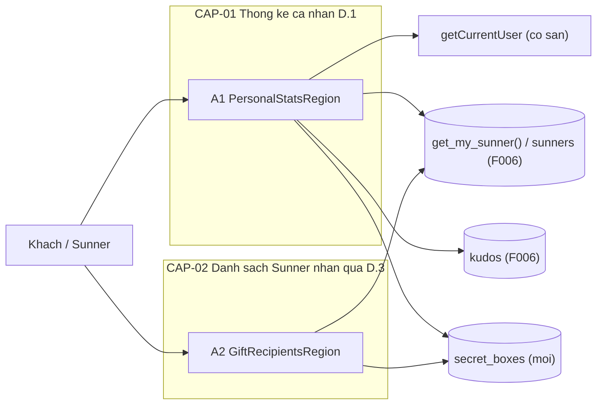
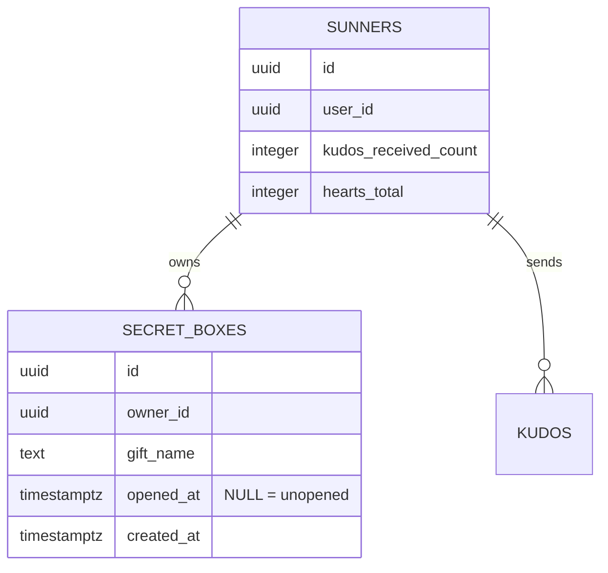

# F009_KudosPersonalSidebar — Technical Spec

**Priority**: P2
**Type**: ui
**Generated**: 2026-10-12

**See also:** [`functional-spec.md`](./functional-spec.md) — plain-language overview, open
decisions, requirements/business rules stated in one-liners, screens, user stories, scenarios,
edge cases, and configuration for a BA/QA audience.

**How to read this file:** § 2 is the index — pick the action you care about and read its block
in § 3 straight through; each block is one complete thread, top to bottom. § 4 is the shared
appendix — jump in only when a § 3 block points you there.

## 1. Technical Overview

Sidebar bên phải của `/sun-kudos` gồm hai vùng Server Component, mỗi vùng bọc `<Suspense>` riêng: vùng thống kê cá nhân (D.1) và danh sách 10 hộp quà đã mở gần nhất (D.3). D.1 gọi `getCurrentUser()` (đã có, dùng lại nguyên): khách thấy lời nhắc đăng nhập; người đã đăng nhập thì gọi hàm `get_my_sunner()` (do F006 tạo, `security definer`, chỉ trả hàng của chính người gọi) để lấy `id`, số kudos nhận và tổng tim, rồi đếm kudos đã gửi và Secret Box đã mở/chưa mở. D.3 đọc 10 hàng `secret_boxes` đã mở kèm tên và avatar của chủ hộp, cho cả khách. Feature thêm bảng `secret_boxes` (migration cộng thêm + seed), chỉ đọc `sunners` và `kudos` của Kudos Board Browse (kể cả cột tổng tim `hearts_total`, do F006 tạo và F007 bảo trì); không ghi gì vào dữ liệu nào lúc chạy. Phụ thuộc kiến trúc: vỏ trang, bảng `sunners`/`kudos`, cột tổng tim và hàm `get_my_sunner()` thuộc F006 (provisional); trigger giữ tổng tim thuộc F007 (provisional).



## 2. Action Index

| # | Action (handler) | Method · Path | Codes | Writes | Detail |
|---|---|---|---|---|---|
| **A0** | *cross-cutting — belongs to no single action* | — | FR-001, FR-101, FR-601, FR-602, BR-004 | — | § 4.4 |
| **A1** | `KudosPersonalStats#PersonalStatsRegion` (planned) | `GET` `/sun-kudos` *(vùng D.1 của trang)* | FR-201, FR-202, FR-203, FR-204, FR-205, FR-206, FR-207, FR-208, FR-209, FR-214, BR-001, BR-002, DEC-001, US054, US055 | — *(read-only)* | § 3.1 |
| **A2** | `KudosGiftRecipients#GiftRecipientsRegion` (planned) | `GET` `/sun-kudos` *(vùng D.3 của trang)* | FR-102, FR-210, FR-211, FR-212, FR-213, FR-215, BR-001, BR-003, DEC-002, US056, US057 | — *(read-only)* | § 3.2 |

**Rung set** — mọi block trong § 3 dùng đúng thứ tự: **Who** → **FE** → **Request** → **BE** → **Rule** → **Result** → **State** → **Source**; rung không có thì bỏ hẳn. Bản soạn trước khi có mã: tên *(planned)* và `**Source:**` `TBD (draft)` chưa đối chiếu lại, Stage 6 (2026-10-13) chỉ đối chiếu A1, A2 và § 5 (muốn có `path:line` chạy `/tkm:rebuild-spec --features F009`).

## 3. Actions

### 3.1 CAP-01 — Thống kê cá nhân (D.1)

#### A1 · Dựng khối thống kê cá nhân theo phiên
`GET /sun-kudos` *(vùng D.1 của trang)* → `` `KudosPersonalStats#PersonalStatsRegion` `` (planned)
`FR-201` `FR-202` `FR-203` `FR-204` `FR-205` `FR-206` `FR-207` `FR-208` `FR-209` `FR-214` `BR-001` `BR-002` `DEC-001` `US054` `US055` · `TBD (draft)`

**Who** · Khách và người dùng đã đăng nhập *(gate A0 — § 4.4: BR-004 — thống kê chỉ của chính người đăng nhập, FR-601)*
**FE** · Vùng D.1 nằm ở đầu cột sidebar, bọc `<Suspense>` riêng với khung giữ chỗ cố định, không chữ — cùng cách `AccountSlotSkeleton` (`app/_components/site/account-slot-parts.tsx:9-11`) — nên người đã đăng nhập không thấy lời nhắc đăng nhập nhấp nháy (FR-208). Khách: lời nhắc đăng nhập thay cho cả khối, gồm nút "Mở Secret Box" (FR-207): một dòng chữ và nút "Đăng nhập" (`next/link` tạo kiểu như nút "Đăng nhập" của header) tới `/login` (D001); chữ tạm, chờ người sở hữu nội dung: VN "Đăng nhập để xem thống kê Kudos của bạn" + "Đăng nhập", EN "Log in to see your Kudos stats" + "Login". Đã đăng nhập: bảng nhãn–giá trị theo thứ tự FR-201 (Số Kudos bạn nhận được, Số Kudos bạn đã gửi, Số tim bạn nhận được, đường kẻ, Số Secret Box bạn đã mở, Số Secret Box chưa mở) rồi nút "Mở Secret Box" là `<button>` không handler, không hộp thoại, không đổi số (FR-206). Nhãn lấy từ từ điển VN/EN (FR-214). Design basis: Study report (view stateless nhận chuỗi qua props, đặt dưới `app/_components/sun-kudos/`).
**Request** · cookie phiên Supabase và cookie `NEXT_LOCALE`; không có tham số nào từ URL hay trình duyệt chỉ ra "ai" (FR-601)
**BE** · `getCurrentUser()` (dùng lại, không đổi — `lib/supabase/current-user.ts:33-59`) trả `null` thì rẽ nhánh khách. Có người dùng thì `getKudosPersonalStats()` (`lib/kudos/get-kudos-personal-stats.ts`): (1) lấy hàng Sunner qua `getMySunnerPerRequest()` (`lib/kudos/get-my-sunner-per-request.ts`: bọc `cache()` của React nên RPC `get_my_sunner()` của F006 chỉ chạy một lần mỗi lần render trang, dùng chung với `getViewerSunnerId` của F006; không dùng cho Server Action hay Route Handler; khách nhận `guest` không gọi RPC; RPC chỉ trả hàng của `auth.uid()`, không có `email` hay `user_id`) lấy `id`, `kudos_received_count` (FR-202) và `hearts_total` (FR-204, BR-002); (2) `Promise.all` ba lệnh đếm `head: true, count: "exact"`: `kudos` có `sender_id = sunner.id` (FR-203), `secret_boxes` của chủ hộp ấy có `opened_at` khác rỗng (đã mở) và có `opened_at` rỗng (chưa mở) (FR-205). Theo mẫu getter hiện có: `await connection()` ngoài `try`, lỗi (kể cả không đọc được hàng Sunner) thì `console.error("[kudos-sidebar] ...")` và trả `{status: "unavailable"}` (mọi giá trị hiện "—"), `unstable_rethrow` đầu `catch`, không bao giờ ném ra; khách trả `{status: "guest"}` không truy vấn. Design basis: Study report + scout-report.
**Rule** · quyết định khối D.1 hiện gì, và hai quy tắc về nội dung số liệu:
- **BR-001 — Hộp "đã mở" khi có thời điểm mở, "chưa mở" khi thời điểm mở trống.** Hai số Secret Box ở FR-205 chỉ là hai phép đếm của cột này; không có cột đếm lưu riêng *(§ 4.4)*.
- **BR-002 — "Số tim bạn nhận được" lấy thẳng từ tổng tim của người gửi do Kudos Hearts giữ.** Sidebar không tự cộng lại từ lượt thích; giá trị này là tim người dùng kiếm được khi là người gửi, không phải tim trên kudos họ nhận (FR-204).

| DEC | subtype | Condition | What the user sees | Source |
|---|---|---|---|---|
| **DEC-001** | render | phiên/số liệu chưa đọc xong (đang trong `Suspense`) | khung giữ chỗ cố định, không chữ; chưa có lời nhắc đăng nhập, chưa có số (FR-208) | `TBD (draft)` |
| **DEC-001** | render | `getCurrentUser()` trả `null` | lời nhắc đăng nhập (dòng chữ + nút "Đăng nhập" tới `/login`); không số liệu, không nút "Mở Secret Box" (FR-207) | `TBD (draft)` |
| **DEC-001** | render | có người dùng và `getKudosPersonalStats` trả đủ số liệu | năm giá trị (0 hiện "0") và nút "Mở Secret Box" (FR-201, FR-206) | `TBD (draft)` |
| **DEC-001** | render | có người dùng nhưng `getKudosPersonalStats` trả `null` (lỗi đọc hoặc chưa có hàng Sunner) | năm giá trị hiện "—", nút "Mở Secret Box" vẫn có (FR-209) | `TBD (draft)` |

**Result** · read-only — **no DB write**. Hiện đúng một trong bốn trạng thái của DEC-001; không phân trang, không đếm lại sau khi hiển thị. Nhãn đổi theo VN/EN (FR-214); số liệu không đổi theo ngôn ngữ. Số liệu là ảnh chụp lúc tải trang, không cập nhật trực tiếp.
**Source:** `TBD (draft)`

<!-- No diagram: dưới ngưỡng — chỉ đọc, không ghi bảng nào, đồng bộ; nhánh rẽ nằm trong bảng DEC-001 (vẽ thành sơ đồ trình tự chỉ làm khó đọc). -->

---

### 3.2 CAP-02 — Danh sách Sunner nhận quà (D.3)

#### A2 · Dựng danh sách 10 hộp quà đã mở gần nhất
`GET /sun-kudos` *(vùng D.3 của trang)* → `` `KudosGiftRecipients#GiftRecipientsRegion` `` (planned)
`FR-102` `FR-210` `FR-211` `FR-212` `FR-213` `FR-215` `BR-001` `BR-003` `DEC-002` `US056` `US057` · `TBD (draft)`

**Who** · Khách và người dùng đã đăng nhập *(dữ liệu đọc công khai — FR-602, § 4.4)*
**FE** · Vùng D.3 bọc `<Suspense>` riêng; trong lúc chờ là khung giữ chỗ cùng kích thước, không chữ (FR-213). Tiêu đề "10 SUNNER NHẬN QUÀ MỚI NHẤT" rồi danh sách cuộn được trong cột sidebar; mỗi hàng là một `next/link` gồm avatar tròn 64px viền trắng 1.87px (`GiftRecipientAvatar`; `avatarUrl` đã qua `safeAvatarUrl`, chỉ nhận đường dẫn cục bộ dưới `/public`, không thì chữ cái đầu), tên Sunner đậm 22px màu `#FFEA9E`, dòng mô tả 16px trắng "Nhận được 1 <tên quà>" (FR-210). Đích liên kết do viewer quyết: đã đăng nhập → `/profiles/[id]` (trang dự kiến, hiện 404), khách → `/login` (FR-102). Tiêu đề và câu mô tả dịch theo VN/EN, tên Sunner và tên quà giữ nguyên như trong DB (FR-215). Design basis: Study report + MoMorph D.3.
**Request** · cookie phiên (chỉ để chọn đích liên kết) và cookie `NEXT_LOCALE`; không có tham số
**BE** · `getRecentGiftRecipients()` (`lib/kudos/get-recent-gift-recipients.ts`; giới hạn `KUDOS_GIFT_LIST_LIMIT`): `secret_boxes` chọn `id`, `gift_name`, `opened_at` kèm chủ hộp `sunners` (`id`, `full_name`, `avatar_url`), lọc `opened_at` khác rỗng, sắp `opened_at` giảm dần rồi `id` giảm dần, `limit` 10 (FR-211, BR-003). Cùng mẫu getter như A1 (lỗi → `[]`). Vùng gọi `getCurrentUser()` (dùng lại, `cache()` nên chung kết quả với A1) chỉ để chọn đích liên kết. Không dùng `use cache` (YAGNI): đích liên kết phụ thuộc người xem, và các getter hiện có đều đọc theo request (xem § 5.3 mục 4).
**Rule** · quyết định danh sách hiện gì:
- **BR-001 — Hộp "đã mở" khi có thời điểm mở, "chưa mở" khi thời điểm mở trống.** Danh sách này chỉ lấy hộp có thời điểm mở, nên hộp chưa mở không bao giờ lọt vào *(§ 4.4)*.
- **BR-003 — Danh sách là 10 hộp đã mở gần nhất, mỗi hộp một hàng, mới nhất trên cùng.** Một Sunner mở nhiều hộp gần đây thì xuất hiện nhiều hàng (functional-spec § 3, D003 đã chốt); hai hộp cùng thời điểm mở thì hộp có `id` lớn hơn xếp trước để thứ tự ổn định.

| DEC | subtype | Condition | What the user sees | Source |
|---|---|---|---|---|
| **DEC-002** | render | dữ liệu chưa đọc xong | khung giữ chỗ không chữ (FR-213) | `TBD (draft)` |
| **DEC-002** | render | danh sách rỗng (kể cả khi lỗi đọc) | tiêu đề và dòng "Chưa có dữ liệu" (FR-212) | `TBD (draft)` |
| **DEC-002** | render, flow | có hàng, viewer đã đăng nhập | các hàng liên kết `/profiles/[id]` (FR-102, FR-210) | `TBD (draft)` |
| **DEC-002** | render, flow | có hàng, viewer là khách | các hàng liên kết `/login` (FR-102) | `TBD (draft)` |

**Result** · read-only — **no DB write**. Hiện tối đa 10 hàng, ít hơn thì hiện bấy nhiêu. Bấm hàng là điều hướng thường của `next/link`; đích `/profiles/[id]` chưa có page nên 404 tới khi được xây, phiên giữ nguyên.
**Source:** `TBD (draft)`

<!-- No diagram: dưới ngưỡng — chỉ đọc một bảng, đồng bộ; nhánh rẽ nằm trong bảng DEC-002. -->

---

### 3.3 Edge cases

| Action | Scenario | Behavior |
|---|---|---|
| A1 | Người đã đăng nhập chưa có hàng `sunners` (trigger liên kết chưa chạy) hoặc truy vấn lỗi | `getKudosPersonalStats` trả `null`, log `[kudos-sidebar]`; năm giá trị hiện "—" (FR-209) |
| A1 | Người dùng chưa gửi/nhận kudos nào, chưa có hộp nào | các giá trị là 0 và hiện "0", không phải "—" (FR-209) |
| A1 | Một trong ba lệnh đếm lỗi, hai lệnh kia thành công | cả `getKudosPersonalStats` coi như lỗi (không hiện số lẫn lộn) → "—" |
| A1 · A2 | Phiên hết hạn giữa lúc xem | trang đã dựng giữ nguyên; lần tải kế `getCurrentUser()` trả `null` → D.1 là lời nhắc đăng nhập, D.3 trỏ `/login` |
| A2 | Có ít hơn 10 hộp đã mở | hiện bấy nhiêu hàng, không độn |
| A2 | Hộp có `owner_id` trỏ hàng `sunners` không còn | không xảy ra: khoá ngoại `on delete cascade` xoá hộp theo Sunner |
| A2 | Hai hộp cùng `opened_at` | sắp theo `id` giảm dần (BR-003) |
| A1-A2 | Người khác mở thêm hộp trong lúc đang xem | không cập nhật trực tiếp; thấy khi tải lại trang |
| A1-A2 | Cổng prelaunch (F005) đang đóng | cả `/sun-kudos` bị chặn như mọi trang; sidebar không có đường vào riêng nên không lộ dữ liệu |

## 4. Shared Foundation

### 4.1 Components

Tên là tên dự kiến; vị trí tệp dự kiến dưới `app/_components/sun-kudos/` (view stateless) và `lib/kudos/` (getter), quyết định ở bước promote.

| Component | Responsibility | Used in | File |
|---|---|---|---|
| `KudosSidebar` (planned) | đặt hai vùng vào cột phải, cuộn độc lập (FR-101) | A0 | `TBD (draft)` |
| `PersonalStatsRegion` + `PersonalStatsView` (planned) | rẽ nhánh DEC-001, dựng bảng nhãn–giá trị hoặc lời nhắc đăng nhập | A1 | `TBD (draft)` |
| `getKudosPersonalStats` (planned) | gọi `get_my_sunner()` và ba lệnh đếm cho người xem | A1 | `TBD (draft)` |
| `GiftRecipientsRegion` + `GiftRecipientsView` (planned) | rẽ nhánh DEC-002, dựng hàng liên kết | A2 | `TBD (draft)` |
| `getRecentGiftRecipients` (planned) | đọc 10 hộp đã mở mới nhất kèm chủ hộp | A2 | `TBD (draft)` |
| thành phần avatar dùng chung (F006) | avatar tròn, ảnh dự phòng chữ cái đầu | A2 | `TBD (draft)` |
| nhãn `kudos.sidebar` trong từ điển (planned) | nhãn VN/EN cho D.1, tiêu đề và câu mô tả D.3 | A1, A2 | `lib/i18n/dictionary.ts` *(mở rộng, chưa có)* |

### 4.2 Data Model



Tên bảng, cột là tên tạm từ Study; `sunners`, `kudos` và hai cột đếm do F006, F007 sở hữu và đổi tên được lúc promote. `secret_boxes` là bảng duy nhất mới của feature (migration cộng thêm, đặt tên theo quy ước `YYYYMMDDHHMMSS_create_secret_boxes.sql`, có `-- ROLLBACK STRATEGY` và seed idempotent dưới `supabase/seeds/common/`).

#### Key Entities

| Entity | Table | Key Columns | Purpose |
|--------|-------|-------------|---------|
| `Sunner` (F006 tạo, F007 bảo trì tổng tim — chỉ đọc) | `sunners` | `id`, `full_name`, `avatar_url`, `kudos_received_count`, `hearts_total` (`user_id` và `email` không mở cho client) | định danh người xem qua `get_my_sunner()`; nguồn số kudos nhận, tổng tim, tên và avatar ở D.3 (A1, A2) |
| `Kudos` (F006 — chỉ đọc) | `kudos` | `id`, `sender_id` | đếm kudos đã gửi (A1) |
| `SecretBox` (mới) | `secret_boxes` | `id` (khoá chính), `owner_id` (khoá ngoại `sunners`, `on delete cascade`), `gift_name` (text, not null), `opened_at` (timestamptz, null = chưa mở), `created_at` | số Secret Box đã mở/chưa mở (A1), danh sách quà (A2) |

**Quyền truy cập `secret_boxes` (Design basis: Study report — chưa có migration):** bật RLS; `revoke all ... from public, anon, authenticated`; `grant select` cho `anon`, `authenticated`; `grant select, insert, update, delete` cho `service_role`. Hai policy chọn (đã chốt: hộp đã mở đọc công khai, hộp chưa mở chỉ chủ hộp đọc): `secret_boxes_select_opened_public` (cho `anon`, `authenticated`) với điều kiện `opened_at is not null`; `secret_boxes_select_own` (cho `authenticated`) với điều kiện `owner_id = (select id from public.get_my_sunner())` — dùng hàm `security definer` của F006 vì `sunners.user_id` không cấp cho client. Không cấp quyền ghi cho client (FR-602). Chỉ mục dự kiến: `(owner_id)` và `(opened_at desc, id desc)` một phần khi `opened_at is not null`.

#### Polymorphic Behavior

N/A — no discriminator fields in Key Entities.

### 4.3 State Management

None.

### 4.4 Shared Rules

#### Bin 3 — cross-cutting, belongs to no single action

**A0 · FR-601 / BR-004 — Thống kê cá nhân chỉ của chính người đang đăng nhập, do máy chủ quyết.**
Mã người dùng lấy từ `getCurrentUser()` (claims JWT đã xác minh), không bao giờ từ tham số URL, cookie tự khai hay dữ liệu trình duyệt gửi. Khách không có truy vấn thống kê nào được chạy. Ẩn D.1 với khách chỉ là giao diện; ranh giới thật là RLS `secret_boxes_select_own` và việc getter chỉ truy vấn theo mã của phiên. Áp cho cả A1 (chỗ duy nhất đọc dữ liệu riêng).
**Source:** `TBD (draft)`

**A0 · FR-602 — Trình duyệt không ghi được dữ liệu Secret Box; hộp chưa mở của người khác không đọc được.**
Không cấp `insert/update/delete` cho `anon`/`authenticated`; policy đọc công khai chỉ thấy hàng có `opened_at` khác rỗng; policy đọc riêng chỉ trả hộp của chính người dùng (kể cả chưa mở). Đổi `opened_at` (mở hộp) chỉ có đường `service_role`, và hiện không có luồng nào làm việc đó (ngoài phạm vi).
**Source:** `TBD (draft)`

**A0 · FR-001 / FR-101 — Dữ liệu nền và vị trí sidebar.**
FR-001: một bảng `secret_boxes` seed duy nhất, mỗi hộp một chủ, tên quà, thời điểm mở (xem § 4.2). FR-101: sidebar là cột phải cạnh All Kudos, khối D.1 đứng trên D.3, cuộn độc lập; vỏ trang và bố cục hai cột do F006 sở hữu, F009 chỉ cấp nội dung của cột.
**Source:** `TBD (draft)`

#### Bin 2 — used by ≥2 named actions

**BR-001 — Hộp "đã mở" khi có thời điểm mở, "chưa mở" khi thời điểm mở trống.**
Used in: **A1** · **A2**. A1 đếm hộp của chính người dùng theo hai nhánh của điều kiện này (FR-205); A2 chỉ lấy nhánh "đã mở" (FR-211). Không có cờ `opened` hay cột đếm riêng, nên hai số ở D.1 và danh sách ở D.3 không thể lệch nhau.
**Source:** `TBD (draft)`
```text
isOpened(box)  = box.opened_at IS NOT NULL
openedCount    = COUNT(boxes WHERE owner = me AND isOpened)        # A1
unopenedCount  = COUNT(boxes WHERE owner = me AND NOT isOpened)    # A1
giftList       = boxes WHERE isOpened
                 ORDER BY opened_at DESC, id DESC LIMIT 10         # A2
```

### 4.5 Algorithms & Integrations

None.

### 4.6 Configuration

```text
KUDOS_GIFT_LIST_LIMIT = 10   # số hộp đã mở hiển thị ở danh sách quà (A2, FR-211); hằng số trong mã, không phải biến môi trường
```

Không có biến môi trường hay cờ tính năng mới; hạ tầng Supabase dùng lại cấu hình sẵn có.

**Client behavior:** see behavior-logic.md, permissions.md, architecture.md

## 5. Verification & Technical Notes

### 5.1 Technical Verification

Chính sách kiểm thử: `e2e-red-first` (clarifications). Các ca sau viết RED trước khi có mã, dùng `@playwright/test` hiện có; ca quyền DB đi theo kiểu `supabase-schema-rls-*.spec.ts` (client `anon` và client người dùng, khẳng định `/permission|denied|rls/`). Tên tệp dự kiến theo vùng: `e2e/sun-kudos-sidebar-*.spec.ts`.

- **SC-001** *(A1)* khách mở `/sun-kudos` thấy lời nhắc đăng nhập (dòng chữ và nút "Đăng nhập" có `href` `/login`, bấm tới màn hình đăng nhập) và không thấy nhãn thống kê, số, nút "Mở Secret Box" (covers FR-207, DEC-001, D001)
- **SC-002** *(A1)* người dùng seed đã đăng nhập thấy năm giá trị khớp DB và nút "Mở Secret Box" bấm không đổi gì (covers FR-201, FR-202, FR-203, FR-204, FR-205, FR-206, BR-001, BR-002)
- **SC-003** *(A1)* người dùng đã đăng nhập chưa có hàng Sunner (hoặc truy vấn lỗi) thấy năm dấu "—", người dùng có dữ liệu bằng 0 thấy "0" (covers FR-209, DEC-001)
- **SC-004** *(A1)* trong lúc đọc phiên không có chữ "Đăng nhập" nhấp nháy với người đã đăng nhập (covers FR-208)
- **SC-005** *(A2)* danh sách có đúng 10 hàng khi seed ≥ 10 hộp đã mở, mới nhất trên cùng, không có hộp chưa mở (covers FR-210, FR-211, BR-003)
- **SC-006** *(A2)* không có hộp đã mở thì hiện "Chưa có dữ liệu" (covers FR-212, DEC-002)
- **SC-007** *(A2)* bấm hàng: đã đăng nhập tới `/profiles/[id]`, khách tới `/login` (covers FR-102)
- **SC-008** *(A0)* RLS: `anon` không đọc được hộp chưa mở, người dùng chỉ đọc hộp chưa mở của chính mình, không ai ghi được từ client; `anon` gọi `rpc('get_my_sunner')` bị từ chối và người dùng đã đăng nhập chỉ nhận hàng của chính mình (covers FR-602, BR-004, FR-601)
- **SC-009** *(A1, A2)* nhãn đổi VN/EN, tên Sunner và tên quà không đổi (covers FR-214, FR-215)

#### US054 *(A1)*

**Independent Test:** đăng nhập bằng người dùng seed đã biết số liệu, mở `/sun-kudos`, đọc khối D.1.

**Acceptance Scenarios:**

1. **Given** người dùng seed có K kudos nhận, G kudos gửi, H tim kiếm được, O hộp đã mở và U hộp chưa mở, **When** mở `/sun-kudos`, **Then** năm giá trị là K, G, H, O, U theo đúng thứ tự FR-201.
2. **Given** cùng người dùng, **When** bấm "Mở Secret Box", **Then** không có hộp thoại, không điều hướng, số liệu không đổi.

#### US055 *(A1)*

**Independent Test:** mở `/sun-kudos` không có phiên.

**Acceptance Scenarios:**

1. **Given** chưa đăng nhập, **When** mở `/sun-kudos`, **Then** D.1 là lời nhắc đăng nhập có nút "Đăng nhập" tới `/login`, không có số hay nút "Mở Secret Box".

#### US056 *(A2)*

**Independent Test:** seed N hộp đã mở với `opened_at` khác nhau cộng một số hộp chưa mở, mở `/sun-kudos` ở cả hai trạng thái phiên.

**Acceptance Scenarios:**

1. **Given** ≥ 10 hộp đã mở, **When** mở `/sun-kudos`, **Then** D.3 hiện 10 hàng đúng thứ tự `opened_at` giảm dần, mỗi hàng có avatar, tên và "Nhận được 1 <tên quà>".
2. **Given** không có hộp đã mở, **When** mở `/sun-kudos`, **Then** hiện "Chưa có dữ liệu".

#### US057 *(A2)*

**Independent Test:** đọc thuộc tính `href` của một hàng D.3 ở hai trạng thái phiên.

**Acceptance Scenarios:**

1. **Given** đã đăng nhập, **When** bấm một hàng, **Then** trình duyệt tới `/profiles/[id]` của Sunner đó (404 tới khi trang được xây).
2. **Given** khách, **When** bấm một hàng, **Then** trình duyệt tới `/login`.

### 5.2 Assumptions

- *(A1, A2)* tên bảng và cột (`sunners`, `kudos`, `kudos_received_count`, `hearts_total`, `sender_id`) và tên hàm `get_my_sunner()` là tên tạm; sẽ đổi theo migration thật của F006, F007 lúc promote. `hearts_total` do F006 tạo (mặc định 0); F007 chỉ bảo trì.
- *(A1)* mỗi tài khoản đăng nhập có đúng một hàng `sunners` nhờ trigger liên kết/tạo của F006, nên "chưa có hàng Sunner" hiếm; bản nháp vẫn xử lý bằng "—" để không vỡ trang.
- *(A2)* feature-list nháp nhắc bảng `gifts`; quyết định ở clarifications (một bảng `secret_boxes` có `gift_name`) thay thế, nên spec này không có bảng `gifts`.
- *(A1, A2)* hero badge và sao không xuất hiện ở sidebar (clarifications: chỉ hiện ở thẻ và khối người gửi/người nhận).
- *(A1, A2)* không có cập nhật trực tiếp: số liệu là ảnh chụp lúc tải trang (YAGNI, không dùng Realtime).

### 5.3 Unresolved Questions

1. **Cấp cột `sunners.user_id` cho `authenticated`** *(A1, A0)* — **đã chốt** (clarifications.md, spec gaps): không cấp; `sunners.email` và `sunners.user_id` không mở cho client, A1 và policy `secret_boxes_select_own` dùng hàm `security definer` `get_my_sunner()` của F006 chỉ trả hàng của người gọi. Không còn câu hỏi mở.
2. **Chỉ mục `kudos(sender_id)` và cột đếm gửi** *(A1)* — **đã chốt**: F006 sở hữu chỉ mục `kudos_sender_id_idx` (migration `20261012072146_create_kudos_board.sql`); đếm kudos đã gửi dùng lệnh đếm chính xác, không có cột `kudos_sent_count`.
3. **Ba lệnh đếm mỗi request so với một RPC/view** *(A1)*: chấp nhận ba lệnh song song ở quy mô hiện tại (dưới vài nghìn hộp); chưa đo.
4. **`use cache` cho D.3** *(A2)*: bỏ ở bản này vì đích liên kết phụ thuộc người xem; xem lại nếu tải đọc tăng (tách danh sách công khai khỏi chọn đích).
5. **Avatar `` hay `next/image`** *(A2)* — **đã chốt** (clarifications 2026-10-13, M1): avatar chỉ là đường dẫn cục bộ dưới `/public` (`next/image`); URL ngoài, kể cả Google, không được nhúng. `sunners.avatar_url` có CHECK cục bộ và `safeAvatarUrl` lọc lần nữa ở phía đọc (F006 § 4.2); giá trị không hợp lệ thì hiện chữ cái đầu.

### 5.4 Source References

Mã đã giao: `lib/kudos/get-kudos-personal-stats.ts`, `lib/kudos/get-my-sunner-per-request.ts`, `lib/kudos/get-recent-gift-recipients.ts`, `lib/kudos/sidebar-mapping.ts`, `app/sun-kudos/_components/` (`kudos-sidebar.tsx`, `personal-stats-region.tsx`, `gift-recipients-region.tsx`), `app/_components/sun-kudos/sidebar/`, `supabase/migrations/20261012072258_create_secret_boxes.sql`. Mã có sẵn dùng lại không đổi: `getCurrentUser` ở `lib/supabase/current-user.ts` (F003) và `createClient` ở `lib/supabase/server.ts`.

#### Data Flow

```text
A1: cookie phiên -> getMySunnerPerRequest (cache() của React: một RPC mỗi lần render, chung với F006) -> (guest: lời nhắc đăng nhập | có người dùng)
    -> get_my_sunner() (chỉ hàng của auth.uid()) -> {id, kudos_received_count, hearts_total}
    -> 3 lệnh đếm (kudos.sender_id, secret_boxes mở / chưa mở) -> 5 giá trị hoặc "—"
A2: secret_boxes WHERE opened_at IS NOT NULL ORDER BY opened_at DESC, id DESC LIMIT 10
    + chủ hộp sunners -> hàng {avatar, tên, "Nhận được 1 <quà>", href theo viewer} hoặc "Chưa có dữ liệu"
```

### 5.5 Artifact References

| Artifact | File | Codes Used | Reviewed |
|----------|------|------------|----------|
| Feature List | [feature-list.md](../../generated/feature-list.md) | F009 | [x] |
| Screens | [functional-spec.md § 6](./functional-spec.md#6-screens) | SCR006_SunKudosLiveBoard (vùng sidebar) | [ ] |
| Entities | [entities.md](../../generated/entities.md) | MODEL013, MODEL006 | [ ] |
| User Stories | [functional-spec.md § 7](./functional-spec.md#7-user-stories) | US054..US057 (chưa có trong user-stories.md) | [ ] |
