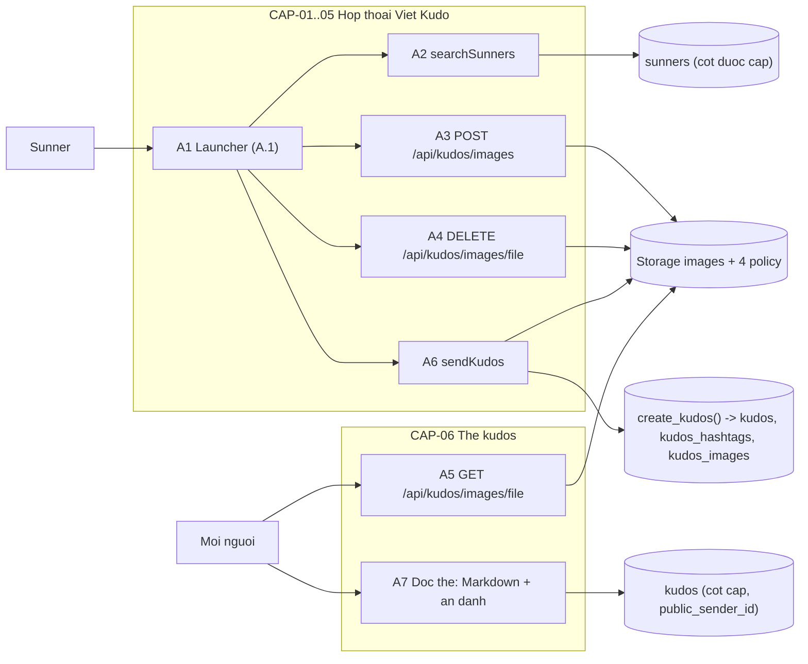
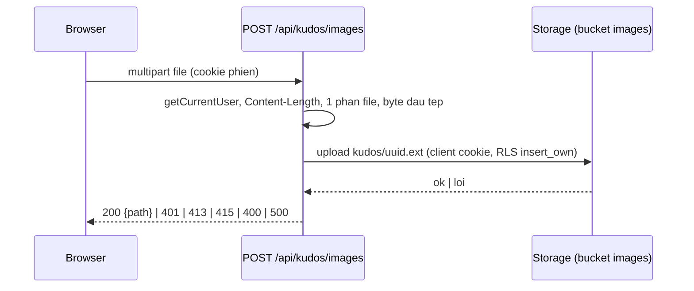
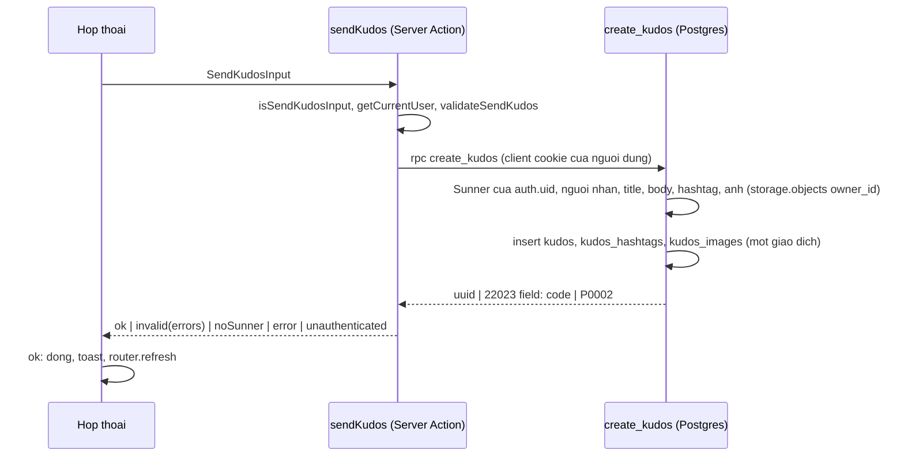
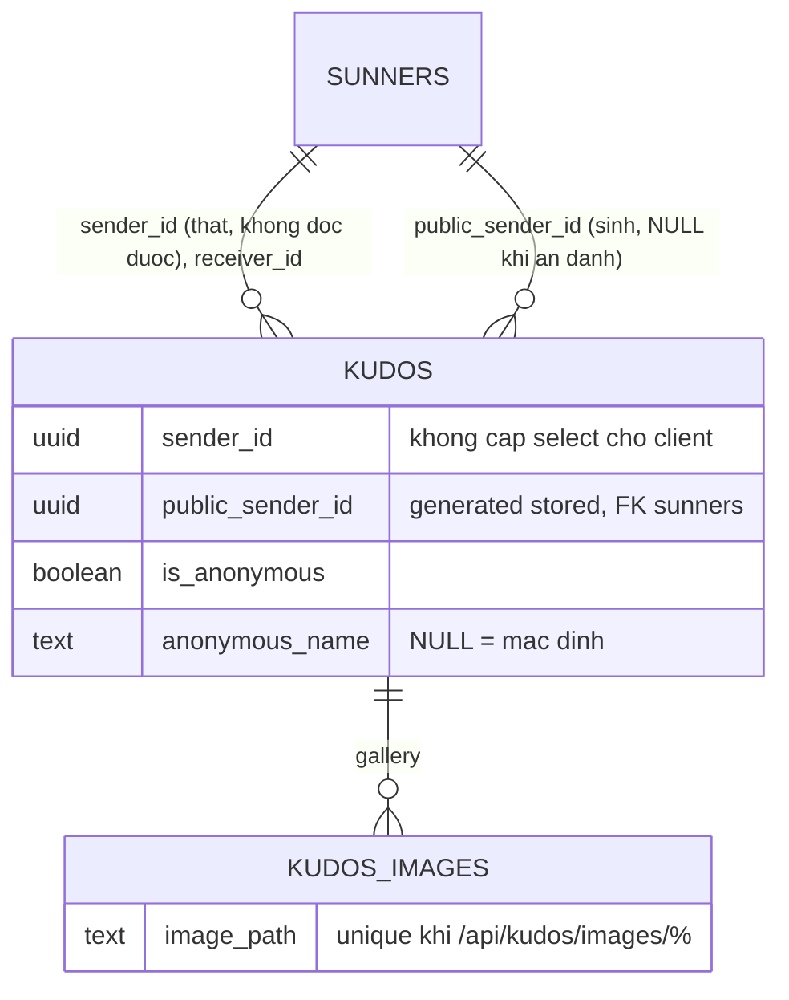

# F010_KudosWrite — Technical Spec

**Priority**: P1
**Type**: ui
**Generated**: 2026-10-14

**See also:** [`functional-spec.md`](./functional-spec.md) — tổng quan, quyết định đã chốt, yêu cầu và luật nghiệp vụ dạng một dòng, màn hình, user story, kịch bản, ca biên và cấu hình cho BA/QA.

**How to read this file:** § 2 là chỉ mục — chọn hành động cần đọc rồi đọc trọn khối của nó ở § 3 (mỗi khối là một mạch từ trên xuống dưới). § 4 là phụ lục dùng chung, chỉ vào khi khối § 3 trỏ tới.

> **Ghi chú nguồn:** spec được promote lúc giao (Stage 6, 2026-10-14), viết từ bản nháp tối thiểu, `clarifications.md` và mã đã giao nên `**Source:**` ghi theo tệp thật (số dòng chỉ ở nơi đã kiểm). Muốn `path:line` cho từng ca, chạy `/tkm:rebuild-spec --features F010`.

## 1. Technical Overview

Hộp thoại "Viết Kudo" là một Client Component mở từ thanh gửi kudos A.1 của `/sun-kudos`. Server Component `WriteKudosLauncherRegion` (bọc `<Suspense>` riêng, fallback là nút inert) đọc người xem và danh sách hashtag (cho mọi người, kể cả khách); client `WriteKudosLauncher` giữ trạng thái mở; khách chưa có phiên thì gọi trước Server Action `ensureGuestSession` (phiên ẩn danh Supabase, plan 261014-1505-guest-anonymous-access). Hộp thoại gọi ba đầu mối phía máy chủ: Server Action `searchSunners` (gợi ý người nhận và `@tên`), route `POST|DELETE /api/kudos/images` (tải và xoá nháp ảnh), và Server Action `sendKudos`, gọi hàm Postgres `create_kudos` bằng client cookie của chính người dùng. `create_kudos` (`security definer`) kiểm lại mọi luật rồi ghi `kudos`, `kudos_hashtags`, `kudos_images` trong một giao dịch. Ảnh nằm trong bucket riêng `images` ở Storage với bốn policy trên `storage.objects` (hai policy gọi hàm `kudos_image_is_attached`); `GET /api/kudos/images/[file]` phục vụ ảnh đã gắn bằng client không cookie (vai `anon`). Ẩn danh thật: cột `kudos.sender_id` bị rút khỏi quyền `select` của `anon`/`authenticated`; trình duyệt đọc người gửi qua cột sinh `public_sender_id` (rỗng khi ẩn danh); tổng tim `sunners.hearts_total` cũng bị thu `select` (review round 2, C2) nên lượt thích không lộ người gửi, còn tim vẫn cộng cho người gửi. Phía đọc, `KUDOS_CARD_COLUMNS` nhúng `sender:sunners!public_sender_id`, `toKudosCard` ánh xạ `sender: null` + `senderAlias` và phân tích `body` thành `bodyBlocks`, thẻ dựng bằng phần tử React. Khách hoạt động như "Anonymous": phiên ẩn danh có hồ sơ Sunner khách (`sunners.is_guest`, tạo bởi trigger `create_guest_sunner`); `create_kudos` ép kudos của hồ sơ khách luôn ẩn danh và từ chối hồ sơ khách làm người nhận, `searchSunners` loại hồ sơ khách. Sidebar F009 đếm kudos đã gửi qua RPC `get_my_sent_kudos_count()`. Phụ thuộc: F006 (vỏ trang, thẻ, bảng, `get_my_sunner`), F007 (trigger tim dùng `sender_id`), F009 (số đã gửi).



## 2. Action Index

| # | Action (handler) | Method · Path | Codes | Writes | Detail |
|---|---|---|---|---|---|
| **A0** | *cross-cutting — belongs to no single action* | — | FR-001, FR-002, FR-003, FR-601, FR-602, FR-604, BR-002, BR-006 | — | § 4.4 |
| **A1** | `WriteKudosLauncher` (`app/_components/write-kudos-behaviour/write-kudos-launcher.tsx`) | `GET` `/sun-kudos` *(thanh A.1)* | FR-101, FR-102, FR-103, FR-104, FR-105, FR-201, FR-209, FR-301, DEC-001, US058, US059 | — *(chỉ trạng thái client)* | § 3.1 |
| **A2** | `searchSunners` (`lib/kudos/send-kudos-action.ts`) | `POST` `/sun-kudos` `[Next-Action: searchSunners]` (ROUTE020) | FR-202, FR-205, FR-606, US059 | — *(read-only)* | § 3.2 |
| **A3** | `POST` Route Handler (`app/api/kudos/images/route.ts`) | `POST` `/api/kudos/images` (ROUTE016) | FR-002, FR-207, FR-603, US060 | Storage: một đối tượng `kudos/<uuid>.<ext>` | § 3.3 |
| **A4** | `DELETE` Route Handler (`app/api/kudos/images/[file]/route.ts`) | `DELETE` `/api/kudos/images/<uuid>.<ext>` (ROUTE018) | FR-103, FR-207, FR-604, US060 | Storage: xoá nháp của chính chủ | § 3.4 |
| **A5** | `GET` Route Handler (cùng tệp A4) | `GET` `/api/kudos/images/<uuid>.<ext>` (ROUTE017) | FR-002, FR-604, US063 | — *(read-only)* | § 3.5 |
| **A6** | `sendKudos` (`lib/kudos/send-kudos-action.ts`) → RPC `create_kudos` | `POST` `/sun-kudos` `[Next-Action: sendKudos]` (ROUTE019) | FR-203..FR-208, FR-301..FR-305, FR-601, FR-606, BR-001..BR-006, DEC-002, US061, US062 | `kudos`, `kudos_hashtags`, `kudos_images` | § 3.6 |
| **A7** | `toKudosCard` + `KudosCardView` (F006, đổi ở F010) | `GET` `/sun-kudos`, `GET` `/api/kudos` | FR-401, FR-402, FR-403, FR-602, FR-605, DEC-003, US062, US063 | — *(read-only)* | § 3.7 |

**Rung set** — mọi block trong § 3 dùng đúng thứ tự: **Who** → **FE** → **Request** → **BE** → **Rule** → **Result** → **State** → **Source**; rung không có thì bỏ hẳn.

## 3. Actions

### 3.1 CAP-01, CAP-02 — Mở và soạn trong hộp thoại

#### A1 · Mở hộp thoại từ thanh gửi kudos
`GET /sun-kudos` *(thanh A.1)* → `` `WriteKudosLauncher` ``
`FR-101` `FR-102` `FR-103` `FR-104` `FR-105` `FR-201` `FR-209` `FR-301` `DEC-001` `US058` `US059` · `app/_components/write-kudos-behaviour/write-kudos-launcher.tsx:29`

**Who** · Khách (chưa có phiên, hoặc có phiên ẩn danh) và người đã đăng nhập *(không có kiểm tra quyền riêng; ranh giới thật ở A2/A3/A6, § 4.4)*
**FE** · `SunKudosContent` truyền vào `KudosSendBar` thuộc tính `sendButton` = `<Suspense fallback={<KudosSendButton .../>}><WriteKudosLauncherRegion .../></Suspense>`; fallback là nút inert (server) nên A.1 vẫn hiện trong lúc chờ. `WriteKudosLauncher` render `KudosSendButton` có `onClick`: có phiên (`signedIn`) → `setOpen(true)`; chưa có phiên → `await startGuestSessionOnce()` (`lib/supabase/start-guest-session-once.ts`, bọc `ensureGuestSession`) rồi `setOpen(true)`, lỗi thì toast `toast.guestSessionFailed` và không mở (DEC-001). Launcher nhận thêm `anonymousOnly` (= `!signedIn || isAnonymous`, tức mọi người không phải tài khoản đăng nhập) và truyền xuống `WriteKudosModal` thành `anonymousLocked`; `useWriteKudosForm` tính `isAnonymous = anonymousLocked || anonymousChosen`, `WriteKudosAnonymousField` hiện hộp tick, `disabled`, `aria-describedby` trỏ tới gợi ý `anonymous.lockedHint` (VN "Bạn chưa đăng nhập nên Kudos sẽ được gửi ẩn danh.", EN "You are not logged in, so your Kudos will be sent anonymously.") (FR-208). `WriteKudosModal` chỉ được gắn khi mở nên đóng là bỏ sạch trạng thái (FR-103); nó dựng `createPortal` vào `document.body`, `useModalBehaviour` chuyển tiêu điểm vào hộp thoại, khoá cuộn `body`, bẫy Tab và trả tiêu điểm về nút mở (FR-102). `WriteKudosModalView` là `role="dialog"` `aria-modal`, Escape (khi chưa bị popup bên trong xử lý) và Hủy đều gọi `onCancel`. `useWriteKudosForm` gom bốn hook con (`useRecipientField`, `useBodyEditor`, `useKudosImageUploads`, trạng thái hashtag/ẩn danh) và tính lỗi: lỗi hiện khi trường đã `blur`, riêng `tooLong` hiện ngay (FR-209); `canSubmit` chỉ bật khi bốn trường bắt buộc hợp lệ và không còn ảnh đang tải (FR-301). Thanh công cụ gọi `applyMarkdownFormat`; nút Liên kết dùng `window.prompt`. Chữ lấy từ `writeKudosCopy[locale]` (FR-105). Liên kết "Tiêu chuẩn cộng đồng" là `href="/standards"` (`app/_components/write-kudos/write-kudos-editor.tsx:68`).
**Request** · cookie `NEXT_LOCALE` và phiên (để `WriteKudosLauncherRegion` biết `signedIn`, `viewerSunnerId`); không có tham số URL
**BE** · `WriteKudosLauncherRegion` (`app/sun-kudos/_components/write-kudos-launcher-region.tsx`) `await viewer` song song với `getHashtagRowsPerRequest()` (dùng chung `cache()` với bộ lọc F006) → `keepValid(... isHashtagRow)` → `{slug, label}` cho mọi người, vì cú bấm của khách cũng mở hộp thoại; lỗi đọc ghi log `[write-kudos]` và để picker rỗng (Gửi luôn tắt). `anonymousOnly={!signedIn || isAnonymous}`.
**Rule** · quyết định mở hay chuyển trang:

| DEC | subtype | Condition | What the user sees | Source |
|---|---|---|---|---|
| **DEC-001** | flow | `signedIn` (có phiên: tài khoản hoặc phiên ẩn danh) | hộp thoại mở, tiêu điểm trong hộp thoại | `write-kudos-launcher.tsx` |
| **DEC-001** | flow | khách chưa có phiên | mở phiên ẩn danh rồi mở hộp thoại (hộp ẩn danh tick sẵn, khoá); không sang `/login` | `write-kudos-launcher.tsx` |
| **DEC-001** | flow | mở phiên ẩn danh lỗi | toast `toast.guestSessionFailed`, không có hộp thoại | `write-kudos-launcher.tsx` |

**Result** · không ghi gì. Mở: hộp thoại trống; đóng (Hủy, Escape): bỏ toàn bộ trạng thái và xoá các nháp ảnh chưa gửi (A4).
**Source:** `app/_components/write-kudos-behaviour/{write-kudos-launcher,write-kudos-modal,use-modal-behaviour,use-write-kudos-form,use-body-editor,use-recipient-field}.ts(x)`, `app/_components/write-kudos/write-kudos-modal-view.tsx`, `app/sun-kudos/_components/{write-kudos-launcher-region,sun-kudos-content}.tsx`

<!-- No diagram: dưới ngưỡng — chỉ trạng thái client, một nhánh rẽ ở bảng DEC-001. -->

---

#### A2 · Tìm người nhận và gợi ý `@tên`
`POST /sun-kudos [Next-Action: searchSunners]` (ROUTE020) → `` `searchSunners` ``
`FR-202` `FR-205` `FR-606` `US059` · `lib/kudos/send-kudos-action.ts:104`

**Who** · Người có phiên (tài khoản hoặc phiên ẩn danh); người chưa có phiên nhận `[]` *(§ 4.4: FR-606)*
**FE** · `useSunnerSearch(query, excludeId)` (`app/_components/write-kudos-behaviour/use-sunner-search.ts`): bỏ khoảng trắng đầu cuối, rỗng thì không tìm, debounce 200 ms, bỏ qua câu trả lời cũ (`stale`), lọc bỏ `excludeId` (người gửi) khỏi kết quả. `useBodyMentions` dùng cùng hook với mẫu `(?:^|\s)@([^\n@]{0,40})$` trước con trỏ; chọn thì thay `@từ-khoá` bằng `@Họ tên ` (chữ thường, không thông báo).
**Request** · tham số `query: string`
**BE** · `q = query.trim()`; rỗng hoặc dài hơn 100 → `[]`. `getCurrentUser()` null → `[]`. `createClient()` (cookie của người dùng) `.from("sunners").select("id,full_name,department_code,avatar_url").ilike("full_name", "%<q thoát>%").eq("is_guest", false).order("full_name").order("id").limit(10)`. `escapeLikePattern` thoát `\ % _ *` (PostgREST đổi mọi `*` thành `%`). Kết quả qua `toSunnerOptions`: bỏ hàng sai kiểu, `avatarUrl` qua `safeAvatarUrl`. Mọi lỗi → log mã, trả `[]`; `unstable_rethrow` đầu `catch`.
**Rule** · không có luật nghiệp vụ riêng; khớp theo D009.
**Result** · read-only — **no DB write**. Trả tối đa 10 `SunnerOption {id, name, department, avatarUrl}`; "@ # $" không khớp tên nào nên trả `[]`.
**Source:** `lib/kudos/send-kudos-action.ts:104-151`, `app/_components/write-kudos-behaviour/{use-sunner-search,use-body-mentions,use-recipient-field}.ts`

<!-- No diagram: dưới ngưỡng — một truy vấn đọc, đồng bộ. -->

---

### 3.2 CAP-03 — Ảnh đính kèm

#### A3 · Tải một ảnh lên
`POST /api/kudos/images` (ROUTE016) → `` `POST` `` Route Handler
`FR-002` `FR-207` `FR-603` `US060` · `app/api/kudos/images/route.ts:35`

**Who** · Người đã đăng nhập *(gate A0 — § 4.4: FR-603, FR-604)*
**FE** · `useKudosImageUploads` (`use-kudos-image-uploads.ts`): mỗi tệp qua `validateImageFile` (UX: MIME hoặc đuôi `.jpg/.jpeg/.png`, ≤ 5 MiB, tối đa 5 ảnh) rồi vào hàng đợi tuần tự `POST /api/kudos/images` (`multipart/form-data`, một trường `file`); có ảnh nhỏ bằng object URL trong lúc tải; lỗi thì bỏ ảnh nhỏ và đặt `error` (role="alert").
**Request** · `multipart/form-data` đúng một phần `file`; cookie phiên
**BE** · `getCurrentUser()` null → 401 `{error:"unauthenticated"}`. `Content-Length` lớn hơn 5 MiB + 64 KiB → 413 `fileTooLarge` trước khi đọc thân. `readSingleFile` (đúng một phần `file` kiểu `File`, nếu không → 400 `uploadFailed`); `file.size` > 5 MiB → 413. `sniffKudosImageType(bytes)` (`FF D8 FF` hoặc chữ ký PNG) null → 415 `invalidFileType`; MIME và tên tệp bị bỏ qua. Tên đối tượng `randomUUID().<jpg|png>`, `supabase.storage.from("images").upload("kudos/<tên>", bytes, {contentType, cacheControl: "31536000", upsert: false})` bằng client cookie của người dùng (không `service_role`). Lỗi Storage → log, 500 `uploadFailed`. Thành công → 200 `{path: "/api/kudos/images/<tên>"}`. Mọi phản hồi `Cache-Control: no-store`. Tên không chứa người tải: Storage tự ghi `owner_id`.
**Rule** · quy tắc kiểu tệp và kích thước (BR-004 bắt đầu từ đây: ảnh phải là đối tượng của chính người gửi):
- **FR-603 — Loại tệp quyết định bằng byte đầu tệp, giới hạn 5 MiB.** Policy `kudos_images_objects_insert_own` là chốt cuối: tên đúng dạng `kudos/<uuid>.<jpg|png>` và `owner_id = auth.uid()` *(§ 4.4)*.
**Result** · ghi một đối tượng vào Storage (một "nháp": chưa tham chiếu bởi `kudos_images`). Proxy chạy cho đường này (không có dấu chấm) để làm mới phiên, không bao giờ chuyển hướng `POST`.
**Source:** `app/api/kudos/images/route.ts:35-84`, `lib/kudos/kudos-image-files.ts`, `supabase/migrations/20261014004600_create_kudos_images_storage.sql:57-65`



---

#### A4 · Xoá nháp ảnh
`DELETE /api/kudos/images/<uuid>.<ext>` (ROUTE018) → `` `DELETE` `` Route Handler
`FR-103` `FR-207` `FR-604` `US060` · `app/api/kudos/images/[file]/route.ts:93`

**Who** · Người đã đăng nhập, chỉ với nháp của chính mình *(§ 4.4: FR-604)*
**FE** · `discardDraft(path)`: `fetch(path, {method:"DELETE", keepalive:true})`, gọi khi xoá ảnh nhỏ, khi hộp thoại đóng mà chưa gửi (cleanup của hook), hoặc khi ảnh tải xong sau lúc đã bị bỏ. `markSent` giữ lại các ảnh vừa gửi (đã gắn). Lỗi chỉ ghi log.
**Request** · `file` ở đường dẫn
**BE** · `isKudosImageFileName(file)` sai dạng → 404. `getCurrentUser()` null → 401. `supabase.storage.from("images").remove(["kudos/<file>"])` bằng client cookie: policy `delete_own_draft` + `select_own` quyết định (chủ sở hữu, và chưa có dòng `kudos_images` tham chiếu). `data` rỗng → 404 (không tồn tại, của người khác, hoặc đã gắn); có → 204; lỗi khác → 502.
**Rule** · ảnh đã gắn kudos không xoá được (FR-604) — do policy, không do route.
**Result** · xoá đối tượng nháp của chủ. Proxy bỏ qua đường này (có dấu chấm trong tên tệp); route tự kiểm phiên.
**Source:** `app/api/kudos/images/[file]/route.ts:93-114`, `supabase/migrations/20261014004600_create_kudos_images_storage.sql:33-55,67-80`

<!-- No diagram: dưới ngưỡng — một lệnh xoá, nhánh rẽ nằm ở các mã phản hồi. -->

---

#### A5 · Phục vụ ảnh đã gắn kudos
`GET /api/kudos/images/<uuid>.<ext>` (ROUTE017) → `` `GET` `` Route Handler
`FR-002` `FR-604` `US063` · `app/api/kudos/images/[file]/route.ts:53`

**Who** · Mọi người, kể cả khách *(ảnh đã gắn là nội dung công khai như kudos; § 4.4: FR-604)*
**FE** · `KudosCardGallery` (F006) dựng `next/image` với `src` là đường dẫn này (`isAllowedImagePath` chấp nhận vì là đường dẫn cục bộ); bấm ảnh mở ảnh gốc ở tab mới.
**Request** · `file` ở đường dẫn
**BE** · tên sai dạng → 404. Tạo client **không cookie** `createClient(url, publishableKey, {persistSession:false, ...})` (vai `anon`) và `download("kudos/<file>")`; policy `select_attached` chỉ cho đọc đối tượng được `kudos_images` tham chiếu. Lỗi "không tồn tại" (400/404 tuỳ phiên bản) → 404; lỗi khác → log, 502. Byte đầu tệp phải khớp đuôi tên (`sniffKudosImageType(bytes) === ext`) nếu không → 404. Thành công → 200 kèm `Content-Type`, `Content-Length`, `Cache-Control: public, max-age=31536000, immutable`, `X-Content-Type-Options: nosniff`, `Content-Security-Policy: default-src 'none'; sandbox`.
**Rule** · nháp (chưa gắn) và tên lạ đều 404, kể cả với chủ nháp (route dùng vai `anon` để cache công khai được).
**Result** · read-only — **no DB write**; thân ảnh đọc hết vào bộ nhớ trước khi trả (RISK-06).
**Source:** `app/api/kudos/images/[file]/route.ts:53-91`, `lib/kudos/kudos-image-files.ts`, `supabase/migrations/20261014004600_create_kudos_images_storage.sql:33-55,82-86`

<!-- No diagram: dưới ngưỡng — một lần đọc, đồng bộ. -->

---

### 3.3 CAP-04, CAP-05 — Gửi kudos

#### A6 · Gửi kudos (kể cả ẩn danh)
`POST /sun-kudos [Next-Action: sendKudos]` (ROUTE019) → `` `sendKudos` `` → RPC `create_kudos`
`FR-203` `FR-204` `FR-205` `FR-206` `FR-207` `FR-208` `FR-301` `FR-302` `FR-303` `FR-304` `FR-305` `FR-601` `FR-606` `BR-001` `BR-002` `BR-003` `BR-004` `BR-005` `BR-006` `DEC-002` `US061` `US062` · `lib/kudos/send-kudos-action.ts:45`

**Who** · Người có phiên và có hồ sơ Sunner (tài khoản, hoặc phiên ẩn danh với hồ sơ Sunner khách) *(gate A0 — § 4.4: FR-601, FR-606; ranh giới thật là `create_kudos`)*
**FE** · `WriteKudosModal.submit` (`write-kudos-modal.tsx:38-66`): lấy `form.readySubmission` (đã trim; `anonymousName` rỗng khi không ẩn danh), `setSubmitting(true)` rồi `await sendKudos(input)`; `ok` → `form.markSent()`, `onClose()`, toast thành công, `router.refresh()`; `unauthenticated` → `router.push("/login")`; `invalid` → `form.showServerErrors(errors)`; `noSunner`/`error` → toast lỗi. Khi `submitting`, `onCancel` (Hủy và Escape, `write-kudos-modal.tsx:75-78`) không làm gì và nút Hủy vô hiệu (`write-kudos-footer.tsx:25`): đóng hộp thoại sẽ xoá các nháp ảnh mà `create_kudos` có thể đang gắn. Làm mới là lúc `KudosFeedLoader` đổi `key` (`${filterKey}:${id kudos đầu tiên}`, `kudos-feed-loader.tsx:35`) nên danh sách All Kudos dựng lại từ trang 1 và hiện kudos mới đầu tiên.
**Request** · `SendKudosInput {recipientId, title, body, hashtagSlugs, imagePaths, isAnonymous, anonymousName}`
**BE** · `isSendKudosInput` (hình dạng, danh sách ≤ 50 phần tử, độ dài chữ có trần) sai → log, `{status:"error"}`. `getCurrentUser()` null → `unauthenticated`. `validateSendKudos(input)` có lỗi → `{status:"invalid", errors}`. `createClient()` cookie → `rpc("create_kudos", {p_receiver_id, p_title, p_body, p_hashtag_slugs, p_image_paths, p_is_anonymous, p_anonymous_name: isAnonymous ? name : ""})`. Lỗi `22023` có thông điệp `<field>: <code>` (regex `FIELD_ERROR_PATTERN`) → `invalid` với đúng trường; `P0002` → `noSunner`; còn lại → log mã, `error`. `data` phải là UUID, nếu không → `error`. Không bao giờ ném (trừ lỗi điều hướng của Next).
**Rule** · hàm `create_kudos` quyết định (mọi bước trước khi ghi, một giao dịch):
- **BR-001 — Người gửi là Sunner của `auth.uid()`; người nhận có thật và khác người gửi.** Không có Sunner → `P0002 sender: noSunner`; người nhận thiếu/lạ → `recipient: required`; tự gửi → `recipient: selfRecipient`. **Luật khách** (migration `20261014084206_guest_anonymous_sunners`): nếu Sunner của người gọi có `is_guest` thì `is_anonymous` bị ép `true` (tên ẩn danh vẫn tuỳ chọn); người nhận có `is_guest` bị coi như không tồn tại (`recipient: required`).
- **BR-002 — Danh hiệu và nội dung bỏ khoảng trắng theo đúng `String.prototype.trim()` của JS** (regex `c_trim` liệt kê khoảng trắng ASCII, NBSP, U+1680, U+2000–U+200A, U+2028/9, U+202F, U+205F, U+3000, BOM), rồi `title` 1–50, `body` 1–2000 theo `char_length`; sai → `title|body: required|tooLong`.
- **BR-003 — Hashtag:** bỏ trùng im lặng, 0 → `hashtags: required`, > 5 → `hashtags: maxHashtags`, có slug không tồn tại → `hashtags: required`. Ảnh: > 5 → `images: maxImages`.
- **BR-004 — Ảnh:** mỗi đường dẫn khớp `^/api/kudos/images/<uuid thường>\.(jpg|png)$`, không trùng nhau, đối tượng `storage.objects` (`bucket_id='images'`, `name='kudos/'||tên`) tồn tại với `owner_id = auth.uid()::text`, và chưa có `kudos_images` nào dùng; sai → `images: uploadFailed`. Hai kiểm tra này là tra cứu từng điểm (`storage.objects` theo tên, `kudos_images` theo chỉ mục duy nhất một phần), không quét cả bảng; hành vi không đổi (review round 2).
- **BR-005 — Tên ẩn danh** chỉ xét khi `p_is_anonymous`: bỏ khoảng trắng, rỗng → NULL, > 50 → `anonymousName: tooLong`.
- **BR-006 — Ghi cùng giao dịch:** `insert kudos` → `insert kudos_hashtags` → `insert kudos_images` (thứ tự theo `ordinality`); nếu chỉ mục duy nhất `kudos_images_uploaded_path_key` báo `unique_violation` (yêu cầu song song gắn trước) thì cả lần gọi lỗi `images: uploadFailed`.

| DEC | subtype | Condition | What the user sees | Source |
|---|---|---|---|---|
| **DEC-002** | render | chưa đủ điều kiện hoặc còn ảnh đang tải | Gửi vô hiệu | `use-write-kudos-form.ts` |
| **DEC-002** | render | đang gọi `sendKudos` | nút vô hiệu (`aria-busy`) kèm vòng quay, không gửi lặp | `write-kudos-modal.tsx:40-41` |
| **DEC-002** | render | Hủy hoặc Escape khi đang gửi | không đóng, ảnh chưa bị xoá; nút Hủy vô hiệu | `write-kudos-modal.tsx:75-78`, `write-kudos-footer.tsx:25` |
| **DEC-002** | flow | `status: "ok"` | đóng, toast "Gửi Kudos thành công!", `router.refresh()` | `write-kudos-modal.tsx:52-57` |
| **DEC-002** | render | `status: "invalid"` | lỗi hiện ở đúng trường, hộp thoại giữ nguyên | `write-kudos-modal.tsx:64` |
| **DEC-002** | render | `noSunner` / `error` | toast lỗi tương ứng, hộp thoại giữ nguyên | `write-kudos-modal.tsx:65` |
| **DEC-002** | flow | `unauthenticated` | `/login` | `write-kudos-modal.tsx:59-62` |

**Result** · **writes** `kudos` (một dòng, `is_anonymous`, `anonymous_name`), `kudos_hashtags` (1–5 dòng), `kudos_images` (0–5 dòng, `sort_order` từ 1); trigger F006/F007 cộng `sunners.kudos_received_count` của người nhận. Trả `{status:"ok", kudosId}`; ảnh đã gắn thành công khai.
**Source:** `lib/kudos/send-kudos-action.ts:45-96`, `supabase/migrations/20261014004500_create_kudos_write.sql:69-181`, `lib/kudos/kudos-write-validation.ts`, `app/_components/write-kudos-behaviour/write-kudos-modal.tsx`



---

### 3.4 CAP-05, CAP-06 — Hiển thị trên thẻ

#### A7 · Đọc thẻ kudos: Markdown và người gửi ẩn danh
`GET /sun-kudos`, `GET /api/kudos` → `` `toKudosCard` `` + `` `KudosCardView` ``
`FR-401` `FR-402` `FR-602` `FR-605` `DEC-003` `US062` `US063` · `lib/kudos/kudos-card-mapping.ts:135`

**Who** · Mọi người *(§ 4.4: FR-602)*
**FE** · `KudosCardView` (`app/_components/sun-kudos/card/kudos-card-view.tsx`): `card.sender` có thì `KudosPersonBlock` như cũ, null thì `KudosAnonymousSenderBlock` với `alias = card.senderAlias ?? copy.anonymousSender ?? "Người gửi ẩn danh"` (cùng bố cục nhưng chỉ có ô xám trơn `aria-hidden` và tên, không ảnh, liên kết, phòng ban, Hero, sao). Thân thẻ là `KudosRichBody` dựng `card.bodyBlocks` bằng `<p>`, `<blockquote>`, `<ol>`, `<strong>`, `<em>`, `<s>`, `<a target="_blank" rel="noopener noreferrer nofollow">` — không HTML thô; một đoạn duy nhất giữ nguyên là phần tử bị cắt dòng như `<p>` cũ. Thẻ All Kudos có liên kết "stretched" rỗng (`aria-label` "Xem chi tiết") là anh em, không còn bọc thân, để liên kết trong thân là `<a>` thật. `kudos-card-links.ts`: `senderHref` rỗng khi không có người gửi.
**Request** · như A của F006
**BE** · `KUDOS_CARD_COLUMNS` thêm `is_anonymous,anonymous_name` và đổi nhúng thành `sender:sunners!public_sender_id(...)` (cột `sender_id` không được cấp nên không thể nhúng qua nó). `isKudosRow`: `is_anonymous` phải là boolean, `anonymous_name` chuỗi hoặc null, và `sender` null **khi và chỉ khi** ẩn danh. `toKudosCard`: `sender` = `toPerson(row.sender)` hoặc `null`; `senderAlias = row.is_anonymous ? (anonymous_name.trim() || null) : null`; `bodyBlocks = parseKudosMarkdown(row.body)` (chạy ở máy chủ; hook cuộn vô hạn kiểm `bodyBlocks` là mảng và `sender` là null hoặc có `id`). `withViewerFlags` giữ cờ `isSender` do máy chủ đặt (từ `kudos_sent_by_me()`, nguồn duy nhất cho kudos ẩn danh của chính người xem vì `sender: null`) và chỉ so `sender.id` với người xem cho thẻ có tên; từ 2026-10-15 nút tim trên kudos ẩn danh của chính mình vô hiệu (RISK-02 đã sửa). Parser: khối `> ` (nhiều dòng gộp một), `1. ` (nhiều dòng gộp một danh sách), còn lại là đoạn; dòng trống ngắt khối; inline `**x**`, `~~x~~`, `*x*` và `_x_` (`_` không mở/đóng giữa từ), `[chữ](url)` với `safeHref` (http/https, không khoảng trắng hoặc ký tự điều khiển, ≤ 2048); cặp không hợp lệ giữ là chữ; lồng sâu quá 8 giữ là chữ; liên kết không lồng liên kết.
**Rule** · hai luật của F010 trên thẻ:
- **DEC-003 — Khối người gửi.** Có `sender` → khối người; không có `sender` và có alias → alias; không có `sender` không alias → chữ mặc định. Thân luôn dựng từ `bodyBlocks`.

**Result** · read-only — **no DB write**. Ẩn danh thật: trình duyệt chỉ nhận `public_sender_id` (null khi ẩn danh) nên cả RSC lẫn JSON của `/api/kudos` không mang `sender` của kudos ẩn danh.
**Source:** `lib/kudos/{kudos-card-columns,kudos-card-mapping,kudos-card-types,with-viewer-flags,kudos-markdown,kudos-markdown-inline,use-kudos-infinite-list}.ts`, `app/_components/sun-kudos/card/{kudos-card-view,kudos-anonymous-sender-block,kudos-rich-body}.tsx`, `app/_components/sun-kudos-behaviour/kudos-card-links.ts`

<!-- No diagram: dưới ngưỡng — ánh xạ thuần, đồng bộ; nhánh rẽ nằm ở DEC-003. -->

---

### 3.5 Edge cases

| Action | Scenario | Behavior |
|---|---|---|
| A1 | Đọc hashtag lỗi | picker rỗng, Gửi tắt; log `[write-kudos] hashtag list failed` |
| A1 | Đóng hộp thoại khi ảnh đang tải | ảnh tải xong sau đó bị xoá (`discardDraft`), không để nháp |
| A2 | Từ khoá chứa `%`, `_`, `*`, `\` | thoát thành chữ thường; không khớp tràn |
| A3 | Thân chunked không có `Content-Length` | bỏ qua chốt sớm; `file.size` vẫn bị kiểm sau khi đọc (chặn thêm bởi giới hạn thân của Next) |
| A3 | Tệp đổi đuôi nhưng không phải JPEG/PNG | 415 `invalidFileType` |
| A4 | Xoá ảnh đã gắn kudos | 404 (policy không cho, `data` rỗng) |
| A5 | Nháp (chưa gắn) hoặc tên lạ | 404 |
| A5 | Byte tệp không khớp đuôi (đưa lên ngoài route POST) | 404, log cảnh báo |
| A6 | Hai yêu cầu gắn cùng một ảnh | chỉ mục duy nhất `kudos_images_uploaded_path_key` → một yêu cầu `images: uploadFailed` |
| A6 | Người nhận bị xoá giữa lúc gửi | `recipient: required` → lỗi ở trường Người nhận |
| A6 | Tài khoản chưa có Sunner | `P0002` → `noSunner` → toast riêng |
| A7 | Hàng `is_anonymous` nhưng `sender` có giá trị (hoặc ngược lại) | `isKudosRow` loại hàng, đếm vào log hàng hỏng |
| A7 | Nội dung có `<script>`, `javascript:` | giữ là chữ; không có phần tử thực thi |

## 4. Shared Foundation

### 4.1 Components

| Component | Responsibility | Used in | File |
|---|---|---|---|
| `KudosSendButton` (mới) | nút pill A.1, không hook; inert hoặc nhận `onClick` | A1 | `app/_components/sun-kudos/banner/kudos-send-button.tsx` |
| `KudosSendBar` (đổi) | nhận `sendButton?: ReactNode` thay cho pill inert; thanh tìm profile vẫn inert (D013 của F006) | A1 | `app/_components/sun-kudos/banner/kudos-send-bar.tsx`, `kudos-banner-types.ts` |
| `WriteKudosLauncherRegion` | Server Component: viewer + hashtag cho mọi người, truyền `signedIn`, `anonymousOnly` | A1 | `app/sun-kudos/_components/write-kudos-launcher-region.tsx` |
| `WriteKudosLauncher`, `WriteKudosModal` | mở/đóng, nộp, toast, `router.refresh()` | A1, A6 | `app/_components/write-kudos-behaviour/write-kudos-{launcher,modal}.tsx` |
| hook của hộp thoại | `use-write-kudos-form`, `use-body-editor`, `use-body-mentions`, `use-recipient-field`, `use-sunner-search`, `use-kudos-image-uploads`, `use-modal-behaviour`; `write-kudos-labels.ts` đổi bản sao chữ thành nhãn view | A1..A6 | `app/_components/write-kudos-behaviour/*` |
| view hộp thoại (thuần) | `WriteKudosModalView` và các trường (recipient, title, editor, hashtag, image, anonymous, footer) | A1 | `app/_components/write-kudos/*` |
| `sendKudos`, `searchSunners` | hai Server Action | A2, A6 | `lib/kudos/send-kudos-action.ts` |
| `validateSendKudos` & hàm con | bộ kiểm dùng chung client và máy chủ | A1, A6 | `lib/kudos/kudos-write-validation.ts` |
| `kudos-image-files` | giới hạn, `sniffKudosImageType`, các dạng tên/đường dẫn ảnh | A3..A6 | `lib/kudos/kudos-image-files.ts` |
| `parseKudosMarkdown`, `parseKudosInline`, `applyMarkdownFormat` | phân tích và thanh công cụ | A1, A7 | `lib/kudos/kudos-markdown{,-inline,-format}.ts` |
| `KudosRichBody`, `KudosAnonymousSenderBlock` | dựng thân Markdown và khối người gửi ẩn danh | A7 | `app/_components/sun-kudos/card/*` |
| `writeKudosCopy` | chữ VN/EN của hộp thoại; `sunKudosBoardCopy.card.anonymousSender` cho thẻ | A1, A7 | `lib/i18n/write-kudos-copy{,-types}.ts`, `lib/i18n/sun-kudos-copy{,-types}.ts` |
| kiểu dùng chung | `SunnerOption`, `SendKudosInput/Result`, `KudosBlock`, `WriteKudos*` | tất cả | `lib/kudos/write-kudos-types.ts` |

### 4.2 Data Model



#### Key Entities

| Entity | Table | Key Columns | Purpose |
|--------|-------|-------------|---------|
| `Kudos` (F006, mở rộng) | `kudos` | thêm `is_anonymous boolean not null default false`, `anonymous_name text` (CHECK: chỉ khi ẩn danh, không rỗng sau `btrim`, ≤ 50), `public_sender_id uuid` (`generated always as (case when is_anonymous then null else sender_id end) stored`, FK `sunners(id)` `on delete cascade`, chỉ mục `kudos_public_sender_id_idx`) | ẩn danh thật và nhúng người gửi qua PostgREST (A6, A7) |
| `KudosImage` (F006, thêm chỉ mục) | `kudos_images` | chỉ mục duy nhất một phần `kudos_images_uploaded_path_key (image_path) where image_path like '/api/kudos/images/%'`; `image_path` lưu `/api/kudos/images/<uuid>.<jpg\|png>` | một ảnh tải lên gắn tối đa một kudos; dùng cho các tra cứu "đã gắn?" (A5, A6) |
| `Sunner` (F006, quyền cột thu hẹp) | `sunners` | quyền cột `select` chỉ còn `id, full_name, department_code, avatar_url, kudos_received_count, created_at, is_guest` (`is_guest` để `searchSunners` lọc; hồ sơ Sunner khách của phiên ẩn danh); `hearts_total` không mở cho client (hàm `get_my_sunner()` vẫn trả cho chủ) | chặn kênh phụ lộ người gửi ẩn danh qua tổng tim (C2) |
| Bucket `images` | `storage.buckets` | `public = false`, `file_size_limit = 5242880`, `allowed_mime_types = {image/jpeg, image/png}` (cũng khai trong `supabase/config.toml`, `file_size_limit = "5MiB"`) | kho ảnh riêng (A3..A5) |

**Quyền cột `kudos`:** `revoke select ... from anon, authenticated`, rồi `grant select (id, seq, receiver_id, title, body, like_count, created_at, is_anonymous, anonymous_name, public_sender_id)` — không có `sender_id`; `select *`, lọc hay nhúng qua `sender_id` bị từ chối `42501`. Vẫn không có quyền ghi bảng cho client.
**Quyền cột `sunners`** (migration `20261014004700_hide_sunner_hearts_total.sql`, review round 2, C2): `revoke select on public.sunners from public, anon, authenticated` rồi `grant select (id, full_name, department_code, avatar_url, kudos_received_count, created_at)` cho `anon`, `authenticated` (migration `20261014084206_guest_anonymous_sunners` thêm cột `is_guest` vào đúng danh sách này): không `email`, `user_id`, `hearts_total`; chọn, lọc hay nhúng `hearts_total` bị `42501`. Trigger F007 vẫn cộng `weight` vào `hearts_total` của người gửi, kể cả kudos ẩn danh; chủ đọc tổng của mình qua `get_my_sunner()` (sidebar F009); `kudos.like_count` vẫn công khai.
**Hàm:** `public.create_kudos(uuid, text, text, text[], text[], boolean, text) returns uuid` và `public.get_my_sent_kudos_count() returns integer`: cả hai `security definer`, `search_path = ''`, `execute` chỉ cấp `authenticated` (thu hồi khỏi `public`, `anon`, `authenticated` rồi cấp lại); `get_my_sent_kudos_count` đếm `kudos` nối `sunners` theo `user_id = auth.uid()` nên 0 khi không có Sunner.
**Hàm `public.kudos_image_is_attached(object_name text) returns boolean`** (`security definer`, `stable`, `search_path = ''`; `execute` thu của `public` rồi cấp `anon`, `authenticated`): `true` khi tên bắt đầu `kudos/` và có `kudos_images.image_path = '/api/kudos/images/' || substr(name, 7)`. Là tra cứu từng điểm trên chỉ mục duy nhất một phần `kudos_images_uploaded_path_key`. Dùng hàm thay cho `EXISTS` viết thẳng trong policy vì `EXISTS` nội tuyến bị lập kế hoạch thành subplan băm đọc mọi ảnh đã gắn (review round 2, M-P2); câu trả lời "đã gắn hay chưa" vốn công khai nên `security definer` không lộ thêm gì.

**Bốn policy `storage.objects`** (bucket `images`):

| Policy | Vai | Lệnh | Điều kiện |
|---|---|---|---|
| `kudos_images_objects_insert_own` | `authenticated` | insert | `bucket_id='images'`, tên khớp `^kudos/<uuid>\.(jpg\|png)$`, `owner_id = auth.uid()::text` |
| `kudos_images_objects_select_own` | `authenticated` | select | `bucket_id='images'` và `owner_id = auth.uid()::text` (cần cho `DELETE ... RETURNING`) |
| `kudos_images_objects_delete_own_draft` | `authenticated` | delete | như trên và `not kudos_image_is_attached(name)` |
| `kudos_images_objects_select_attached` | `anon`, `authenticated` | select | `bucket_id='images'` và `kudos_image_is_attached(name)` |

#### Polymorphic Behavior

N/A — no discriminator fields in Key Entities (`is_anonymous` chỉ đổi nguồn của khối người gửi, không đổi cấu trúc bản ghi).

### 4.3 State Management

Trạng thái hộp thoại là state React cục bộ trong `WriteKudosModal` và các hook con; hộp thoại chỉ được gắn khi mở nên đóng là bỏ hết. Không có store dùng chung mới. `router.refresh()` (App Router) làm mới dữ liệu máy chủ; All Kudos dựng lại nhờ `key` của `KudosFeedList` có kèm `id` của kudos đầu tiên.

### 4.4 Shared Rules

#### Bin 3 — cross-cutting, belongs to no single action

**A0 · FR-601 — Đường ghi duy nhất vào `kudos` là `create_kudos`.**
Bảng `kudos` không có quyền `insert/update/delete` cho client. `create_kudos` lấy người gửi từ `auth.uid()` (không là tham số), kiểm lại mọi luật của functional-spec § 4 rồi ghi ba bảng trong một giao dịch (BR-006). `sendKudos` là lớp kiểm hình dạng và ánh xạ lỗi; ranh giới thật là hàm DB. Không dùng `service_role` ở mã ứng dụng.
**Source:** `supabase/migrations/20261014004500_create_kudos_write.sql:62-181`, `lib/kudos/send-kudos-action.ts`

**A0 · FR-602 / FR-001 — Người gửi ẩn danh không bao giờ tới trình duyệt.**
`sender_id` không có trong quyền cột; người gửi công khai chỉ qua `public_sender_id` (rỗng khi `is_anonymous`). `sender_id` vẫn là sự thật ở DB cho trigger tim của F007, luật chặn tự thích, `get_my_sent_kudos_count()` và `kudos_sent_by_me()` (từ 2026-10-15; đánh dấu kudos ẩn danh của chính người gọi để nút tim vô hiệu) của chính người gọi. Kênh phụ qua tổng tim đã đóng (review round 2, C2; RISK-01): `sunners.hearts_total` không còn trong quyền cột của `anon`/`authenticated`, nên so sánh tổng tim quanh một lượt thích không chỉ ra người gửi. Tim vẫn cộng cho người gửi, kể cả kudos ẩn danh; số tim trên thẻ (`kudos.like_count`) vẫn công khai và tăng như thường.
**Source:** `supabase/migrations/20261014004500_create_kudos_write.sql:34-66`, `supabase/migrations/20261014004700_hide_sunner_hearts_total.sql:24-26`

**A0 · FR-604 / FR-002 / FR-003 — Ảnh: tên trung lập, chủ ở `owner_id`, nháp riêng, ảnh gắn thì công khai.**
Tên đối tượng và đường dẫn công khai không chứa người tải (lượt review C1); `owner_id` do Storage ghi từ JWT nên không giả được. Nháp chỉ chủ đọc/xoá; ảnh gắn kudos đọc công khai và không ai xoá. Hai policy `delete_own_draft` và `select_attached` hỏi hàm `kudos_image_is_attached` thay vì `EXISTS` nội tuyến: một tra cứu cho mỗi đối tượng (review round 2, M-P2). `create_kudos` chỉ gắn nháp của chính người gọi, chưa gắn.
**Source:** `supabase/migrations/20261014004600_create_kudos_images_storage.sql:25-86`, `supabase/migrations/20261014004500_create_kudos_write.sql:47-50,140-154`

**A0 · FR-606 / FR-603 — Server Action và route công khai không tin đầu vào.**
`sendKudos`/`searchSunners` kiểm hình dạng, lấy người dùng từ `getCurrentUser()` (fail closed thành khách; phiên ẩn danh cũng là người dùng, với `isAnonymous`) và không bao giờ ném lỗi ra client; route ảnh tự kiểm phiên (proxy không bảo vệ `POST` hay đường có dấu chấm), kiểm loại tệp bằng byte đầu tệp.
**Source:** `lib/kudos/send-kudos-action.ts`, `lib/kudos/kudos-write-validation.ts:108-117`, `app/api/kudos/images/route.ts`

#### Bin 2 — used by ≥2 named actions

**BR-002 — Cùng quy tắc cắt khoảng trắng và đếm ký tự ở trình duyệt và DB.**
Used in: **A1** · **A6**. Phía trình duyệt: `String.prototype.trim()` và đếm theo điểm mã (`[...value].length`); phía DB: regex `c_trim` mô phỏng đúng tập khoảng trắng của JS và `char_length`. Nhờ vậy một giá trị qua bộ kiểm phía trình duyệt không bị DB từ chối vì khoảng trắng lạ.
**Source:** `lib/kudos/kudos-write-validation.ts:30-48`, `supabase/migrations/20261014004500_create_kudos_write.sql:86-92`
```text
title   = trim(p_title)   ; 1 <= char_length(title) <= 50
body    = trim(p_body)    ; 1 <= char_length(body)  <= 2000
alias   = nullif(trim(p_anonymous_name), '') ; only if p_is_anonymous ; char_length <= 50
```

### 4.5 Algorithms & Integrations

- **ALG — Markdown con** (`parseKudosMarkdown`, `parseKudosInline`): phân tích hai tầng thành cây `KudosBlock[]`/`KudosInline[]`, không bao giờ ném; xem A7. `applyMarkdownFormat(value, start, end, format, href?)` bọc hoặc bỏ bọc phần chọn và trả giá trị cùng vùng chọn mới; Liên kết không có `href` (người dùng huỷ) thì giữ nguyên giá trị.
- **INT — Supabase Storage** (bucket `images`): tải lên bằng client cookie (A3), tải xuống bằng client không cookie (A5), xoá bằng client cookie (A4); không `service_role`.

### 4.6 Configuration

```text
WRITE_KUDOS_LIMITS = { titleMax: 50, bodyMax: 2000, hashtagsMax: 5, imagesMax: 5, anonymousNameMax: 50, imageMaxBytes: 5 MiB }
KUDOS_IMAGES_BUCKET = "images"            # file_size_limit 5 MiB, jpeg/png, private (migration + supabase/config.toml)
SEARCH_LIMIT = 10, SEARCH_MAX_LENGTH = 100, DEBOUNCE_MS = 200
Cache-Control (GET anh) = public, max-age=31536000, immutable ; (POST/DELETE) = no-store
```

Không có biến môi trường hay cờ tính năng mới; hạ tầng Supabase dùng lại cấu hình sẵn có.

**Client behavior:** see behavior-logic.md, permissions.md, architecture.md

## 5. Verification & Technical Notes

### 5.1 Technical Verification

Chính sách kiểm thử: `e2e-red-first` (form validation, mở/đóng hộp thoại, chuyển trạng thái khi gửi). Các tệp `e2e/` của feature (Playwright, chạy một lần một tệp):

| Tệp | Bao phủ |
|---|---|
| `e2e/write-kudos-modal.spec.ts` | mở/đóng, khách mở được hộp thoại (không tới `/login`), tên hộp thoại, Hủy, Gửi vô hiệu (FR-101..FR-103, FR-301) |
| `e2e/write-kudos-modal-recipient-and-hashtags.spec.ts` | gợi ý người nhận, `@ # $`, hashtag và giới hạn 5 (FR-202, FR-206) |
| `e2e/write-kudos-modal-editor.spec.ts` | thanh công cụ Markdown, `@tên`, giới hạn độ dài (FR-203..FR-205) |
| `e2e/write-kudos-modal-images.spec.ts` | chọn, từ chối, xoá ảnh, ẩn nút ở 5 ảnh (FR-207) |
| `e2e/sun-kudos-serial-write-kudos.spec.ts`, `e2e/sun-kudos-serial-write-kudos-db.spec.ts` | gửi thật, kudos mới đứng đầu, ẩn danh, thẻ Markdown (FR-302, FR-304, FR-401, FR-402); Hủy và Escape bị chặn khi đang gửi (FR-103) — chạy tuần tự vì ghi DB |
| `e2e/sun-kudos-serial-anonymous-hearts.spec.ts` | thích kudos ẩn danh không lộ người gửi, người gửi vẫn được cộng tim, số tim trên thẻ vẫn tăng (FR-602, D011) — chạy tuần tự vì ghi DB |
| `e2e/sun-kudos-serial-guest-write-kudos.spec.ts`, `e2e/sun-kudos-serial-guest-not-searchable.spec.ts`, `e2e/sun-kudos-serial-guest-db-contract.spec.ts` | khách gửi kudos ẩn danh (hộp khoá, tên ẩn danh), hồ sơ khách không tìm thấy, hợp đồng DB: hồ sơ Sunner khách, `create_kudos` ép ẩn danh, khách không là người nhận, phiên ẩn danh không bao giờ là admin (FR-101, FR-208, FR-304) |
| `e2e/write-kudos-image-storage-and-routes.spec.ts` | POST/GET/DELETE ảnh và policy Storage (FR-603, FR-604) |
| `e2e/supabase-schema-rls-kudos-write.spec.ts` | quyền cột `kudos`, `create_kudos`, `get_my_sent_kudos_count` (FR-601, FR-602, BR-001..BR-006); `sunners.hearts_total` không đọc được (review C2) |
| `e2e/sun-kudos-page-shell.spec.ts` (đã sửa), `e2e/supabase-schema-rls-kudos-board-read.spec.ts` (đã sửa) | A.1 không còn inert; đọc bảng kudos không dùng `sender_id` |

- **SC-001** *(A1)* khách bấm A.1 thì `dialog` mở, không tới `/login`, hộp ẩn danh tick sẵn và khoá; người đăng nhập thấy `dialog` đúng tên (covers FR-101, FR-102, DEC-001)
- **SC-002** *(A1, A6)* Hủy hoặc Escape đóng, mở lại trống; Tab không ra ngoài; khi Gửi đang chạy thì Hủy vô hiệu và Escape không đóng (covers FR-102, FR-103)
- **SC-003** *(A2)* gợi ý theo tên, không phân biệt hoa thường, trim, "@ # $" không kết quả; chọn gợi ý điền tên (covers FR-202, FR-205)
- **SC-004** *(A1)* thanh công cụ bọc đúng ký hiệu; hashtag 1–5 và chip (covers FR-204, FR-206)
- **SC-005** *(A3, A4)* ảnh: chọn, xoá, đủ 5 thì ẩn nút; sai loại, quá 5 MB bị từ chối; khách 401, tệp giả đuôi 415, quá lớn 413 (covers FR-207, FR-603)
- **SC-006** *(A6)* Gửi vô hiệu tới khi hợp lệ; gửi thành công: đóng, toast `role="status"`, kudos mới đầu All Kudos, không tải lại (covers FR-301, FR-302)
- **SC-007** *(A6, A7)* gửi ẩn danh: thẻ hiện tên ẩn danh hoặc mặc định, không ảnh đại diện, không liên kết; `select=sender_id` và `select=*` bị từ chối; `public_sender_id` rỗng (covers FR-208, FR-402, FR-602)
- **SC-008** *(A0, A5)* DB: gọi `create_kudos` bằng `anon` bị từ chối; ảnh của người khác hoặc đã gắn bị `images: uploadFailed`; nháp 404 với khách, ảnh đã gắn 200; chủ xoá được nháp, không xoá được ảnh đã gắn (covers FR-601, FR-604, BR-004)
- **SC-009** *(A7)* thẻ dựng đúng Markdown, HTML và `javascript:` giữ là chữ (covers FR-401, FR-605)
- **SC-010** *(A6)* sidebar F009 đếm cả kudos ẩn danh của chính mình (covers FR-403)
- **SC-011** *(A0, A7)* `anon` và `authenticated` không chọn, lọc hay nhúng được `sunners.hearts_total` (`42501`); thích một kudos ẩn danh không đổi gì mà client đọc được về Sunner, tổng tim của người gửi qua `get_my_sunner()` vẫn tăng đúng trọng số, và số tim trên thẻ vẫn tăng (covers FR-602, D011)

#### US058 *(A1)*

**Independent Test:** mở `/sun-kudos` ở hai trạng thái phiên rồi bấm thanh gửi kudos.

**Acceptance Scenarios:**

1. **Given** đã đăng nhập, **When** bấm A.1, **Then** `dialog` mở, tiêu điểm trong đó.
2. **Given** khách chưa có phiên, **When** bấm A.1, **Then** phiên ẩn danh được mở, `dialog` mở, hộp ẩn danh tick sẵn và bị khoá; không tới `/login`.

#### US059 *(A1, A2)*

**Independent Test:** mở hộp thoại, gõ vào từng trường, đọc gợi ý và chip.

**Acceptance Scenarios:**

1. **Given** hộp thoại mở, **When** gõ tên vào Người nhận, **Then** có tối đa 10 gợi ý chứa chữ đó; chọn một thì ô nhận tên và danh sách đóng.
2. **Given** ô nội dung có chọn một cụm, **When** bấm "Đậm", **Then** cụm được bọc `**`.

#### US060 *(A3, A4)*

**Independent Test:** chọn tệp hợp lệ, quá lớn và sai loại; đóng hộp thoại; gọi route ảnh trực tiếp.

**Acceptance Scenarios:**

1. **Given** hộp thoại mở, **When** chọn png 1 MB, **Then** ảnh nhỏ hiện và `POST` trả 200 `{path}`.
2. **Given** đã tải một ảnh, **When** bấm xoá ảnh nhỏ hoặc đóng hộp thoại, **Then** `DELETE` xoá nháp.

#### US061 *(A6)*

**Independent Test:** điền đủ bốn trường bắt buộc rồi Gửi; thử một giá trị bị DB từ chối.

**Acceptance Scenarios:**

1. **Given** đủ điều kiện, **When** bấm Gửi, **Then** hộp thoại đóng, toast hiện, kudos mới đầu All Kudos.
2. **Given** máy chủ trả `22023` cho một trường, **When** bấm Gửi, **Then** lỗi hiện ở trường đó, hộp thoại giữ dữ liệu.

#### US062 *(A6, A7)*

**Independent Test:** gửi kudos ẩn danh, đọc thẻ và `/rest/v1/kudos`.

**Acceptance Scenarios:**

1. **Given** tick ẩn danh và gõ tên, **When** Gửi, **Then** thẻ hiện tên đó, không ảnh đại diện hay liên kết.
2. **Given** kudos ẩn danh đã gửi, **When** client `anon` chọn `sender_id`, **Then** bị từ chối `42501`; `public_sender_id` là rỗng.

#### US063 *(A7)*

**Independent Test:** seed một kudos có Markdown và HTML trong `body`, mở `/sun-kudos`.

**Acceptance Scenarios:**

1. **Given** `body = "**x** _y_ ~~z~~"`, **When** mở trang, **Then** có `<strong>`, `<em>`, `<s>`.
2. **Given** `body` có `<script>` và `[a](javascript:x)`, **When** mở trang, **Then** cả hai là chữ.

### 5.2 Assumptions

- *(A6)* tên hàm và cột (`create_kudos`, `get_my_sent_kudos_count`, `public_sender_id`, `is_anonymous`, `anonymous_name`) là tên thật theo migration `20261014004500_create_kudos_write.sql`; bucket `images`, hàm `kudos_image_is_attached` và bốn policy theo `20261014004600_create_kudos_images_storage.sql`; quyền cột `sunners` không còn `hearts_total` theo `20261014004700_hide_sunner_hearts_total.sql`.
- *(A3, A5)* giới hạn thân yêu cầu của Next (khoảng 10 MB) bao thêm cho trường hợp thân chunked không có `Content-Length`; đã đánh giá ở review là mức thông tin.
- *(A7)* `KudosCardCopy` có trường `anonymousSender` tuỳ chọn để thẻ vẫn dựng nếu bản sao chữ chưa có; bản sao chữ hiện có đủ ở cả vi và en.
- *(A1)* hộp nhập đường dẫn của nút Liên kết là `window.prompt` của trình duyệt (không có hộp thoại riêng).

### 5.3 Unresolved Questions

Tất cả quyết định thiết kế đã chốt ở clarifications.md; còn lại là các việc hoãn có chủ ý (không chặn giao):

1. **Dọn ảnh mồ côi** *(A3, A4)* — chưa có tác vụ quét; chỉ xoá khi đóng hộp thoại, cố gắng hết sức.
2. **Giới hạn tốc độ** *(A3, A6)* — chưa có theo người dùng; khách gửi không cần đăng nhập nên cũng chưa có giới hạn hay captcha cho phiên ẩn danh (rủi ro đã chấp nhận, clarifications 2026-10-14; chỉ có trần Supabase mặc định 30 lượt đăng nhập ẩn danh mỗi giờ mỗi IP, local nâng lên 1000). Triển khai thật: bật `enable_anonymous_sign_ins` trên dự án Supabase và chọn mức giới hạn.
3. **Dựng lại All Kudos khi làm mới**, **stream thân ảnh ở GET**, **kích thước tải do mang cả `body` và `bodyBlocks`** *(A5, A7)* — mức Low, hoãn.
4. **Giả mạo bằng tên ẩn danh** — quyết định sản phẩm, chưa chặn.
5. **`/standards`** — liên kết tới trang chưa xây (404).

### 5.4 Source References

Mã đã giao: `supabase/migrations/20261014004500_create_kudos_write.sql`, `supabase/migrations/20261014004600_create_kudos_images_storage.sql`, `supabase/migrations/20261014004700_hide_sunner_hearts_total.sql`, `supabase/migrations/20261014084206_guest_anonymous_sunners.sql` (guests act as Anonymous), `supabase/config.toml` (bucket `images`; `enable_anonymous_sign_ins = true`), `lib/supabase/{ensure-guest-session,start-guest-session-once}.ts`, `app/api/kudos/images/route.ts`, `app/api/kudos/images/[file]/route.ts`, `lib/kudos/{send-kudos-action,kudos-write-validation,kudos-image-files,kudos-markdown,kudos-markdown-inline,kudos-markdown-format,write-kudos-types}.ts`, `lib/i18n/write-kudos-copy{,-types}.ts`, `app/_components/write-kudos/**`, `app/_components/write-kudos-behaviour/**`, `app/sun-kudos/_components/write-kudos-launcher-region.tsx`, `public/write-kudos/*`. Đổi ở F006/F009: `lib/kudos/{kudos-card-columns,kudos-card-mapping,kudos-card-types,with-viewer-flags,use-kudos-infinite-list,get-kudos-personal-stats}.ts`, `app/_components/sun-kudos/banner/{kudos-send-bar,kudos-send-button,kudos-banner-types}.ts(x)`, `app/_components/sun-kudos/card/{kudos-card-view,kudos-anonymous-sender-block,kudos-rich-body}.tsx`, `app/_components/sun-kudos-behaviour/kudos-card-links.ts`, `app/sun-kudos/_components/{sun-kudos-content,kudos-feed-loader}.tsx`.

#### Data Flow

```text
A1: A.1 -> (khach chua co phien: ensureGuestSession -> dialog | co phien: dialog) ; WriteKudosLauncherRegion doc viewer + hashtags (cache())
A2: query -> trim -> ilike full_name (thoat \ % _ *) -> <= 10 {id, name, department, avatarUrl}
A3: file -> getCurrentUser -> kich thuoc -> byte dau tep -> upload kudos/<uuid>.<ext> -> {path}
A4: DELETE <file> -> getCurrentUser -> storage.remove (RLS: owner_id, chua gan) -> 204 | 404
A6: SendKudosInput -> validateSendKudos -> rpc create_kudos -> kudos + kudos_hashtags + kudos_images (1 giao dich) -> uuid
    -> client: dong, toast, router.refresh -> KudosFeedList remount (key co id kudos dau) -> kudos moi dau All Kudos
A5/A7: GET anh (anon, chi anh da gan) ; KUDOS_CARD_COLUMNS sender:sunners!public_sender_id -> toKudosCard (sender null + senderAlias + bodyBlocks) -> KudosCardView
```

### 5.5 Artifact References

| Artifact | File | Codes Used | Reviewed |
|----------|------|------------|----------|
| Feature List | [feature-list.md](../../generated/feature-list.md) | F010 | [x] |
| Screens | [functional-spec.md § 6](./functional-spec.md#6-screens) | SCR006_SunKudosLiveBoard (hộp thoại Viết Kudo) | [ ] |
| Routes | [route-list.md](../../generated/route-list.md) | ROUTE016..ROUTE020 | [x] |
| Entities | [entities.md](../../generated/entities.md) | MODEL007_Kudos, MODEL010_KudosImage | [x] |
| Permissions | [permissions-matrix.md](../../generated/permissions-matrix.md) | PERM020..PERM024 | [x] |
| User Stories | [functional-spec.md § 7](./functional-spec.md#7-user-stories) | US058..US063 (chưa có trong user-stories.md) | [ ] |
