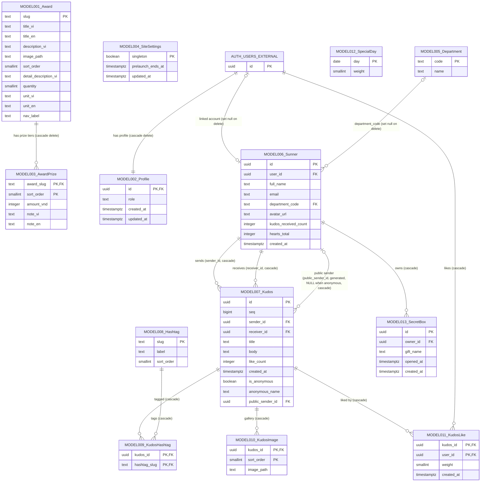

# Entities

**Project**: my-app (SAA Homepage — Next.js 16.4 + Supabase)
**Generated**: 2026-10-08

> Phạm vi: chỉ các bảng Postgres do app sở hữu trong `public` (qua `supabase/migrations/*.sql`). `auth.users` do Supabase quản lý nên chỉ ghi nhận là thực thể ngoài được tham chiếu, không đánh mã MODEL###. Trạng thái phía client (cookie `NEXT_LOCALE`) không thuộc mô hình dữ liệu này — xem artifact khác.

## Entity Relationship Diagram

## Entities

### MODEL001_Award

**Description**: Danh mục giải thưởng SAA hiển thị ở lưới giải thưởng trên trang chủ và, qua năm cột chi tiết thêm ngày 2026-10-09 (F004), ở trang Awards Information. Dữ liệu chỉ đọc cho `anon` và `authenticated`; ghi chỉ qua `service_role`. Sáu dòng được seed cục bộ (`top-talent`, `top-project`, `top-project-leader`, `best-manager`, `signature-2025-creator`, `mvp`) và chạy lại được nhờ `on conflict (slug) do update`.

**Source:** `supabase/migrations/20261008045411_create_awards.sql:15-22` (bảng), `:26-30` (RLS), `:34-36` (quyền); seed: `supabase/seeds/common/01-awards.sql:4-28`; đọc dữ liệu: `lib/awards/get-awards.ts:25-27`; kiểu TS: `lib/awards/award-card-mapping.ts:7-16` (`AWARD_COLUMNS`, `AwardRow`), guard `:34-44` (`isAwardRow`). Cột chi tiết (F004): `supabase/migrations/20261009021753_add_award_details_and_prizes.sql:26-31`; seed `supabase/seeds/common/02-award-details.sql:10-30`; đọc: `lib/awards/get-award-details.ts:30-33` (một truy vấn lồng kèm `award_prizes`), cột chọn `lib/awards/award-detail-mapping.ts:9-11`, kiểu `:20-31`, guard `:64-81` (`isAwardDetailRow`). Trang chủ vẫn chọn tường minh `AWARD_COLUMNS` nên không thấy cột mới.

| Attribute | Type | Constraints | Description |
|-----------|------|-------------|-------------|
| slug | text | PK, NOT NULL | Định danh giải thưởng; đồng thời là anchor `/awards-information#<slug>` (`create_awards.sql:16`). Seed dùng kebab-case. |
| title_vi | text | NOT NULL | Tên giải thưởng tiếng Việt. |
| title_en | text | NOT NULL | Tên giải thưởng tiếng Anh. Seed đặt `title_en = title_vi` vì là tên riêng (`01-awards.sql:3`). Ở chế độ EN, mapping dùng `title_en`, nếu rỗng sau `trim()` thì quay về `title_vi` (`award-card-mapping.ts:57`). |
| description_vi | text | NOT NULL | Mô tả giải thưởng, chỉ có bản tiếng Việt; chế độ EN vẫn hiển thị nội dung VN (`create_awards.sql:19`, `award-card-mapping.ts:58`). |
| image_path | text | NOT NULL | Đường dẫn ảnh dưới `/public`, ví dụ `/home/awards/<slug>.png`. Chỉ nhận đường dẫn gốc nội bộ (bắt đầu bằng `/`, không `//`, không `\`), ngược lại dùng ảnh thay thế `/home/logo.png` (`award-card-mapping.ts:31,59,67-69`). |
| sort_order | smallint | NOT NULL | Thứ tự hiển thị tăng dần (query `.order("sort_order", { ascending: true })`). Cố ý không UNIQUE để upsert đổi thứ tự không va chạm (`create_awards.sql:21`). Không nằm trong `AWARD_COLUMNS` — chỉ dùng để sắp xếp ở DB. |
| detail_description_vi | text | NULL (không default) | Mô tả dài của giải, chỉ có bản tiếng Việt; chế độ EN vẫn hiển thị bản VN (`add_award_details_and_prizes.sql:27`). Đoạn văn cách nhau bằng `\n\n` (seed lưu `chr(10) || chr(10)`), trang hiển thị bằng `white-space: pre-line`. Hàng để trống hoặc toàn khoảng trắng bị coi là hỏng (`award-detail-mapping.ts:73`). |
| quantity | smallint | NULL, CHECK (quantity > 0) | Số lượng giải (`add_award_details_and_prizes.sql:28`). Guard: số nguyên > 0 (`award-detail-mapping.ts:76-77`); hiển thị đệm tới hai chữ số (`:105`). |
| unit_vi | text | NULL (không default) | Đơn vị tiếng Việt: Cá nhân, Tập thể, Cá nhân hoặc tập thể (`add_award_details_and_prizes.sql:29`). Guard: không rỗng (`award-detail-mapping.ts:74`). |
| unit_en | text | NULL | Đơn vị tiếng Anh (`add_award_details_and_prizes.sql:30`); trống thì chế độ EN rơi về `unit_vi` (`award-detail-mapping.ts:106`). |
| nav_label | text | NULL (không default) | Nhãn ngắn của menu bên trái, dùng chung VN/EN (`add_award_details_and_prizes.sql:31`). Guard: không rỗng (`award-detail-mapping.ts:72`). |

**Relationships**:
- Không có khóa ngoại tới bảng khác. Là phía cha 1—n của MODEL003_AwardPrize qua `award_prizes.award_slug` (xoá hoặc đổi `slug` thì cascade sang các mức giá trị).

**Discriminator Fields**: None.

---

### MODEL002_Profile

**Description**: Hồ sơ mỗi người dùng đã xác thực, giữ vai trò (role) dùng cho phân quyền. Mỗi `auth.users` có đúng một dòng: tạo tự động bằng trigger `on_auth_user_created` khi user mới sinh ra, và đã backfill một lần cho tài khoản có trước migration. Người dùng chỉ đọc được dòng của chính mình; không có quyền insert/update/delete cho `authenticated`, nên đổi role chỉ qua `service_role` hoặc SQL của vận hành.

**Source:** `supabase/migrations/20261008045415_create_profiles.sql:18-23` (bảng), `:27-31` (RLS), `:35-37` (quyền), `:41-58` (hàm + trigger), `:61-63` (backfill); đọc role: `lib/supabase/current-user.ts:63-84` (`readRole`), quy tắc `"admin"`: `lib/supabase/user-role.ts:13-15` (`toUserRole`), kiểu `UserRole`: `lib/supabase/user-role.ts:6` (re-export ở `current-user.ts:7`); cổng prelaunch (F005) đọc lại cột này bằng `lib/prelaunch/read-gate-user-role.ts:24-49`.

| Attribute | Type | Constraints | Description |
|-----------|------|-------------|-------------|
| id | uuid | PK, FK, NOT NULL | Trùng `auth.users.id` (`references auth.users (id) on delete cascade`, `create_profiles.sql:19`). Xoá user thì xoá profile theo. |
| role | text | NOT NULL, DEFAULT 'user', CHECK (role in ('user','admin')) | Vai trò của người dùng; mặc định `user`. Luôn lấy default khi tạo, không bao giờ lấy từ user metadata (`create_profiles.sql:20,39-40`). |
| created_at | timestamptz | NOT NULL, DEFAULT now() | Thời điểm tạo profile. |
| updated_at | timestamptz | NOT NULL, DEFAULT now() | Thời điểm cập nhật cuối. Không có trigger tự cập nhật trong migration — giá trị chỉ đổi nếu bên ghi tự đặt. |

**Relationships**:
- One-to-One với `auth.users` (thực thể ngoài do Supabase quản lý) qua `id`; xoá cascade từ `auth.users` sang `profiles`. Phía `auth.users` là bắt buộc phát sinh profile qua trigger `on_auth_user_created` (`after insert`, `for each row`, gọi `public.handle_new_user()`, `security definer`, `set search_path = ''`, `on conflict (id) do nothing`).

**Discriminator Fields**:

> **Scope:** enum fields with ≥2 distinct behavioral values. Boolean flags (`is_active`, `is_published`) are NOT discriminators — document their behavioral impact in feature spec Business Rules.

| Field | DISC-### | Values | Description |
|-------|----------|--------|-------------|
| role | DISC-001 | user, admin | `user`: người dùng thường (mặc định). `admin`: quản trị viên. Ràng buộc bằng CHECK ở DB (`create_profiles.sql:20`) và bằng kiểu `UserRole = "user" \| "admin"` ở app (`user-role.ts:6`). Phía app chỉ giá trị chữ `"admin"` mới được coi là admin (`toUserRole`, `user-role.ts:13-15`, dùng chung bởi `getCurrentUser()` và cổng prelaunch); mọi giá trị khác, lỗi tra cứu hay không có dòng đều quy về `"user"` (`current-user.ts:78`, `read-gate-user-role.ts:35-47`). |

---

### MODEL003_AwardPrize

**Description**: Các mức giá trị (số tiền VNĐ kèm ghi chú tuỳ chọn) của từng giải thưởng, đọc ở trang Awards Information. Hầu hết giải có một mức; Signature 2025 - Creator có hai (`sort_order` 1 và 2, cá nhân và tập thể). Dữ liệu chỉ đọc cho `anon` và `authenticated`; ghi chỉ qua `service_role`. Bảy dòng seed cục bộ, chạy lại được nhờ `on conflict (award_slug, sort_order) do update`.

**Source:** `supabase/migrations/20261009021753_add_award_details_and_prizes.sql:33-42` (bảng), `:46-50` (RLS, policy `award_prizes_select_public`), `:55-57` (quyền); seed: `supabase/seeds/common/02-award-details.sql:33-43`; đọc: truy vấn lồng `award_prizes(sort_order,amount_vnd,note_vi,note_en)` (`lib/awards/award-detail-mapping.ts:10-11`), kiểu `:13-18`, guard `:51-61` (`isAwardPrizeRow`).

| Attribute | Type | Constraints | Description |
|-----------|------|-------------|-------------|
| award_slug | text | PK (thành phần), FK → `awards.slug`, NOT NULL | Giải sở hữu mức này; `on delete cascade on update cascade` (`add_award_details_and_prizes.sql:34-35`). |
| sort_order | smallint | PK (thành phần), NOT NULL | Thứ tự mức trong cùng một giải (`:36`); trang sắp tăng dần (`award-detail-mapping.ts:108`). |
| amount_vnd | integer | NOT NULL, CHECK (amount_vnd >= 0) | Số tiền theo đồng VNĐ nguyên (`:37`); hiển thị ngăn nghìn bằng dấu chấm kèm "VNĐ" (`award-detail-mapping.ts:84-86`). |
| note_vi | text | NULL | Ghi chú dưới số tiền bản tiếng Việt, ví dụ "cho mỗi giải thưởng"; NULL = không có dòng ghi chú (Best Manager, MVP) (`:38`). |
| note_en | text | NULL | Bản tiếng Anh của ghi chú; trống thì chế độ EN rơi về `note_vi` (`award-detail-mapping.ts:111`). |

**Relationships**:
- Many-to-One với MODEL001_Award qua `award_slug` (`on delete cascade on update cascade`). Khóa chính (`award_slug`, `sort_order`) bắt đầu bằng `award_slug` nên cũng phục vụ tra cứu theo khóa ngoại, không có chỉ mục riêng (`:40-41`).

**Discriminator Fields**: None.

---

### MODEL004_SiteSettings

**Description**: Cài đặt toàn site, một dòng duy nhất, hiện chỉ giữ mốc mở site (F005): `prelaunch_ends_at` là thời điểm tuyệt đối; trước mốc proxy đưa mọi người không phải admin về `/countdown`, `NULL` nghĩa là cổng tắt. Dữ liệu chỉ đọc cho `anon` và `authenticated` (mọi cột đọc công khai, không lưu giá trị nhạy cảm); ghi chỉ qua `service_role`. Migration chèn sẵn dòng với `prelaunch_ends_at = NULL`; seed local đặt mốc quá khứ và chạy lại được nhờ `on conflict (singleton) do update`.

**Source:** `supabase/migrations/20261009083754_create_site_settings.sql:22-27` (bảng), `:29` (comment), `:31-35` (RLS, policy `site_settings_select_public`), `:41-43` (quyền), `:46` (dòng khởi tạo); seed: `supabase/seeds/common/03-site-settings.sql:7-11`; đọc dữ liệu: `lib/prelaunch/read-prelaunch-ends-at.ts:32-66` (`.select("prelaunch_ends_at").eq("singleton", true).maybeSingle()`, khoá publishable, không cache, hạn chờ 2 giây, không retry); ghi (chỉ E2E): `e2e/support/prelaunch-setting.ts:33-37`.

| Attribute | Type | Constraints | Description |
|-----------|------|-------------|-------------|
| singleton | boolean | PK, NOT NULL, DEFAULT true, CHECK (singleton) | Chỉ nhận `true` nên tối đa một dòng (`create_site_settings.sql:23-24`). Truy vấn lọc `eq("singleton", true)`. |
| prelaunch_ends_at | timestamptz | NULL (không default) | Mốc mở site; `NULL` = cổng tắt (site mở). Kiểu `timestamptz` nên DB từ chối giá trị không phải thời điểm (lỗi 22007); PostgREST trả chuỗi ISO có offset, được `parseCountdownTarget` phân tích (`create_site_settings.sql:25`, `read-prelaunch-ends-at.ts:70-77`). |
| updated_at | timestamptz | NOT NULL, DEFAULT now() | Thời điểm cập nhật cuối. Không có trigger tự cập nhật; seed đặt `now()` khi upsert (`create_site_settings.sql:26`). |

**Relationships**:
- Không có khóa ngoại và không quan hệ với bảng nào khác; proxy đọc đồng thời `profiles` (MODEL002_Profile) để biết admin nhưng không join.

**Discriminator Fields**: None.

---

### MODEL005_Department

**Description**: Danh sách phòng ban của bảng Sun* Kudos (F006); nhãn hiển thị chỉ là mã (ví dụ `CEVC10`). Đọc công khai cho `anon` và `authenticated`, ghi chỉ `service_role`. Seed cục bộ từ nội dung Figma.

**Source:** `supabase/migrations/20261012072146_create_kudos_board.sql:33-36` (bảng), `:104,111` (RLS, policy `departments_select_public`), `:121-129` (quyền); seed: `supabase/seeds/common/04-kudos-board.sql`; đọc: `lib/kudos/get-kudos-filter-options.ts` (cột `DEPARTMENT_COLUMNS`).

| Attribute | Type | Constraints | Description |
|-----------|------|-------------|-------------|
| code | text | PK, CHECK (code ~ '^[A-Za-z0-9][A-Za-z0-9_-]{0,31}$') | Mã phòng ban; cùng quy tắc với giá trị lọc `department` trên URL (`:34`). |
| name | text | NOT NULL, CHECK (btrim(name) <> '') | Tên đầy đủ; giao diện chỉ hiện `code` (D018 của F006). |

**Relationships**:
- One-to-Many với MODEL006_Sunner qua `sunners.department_code` (`on delete set null on update cascade`).

**Discriminator Fields**: None.

---

### MODEL006_Sunner

**Description**: Người trong bảng kudos (F006): người gửi, người nhận, chủ Secret Box; có thể liên kết một tài khoản `auth.users`. Đọc công khai **theo cột** (không có `email`, `user_id`, `hearts_total`); hàng của chính người xem (kèm `hearts_total`) lấy qua hàm `get_my_sunner()`. Hai bộ đếm (`kudos_received_count`, `hearts_total`) chỉ đổi qua trigger. Ghi chỉ `service_role` và các hàm `security definer`. Tài khoản đã xác nhận email được gắn hoặc tạo Sunner bởi hai trigger trên `auth.users` (xem Relationships).

**Source:** `supabase/migrations/20261012072146_create_kudos_board.sql:38-51` (bảng), `:53-54` (chỉ mục duy nhất), `:105,112` (RLS), `:127-128` (column grant gốc); `supabase/migrations/20261014004700_hide_sunner_hearts_total.sql:24-26` (thu `select` theo bảng rồi cấp lại không có `hearts_total`); `20261012072146_create_kudos_board.sql:206-225` (`get_my_sunner`); `supabase/migrations/20261013060400_restrict_sunner_avatars_and_index_department.sql:66-73` (CHECK avatar cục bộ, chỉ mục `department_code`); đọc: `lib/kudos/kudos-card-columns.ts`, `lib/kudos/get-my-sunner-per-request.ts`.

| Attribute | Type | Constraints | Description |
|-----------|------|-------------|-------------|
| id | uuid | PK, DEFAULT gen_random_uuid() | Định danh Sunner. |
| user_id | uuid | NULL, FK → `auth.users.id` ON DELETE SET NULL, duy nhất khi không NULL (`sunners_user_id_key`) | Tài khoản đã liên kết; một tài khoản tối đa một Sunner (BR-011). Không cấp cho client. |
| full_name | text | NOT NULL, CHECK (1..200 ký tự sau btrim) | Tên hiển thị. |
| email | text | NULL, CHECK (btrim(email) <> ''), duy nhất theo `lower(email)` khi không NULL (`sunners_email_lower_key`) | Khoá gắn tài khoản theo email. Không cấp cho client. |
| department_code | text | NULL, FK → `departments.code` ON DELETE SET NULL ON UPDATE CASCADE; chỉ mục `sunners_department_code_idx` | Phòng ban; bộ lọc Department của All Kudos lọc theo cột này của người nhận. |
| avatar_url | text | NULL, CHECK (≤ 2048 ký tự và khớp `^/[^/\\[:space:]][^\\[:space:]]*$`) | **Chỉ đường dẫn cục bộ dưới `/public`** (một `/` đầu, không `//`, không `\`, không khoảng trắng); NULL hiện chữ cái đầu. Không bao giờ sao chép từ `user_metadata`. Migration `20261013060400_restrict_sunner_avatars_and_index_department.sql` xoá giá trị https cũ và bỏ nhánh https của CHECK (clarifications 2026-10-13, M1). |
| kudos_received_count | integer | NOT NULL, DEFAULT 0, CHECK (>= 0) | Số kudos nhận, trigger `kudos_sync_received_count` giữ; quyết định hạng Hero. |
| hearts_total | integer | NOT NULL, DEFAULT 0, CHECK (>= 0) | Tổng tim kiếm được khi là người gửi (kể cả kudos ẩn danh), trigger của `kudos_likes` giữ (F007). **Không cấp `select` cho client** từ F010 review C2 (đọc được thì lộ người gửi ẩn danh qua so sánh trước/sau một lượt thích); chủ đọc qua `get_my_sunner()`. |
| created_at | timestamptz | NOT NULL, DEFAULT now() | Thời điểm tạo. |

**Relationships**:
- Many-to-One với MODEL005_Department (`department_code`); One-to-One tuỳ chọn với `auth.users` (`user_id`).
- One-to-Many với MODEL007_Kudos hai chiều (`sender_id`, `receiver_id`) và với MODEL013_SecretBox (`owner_id`).
- Gắn tài khoản: trigger `on_auth_user_created_link_sunner` (AFTER INSERT, chỉ khi `email_confirmed_at` khác NULL) và `on_auth_user_confirmed_link_sunner` (AFTER UPDATE OF `email_confirmed_at`, NULL → có giá trị) cùng gọi `link_or_create_sunner()` → `link_or_create_sunner_for_user(uuid, text, jsonb)`: gắn Sunner chưa gắn cùng `lower(email)`, không thì tạo Sunner mới (chỉ lấy tên, không lấy avatar); lỗi hạ xuống WARNING nên đăng ký không bao giờ thất bại; tài khoản chưa xác nhận không có Sunner (`supabase/migrations/20261012072146_create_kudos_board.sql:135-170,234-242`, `supabase/migrations/20261013060400_restrict_sunner_avatars_and_index_department.sql:84-110`).

**Discriminator Fields**: None.

---

### MODEL007_Kudos

**Description**: Một lời cảm ơn từ Sunner này tới Sunner khác (F006); một người nhận mỗi kudos. Đọc công khai theo cột (từ F010 không gồm `sender_id`); client ghi chỉ qua hàm `create_kudos` (hộp thoại Viết Kudo, F010), `insert/update/delete` trực tiếp chỉ `service_role`. Kudos có thể ẩn danh (`is_anonymous`, tên tuỳ chọn `anonymous_name`): người gửi thật nằm ở `sender_id` (không đọc được từ client), người gửi công khai ở `public_sender_id` (NULL khi ẩn danh). `like_count` do trigger của `kudos_likes` giữ. Xoá kudos trực tiếp bằng SQL kích hoạt trigger `kudos_before_delete_release_like_hearts` (BEFORE DELETE, hàm `release_kudos_like_hearts`) trả lại đúng trọng số tim đã lưu cho người gửi trước khi cascade xoá các lượt thích, và `kudos_sync_received_count` giảm số nhận của người nhận.

**Source:** `supabase/migrations/20261012072146_create_kudos_board.sql:56-65` (bảng), `:67-69` (chỉ mục), `:106,113` (RLS), `:189-205,227-229` (trigger đếm nhận); `supabase/migrations/20261012072217_create_kudos_likes.sql:121-135,147-149` (trigger trả tim trước khi xoá); `supabase/migrations/20261014004500_create_kudos_write.sql:34-66` (cột ẩn danh, cột sinh `public_sender_id`, quyền cột không gồm `sender_id`), `:69-181` (`create_kudos`), `:183-195` (`get_my_sent_kudos_count`); đọc: `lib/kudos/get-kudos-page.ts`, `lib/kudos/kudos-card-columns.ts`, `lib/kudos/spotlight-mapping.ts`.

| Attribute | Type | Constraints | Description |
|-----------|------|-------------|-------------|
| id | uuid | PK, DEFAULT gen_random_uuid() | Định danh; dùng cho `/sun-kudos/[id]` (trang đích chưa xây). |
| seq | bigint | GENERATED ALWAYS AS IDENTITY, UNIQUE | Thứ tự chèn, con trỏ phân trang (`GET /api/kudos?cursor=<seq>`); chỉ mục duy nhất của ràng buộc phục vụ `ORDER BY seq DESC`. Đọc về dạng `text` để không mất chính xác quá 2^53. |
| sender_id | uuid | NOT NULL, FK → `sunners.id` ON DELETE CASCADE ON UPDATE CASCADE; chỉ mục `kudos_sender_id_idx` | Người gửi thật, kể cả kudos ẩn danh (nhận tim từ lượt thích). **Không cấp `select` cho client** từ F010 (chọn, lọc, nhúng qua cột này hay `select *` bị từ chối); "kudos đã gửi" của F009 đếm qua `get_my_sent_kudos_count()`. |
| receiver_id | uuid | NOT NULL, FK → `sunners.id` ON DELETE CASCADE ON UPDATE CASCADE; chỉ mục `kudos_receiver_seq_idx (receiver_id, seq desc)` | Người nhận (bộ lọc Department theo phòng ban người nhận). |
| title | text | NULL, CHECK (btrim(title) <> '') | Nhãn tiêu đề chữ tự do (D.4); bấm lọc theo hashtag chỉ khi có hashtag cùng chữ. |
| body | text | NOT NULL, CHECK (btrim(body) <> '') | Nội dung. |
| like_count | integer | NOT NULL, DEFAULT 0, CHECK (>= 0); chỉ mục `kudos_highlight_idx (like_count desc, seq desc)` | Số lượt thích, khoá sắp xếp Highlight. |
| created_at | timestamptz | NOT NULL, DEFAULT now() | Giờ gửi, hiển thị `HH:mm - MM/DD/YYYY` theo Asia/Ho_Chi_Minh. |
| is_anonymous | boolean | NOT NULL, DEFAULT false | F010: kudos ẩn danh thì thẻ không hiện người gửi (`public_sender_id` là NULL). |
| anonymous_name | text | NULL, CHECK (NULL, hoặc `is_anonymous` và không rỗng sau `btrim` và ≤ 50 ký tự) | F010: tên ẩn danh tuỳ chọn; NULL = thẻ hiện chữ mặc định "Người gửi ẩn danh". |
| public_sender_id | uuid | GENERATED ALWAYS AS (`case when is_anonymous then null else sender_id end`) STORED, FK → `sunners.id` ON DELETE CASCADE; chỉ mục `kudos_public_sender_id_idx` | F010: người gửi công khai; đường duy nhất để client nhúng người gửi (`sender:sunners!public_sender_id(...)`). |

**Relationships**:
- Many-to-One với MODEL006_Sunner hai lần (`sender_id`, `receiver_id`, cascade), cộng quan hệ tuỳ chọn `public_sender_id` (cột sinh, NULL khi ẩn danh, cascade).
- One-to-Many với MODEL009_KudosHashtag, MODEL010_KudosImage, MODEL011_KudosLike (đều `on delete cascade`).

**Discriminator Fields**: None.

---

### MODEL008_Hashtag

**Description**: Danh sách hashtag cố định của bộ lọc Hashtag (F006), sắp theo `sort_order` rồi `slug`. Đọc công khai, ghi chỉ `service_role`.

**Source:** `supabase/migrations/20261012072146_create_kudos_board.sql:71-75` (bảng), `:107,114` (RLS); đọc: `lib/kudos/get-hashtag-rows-per-request.ts` (một lần mỗi lần render trang, `cache()` của React).

| Attribute | Type | Constraints | Description |
|-----------|------|-------------|-------------|
| slug | text | PK, CHECK (slug ~ '^[a-z0-9][a-z0-9-]{0,63}$') | Giá trị `hashtag` trên URL. |
| label | text | NOT NULL, CHECK (btrim(label) <> '') | Nhãn hiển thị. |
| sort_order | smallint | NOT NULL | Thứ tự trong danh sách lọc. |

**Relationships**:
- One-to-Many với MODEL009_KudosHashtag (`on delete cascade on update cascade`).

**Discriminator Fields**: None.

---

### MODEL009_KudosHashtag

**Description**: Bảng nối nhiều-nhiều giữa kudos và hashtag (F006). Đọc công khai, ghi chỉ `service_role`.

**Source:** `supabase/migrations/20261012072146_create_kudos_board.sql:77-83` (bảng, chỉ mục `kudos_hashtags_slug_kudos_idx (hashtag_slug, kudos_id)`), `:108,115` (RLS).

| Attribute | Type | Constraints | Description |
|-----------|------|-------------|-------------|
| kudos_id | uuid | PK (thành phần), FK → `kudos.id` ON DELETE CASCADE ON UPDATE CASCADE | Kudos được gắn. |
| hashtag_slug | text | PK (thành phần), FK → `hashtags.slug` ON DELETE CASCADE ON UPDATE CASCADE | Hashtag gắn vào. |

**Relationships**:
- Many-to-One với MODEL007_Kudos và MODEL008_Hashtag.

**Discriminator Fields**: None.

---

### MODEL010_KudosImage

**Description**: Ảnh đính kèm của kudos (F006), đường dẫn gốc dưới `/public` (gallery chỉ nhận đường dẫn cục bộ; bấm ảnh mở ảnh gốc ở tab mới). Từ F010 `image_path` còn có thể là `/api/kudos/images/<uuid>.<jpg|png>`: ảnh người dùng tải lên, đối tượng `kudos/<uuid>.<ext>` trong bucket riêng `images`, một ảnh gắn tối đa một kudos. Đọc công khai; ghi qua `create_kudos` hoặc `service_role`.

**Source:** `supabase/migrations/20261012072146_create_kudos_board.sql:85-90` (bảng), `:109,116` (RLS); guard phía đọc: `lib/kudos/safe-media-path.ts` (`isAllowedImagePath`); `supabase/migrations/20261014004500_create_kudos_write.sql:47-50` (chỉ mục duy nhất `kudos_images_uploaded_path_key`), `supabase/migrations/20261014004600_create_kudos_images_storage.sql` (bucket `images`, bốn policy Storage).

| Attribute | Type | Constraints | Description |
|-----------|------|-------------|-------------|
| kudos_id | uuid | PK (thành phần), FK → `kudos.id` ON DELETE CASCADE ON UPDATE CASCADE | Kudos sở hữu ảnh. |
| sort_order | smallint | PK (thành phần), CHECK (>= 1) | Thứ tự ảnh; thẻ hiện tối đa 5 ảnh. |
| image_path | text | NOT NULL, CHECK (khớp `^/[^/\\[:space:]][^\\[:space:]]*$`); chỉ mục duy nhất một phần `kudos_images_uploaded_path_key` khi `image_path like '/api/kudos/images/%'` | Đường dẫn dưới `/public`, không `//`, không `\`, không khoảng trắng; từ F010 có thể là `/api/kudos/images/<uuid>.<jpg|png>` (duy nhất giữa các dòng loại này). |

**Relationships**:
- Many-to-One với MODEL007_Kudos (cascade).

**Discriminator Fields**: None.

---

### MODEL011_KudosLike

**Description**: Một lượt thích của một tài khoản trên một kudos (F007), kèm trọng số tim đã chốt lúc thích. Chỉ chủ lượt thích đọc, chèn, xoá được (`user_id = auth.uid()`); không ai biết ai đã thích kudos nào. Client chỉ có quyền chèn hai cột `(kudos_id, user_id)` nên không chọn được `weight`; không có quyền update. Trigger `kudos_likes_before_insert` từ chối tài khoản không có Sunner hoặc là người gửi (`check_violation`, 23514) và gán `weight` (ngày đặc biệt hoặc 1); `kudos_likes_after_change` cộng/trừ `kudos.like_count` và `sunners.hearts_total` của người gửi theo đúng `weight` đã lưu.

**Source:** `supabase/migrations/20261012072217_create_kudos_likes.sql:33-41` (bảng, chỉ mục `kudos_likes_user_id_idx`), `:48,54-59` (RLS, policy), `:63-67` (quyền), `:71-149` (hàm và trigger); ghi: `lib/kudos/kudos-heart-actions.ts` (`likeKudos`, `unlikeKudos`).

| Attribute | Type | Constraints | Description |
|-----------|------|-------------|-------------|
| kudos_id | uuid | PK (thành phần), FK → `kudos.id` ON DELETE CASCADE ON UPDATE CASCADE | Kudos được thích. |
| user_id | uuid | PK (thành phần), FK → `auth.users.id` ON DELETE CASCADE; chỉ mục `kudos_likes_user_id_idx` | Tài khoản thích; PK ghép bảo đảm một lượt mỗi người mỗi kudos (BR-001). |
| weight | smallint | NOT NULL, DEFAULT 1, CHECK (weight in (1, 2)) | Tim cộng cho người gửi, chỉ trigger đặt; bỏ thích trừ đúng giá trị này. |
| created_at | timestamptz | NOT NULL, DEFAULT now() | Thời điểm thích. |

**Relationships**:
- Many-to-One với MODEL007_Kudos và với `auth.users` (cả hai cascade).

**Discriminator Fields**:

| Field | DISC-### | Values | Description |
|-------|----------|--------|-------------|
| weight | DISC-002 | 1, 2 | 1: ngày thường; 2: lượt thích rơi vào ngày có trong `special_days` (theo ngày Asia/Ho_Chi_Minh). |

---

### MODEL012_SpecialDay

**Description**: Ngày đặc biệt do vận hành khai báo (F007): lượt thích trong ngày này cho người gửi 2 tim thay vì 1. Đọc công khai, ghi chỉ `service_role` (chưa có giao diện quản trị). Đổi hoặc xoá một ngày chỉ ảnh hưởng lượt thích tạo sau đó.

**Source:** `supabase/migrations/20261012072217_create_kudos_likes.sql:28-31` (bảng), `:47,50-52` (RLS), `:63-67` (quyền); seed: `supabase/seeds/common/05-special-days.sql`.

| Attribute | Type | Constraints | Description |
|-----------|------|-------------|-------------|
| day | date | PK | Ngày (theo Asia/Ho_Chi_Minh) có trọng số riêng. |
| weight | smallint | NOT NULL, DEFAULT 2, CHECK (weight in (1, 2)) | Trọng số tim của lượt thích trong ngày đó. |

**Relationships**:
- Không có khoá ngoại; `kudos_likes_before_insert` đọc bảng này.

**Discriminator Fields**: None.

---

### MODEL013_SecretBox

**Description**: Hộp quà của Sunner (F009): một chủ hộp, một tên quà; `opened_at` NULL nghĩa là chưa mở. Hộp đã mở đọc công khai (danh sách "10 SUNNER NHẬN QUÀ MỚI NHẤT"); hộp chưa mở chỉ chủ hộp đọc, xác định qua `get_my_sunner()` vì `sunners.user_id` không cấp cho client. Không client nào ghi; mở hộp nằm ngoài phạm vi hiện tại.

**Source:** `supabase/migrations/20261012072258_create_secret_boxes.sql:20-26` (bảng), `:28-31` (chỉ mục `secret_boxes_owner_id_idx`, `secret_boxes_opened_recent_idx`), `:36-45` (RLS, hai policy), `:47-49` (quyền); seed: `supabase/seeds/common/06-secret-boxes.sql`; đọc: `lib/kudos/get-recent-gift-recipients.ts`, `lib/kudos/get-kudos-personal-stats.ts`.

| Attribute | Type | Constraints | Description |
|-----------|------|-------------|-------------|
| id | uuid | PK, DEFAULT gen_random_uuid() | Định danh hộp (tie-break của danh sách quà). |
| owner_id | uuid | NOT NULL, FK → `sunners.id` ON DELETE CASCADE | Chủ hộp. |
| gift_name | text | NOT NULL, CHECK (btrim(gift_name) <> '') | Tên quà. |
| opened_at | timestamptz | NULL | Thời điểm mở; NULL = chưa mở. Số hộp đã mở/chưa mở của D.1 đếm từ cột này. |
| created_at | timestamptz | NOT NULL, DEFAULT now() | Thời điểm tạo. |

**Relationships**:
- Many-to-One với MODEL006_Sunner (`owner_id`, cascade).

**Discriminator Fields**: None.

---

## Validation Rules

### Award (`awards`)

| Rule | Field | Constraint | Error Message |
|------|-------|------------|---------------|
| Slug bắt buộc, duy nhất | slug | PRIMARY KEY, NOT NULL | Lỗi Postgres 23505 khi trùng (seed dùng upsert `on conflict (slug)`) |
| Các cột văn bản bắt buộc | title_vi, title_en, description_vi, image_path | NOT NULL | Lỗi Postgres 23502 |
| Thứ tự bắt buộc | sort_order | NOT NULL, kiểu smallint (không UNIQUE) | Lỗi Postgres 23502 / 22003 khi vượt miền smallint |
| Kiểu dữ liệu dòng đọc về | slug, title_vi, title_en, description_vi, image_path | `isAwardRow`: cả 5 cột phải là `string` | Dòng không qua guard bị bỏ; log `[awards] skipped N malformed row(s)` (`award-card-mapping.ts:34-44`, `get-awards.ts:34-37`) |
| Đường dẫn ảnh nội bộ | image_path | Bắt đầu bằng `/`, không bắt đầu `//`, không chứa `\` | Không có thông báo; dùng ảnh thay thế `/home/logo.png` |
| Cột chi tiết của trang Awards Information | detail_description_vi, quantity, unit_vi, unit_en, nav_label | Cho phép NULL, không default; `quantity` CHECK (quantity > 0) | Lỗi Postgres 23514 khi `quantity <= 0`. Hàng thiếu hoặc trống `nav_label`, `detail_description_vi`, `unit_vi`, hoặc `quantity` không phải số nguyên > 0 bị trang Awards Information bỏ, log `[awards-information] skipped N malformed row(s)` (`award-detail-mapping.ts:64-81`, `get-award-details.ts:39-43`); trang chủ không bị ảnh hưởng |
| Chỉ đọc cho client | (bảng) | RLS: select cho `anon`, `authenticated`; không có policy ghi | Ghi bị từ chối (quyền: chỉ `select` cho hai role này; `insert/update/delete` chỉ `service_role`) |

### AwardPrize (`award_prizes`)

| Rule | Field | Constraint | Error Message |
|------|-------|------------|---------------|
| Khoá chính ghép, duy nhất theo giải | award_slug, sort_order | PRIMARY KEY (award_slug, sort_order), NOT NULL | Lỗi Postgres 23505 khi trùng (seed dùng upsert `on conflict (award_slug, sort_order)`) |
| Giải phải tồn tại | award_slug | FK → `awards(slug)` ON DELETE CASCADE ON UPDATE CASCADE | Lỗi Postgres 23503 khi `award_slug` không có trong `awards` |
| Số tiền không âm | amount_vnd | NOT NULL, kiểu integer, CHECK (amount_vnd >= 0) | Lỗi Postgres 23514 / 23502 |
| Ghi chú tuỳ chọn | note_vi, note_en | Cho phép NULL | NULL hoặc trống nghĩa là không vẽ dòng ghi chú |
| Kiểu dòng đọc về | sort_order, amount_vnd, note_vi, note_en | `isAwardPrizeRow`: hai số là số nguyên (`amount_vnd >= 0`), hai ghi chú là chuỗi hoặc null | Một mức hỏng làm cả hàng giải bị coi là hỏng và bị bỏ (`award-detail-mapping.ts:51-61,79`) |
| Chỉ đọc cho client | (bảng) | RLS: policy `award_prizes_select_public` cho `anon`, `authenticated`; thu hồi hết quyền rồi chỉ cấp `select` | Ghi bị từ chối (`insert/update/delete` chỉ `service_role`) |

### SiteSettings (`site_settings`)

| Rule | Field | Constraint | Error Message |
|------|-------|------------|---------------|
| Chỉ một dòng | singleton | PRIMARY KEY, CHECK (singleton) | Lỗi Postgres 23514 khi chèn `singleton = false`; 23505 khi trùng dòng (seed dùng upsert `on conflict (singleton)`) |
| Mốc là thời điểm | prelaunch_ends_at | kiểu timestamptz, cho phép NULL | Lỗi Postgres 22007 khi giá trị không phải thời điểm; NULL tắt cổng |
| Dấu thời gian bắt buộc | updated_at | NOT NULL, DEFAULT now() | Lỗi Postgres 23502 |
| Giá trị đọc về | prelaunch_ends_at | chuỗi ISO có offset; app kiểm kiểu và phân tích | Không phải chuỗi hoặc không phân tích được → coi là không khoá, log `[prelaunch]` một lần mỗi tiến trình (`read-prelaunch-ends-at.ts:70-77`) |
| Chỉ đọc cho client | (bảng) | RLS: policy `site_settings_select_public` cho `anon`, `authenticated`; thu hồi hết quyền rồi chỉ cấp `select` | Ghi bị từ chối (`insert/update/delete` chỉ `service_role`) |

### Profile (`profiles`)

| Rule | Field | Constraint | Error Message |
|------|-------|------------|---------------|
| Khoá chính = user | id | PRIMARY KEY, FK → `auth.users(id)` ON DELETE CASCADE | Lỗi Postgres 23503/23505 |
| Role hợp lệ | role | NOT NULL, CHECK (role in ('user','admin')), DEFAULT 'user' | Lỗi Postgres 23514 (check violation) |
| Dấu thời gian bắt buộc | created_at, updated_at | NOT NULL, DEFAULT now() | Lỗi Postgres 23502 |
| Chỉ đọc dòng của mình | (bảng) | RLS `profiles_select_own`: `(select auth.uid()) = id`, chỉ role `authenticated` | Dòng của người khác không trả về (không có lỗi); `anon` không có quyền |
| Role không do user ghi | role | Không có grant/policy insert/update/delete cho `anon`/`authenticated` | Ghi bị từ chối; chỉ `service_role` ghi được |
| Tạo profile idempotent | id | `insert ... on conflict (id) do nothing` (trigger và backfill) | Không lỗi khi đã tồn tại |

### Sun* Kudos (F006, F007, F009, F010)

| Rule | Field | Constraint | Error Message |
|------|-------|------------|---------------|
| Avatar chỉ cục bộ | sunners.avatar_url | CHECK ≤ 2048 ký tự và `^/[^/\\[:space:]][^\\[:space:]]*$`; phía đọc `safeAvatarUrl` kiểm lại và quy giá trị lạ về NULL | Lỗi Postgres 23514 khi ghi giá trị khác; ở phía đọc không có thông báo, hiện chữ cái đầu |
| Email, tài khoản và tổng tim không lộ | sunners.email, sunners.user_id, sunners.hearts_total | Không nằm trong column grant của `anon`/`authenticated`; `select *` bị từ chối | Lỗi Postgres 42501 (permission denied) |
| Một tài khoản một Sunner | sunners.user_id | Chỉ mục duy nhất một phần (`user_id is not null`) | Lỗi Postgres 23505 |
| Email Sunner duy nhất | sunners.email | Chỉ mục duy nhất theo `lower(email)` khi không NULL | Lỗi Postgres 23505 |
| Bộ đếm không âm | sunners.kudos_received_count, sunners.hearts_total, kudos.like_count | NOT NULL, DEFAULT 0, CHECK (>= 0); client không có quyền ghi; trigger dùng `greatest(.., 0)` | Lỗi Postgres 23514 |
| Ảnh kudos là đường dẫn cục bộ | kudos_images.image_path | CHECK khớp `^/[^/\\[:space:]][^\\[:space:]]*$` | Lỗi Postgres 23514 |
| Một lượt thích mỗi người mỗi kudos | kudos_likes (kudos_id, user_id) | PRIMARY KEY ghép; `likeKudos` coi 23505 là đã thích (idempotent) | Lỗi Postgres 23505 (được action nuốt, trả `ok`) |
| Người gửi không tự thích; cần Sunner | kudos_likes | Trigger `kudos_likes_before_insert` ném `check_violation` | Lỗi Postgres 23514, action trả `forbidden` |
| Trọng số do DB quyết | kudos_likes.weight | CHECK (1, 2); client chỉ được chèn `(kudos_id, user_id)` | Lỗi Postgres 42501 khi chèn cột khác |
| Chỉ chủ lượt thích đọc, chèn, xoá | kudos_likes | RLS `kudos_likes_select_own`, `kudos_likes_insert_own`, `kudos_likes_delete_own` (`user_id = auth.uid()`); không có quyền update | Hàng người khác không trả về; ghi bị từ chối |
| Hộp chưa mở chỉ chủ hộp đọc | secret_boxes | RLS `secret_boxes_select_opened_public` (`opened_at is not null`) và `secret_boxes_select_own` (qua `get_my_sunner()`); không có quyền ghi cho client | Hàng không đủ điều kiện không trả về |
| Bảng kudos chỉ đọc cho client | departments, sunners (theo cột), kudos (theo cột, từ F010), hashtags, kudos_hashtags, kudos_images, special_days | RLS policy `*_select_public`; thu hồi hết quyền rồi chỉ cấp `select`; client chỉ ghi kudos, hashtag của kudos và ảnh qua `create_kudos` | Ghi trực tiếp bị từ chối (`insert/update/delete` chỉ `service_role`) |
| Người gửi không đọc được từ client | kudos.sender_id | Không nằm trong column grant của `anon`/`authenticated`; chọn, lọc, nhúng qua cột này và `select *` bị từ chối | Lỗi Postgres 42501 (permission denied) |
| Tên ẩn danh chỉ khi ẩn danh | kudos.anonymous_name | CHECK `kudos_anonymous_name_check`; `create_kudos` đổi tên trống thành NULL và chỉ nhận tên khi `p_is_anonymous` | Lỗi Postgres 23514; `create_kudos` trả `anonymousName: tooLong` (22023) |
| Một ảnh tải lên gắn một kudos | kudos_images.image_path | Chỉ mục duy nhất một phần `kudos_images_uploaded_path_key`; `create_kudos` tra trước và bắt `unique_violation` | `images: uploadFailed` (22023) |
| Luật của một kudos mới | kudos.title, kudos.body, kudos_hashtags, kudos_images | `create_kudos`: người nhận có thật và khác người gửi; title 1–50, body 1–2000 sau trim (cùng tập khoảng trắng với JS `trim()`); hashtag 1–5 thuộc danh sách; ảnh 0–5, mỗi ảnh là đối tượng của chính người gọi và chưa gắn | SQLSTATE `22023` thông điệp `<field>: <code>` (`recipient`, `title`, `body`, `hashtags`, `images`, `anonymousName`); `P0002` `sender: noSunner` |

---

## Summary

- **Total Entities**: 13 (MODEL001_Award, MODEL002_Profile, MODEL003_AwardPrize, MODEL004_SiteSettings; MODEL005..MODEL013 của Sun* Kudos: Department, Sunner, Kudos, Hashtag, KudosHashtag, KudosImage, KudosLike, SpecialDay, SecretBox; `auth.users` là thực thể ngoài, không tính)
- **Total Relationships**: 13 (Profile 1—1 `auth.users`, cascade delete; Award 1—n AwardPrize, cascade delete; MODEL004_SiteSettings không có quan hệ; Sun* Kudos: Sunner—`auth.users`, Department—Sunner, Sunner—Kudos hai chiều (gửi, nhận) cùng quan hệ công khai `public_sender_id` (F010), Kudos—KudosHashtag—Hashtag, Kudos—KudosImage, Kudos—KudosLike, `auth.users`—KudosLike, Sunner—SecretBox; MODEL012_SpecialDay không có khoá ngoại)
