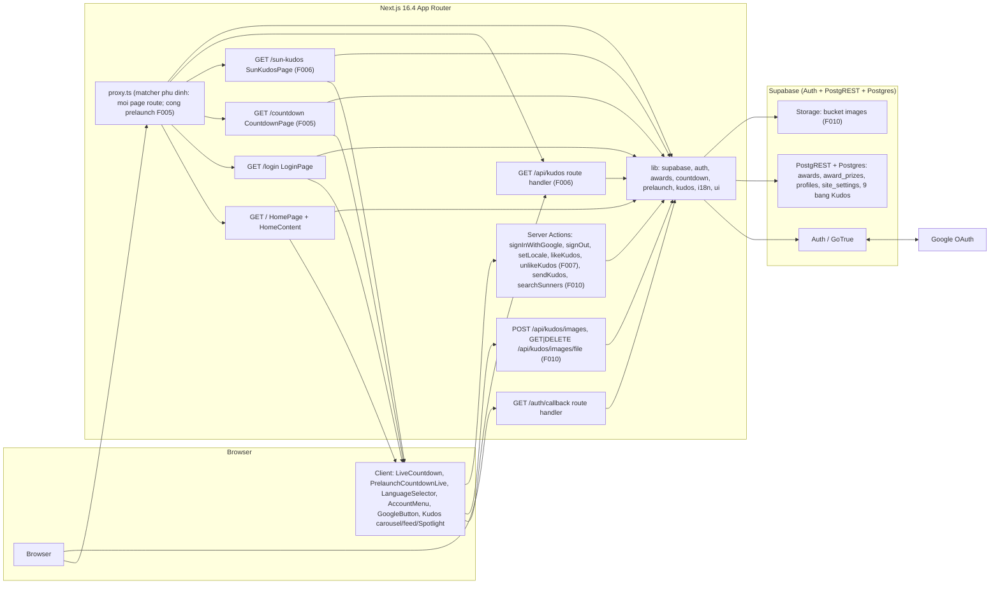
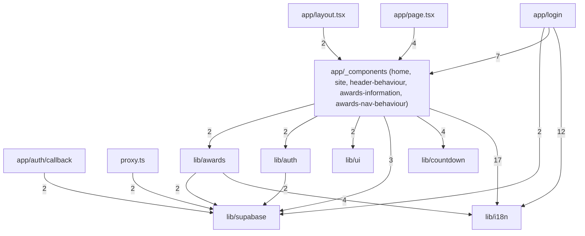
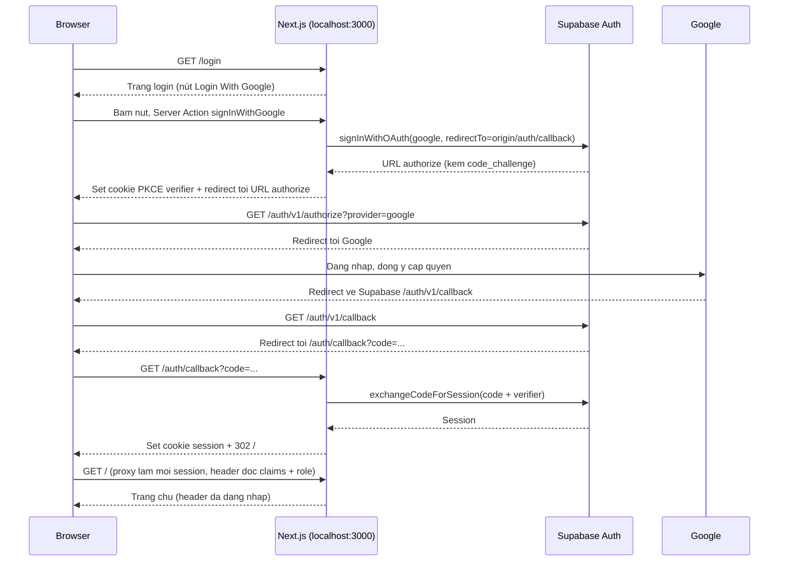
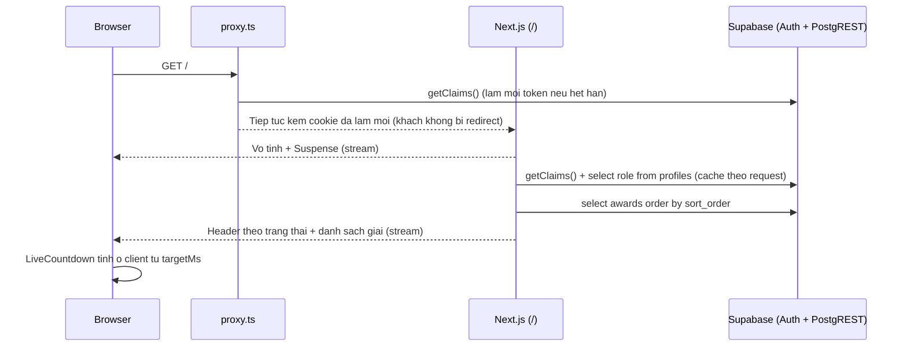
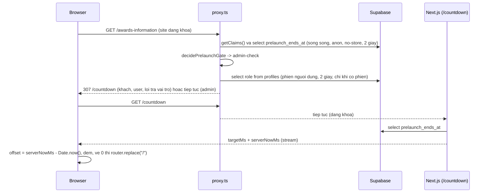
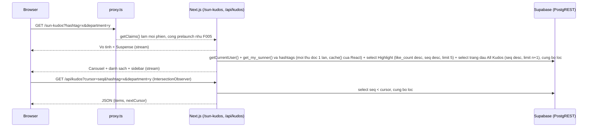
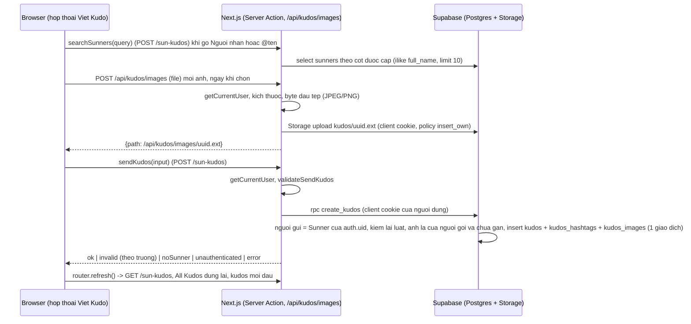

# Architecture

Kiến trúc AS-BUILT của ứng dụng SAA 2025 (Next.js 16.4 + Supabase): trang chủ công khai `/` (F002), trang Hệ thống giải thưởng công khai `/awards-information` (F004), đăng nhập Google `/login` + `/auth/callback` (F001), menu tài khoản có vai trò admin nằm trong header trang chủ (F003), trang đếm ngược prelaunch `/countdown` cùng cổng prelaunch toàn site trong `proxy.ts` (F005), và bảng Sun* Kudos live board `/sun-kudos` (F006–F009, giao 2026-10-13): route `GET /sun-kudos` và `GET /api/kudos`, hai Server Action thả/rút tim, chín bảng dữ liệu Kudos; từ 2026-10-14 thêm Viết Kudo (F010): hộp thoại gửi kudos, Server Action `sendKudos` và `searchSunners`, route ảnh `POST /api/kudos/images` và `GET|DELETE /api/kudos/images/[file]`, bucket Storage `images`. Route theo `ROUTE001`–`ROUTE020` (xem `route-list.md`), bảng dữ liệu theo `MODEL001`–`MODEL013` (xem `entities.md`; Kudos là `MODEL005`–`MODEL013`). Đường dẫn trong tài liệu này đã đối chiếu với working tree; riêng bảng "Components" của phần Kudos mô tả theo thư mục/tệp chính, muốn `path:line` chi tiết xem technical-spec của F006–F009.

> Note: `/todo` (SCR002_Todo) đã bị xoá khỏi code (`app/todo/**` không còn); `/profile`, `/admin`, `/standards` được link tới nhưng **chưa có page** trong `app/` (xem "Known Gaps" ở cuối mục System Architecture). `/sun-kudos` có page từ F006; `/sun-kudos/[id]` và `/profiles/[id]` chỉ được link tới, chưa xây (404).

## System Architecture

Ứng dụng là một Next.js App Router (`cacheComponents: true`, `partialPrefetching: true` — `next.config.ts:8-9`) chạy `http://localhost:3000` (`playwright.config.ts:10`). Mọi lời gọi Supabase đi qua server (Server Component, Server Action, Route Handler, `proxy.ts`): ứng dụng **không có client Supabase phía trình duyệt**, cookie session là `httpOnly` (`lib/supabase/session-cookie-options.ts:11-16`). Supabase Auth (GoTrue) xử lý OAuth với Google; dữ liệu (`public.awards`, `public.award_prizes`, `public.profiles`) đọc qua PostgREST bằng publishable key kèm cookie của người dùng, RLS áp dụng; ngoại lệ có chủ ý là mốc prelaunch (`public.site_settings`), đọc bằng client không cookie (vai `anon`) ở `lib/prelaunch/read-prelaunch-ends-at.ts` để không đua làm mới refresh token với `getClaims()` của proxy.

Kudos (F006–F009): dữ liệu bảng kudos đọc bằng server client có cookie (vai `anon` cho khách, `authenticated` cho người đăng nhập, RLS áp dụng) để cột "tim của tôi" đúng theo người xem. Trang kế của All Kudos lấy bằng Route Handler `GET /api/kudos` (đọc, theo request); thả/rút tim và (từ F010) gửi kudos đi qua Server Action; gửi kudos gọi hàm `create_kudos` (người gửi là Sunner của người gọi), ảnh đính kèm tải vào Storage qua Route Handler. Kudos ẩn danh: `kudos.sender_id` không đọc được từ client, trình duyệt đọc người gửi qua `public_sender_id`. Hàm/trigger `security definer` trong Postgres giữ các bất biến (trọng số tim, bộ đếm, liên kết Sunner), client không ghi được bộ đếm. Trong một lần render trang, danh sách hashtag và hàng Sunner của người xem (`get_my_sunner()`) chỉ đọc một lần rồi dùng chung giữa các vùng (React `cache()`, xem "Per-request cached reads"). Vẫn không có client Supabase phía trình duyệt.



### Module Graph

Đồ thị import cấp module (dựng từ graph máy rồi đối chiếu `import` thực tế; đã loại `docs/`, `e2e/`, `README*`, `.claude/`, `tsconfig.json`, `package.json`). Nhãn cạnh = số import đo được bởi graph. Cạnh `app/layout.tsx → _components` là import `HtmlLangScript`.



Quy tắc phụ thuộc (đúng với code): `lib/*` không import ngược `app/*`; `lib/supabase` chạm Supabase qua `@supabase/ssr`, riêng `lib/prelaunch/read-prelaunch-ends-at.ts` (F005) tạo client không cookie bằng `@supabase/supabase-js` có chủ ý (`:35-38`); `lib/supabase/proxy-session.ts` import `lib/prelaunch/*` và `lib/prelaunch/read-gate-user-role.ts` import `lib/supabase/user-role.ts` (hàm thuần, không import) nên ở mức tệp không có vòng; `lib/countdown/parse-countdown-target.ts` và `lib/awards/award-card-mapping.ts`, `lib/awards/award-detail-mapping.ts` và `lib/ui/section-scroll-spy.ts` và `lib/prelaunch/prelaunch-gate-decision.ts`, `lib/supabase/user-role.ts` là hàm thuần (chỉ import type hoặc mapping thuần, hai tệp sau không import gì), `lib/countdown/use-countdown.ts`, `lib/countdown/use-prelaunch-countdown.ts` và `lib/ui/use-menu-disclosure.ts` là hook client (`"use client"`). Đồ thị trên dựng trước F005; F005 thêm hai nút `app/countdown` (import `lib/i18n`, `lib/prelaunch`, `app/_components/countdown-prelaunch`, `lib/countdown`) và `lib/prelaunch` (import `lib/supabase`, `lib/countdown`), cạnh `proxy`/`lib/supabase` → `lib/prelaunch` chưa vẽ.

Module Kudos (chưa vẽ trong đồ thị): `app/sun-kudos` và `app/api/kudos/route.ts` import `lib/kudos`, `lib/supabase`, `lib/i18n`; `app/_components/sun-kudos` (view thuần) và `app/_components/sun-kudos-behaviour` (client island) import `lib/kudos`, `lib/i18n`, `lib/ui`. `lib/kudos` không import ngược `app/*`; mapper, bố cục Spotlight, suy Hero tier, định dạng thời gian và guard đường dẫn ảnh (`safe-media-path.ts`) là hàm thuần. Cạnh mới chỉ tới `lib/supabase` (server client có cookie); F010 thêm `app/_components/write-kudos` (view thuần) và `app/_components/write-kudos-behaviour` (client island) import `lib/kudos`, `lib/i18n` và `app/_components/sun-kudos*`, cùng `app/api/kudos/images/**` import `lib/kudos`, `lib/supabase`; `lib/kudos/send-kudos-action.ts` là tệp `"use server"`. Client không cookie chỉ có ở `app/api/kudos/images/[file]/route.ts` (đọc ảnh đã gắn bằng vai `anon`); không có `"use cache"`. Hai getter bọc `cache()` của React để dùng chung trong một lượt render: `get-hashtag-rows-per-request.ts`, `get-my-sunner-per-request.ts`.

### Components

| Component | Path | Responsibility |
|-----------|------|----------------|
| Proxy | `proxy.ts` | Chạy trên Node runtime trước route khớp, gọi `updateSession` (`proxy.ts:10-12`). `matcher: ["/((?!_next/|__nextjs|.*\\..*).*)"]` phải là literal tĩnh (`proxy.ts:22-24`): phủ mọi page route kể cả `/`, route lạ; không khớp `/_next/*`, `__nextjs*`, mọi đường có dấu chấm (asset); `/auth/callback` khớp nhưng được trả tiếp ngay trong code. |
| Session helper | `lib/supabase/proxy-session.ts` | `updateSession` (`:43`): `/auth/callback` → đi tiếp ngay (`:45`); `getClaims()` (`verifySession`, `:88-127`) làm mới token song song với đọc mốc prelaunch (`:55-58`), chép cookie mới sang response kể cả khi redirect. Quy tắc `/login`: GET/HEAD + claims hợp lệ → 307 `/` (`loginRedirectTarget`, `:129-135`). Cổng prelaunch (`prelaunchGateTarget`, `:143-160`) chỉ cho GET/HEAD: xem hàng "Prelaunch gate". Khi site đã mở khách trên `/` không bị chuyển hướng. Server Action POST đi tiếp. Thiếu/sai env hoặc `getClaims` lỗi → coi là khách, chỉ ghi log. |
| Server client | `lib/supabase/server.ts` | `createClient()` (`:19`) tạo `createServerClient` mới mỗi lần gọi, đọc/ghi cookie qua `cookies()`. `setAll` bọc try/catch vì Server Component không ghi được cookie; lỗi khác với thông báo "read-only" thì log. |
| Supabase env | `lib/supabase/supabase-env.ts` | `getSupabaseEnv()` (`:15`) đọc `SUPABASE_URL`, `SUPABASE_PUBLISHABLE_KEY` mỗi lần gọi; thiếu hoặc `SUPABASE_URL` không phải http(s) thì ném lỗi. Không dùng tiền tố `NEXT_PUBLIC_`. |
| Cookie options | `lib/supabase/session-cookie-options.ts` | `SESSION_COOKIE_OPTIONS`: `httpOnly`, `sameSite: "lax"`, `secure` khi `NODE_ENV === "production"`, `path: "/"`. Dùng chung cho server client và proxy. |
| Current user | `lib/supabase/current-user.ts` | `getCurrentUser` (`:32`) bọc `cache()` (một lần/request): `connection()` rồi `getClaims()` và đọc `profiles.role` bằng session của người dùng. Lỗi claims/ngoại lệ → `null` (khách); lỗi/thiếu dòng/giá trị lạ khi đọc role → `"user"` (fail closed); chỉ literal `"admin"` mới ra `admin`. |
| Root layout | `app/layout.tsx` | Không đọc cookie (đọc sẽ chặn prerender mọi route dưới `cacheComponents`). Cố định `lang="vi"` + `suppressHydrationWarning`; `HtmlLangScript` (`app/_components/html-lang.tsx`) đặt `documentElement.lang` theo cookie `NEXT_LOCALE` lúc parse HTML. Font Geist/Geist Mono qua `next/font/google`. |
| Homepage | `app/page.tsx`, `app/_components/home/home-content.tsx` | `HomePage` là vỏ tĩnh bọc `SaaPageShell` + `<Suspense>`; `HomeContent` (async) đọc locale, `parseCountdownTarget(process.env.SAA_COUNTDOWN_TARGET)` và ráp header, hero, Root Further, Awards, Kudos, widget, footer. Awards và vùng tài khoản có `<Suspense>` riêng. |
| Award details query (F004) | `lib/awards/get-award-details.ts`, `lib/awards/award-detail-mapping.ts` | `getAwardDetails(locale)` (`get-award-details.ts:24`): `connection()` ngoài `try`, rồi một truy vấn lồng `from("awards").select(AWARD_DETAIL_COLUMNS)` kèm `award_prizes(...)` sắp theo `sort_order` (`:30-33`). Không bao giờ ném: lỗi → log `[awards-information]` và trả `[]`; hàng hỏng bị lọc và đếm vào log. Mapping thuần (`award-detail-mapping.ts:99-116`): số lượng đệm hai chữ số, số tiền ngăn nghìn bằng dấu chấm kèm "VNĐ", chữ EN rơi về VN khi trống, ảnh trái/phải xen kẽ. |
| Awards query | `lib/awards/get-awards.ts`, `lib/awards/award-card-mapping.ts` | `getAwards(locale)` (`:18`): `connection()` rồi `from("awards").select(...).order("sort_order")` bằng server client (vai `anon` cho khách). Không bao giờ ném: lỗi → log `[awards]` và trả `[]`. Mapping lọc dòng sai kiểu, ép `image_path` về đường dẫn cục bộ (fallback `/home/logo.png`), link `/awards-information#<slug>`. Chưa dùng `"use cache"`. |
| Countdown | `lib/countdown/parse-countdown-target.ts`, `lib/countdown/countdown-math.ts`, `lib/countdown/use-countdown.ts`, `app/_components/home/countdown.tsx`, `app/_components/home/countdown-tiles.tsx` | Server parse `SAA_COUNTDOWN_TARGET` (ISO-8601 bắt buộc có offset; sai/thiếu → `null`, log một lần mỗi giá trị) rồi truyền số epoch ms xuống `LiveCountdown` (client). Hook dùng `useSyncExternalStore`, snapshot server là chỗ giữ chỗ `--`, tick theo phút, đọc lại khi tab hiện. F005 thêm tham số tuỳ chọn `clockOffsetMs` (mặc định `0`) cho `useCountdown` (`use-countdown.ts:42`) và tham số `label` cho `parseCountdownTarget` (`parse-countdown-target.ts:32`); trang chủ không truyền nên không đổi. |
| Prelaunch gate (F005) | `lib/prelaunch/prelaunch-gate-decision.ts`, `lib/prelaunch/read-prelaunch-ends-at.ts`, `lib/prelaunch/read-gate-user-role.ts`, `lib/supabase/user-role.ts` | `decidePrelaunchGate` (`:40-56`) hàm thuần: non-GET/HEAD và `/login`, `/auth/callback` → đi tiếp; `locked = momentMs !== null && nowMs < momentMs`; `/countdown` đi tiếp khi khoá, 307 `/` khi mở; trang khác khi khoá → `admin-check`. `readPrelaunchEndsAt` (`:32-66`) đọc `site_settings.prelaunch_ends_at` bằng client không cookie, `cache: "no-store"`, hạn chờ 2 giây, `.retry(false)`, fail open (`null`). `readGateUserRole` (`:24-49`) đọc `profiles.role` bằng client cookie của proxy sau `getClaims()`, hạn chờ 2 giây, fail closed (`"user"`). `toUserRole` (`user-role.ts:13-15`) là quy tắc "chỉ đúng chữ `admin`" dùng chung với `getCurrentUser()`. |
| Countdown Prelaunch page (F005) | `app/countdown/page.tsx`, `app/countdown/_components/{countdown-prelaunch-content,prelaunch-countdown-live}.tsx`, `app/_components/countdown-prelaunch/{countdown-prelaunch-view,countdown-prelaunch-unit}.tsx`, `lib/countdown/use-prelaunch-countdown.ts`, `public/countdown/bg-image.png` | Vỏ tĩnh `<Suspense>` (`page.tsx:8-14`); `CountdownPrelaunchContent` (`:14-34`) gọi `connection()`, đọc locale, mốc, rồi `serverNowMs = Date.now()` (`:39-45`) và giao cho client. `usePrelaunchCountdown` (`:32-51`) đo `clockOffsetMs = serverNowMs - Date.now()` một lần cho mỗi `serverNowMs`, đếm bằng `useCountdown`, và `router.replace("/")` một lần khi về 0. View và unit là phần trình bày thuần; không header/footer, một `<h1>`. |
| Account region | `app/_components/header-behaviour/account-region.tsx` | `AccountRegion` / `AccountBellRegion`, mỗi vùng một `<Suspense>`; fallback là `AccountSlotSkeleton` (không phải nút Login, tránh nháy). Khách → `GuestLoginLink` (`/login`); đã đăng nhập → `AccountMenu` + chuông (chỉ UI). Mục Admin chỉ có khi `role === "admin"` (`:69-73`). |
| Account menu | `app/_components/header-behaviour/account-menu.tsx`, `app/_components/site/account-menu-view.tsx`, `lib/ui/use-menu-disclosure.ts` | `AccountMenu` (client) giữ trạng thái mở/đóng + bàn phím; `AccountMenuView` là phần hiển thị thuần. `items` đã lọc theo role ở server nên role không xuống trình duyệt. Mục: Profile (`/profile`), Admin (`/admin`), Sign out (form gọi Server Action). |
| Sign-out action | `lib/auth/actions.ts` | Server Action `signOut` (`:19`): `signOut({ scope: "local" })`, lỗi chỉ log, luôn `redirect("/login")`. Không kiểm tra lại session (không có session thì là no-op). |
| Same-page scroll | `app/_components/header-behaviour/same-page-scroll-top.tsx` | Client, một listener click uỷ quyền: link cùng trang (logo, "About SAA 2025") cuộn lên đầu, không `preventDefault`. |
| Login page | `app/login/page.tsx`, `app/login/_components/login-screen.tsx`, `app/login/_components/login-types.ts` | Vỏ tĩnh; `searchParams` và locale đọc trong `LoginContent` bọc `<Suspense>`. Chỉ nhận `error` ∈ {`cancelled`, `failed`}. |
| Google button | `app/login/_components/google-button.tsx` | Client, `useActionState`: khi chờ thì `disabled` + `aria-busy`; nghe `pageshow` (bfcache) để reset khi người dùng Back từ Google. |
| Sign-in action | `app/login/actions.ts` | Server Action `signInWithGoogle` (`:29`): dựng origin từ header `origin` (hoặc `x-forwarded-host`/`host` đã kiểm tra), `signInWithOAuth({ provider: "google", redirectTo: <origin>/auth/callback })`, `redirect(authorizeUrl)`. Lỗi → `{ error: "failed" }`. |
| Callback | `app/auth/callback/route.ts` | `GET` (`:24`): có `error` → `cancelled` (nếu `access_denied`) hoặc `failed`; không có `code` → `cancelled`; ngược lại `exchangeCodeForSession(code)`. Luôn 302 tới `/` hoặc `/login?error=<outcome>`; đích viết cứng, không đọc từ query (không open redirect). |
| i18n | `lib/i18n/locales.ts`, `lib/i18n/get-locale.ts`, `lib/i18n/actions.ts`, `lib/i18n/dictionary.ts`, `lib/i18n/home-copy.ts` | Từ điển `vi`/`en` tự viết (không dùng thư viện i18n). `getLocale()` đọc cookie `NEXT_LOCALE`, mặc định `vi`. `setLocale` (Server Action) allow-list rồi ghi cookie (`path=/`, 1 năm, `sameSite=lax`). Mô tả giải chỉ có tiếng Việt. |
| Language selector | `app/_components/site/language-selector.tsx` | Client dropdown dùng chung cho `/` và `/login`; nhận `onSelect={setLocale}` qua prop. |
| Site chrome | `app/_components/site/site-header.tsx`, `site-footer.tsx`, `saa-page-shell.tsx`, `site-icons.tsx`, `site-types.ts`, `account-slot-parts.tsx` | Phần hiển thị thuần (header/footer/shell/icon/kiểu props) dùng chung giữa các trang SAA. |
| Home sections | `app/_components/home/{hero,root-further,awards,kudos}-section.tsx`, `awards-grid.tsx`, `widget-button.tsx` | Các khối trình bày của trang chủ; dữ liệu và copy nhận qua props. |
| Awards Information (F004) | `app/awards-information/page.tsx`, `app/awards-information/_components/{awards-information-content,award-details-loader}.tsx`, `app/_components/awards-information/*` (hero, tiêu đề, bố cục, khối giải, trạng thái, `awards-nav-view.tsx`), `app/_components/awards-nav-behaviour/*` | Vỏ tĩnh + `<Suspense>`; nội dung ghép header/footer (`currentPage="awards"`), phần giải thưởng đọc dữ liệu trong `<Suspense>` thứ hai. Menu là client component: hook `use-awards-nav-active-slug.ts` là nơi duy nhất ghi mục đang chọn (bấm, cuộn tay, neo `#<slug>`); thuật toán thuần ở `lib/ui/section-scroll-spy.ts`, các lời gọi DOM ở `awards-nav-scroll-dom.ts`. Chữ trang ở `lib/i18n/awards-information-copy.ts`. |
| Fonts | `app/_components/saa-fonts.ts` | Montserrat (400/700) và Montserrat Alternates (700), subset latin + vietnamese, `next/font/google`. |
| Migration (F005) | `supabase/migrations/20261009083754_create_site_settings.sql` | Tạo `public.site_settings` một dòng (`singleton boolean primary key check (singleton)`, `prelaunch_ends_at timestamptz`, `updated_at`), bật RLS, policy `site_settings_select_public` (`anon`, `authenticated`), `REVOKE`/`GRANT` tường minh (ghi chỉ `service_role`), chèn dòng khởi tạo với `prelaunch_ends_at = NULL`; có chú thích ROLLBACK STRATEGY. |
| Seed (F005) | `supabase/seeds/common/03-site-settings.sql` | Upsert mốc `2026-01-01T00:00:00+07:00` (quá khứ) để local luôn mở sau `db reset`; E2E đặt mốc tương lai rồi khôi phục literal này. |
| Migrations | `supabase/migrations/20261008045411_create_awards.sql`, `supabase/migrations/20261008045415_create_profiles.sql`, `supabase/migrations/20261009021753_add_award_details_and_prizes.sql` | Tạo `public.awards`, `public.profiles`, bật RLS, policy, `REVOKE`/`GRANT` tường minh; trigger `on_auth_user_created` + backfill cho profile; migration thứ ba chỉ thêm năm cột chi tiết vào `awards` và bảng `award_prizes` (RLS + GRANT cùng mẫu). |
| Seed | `supabase/seeds/common/01-awards.sql`, `supabase/seeds/common/02-award-details.sql` | Upsert 6 giải thưởng (`on conflict (slug) do update`); `02` (chạy sau `01` theo tên tệp) cập nhật cột chi tiết theo `slug` và upsert `award_prizes` theo `(award_slug, sort_order)`; chạy khi `supabase db reset` (theo `[db.seed] sql_paths`, `supabase/config.toml:58-63`). |
| Kudos page (F006) | `app/sun-kudos/page.tsx`, `app/sun-kudos/_components/*` (`sun-kudos-content.tsx`, các loader `kudos-highlight-loader.tsx`, `kudos-feed-loader.tsx`, `kudos-filter-options-loader.tsx`, `spotlight-section.tsx`, `kudos-sidebar.tsx`) | Vỏ tĩnh `<Suspense>`; Server Component bên trong `await searchParams` (`hashtag`, `department`), đọc locale, người dùng, Highlight và trang đầu All Kudos; bộ lọc truyền xuống client island bằng props (không `useSearchParams`). Header/footer đánh dấu "Sun* Kudos" là trang hiện tại. Khi có phiên, `getViewerSunnerId()` lấy `id` Sunner của người xem từ `get_my_sunner()` để truyền `isSender` và `likedByMe` cho từng thẻ; `KudosHeartProvider` (kho tim dùng chung của F007) bao quanh Highlight, All Kudos, Spotlight và sidebar nên đổi bộ lọc chỉ làm mới số liệu, không mount lại. Dưới khổ máy tính trang xếp một cột (sidebar dưới All Kudos, carousel một thẻ). |
| Kudos query layer (F006) | `lib/kudos/*` (`get-kudos-highlight.ts`, `get-kudos-page.ts`, `get-kudos-filter-options.ts`, `kudos-filters.ts`, `kudos-card-mapping.ts`, `hero-tier.ts`, `kudos-time.ts`) | Getter theo mẫu hiện có (`connection()` ngoài `try`, lỗi → log `[kudos]` + rỗng, type guard + mapper thuần, không bao giờ ném). Một hàm áp bộ lọc dùng chung cho Highlight (`like_count desc, seq desc`, 5 dòng) và All Kudos (`seq desc`, con trỏ `seq`, lấy thừa một dòng để biết còn trang); `seq` đọc về dạng `text`. Lọc Hashtag qua `kudos_hashtags`, Department theo phòng ban của người nhận. Nhãn Hero + số sao suy từ `kudos_received_count` bằng hàm thuần (không lưu). Thời gian `HH:mm - MM/DD/YYYY` theo Asia/Ho_Chi_Minh. |
| Kudos feed endpoint (F006) | `app/api/kudos/route.ts` | `GET` Route Handler: tham số `cursor` (đúng một giá trị số nguyên dương), `hashtag`, `department` (kiểm danh sách cho phép trước mọi truy cập DB); trả JSON `{items, nextCursor}`, `Cache-Control: no-store`, lỗi là mã cố định (400 `invalid_cursor` / `invalid_filter`, 500 `read_failed`). Chạy theo request (đọc cookie cho cột "tim của tôi"). Matcher của proxy khớp `/api/kudos` nên phiên được làm mới và cổng prelaunch áp dụng (chỉ `GET`/`HEAD`). Không có endpoint ghi. |
| Kudos hearts actions (F007) | Server Action `likeKudos(id)`, `unlikeKudos(id)` trong `lib/kudos/kudos-heart-actions.ts`; kho client `lib/kudos/kudos-heart-store.tsx`; nút `app/_components/sun-kudos-behaviour/kudos-heart-button.tsx` | Biểu thị ý định (không phải nút bật/tắt), idempotent. Kiểm lại phiên phía server bằng `getCurrentUser()`; khách → trả `unauthenticated`, client `router.push("/login")`. Ghi `kudos_likes` bằng phiên của người dùng dưới RLS; trọng số, chặn tự thích và bộ đếm do trigger DB giữ, action không tự tính. Kho client giữ trạng thái lạc quan, hoàn tác khi lỗi (hoặc về giá trị máy chủ mới hơn nếu đổi bộ lọc trong lúc chờ) và giữ hai nút của cùng một kudos đồng bộ. |
| Kudos feed client islands (F006) | `app/_components/sun-kudos/*` (view thuần) + `app/_components/sun-kudos-behaviour/*` (client island), hook trong `lib/kudos/use-*.ts` | Carousel Highlight (state React + transform; `key` theo bộ lọc để về thẻ 1; thứ tự không xếp lại sau khi thả/rút tim), danh sách cuộn vô hạn (`IntersectionObserver`, `AbortController` khi đổi bộ lọc, loại trùng theo id), Copy Link (Clipboard API, dự phòng `execCommand` ở `lib/ui/copy-text.ts`, URL = `window.location.origin` + `/sun-kudos/<id>` lúc bấm) và toast tự viết `role="status"` (cũng dùng cho thông báo lỗi ngắn khi thả/rút tim thất bại); ảnh đính kèm là liên kết mở ảnh gốc ở tab mới. Không thêm dependency npm. |
| Kudos Spotlight (F008) | `app/sun-kudos/_components/spotlight-section.tsx`, `app/_components/sun-kudos/spotlight/*`, `lib/kudos/get-spotlight-data.ts`, `spotlight-mapping.ts`, `spotlight-layout.ts`, `spotlight-search-match.ts`, `use-spotlight-pan-zoom.ts` | React + CSS transform, pointer events; mỗi tên là một liên kết (đã đăng nhập → `/sun-kudos/[id]`, khách → `/login`, `href` chọn ở server); bố cục tất định (không ngẫu nhiên) tính ở server cho tối đa 300 tên (`SPOTLIGHT_MAX_NODES`); một tooltip dùng chung; công tắc Pan/Zoom giữ trạng thái `{x, y, k}` ở client; dưới khổ rộng của bảng, cả bảng thu nhỏ vừa khung (trên điện thoại ô đếm, tìm kiếm, Pan/Zoom nằm ngoài bảng); tìm kiếm (≤ 100 ký tự, kiểm khi bấm tìm, không phân biệt hoa thường và dấu tiếng Việt, chuỗi chỉ có dấu kết hợp coi như rỗng) chỉ tô sáng/làm mờ, không đổi bố cục. Không theo bộ lọc Hashtag/Department của trang; tối đa 300 kudos mới nhất, tổng là tổng thật; dải kudos mới nhất là 5 dòng tĩnh (`hh:mmAM/PM`) đọc lúc tải trang. Chỉ đọc dữ liệu của F006, không thêm bảng. |
| Write Kudos modal (F010) | `app/_components/write-kudos/*` (view thuần: `write-kudos-modal-view.tsx` và các trường), `app/_components/write-kudos-behaviour/*` (client: launcher, modal, `use-write-kudos-form`, `use-body-editor`, `use-body-mentions`, `use-recipient-field`, `use-sunner-search`, `use-kudos-image-uploads`, `use-modal-behaviour`), `app/sun-kudos/_components/write-kudos-launcher-region.tsx`, `app/_components/sun-kudos/banner/kudos-send-button.tsx` | Thanh gửi kudos A.1 nhận `sendButton` từ `SunKudosContent`; `WriteKudosLauncherRegion` (Server Component, bọc `<Suspense>` với nút inert làm fallback) đọc người xem và danh sách hashtag cho người đăng nhập, `WriteKudosLauncher` mở hộp thoại (khách → `/login`). Hộp thoại dựng bằng `createPortal`, giữ tiêu điểm, khoá cuộn, chỉ được gắn khi mở nên đóng là bỏ sạch trạng thái. Gửi xong: đóng, toast, `router.refresh()`; `KudosFeedLoader` đổi `key` theo kudos đầu tiên nên danh sách All Kudos dựng lại. |
| Write Kudos actions (F010) | `lib/kudos/send-kudos-action.ts` (`"use server"`), `lib/kudos/kudos-write-validation.ts`, `lib/kudos/write-kudos-types.ts` | `sendKudos(input)`: kiểm hình dạng và luật, gọi RPC `create_kudos` bằng client cookie, ánh xạ lỗi `22023` về trường, `P0002` về `noSunner`. `searchSunners(query)`: gợi ý Sunner (`ilike`, tối đa 10). Không bao giờ ném lỗi ra client; log chỉ mã. |
| Kudos image routes (F010) | `app/api/kudos/images/route.ts`, `app/api/kudos/images/[file]/route.ts`, `lib/kudos/kudos-image-files.ts` | `POST` tải một ảnh (cần phiên, ≤ 5 MiB, loại theo byte đầu tệp) vào bucket `images` dưới tên `kudos/<uuid>.<ext>`; `GET` phục vụ ảnh đã gắn kudos bằng client không cookie, cache công khai; `DELETE` xoá ảnh nháp của chính chủ. Tên không chứa người tải. |
| Kudos Markdown (F010) | `lib/kudos/kudos-markdown.ts`, `kudos-markdown-inline.ts`, `kudos-markdown-format.ts`, `app/_components/sun-kudos/card/kudos-rich-body.tsx` | Thanh công cụ bọc phần chọn bằng ký hiệu Markdown (`applyMarkdownFormat`); máy chủ phân tích `body` thành `bodyBlocks` khi ánh xạ thẻ; thẻ dựng bằng phần tử React, không HTML thô, liên kết chỉ http/https. |
| Kudos Personal Sidebar (F009) | `app/sun-kudos/_components/kudos-sidebar.tsx`, `personal-stats-region.tsx`, `gift-recipients-region.tsx`, `app/_components/sun-kudos/sidebar/*`, `lib/kudos/get-kudos-personal-stats.ts`, `get-recent-gift-recipients.ts`, `sidebar-mapping.ts` | Server Component: khách → lời nhắc đăng nhập (dòng chữ + nút "Đăng nhập"); người đăng nhập → thống kê của chính mình (hàng Sunner qua `getMySunnerPerRequest()` cho `get_my_sunner()`, kudos gửi, hộp quà đã mở/chưa mở suy từ `secret_boxes`; không xác định được số liệu thì "—") và nút "Mở Secret Box" chưa làm gì; danh sách 10 hộp quà đã mở gần nhất, mỗi hộp một hàng (công khai), rỗng → "Chưa có dữ liệu". |
| Per-request cached reads | `lib/kudos/get-hashtag-rows-per-request.ts`, `lib/kudos/get-my-sunner-per-request.ts` | Hai đọc dùng chung trong MỘT lần render trang, bọc `cache()` của React (chỉ nhớ trong một lượt render, không chia sẻ giữa các request): danh sách `hashtags` (Highlight, trang đầu All Kudos và nút lọc: 1 truy vấn thay vì 3) và hàng Sunner của người xem qua `get_my_sunner()` (`getViewerSunnerId` và thống kê F009; khách không gọi RPC, danh tính lấy từ phiên đã xác minh của request đó nên không lẫn giữa người dùng). Server Action và Route Handler không phải lượt render nên `GET /api/kudos` vẫn tự đọc `hashtags` mỗi lần. Không dùng `"use cache"`: feed có cột "tim của tôi" phụ thuộc người xem. |
| Site chrome — Kudos delta (F006) | `app/_components/site/site-types.ts`, `site-header.tsx`, `site-footer.tsx` | `SitePage` thêm giá trị `"kudos"` cạnh `"about"`, `"awards"`; liên kết "Sun* Kudos" hiện có tới `/sun-kudos` được đánh dấu `aria-current="page"` trên trang mới. |
| Kudos copy (i18n) | `lib/i18n/dictionary.ts` + `lib/i18n/sun-kudos-copy.ts`, `sun-kudos-copy-types.ts`, `sun-kudos-panels-copy.ts`, `write-kudos-copy.ts`, `write-kudos-copy-types.ts` (F010) | Nhãn `vi`/`en` theo mẫu `{vi, en} satisfies Record<Locale, ...>`; nội dung kudos, tên người, hashtag giữ nguyên như đã viết (luật F002). |
| Kudos migrations (F006–F010) | `supabase/migrations/20261012072146_create_kudos_board.sql`, `20261012072217_create_kudos_likes.sql`, `20261012072258_create_secret_boxes.sql`, `20261013060400_restrict_sunner_avatars_and_index_department.sql`, `20261014004500_create_kudos_write.sql`, `20261014004600_create_kudos_images_storage.sql`, `20261014004700_hide_sunner_hearts_total.sql` | Chỉ forward, chỉ thêm (migration thứ tư là sửa sau review: avatar chỉ cục bộ, chỉ mục `department_code`, hàm gắn Sunner không sao chép avatar): chín bảng (xem "Kudos data store"), RLS + `REVOKE`/`GRANT` tường minh cùng mẫu `site_settings`, hàm/trigger `security definer`, backfill `auth.users` → `sunners` một lần. Không sửa migration đã áp dụng (`profiles` giữ nguyên). F010 thêm ba migration: `create_kudos_write` (cột ẩn danh và cột sinh `public_sender_id`, quyền cột `kudos` không gồm `sender_id`, chỉ mục duy nhất ảnh, hàm `create_kudos` và `get_my_sent_kudos_count`) và `create_kudos_images_storage` (bucket `images` riêng tư, hàm `kudos_image_is_attached` và bốn policy `storage.objects`) và `hide_sunner_hearts_total` (thu `select` của `sunners.hearts_total` khỏi `anon`/`authenticated`, review C2); bucket cũng khai ở `supabase/config.toml` (`file_size_limit = "5MiB"`). |
| Kudos seeds | `supabase/seeds/common/04-kudos-board.sql`, `05-special-days.sql`, `06-secret-boxes.sql` | Upsert idempotent nội dung từ Figma: phòng ban, Sunner, hashtag, kudos, ảnh, `special_days`, `secret_boxes`; chạy khi `supabase db reset` sau `01`–`03`. Kudos seed theo thứ tự thời gian vì con trỏ phân trang là `seq`; ảnh và avatar là tệp dưới `public/sun-kudos/`. |

Ghi chú về `cacheComponents`: mọi thứ phụ thuộc request (cookie `NEXT_LOCALE`, `searchParams`, `getClaims()` vì đọc đồng hồ, truy vấn DB) nằm trong `<Suspense>`; hàm phụ thuộc phiên gọi `connection()` ngoài `try` trước khi đọc (`lib/supabase/current-user.ts:35`, `lib/awards/get-awards.ts:20`) và `unstable_rethrow` trong `catch` để không nuốt tín hiệu prerender. Không dùng `export const dynamic/revalidate`. Trang `/sun-kudos` theo cùng quy tắc: `searchParams`, locale, `getCurrentUser()` và truy vấn feed nằm trong `<Suspense>`; getter Kudos gọi `connection()` ngoài `try` và `unstable_rethrow` trong `catch`.

### Data Model

Bốn bảng hiện có trong schema `public` (chi tiết cột/ràng buộc: `entities.md`); chín bảng Kudos ở mục "Kudos data store" ngay sau danh sách ghi chú dưới bảng.

| Bảng | MODEL | Cột chính | RLS / quyền |
|------|-------|-----------|-------------|
| `public.awards` | `MODEL001_Award` | `slug` (PK), `title_vi`, `title_en`, `description_vi`, `image_path` (đường dẫn dưới `/public`, ví dụ `/home/awards/<slug>.png`), `sort_order` (smallint); từ F004 thêm `detail_description_vi`, `quantity`, `unit_vi`, `unit_en`, `nav_label` (nullable) | RLS bật. Policy `awards_select_public` cho `anon`, `authenticated`. `GRANT select` cho hai vai đó; `service_role` đủ quyền (`supabase/migrations/20261008045411_create_awards.sql:26-36`). Migration F004 không đổi policy hay quyền. |
| `public.award_prizes` | `MODEL003_AwardPrize` | `(award_slug, sort_order)` (PK; `award_slug` FK → `awards.slug` cascade), `amount_vnd` (integer, ≥ 0), `note_vi`, `note_en` (nullable) | RLS bật. Policy `award_prizes_select_public` cho `anon`, `authenticated`; thu hồi hết rồi `GRANT select` cho hai vai đó, `service_role` đủ quyền (`supabase/migrations/20261009021753_add_award_details_and_prizes.sql:46-57`). |
| `public.site_settings` | `MODEL004_SiteSettings` | `singleton` (boolean PK, `check (singleton)`: tối đa một dòng), `prelaunch_ends_at` (timestamptz, `NULL` = cổng tắt), `updated_at` | RLS bật. Policy `site_settings_select_public` cho `anon`, `authenticated`; thu hồi hết rồi `GRANT select` cho hai vai đó, `service_role` mới ghi được (`supabase/migrations/20261009083754_create_site_settings.sql:31-43`). Mọi cột đọc công khai. |
| `public.profiles` | `MODEL002_Profile` | `id` (uuid PK, FK `auth.users(id)` `on delete cascade`), `role` (`'user'` \| `'admin'`, mặc định `'user'`), `created_at`, `updated_at` | RLS bật. Policy `profiles_select_own` chỉ cho `authenticated` đọc dòng của mình (`(select auth.uid()) = id`). Chỉ `GRANT select` cho `authenticated`; không có quyền/policy ghi cho người dùng. `service_role` đủ quyền (`supabase/migrations/20261008045415_create_profiles.sql:27-37`). |

- Dòng `profiles` do trigger `after insert on auth.users` tạo (hàm `public.handle_new_user`, `security definer`, `search_path = ''`, `on conflict do nothing`); `role` luôn lấy mặc định, không bao giờ từ metadata người dùng. Migration có backfill cho tài khoản đã tồn tại (`:60-63`).
- `REVOKE ALL` rồi `GRANT` tường minh để kết quả không phụ thuộc ACL mặc định của dự án.
- Ảnh giải nằm trong `/public/home/awards/*.png`, hiển thị bằng `next/image`; không dùng Supabase Storage cho ảnh giải (bucket `images` đặt `public = false`, `supabase/config.toml:109-110`; từ F010 bucket này chứa ảnh kudos do người dùng tải lên, giới hạn 5MiB, xem "Kudos data store").
- Seed chỉ chạy khi `db reset` local; `supabase db push` không chạy seed.
- Chưa sinh kiểu bằng `supabase gen types` (bốn bảng, truy vấn hẹp; dùng type guard tay `isAwardRow`; mốc prelaunch kiểm kiểu ở `read-prelaunch-ends-at.ts:70-77`).

#### Kudos data store (F006–F009)

Chín bảng trong schema `public`, tạo bằng bốn migration chỉ-thêm (xem "Kudos migrations"; F010 thêm ba migration nữa: cột ẩn danh cho `kudos`, kho ảnh và ẩn `hearts_total`); cột và ràng buộc chi tiết: `entities.md` (`MODEL005`–`MODEL013`).

| Bảng | Feature | MODEL | Cột chính | RLS / quyền |
|------|---------|-------|-----------|-------------|
| `public.sunners` | F006 | `MODEL006_Sunner` | `id` (uuid PK), `user_id` (uuid, duy nhất khi không null, → `auth.users(id)` `on delete set null`), `full_name`, `department_code` (FK → `departments`, nullable, chỉ mục `sunners_department_code_idx`), `avatar_url` (**chỉ đường dẫn cục bộ dưới `/public`**, CHECK), `email` (chỉ để liên kết, duy nhất theo `lower`), `kudos_received_count` (int, mặc định 0), `hearts_total` (int, mặc định 0; F006 tạo cột, F007 bảo trì; không mở cho client từ F010), `created_at` | RLS bật. `select` công khai (`anon`, `authenticated`) theo cấp quyền cột, **không gồm `email`, `user_id` và `hearts_total`** (quyền cột: `id, full_name, department_code, avatar_url, kudos_received_count, created_at`; `hearts_total` bị rút từ F010 review C2 vì lộ người gửi kudos ẩn danh); ghi chỉ `service_role`; hai cột đếm chỉ do trigger `security definer` cập nhật. Hàng của chính người xem (kèm `hearts_total`) lấy qua hàm `get_my_sunner()` (cấp `execute` cho `authenticated`, chỉ trả hàng của `auth.uid()`). |
| `public.departments` | F006 | `MODEL005_Department` | `code` (PK), `name` | RLS bật. `select` công khai; ghi chỉ `service_role`. |
| `public.hashtags` | F006 | `MODEL008_Hashtag` | `slug` (PK), `label`, `sort_order`; danh sách cố định seed từ Figma | RLS bật. `select` công khai; ghi chỉ `service_role`. |
| `public.kudos` | F006 | `MODEL007_Kudos` | `id`, `seq` (bigint identity, duy nhất, con trỏ phân trang), `sender_id`, `receiver_id` (→ `sunners.id`, một người nhận mỗi kudos), `title` (chữ tự do, nhãn tiêu đề D.4, rỗng được), `body`, `created_at`, `like_count` (int, mặc định 0; F006 tạo cột, F007 bảo trì), `is_anonymous` (boolean, mặc định false), `anonymous_name` (text, NULL = chữ mặc định), `public_sender_id` (cột sinh `case when is_anonymous then null else sender_id end`, FK → `sunners`; F010); chỉ mục `(like_count desc, seq desc)`, `(receiver_id, seq desc)`, `(sender_id)`, `(public_sender_id)`; `ORDER BY seq DESC` dùng chỉ mục duy nhất của `seq` | RLS bật. `select` công khai theo cột, **không gồm `sender_id`** (F010; người gửi công khai qua `public_sender_id`); client không ghi trực tiếp (kể cả bộ đếm), chỉ gửi kudos qua hàm `create_kudos`; ghi trực tiếp chỉ `service_role`. |
| `public.kudos_hashtags` | F006 | `MODEL009_KudosHashtag` | PK `(kudos_id, hashtag_slug)`, cả hai FK `on delete cascade`; chỉ mục `(hashtag_slug, kudos_id)` | RLS bật. `select` công khai; ghi chỉ `service_role`. |
| `public.kudos_images` | F006 | `MODEL010_KudosImage` | PK `(kudos_id, sort_order)` (FK cascade), `image_path` (đường dẫn cục bộ dưới `/public/sun-kudos/**`, hoặc `/api/kudos/images/<uuid>.<jpg\|png>` cho ảnh người dùng tải lên từ F010; CHECK; chỉ mục duy nhất một phần cho dạng sau); giao diện hiện tối đa 5 | RLS bật. `select` công khai; ghi qua `create_kudos` (F010) hoặc `service_role`. |
| `public.kudos_likes` | F007 | `MODEL011_KudosLike` | PK `(kudos_id, user_id)` (`user_id` → `auth.users(id)`, chỉ mục `user_id`), `weight` (smallint, `check (weight in (1, 2))`), `created_at` | RLS bật. `INSERT`/`DELETE` cho `authenticated` chỉ khi `user_id = (select auth.uid())`; `SELECT` chỉ dòng của mình (không lộ ai đã thích); không `UPDATE`; chỉ được chèn hai cột `(kudos_id, user_id)`, `weight` do trigger gán. |
| `public.special_days` | F007 | `MODEL012_SpecialDay` | `day` (date PK), `weight` (smallint, mặc định 2, `check (weight in (1, 2))`) | RLS bật. `select` công khai; ghi chỉ `service_role`; chưa có giao diện quản trị. |
| `public.secret_boxes` | F009 | `MODEL013_SecretBox` | `id`, `owner_id` (→ `sunners`, cascade), `gift_name`, `opened_at` (`NULL` = chưa mở), `created_at`; chỉ mục `owner_id` và `(opened_at desc, id desc)` một phần (đã mở) | RLS bật. `select`: hộp đã mở (`opened_at is not null`) công khai cho `anon`, `authenticated` (danh sách quà); hộp chưa mở chỉ chủ hộp đọc (chủ hộp xác định qua `get_my_sunner()`); ghi chỉ `service_role`. Mở hộp ngoài phạm vi. |

- Heart-count (`kudos.like_count`, `sunners.hearts_total`) là dữ liệu dùng chung do F006 tạo cả hai cột (mặc định 0; Highlight sắp theo `like_count`); F007 chỉ thêm `kudos_likes`, `special_days` và các trigger giữ hai cột đó. Từ F010 (review C2) chỉ `kudos.like_count` còn công khai; `sunners.hearts_total` không đọc được từ trình duyệt, chủ đọc qua `get_my_sunner()`, và vẫn được cộng cho người gửi kể cả kudos ẩn danh.
- Hàm `public.get_my_sunner()` (F006): `security definer`, `set search_path = ''`, trả đúng một hàng `sunners` của `auth.uid()` với cột không nhạy cảm (không `email`, không `user_id`); cấp `execute` cho `authenticated` (trái với các hàm trigger). Là đường duy nhất cho trang F006, sidebar F009 và policy `secret_boxes` biết Sunner của người xem.
- Hàm `public.create_kudos(uuid, text, text, text[], text[], boolean, text) returns uuid` (F010): `security definer`, `set search_path = ''`, `execute` chỉ cho `authenticated`. Người gửi là Sunner của `auth.uid()` (không là tham số); kiểm lại mọi luật (người nhận khác mình, title 1–50, body 1–2000 sau trim đúng như JS, hashtag 1–5 thuộc danh sách, ≤ 5 ảnh là đối tượng của chính người gọi và chưa gắn); ghi `kudos`, `kudos_hashtags`, `kudos_images` cùng một giao dịch. Lỗi `22023` thông điệp `<trường>: <mã>`, `P0002` khi chưa có Sunner.
- Hàm `public.get_my_sent_kudos_count()` (F010): `security definer`, đếm kudos của chính người gọi (kể cả ẩn danh) vì `sender_id` không còn đọc được từ client; sidebar F009 dùng.
- Supabase Storage (F010): bucket `images` riêng tư (`public = false`, 5 MiB, jpeg/png) với bốn policy trên `storage.objects` (`kudos_images_objects_insert_own`, `select_own`, `delete_own_draft`, `select_attached`; hai policy cuối hỏi hàm `public.kudos_image_is_attached(text)`, tra cứu từng điểm, thay cho `EXISTS` nội tuyến); tên đối tượng `kudos/<uuid>.<jpg|png>` không chứa người tải, quyền sở hữu là `owner_id`. Ảnh nháp chỉ chủ đọc và xoá; ảnh đã gắn công khai. Chi tiết: `permissions-matrix.md` (`PERM020`–`PERM024`).
- Hàm/trigger đều `security definer`, `set search_path = ''`, `REVOKE EXECUTE` khỏi `public`, `anon`, `authenticated` (cùng công thức `handle_new_user`) nên không gọi được qua PostgREST RPC:
  - Liên kết Sunner: hai trigger trên `auth.users` cùng gọi hàm bao `link_or_create_sunner()` rồi hàm lõi `link_or_create_sunner_for_user(uuid, text, jsonb)`: `on_auth_user_created_link_sunner` (`after insert`, chỉ khi `email_confirmed_at` khác null) và `on_auth_user_confirmed_link_sunner` (`after update of email_confirmed_at`, từ null sang có giá trị), độc lập với `handle_new_user`. `lower(email)` khớp Sunner seed chưa có `user_id` → gán `user_id`; không khớp → tạo Sunner mới (chỉ lấy tên từ `raw_user_meta_data`; **không sao chép avatar**). Tài khoản chưa xác nhận email chưa có Sunner. Mọi lỗi bị hạ xuống `WARNING` (đăng ký không bao giờ thất bại vì bước này). Backfill một lần cho `auth.users` đã xác nhận.
  - Kudos: `kudos_sync_received_count` (`after insert/delete`) cập nhật `sunners.kudos_received_count` của người nhận (không dưới 0).
  - Like: `kudos_likes_before_insert` từ chối khi liker không có Sunner hoặc là người gửi (`check_violation`) và gán `weight` theo `special_days` của ngày hiện tại ở Asia/Ho_Chi_Minh (mặc định 1); `kudos_likes_after_change` (`after insert/delete`) đổi `kudos.like_count` ±1 và `sunners.hearts_total` của người gửi ± `weight` đã lưu, cùng giao dịch với dòng like.
  - Xoá kudos: `kudos_before_delete_release_like_hearts` (`before delete on public.kudos`, hàm `release_kudos_like_hearts`) trừ tổng `weight` các lượt thích của kudos đó khỏi `hearts_total` của người gửi TRƯỚC khi cascade xoá `kudos_likes` (sau khi hàng `kudos` đã mất, `kudos_likes_after_change` không còn tìm được người gửi).
- Phân trang bằng `seq` thay vì `(created_at, id)`; seed theo thứ tự thời gian.
- Hashtag là danh sách cố định + bảng nối (đã quyết); nhãn "IDOL GIỚI TRẺ" là cột chữ tự do `kudos.title`, bấm vào chỉ lọc khi có hashtag trùng chữ, không thì là chữ thường (đã chốt).
- Hero tier (0–9 New, 10–19 Rising, 20–49 Super, 50+ Legend) tính ở TS từ `kudos_received_count`, không lưu cột.
- Ảnh kudos và avatar đều là đường dẫn cục bộ: tệp dưới `/public/sun-kudos/**` hoặc, từ F010, ảnh kudos `/api/kudos/images/<uuid>.<jpg|png>` do route của ứng dụng phục vụ từ Storage (đường dẫn trong DB, `next/image`; guard `lib/kudos/safe-media-path.ts` cùng quy tắc với CHECK của DB: một `/` đầu, không `//`, không `\`, không khoảng trắng hay ký tự điều khiển). **Không nhúng ảnh ngoài** (kể cả avatar Google; clarifications 2026-10-13, review M1): không `remotePatterns`, giá trị không hợp lệ → chữ cái đầu.
- Xoá kudos ngoài phạm vi; nếu `service_role` xoá trực tiếp bằng SQL, trigger BEFORE DELETE ở trên hạ `hearts_total` của người gửi đúng trọng số đã lưu (đã chốt là đúng ý).

### Known Gaps

Phát hiện khi đối chiếu code, không sửa trong phạm vi tài liệu này:

- Link tới trang chưa tồn tại (không có `page.tsx`): `/profile`, `/admin` (`app/_components/header-behaviour/account-region.tsx:70-71`), `/standards` (header/footer/kudos). (`/awards-information` đã có page từ F004; `/sun-kudos` có page từ F006, và `/sun-kudos/[id]`, `/profiles/[id]` là link mới tới trang chưa xây, 404 cho tới khi có feature.) Phía server của `/admin` chưa có nên BR-004 (kiểm tra role ở route admin) chưa thực thi được.
- Asset được tham chiếu nhưng không có trong `public/`: `/login/key-visual.png` (`app/login/_components/login-screen.tsx:34`) và `/login/flag-gb.svg` (`app/_components/site/language-selector.tsx:15`). Trang chủ có `public/home/key-visual.png` nhưng login trỏ vào `/login/`.
- `@supabase/supabase-js` được import trong `e2e/` (`e2e/support/supabase-session.ts`, `e2e/support/prelaunch-setting.ts`, các `e2e/supabase-schema-rls-*.spec.ts`) và ở hai tệp ứng dụng: `lib/prelaunch/read-prelaunch-ends-at.ts:1` (từ F005, client không cookie cho mốc prelaunch) và `app/api/kudos/images/[file]/route.ts` (từ F010, client không cookie để phản hồi ảnh cache công khai không phụ thuộc phiên); phần còn lại của ứng dụng dùng `@supabase/ssr`, kể cả mọi đọc của `lib/kudos`.
- Hoãn sau review Stage 5 (2026-10-13): đăng ký trên dự án hosted chưa giới hạn tên miền email (mọi tài khoản đã xác nhận được tạo Sunner, review M2), Spotlight tính lại bố cục và đếm tổng mỗi request (chưa cache), vai trò đọc trên đường nóng của lượt thích, `GET /api/kudos` chưa giới hạn tốc độ. Hoãn sau review F010 (2026-10-14): `sendKudos` và `POST /api/kudos/images` chưa giới hạn tốc độ, chưa dọn ảnh tải lên mà không gửi, route `GET` ảnh đọc cả tệp vào bộ nhớ trước khi trả, thẻ mang cả `body` và `bodyBlocks`, làm mới bảng dựng lại danh sách All Kudos.

## Tech Stack

| Layer | Technology | Version |
|-------|------------|---------|
| Frontend / Server | Next.js (App Router, `cacheComponents`, `proxy.ts`, Turbopack rule cho `*.css`) | 16.4.0 (`package.json`) |
| UI runtime | React, React DOM | 19.3.0 |
| Language | TypeScript (`strict`, alias `@/*` → `./*`) | ^5 |
| Styling | Tailwind CSS qua `@tailwindcss/turbopack` (`next.config.ts:10-17`, `app/globals.css`) | ^4 / ^4 |
| Fonts | `next/font/google`: Geist, Geist Mono, Montserrat, Montserrat Alternates | (đi kèm Next) |
| Auth client | `@supabase/ssr` (server client trong `lib/supabase`) | 0.12.7 (ghim; API 0.x) |
| Supabase JS | `@supabase/supabase-js` (chỉ E2E import trực tiếp) | 2.117.2 |
| Auth server | Supabase Auth (GoTrue); provider Google bật (`supabase/config.toml:302-313`) | theo Supabase CLI ^2.120.0 |
| Identity provider | Google OAuth 2.0 (PKCE) | n/a |
| Backend | Không có API riêng: Server Component, Server Action, Route Handler của Next (`GET /api/kudos` cho trang kế của All Kudos; `POST`/`GET`/`DELETE /api/kudos/images` cho ảnh Viết Kudo) | n/a |
| Database | Supabase Postgres (`major_version = 17`, `supabase/config.toml:34`) + PostgREST, migration trong `supabase/migrations` | 17 |
| Storage | Supabase Storage, bucket `images` riêng tư (5 MiB, jpeg/png) cho ảnh kudos (F010); tải lên và xoá bằng client có cookie, tải xuống bằng client không cookie | theo Supabase CLI |
| i18n | Từ điển tự viết (`lib/i18n`) + cookie `NEXT_LOCALE` | n/a |
| Lint | ESLint + `eslint-config-next` (`eslint.config.mjs`) | ^9 / 16.4.0 |
| E2E | `@playwright/test`, chỉ project chromium, `testDir: ./e2e` (`playwright.config.ts`) | ^1.63.0 |
| Cache | Không có Redis/`"use cache"`; Kudos chỉ dùng `cache()` của React để chia sẻ hai đọc trong một lượt render (xem "Per-request cached reads") | n/a |
| Queue | Không dùng | n/a |
| Kudos UI | React + CSS tự viết (carousel, Spotlight, toast, hộp thoại Viết Kudo, bộ phân tích Markdown con); không thêm dependency npm | n/a |

## Data Flow

Luồng OAuth PKCE, chuyển hướng trong cùng một tab (`ROUTE005`, `ROUTE007`):



Nhánh lỗi: người dùng huỷ ở Google (`error=access_denied`) hoặc thiếu `code` → `/login?error=cancelled`; lỗi provider khác, đổi `code` thất bại hay Supabase không với tới được → `/login?error=failed` (`app/auth/callback/route.ts:35-59`). Cả hai hiển thị cùng một thông báo inline (`role="alert"`): "Đăng nhập không thành công. Vui lòng thử lại." (EN: "Login failed. Please try again."). `signInWithGoogle` lỗi (không dựng được origin, Supabase trả lỗi) → `{ error: "failed" }`, nút bật lại và hiện cùng thông báo.

Luồng hiển thị trang chủ (`ROUTE001`):



- Proxy phải khớp `/` vì `getClaims()` làm mới access token và xoay refresh token; Server Component không ghi được cookie, nên không có proxy thì token mới bị mất và người dùng bị đăng xuất ngẫu nhiên (`proxy.ts:14-21`).
- Countdown: server đọc `SAA_COUNTDOWN_TARGET` trong `HomeContent`, `parseCountdownTarget` chỉ nhận ISO-8601 có offset (`Z` hoặc `±hh:mm`) và trả epoch ms; thiếu hoặc sai → `null`, log một lần mỗi giá trị, client hiện `00 00 00` và ẩn "Coming soon". Trước hydrate hiện `--`.
- Đăng xuất (`ROUTE002`): `<form action={signOut}>` trong menu tài khoản → `signOut({ scope: "local" })` xoá cookie session của trình duyệt này (lỗi chỉ log) → redirect `/login`.
- Đổi ngôn ngữ (`ROUTE003`, `ROUTE006`): chọn trong dropdown → Server Action `setLocale` ghi cookie `NEXT_LOCALE` → Next làm mới cây UI; `HtmlLangSync` cập nhật `<html lang>`.

Luồng cổng prelaunch (F005, `ROUTE010`):



- Cổng là cổng ra mắt, không phải kiểm soát an ninh: mốc fail open (thiếu dòng, `NULL`, sai, quá 2 giây → site mở, log `[prelaunch]`), vai trò fail closed; không thấy `POST` nên mọi trang và Server Action vẫn tự kiểm tra quyền (`lib/supabase/proxy-session.ts:35-40`).
- Redirect là 307 tới hằng `/countdown` hoặc `/`, không đọc từ request (`lib/prelaunch/prelaunch-gate-decision.ts:7,9`). `/countdown` luôn render theo request (`connection()` + `Date.now()`), không được cache, để `serverNowMs` luôn tươi.

Luồng xem bảng Kudos (F006, `ROUTE011`, `ROUTE015`):



- Bộ lọc nằm trên URL; đổi bộ lọc dùng `router.replace(url, { scroll: false })` trong `startTransition`; `key` theo bộ lọc đưa carousel về thẻ 1, bỏ trang đã gom và huỷ fetch đang chờ.
- `GET /api/kudos` bị cổng prelaunch như mọi `GET`: nếu mốc khoá giữa phiên, fetch nhận 307 và client phải coi là thất bại thay vì parse; hiển thị như lỗi nạp thêm (dòng lỗi kèm "Thử lại", giữ các thẻ đã có).

Luồng thả/rút tim (F007, `ROUTE012`, `ROUTE013`):

```mermaid
sequenceDiagram
    participant U as Browser
    participant N as Next.js (Server Action)
    participant S as Supabase (Postgres)

    U->>N: Bam tim -> likeKudos(id) (POST /sun-kudos)
    N->>N: getCurrentUser() (kiem lai phien phia server)
    N-->>U: Khach: unauthenticated -> router.push("/login")
    N->>S: insert kudos_likes (phien nguoi dung, RLS)
    S->>S: before insert chan tu thich + gan weight, after insert: like_count +1, hearts_total nguoi gui + weight
    N-->>U: {status: ok, liked, likeCount} | unauthenticated | forbidden | error; UI doi do/xam, so tim theo likeCount
```

- `unlikeKudos(id)`: `delete` dòng của chính mình; trigger `kudos_likes_after_change` (nhánh delete) hoàn đúng `weight` đã lưu. Like lặp là no-op (`on conflict do nothing`); unlike khi chưa có dòng cũng no-op.
- Server Action là `POST` nên không bị cổng prelaunch; bất biến nằm ở DB, không ở action.
- Liên kết Sunner: sau `exchangeCodeForSession` ở `/auth/callback` (nhánh tạo tài khoản mới), insert vào `auth.users` kích các trigger độc lập: `handle_new_user` (tạo `profiles`) và `on_auth_user_created_link_sunner` (chỉ khi email đã xác nhận); 
Luồng gửi kudos (F010, `ROUTE016`, `ROUTE019`, `ROUTE020`):



- Ảnh chưa gửi là "nháp" trong Storage: `DELETE /api/kudos/images/<file>` (policy `delete_own_draft`) xoá khi gỡ ảnh nhỏ hoặc đóng hộp thoại; ảnh đã gắn kudos đọc công khai qua `GET /api/kudos/images/<file>` bằng client không cookie (vai `anon`, policy `select_attached`) và không ai xoá được.
- `sender_id` không đọc được từ client: thẻ nhúng người gửi qua `public_sender_id` (rỗng khi ẩn danh) nên cả RSC lẫn JSON của `/api/kudos` không mang người gửi của kudos ẩn danh.
- Các tệp `POST` đi qua proxy chỉ để làm mới phiên (không bị cổng prelaunch); `GET|DELETE /api/kudos/images/<uuid>.<ext>` nằm ngoài matcher của proxy vì đường có dấu chấm.

## Deployment View

> Derived from repository infrastructure-as-code — not verified against production.

N/A — no infrastructure-as-code found in repository.

> Note: repo không có Dockerfile, docker-compose, manifest k8s, Terraform, `vercel.json` hay PaaS manifest nào khác. `supabase/config.toml` chỉ là cấu hình Supabase CLI cho môi trường phát triển local (dịch vụ chạy trên máy dev), không thuộc nhóm IaC trong `deployment-source-patterns.md`, nên không dựng sơ đồ topology triển khai. Cách chạy local và cấu hình cần thiết ghi dưới đây.

### Environment & Config

Chỉ nêu tên biến, không có giá trị. Ứng dụng đọc env ở server; không có biến `NEXT_PUBLIC_*`.

| Key | Đọc ở | Ghi chú |
|-----|-------|---------|
| `SUPABASE_URL` | `lib/supabase/supabase-env.ts:16` | Phải là URL http(s) tuyệt đối. Thiếu → ném lỗi khi tạo client (proxy coi là khách; đọc mốc prelaunch coi là không khoá, site mở). |
| `SUPABASE_PUBLISHABLE_KEY` | `lib/supabase/supabase-env.ts:17` | Publishable key; quyền thực tế do RLS quyết định. |
| `SAA_COUNTDOWN_TARGET` | `app/_components/home/home-content.tsx:31` | ISO-8601 có offset. Chỉ server đọc; client nhận số epoch ms. Giá trị cố định lúc prerender, đổi env cần build lại. |
| `SUPABASE_SECRET_KEY` | `e2e/support/supabase-session.ts:6`, `e2e/support/prelaunch-setting.ts:5` | Chỉ E2E (dựng user test, đặt `profiles.role`, đặt và khôi phục `site_settings.prelaunch_ends_at`). Ứng dụng không đọc. |
| `GOOGLE_CLIENT_ID`, `GOOGLE_CLIENT_SECRET` | `supabase/config.toml:304,306` (`env()`) | Supabase CLI đọc khi `supabase start`; ứng dụng Next không đọc. |
| `SUPABASE_EXTRA_SEEDS` | `supabase/config.toml:63` (`env()`) | Danh sách seed bổ sung tuỳ chọn cho `db reset`. |
| `NODE_ENV`, `CI` | `lib/supabase/session-cookie-options.ts:13`, `playwright.config.ts:16-43` | `secure` cho cookie khi production; `CI` đổi `webServer` sang `npm run build && npm run start`. Playwright có thêm project `prelaunch-gate` (`:29-36`, một worker, chạy sau `chromium`) cho các ca đổi mốc prelaunch dùng chung. |

Dịch vụ Supabase local (`supabase/config.toml`, từ Supabase CLI): API `54321` (`:10`), Postgres `54322` (`:29`), Studio `54323`, Inbucket `54324`. `site_url = "http://localhost:3000"` (`:148`) và `additional_redirect_urls` chứa `http://localhost:3000/auth/callback` (`:150`; phải khớp chính xác). Provider `google` bật, `skip_nonce_check = false` (`:302-313`). `[auth.email] enable_signup = true` (`:201`) chỉ để E2E seed session bằng mật khẩu, được chú thích "LOCAL ONLY" — ứng dụng không có form email. Sau khi đổi config: `npx supabase stop && npx supabase start`; sau khi thêm migration/seed: `npx supabase db reset` (xoá `auth.users`/`profiles`; E2E dựng lại user qua `ensureUser`).

Script chạy: `npm run dev`, `npm run build`, `npm run start`, `npm run lint`, `npm run test:e2e` (`package.json`).

Kudos không thêm biến môi trường: URL Copy Link lấy từ `window.location.origin` lúc bấm. F010 cũng không thêm biến môi trường; bucket `images` khai ở migration và `supabase/config.toml` (`file_size_limit = "5MiB"`), sau khi thêm ba migration F010 chạy `npx supabase db reset`.

Ràng buộc host: luôn mở ứng dụng bằng `http://localhost:3000`, không trộn với `127.0.0.1`, vì cookie PKCE verifier và callback phải cùng host (`app/auth/callback/route.ts:21-22`).
